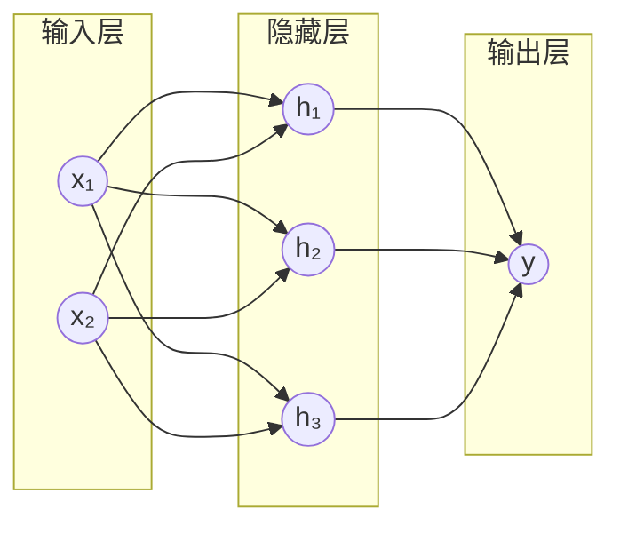
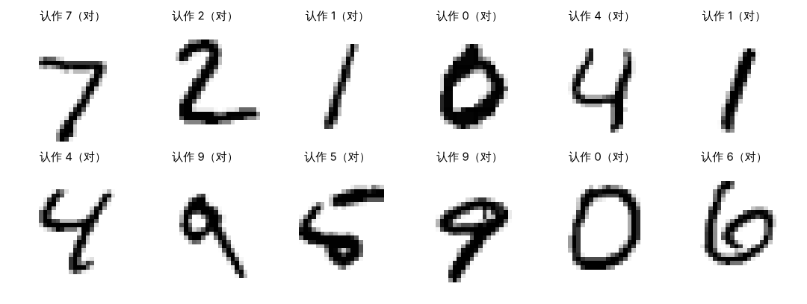
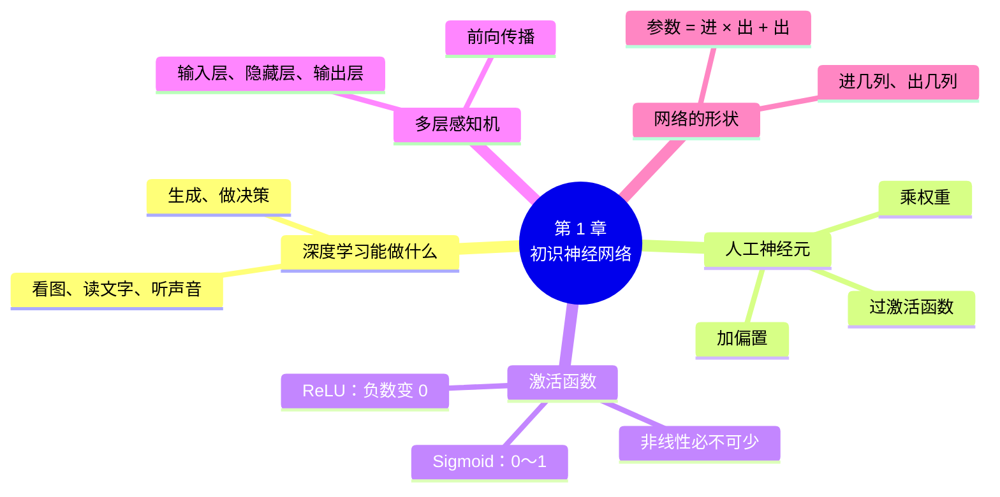

# 第 1 章 初识神经网络：从一个神经元说起

!!! abstract "本章学时"
    线上理论 2 学时 · 线下 1 学时 · 实验 1 学时（本章共 2 个实验，教师可任选）

## 学习目标

学完本章，你应该能够：

1. **说出**神经元、权重、偏置、激活函数、隐藏层、前向传播的含义（记忆）；
2. **解释**激活函数为什么必不可少，多加一个隐藏层为什么能画出弯曲的分界线（理解）；
3. **计算**一个小网络在给定权重下的输出，算出一个全连接网络的参数个数（应用）；
4. **运行**一个现成的 PyTorch 程序，读懂网络结构的打印结果（应用）；
5. 在网页动画中**判断**一组数据需要多大的网络才能分开（分析）。

!!! info "先修要求"
    学习本章前，你需要掌握：

    - 《Python 编程》：会运行 `.py` 文件，会用 `pip install` 安装第三方库；
    - 《人工智能数学基础》：知道什么是加减乘除的混合运算、什么是函数图像；
    - 《人工智能导论》第 4 章“深度学习入门”读过更好，没读过也不影响。

    同学期《机器学习》第 10 章也讲过神经网络入门。学过的同学可以快速浏览 1.2～1.4 节，把时间留给实验。

??? abstract "本章概念清单（点击查看定义和例子）"
    写好术语表后运行 python tools/glossary_links.py concepts 1 自动生成

## 情景导入

小林新买的手机有个功能：打开相册，点“人物”，几千张照片已经按人自动分好了组，连他十年前的毕业照里的自己也认了出来。他很好奇：没有人教过手机“小林长什么样”，它是怎么做到的？

手机里做这件事的，是一个**神经网络**。它在出厂前已经“看”过几百万张人脸，从中学会了：眼睛之间的距离、鼻子的形状、脸的轮廓……这些特征组合在一起，能把一个人和另一个人区分开。拍照时，网络把照片变成一串数字，和相册里每个人的数字比一比，最像的就归到一组。

神经网络听上去很神秘，拆开来看，它的基本零件却非常简单：每个零件只会做“乘一乘、加一加、拐个弯”这三件事。成千上万个这样的零件一层层连起来，就能认人脸、听语音、写文章。这种用很多层神经网络从数据中学习的方法，叫作**深度学习**。

本章从一个零件讲起：它怎样计算，为什么要“拐个弯”，很多个零件怎样连成一个网络。章末的实验里，你会在网页上亲手搭一个网络，再第一次运行 PyTorch 程序，让一个训练好的网络认出你手写的数字。

## 1.1 深度学习能做什么

**深度学习**是机器学习的一个分支，它用层数很多的神经网络，直接从原始数据（照片的像素、声音的波形、文章的文字）中学习规律。在深度学习出现以前，人们要先人工设计“特征”，比如告诉程序“猫的耳朵是三角形的”，再交给模型去学；深度学习把“设计特征”这一步也交给了网络自己。<sup class="cite">[[6]](#ref1-6)</sup>

今天你身边的 AI 应用，大多可以归入下面五类：

| 类别 | 网络在做什么 | 身边的例子 | 本书哪一章 |
|---|---|---|---|
| 看图 | 认出图里是什么、在哪里 | 相册按人分组、拍照识物、车牌识别 | 第 5、7 章 |
| 读文字 | 理解一段话的意思和情绪 | 评论自动分好评差评、垃圾短信拦截 | 第 6、8 章 |
| 听声音 | 把语音变成文字 | 语音输入法、智能音箱 | 第 6 章（序列模型） |
| 生成 | 画出、写出、说出新内容 | AI 画图、AI 写作、老照片修复 | 第 9 章 |
| 做决策 | 在一连串选择中拿到最多奖励 | 下棋程序、游戏 AI、大模型的人类反馈训练 | 第 10 章 |

这五类任务的网络结构各不相同，但它们都由同一种零件搭成，训练方法也是同一套。本书前四章讲这套共同的“基本功”，第 5 章起再分别讲不同任务用的网络。

!!! note "深度学习、机器学习、人工智能是什么关系"
    人工智能是最大的圈，指让机器表现出智能的一切技术；机器学习是其中一类方法，让机器从数据中学规律；深度学习又是机器学习中的一类，用多层神经网络来学。《机器学习》课讲决策树、支持向量机等“经典方法”，本课专讲神经网络。

## 1.2 从生物神经元到人工神经元

### 1.2.1 生物神经元给的启发

人的大脑里大约有 860 亿个神经细胞。一个神经细胞通过许多“树突”接收其他细胞传来的电信号，信号加起来足够强时，它就会“兴奋”，再通过“轴突”把信号传给下一批细胞。不同的连接强弱不同，学习的过程，在很大程度上就是这些连接变强或变弱的过程。

1943 年，麦卡洛克（McCulloch）和皮茨（Pitts）把这个过程写成了一个数学模型：几个输入，加起来超过门槛就输出 1，否则输出 0。<sup class="cite">[[4]](#ref1-4)</sup> 1958 年，罗森布拉特（Rosenblatt）又让这个模型能从例子中自动调整连接的强弱，造出了第一台能“学习”的机器——感知机。<sup class="cite">[[5]](#ref1-5)</sup> 今天的神经网络，用的仍然是这个思路。

### 1.2.2 人工神经元：一张打分卡

**人工神经元**（简称神经元）是神经网络的基本计算单元。可以把它想成一张“打分卡”。

假设一家奶茶店想判断一位顾客会不会办会员卡，店长看三条信息：每周来几次（x₁）、平均每次消费多少十元（x₂）、住得远不远（x₃，远为 1，近为 0）。店长心里给每条信息一个分量：来得多很重要，分量 0.6；消费高比较重要，分量 0.3；住得远是减分项，分量 −0.8。再加上一个“基础分” −1.0。这几个分量，就是神经元的**权重**；基础分就是**偏置**。

神经元做的第一件事，是算“加权和”：每个输入乘上自己的权重，全部加起来，再加上偏置。

\[
z = w_1x_1 + w_2x_2 + w_3x_3 + b
\]

其中 x 是输入，w 是权重，b 是偏置，z 是加权和。权重说明“每条信息有多重要、是加分还是减分”，偏置决定“门槛的高低”：偏置越小（越负），总分越难变成正数。

!!! example "算一算：奶茶店的打分卡"
    一位顾客每周来 3 次、平均每次消费 2 个十元、住得近：x = (3, 2, 0)。

    z = 0.6 × 3 + 0.3 × 2 + (−0.8) × 0 + (−1.0) = 1.8 + 0.6 + 0 − 1.0 = **1.4**

    另一位顾客每周来 1 次、消费 1 个十元、住得远：x = (1, 1, 1)。

    z = 0.6 × 1 + 0.3 × 1 + (−0.8) × 1 + (−1.0) = **−0.9**

    第一位的分数是正的，第二位是负的。分数为正，我们就猜他会办卡。

到这里，神经元和一个普通的“加权打分公式”没有区别。真正让它与众不同的，是下一步：把分数 z 送进一个**激活函数**，得到神经元的输出 a = f(z)。

### 1.2.3 权重从哪里来

上面的权重是店长凭经验给的。神经网络的权重和偏置统称**参数**，它们不是人写进去的，而是**从数据中学出来的**：先随便给一组参数，让网络对大量已知答案的例子做预测，猜错了就把参数往“猜得更准”的方向调一点，反复成千上万次。这个过程叫**训练**，是第 2、3 章的主题。

!!! tip "记住神经元的三步"
    **乘一乘**（每个输入乘权重）→ **加一加**（求和再加偏置）→ **拐个弯**（过激活函数）。后面不管网络多复杂，每个神经元都只做这三步。

<iframe class="sim-frame" src="../../sims/neuron-activation/main.html" height="620" loading="lazy" title="神经元与激活函数"></iframe>

动画：勾选输入、拖动权重和偏置，看一个神经元怎样加权求和、再经过激活函数得到输出。[全屏打开](../../sims/neuron-activation/main.html){ target=_blank }
{ .sim-caption }

## 1.3 激活函数：为什么要“拐个弯” { #13 }

### 1.3.1 两个最常用的激活函数

**激活函数**把加权和 z 变成神经元的输出 a。本书最常用的有两个：

**Sigmoid 函数**把任何数压到 0 到 1 之间：z 很大时输出接近 1，z 很小（很负）时输出接近 0，z = 0 时正好输出 0.5。所以它的输出可以理解为“把握有多大”。

\[
\sigma(z) = \frac{1}{1 + e^{-z}}
\]

**ReLU 函数**（Rectified Linear Unit，线性整流单元）更简单：z 是正数就原样输出，是负数就输出 0。

\[
\text{ReLU}(z) = \max(0, z)
\]

| z | −2 | −1 | 0 | 1 | 2 |
|---|---|---|---|---|---|
| Sigmoid(z) | 0.119 | 0.269 | 0.500 | 0.731 | 0.881 |
| ReLU(z) | 0 | 0 | 0 | 1 | 2 |

!!! example "算一算：给奶茶店的打分卡加上激活函数"
    第一位顾客 z = 1.4：Sigmoid(1.4) = 1 / (1 + e⁻¹·⁴) ≈ 1 / (1 + 0.247) ≈ **0.80**，可以理解为“办卡的把握约 80%”。ReLU(1.4) = **1.4**。

    第二位顾客 z = −0.9：Sigmoid(−0.9) ≈ **0.29**；ReLU(−0.9) = **0**。

    计算器上没有 e 的次方也没关系：查上面的表，或者直接用实验 1-2 的程序算。

两个函数各有用处：Sigmoid 常放在网络的最后一层，输出“是某一类的概率”；ReLU 计算快、训练深层网络时效果好，是隐藏层的首选。<sup class="cite">[[7]](#ref1-7)</sup> 第 3 章会讲 ReLU 为什么让深层网络更好训练。

### 1.3.2 不“拐弯”会怎样

既然 ReLU 只是把负数变成 0，看上去没做什么，能不能干脆不要激活函数？

答案是不能。没有激活函数，每个神经元都只是“乘一乘、加一加”，这种运算叫**线性运算**。把两个线性运算接在一起，结果还是一个线性运算。举个例子：

- 第一个神经元：h = 2x + 1；
- 第二个神经元：y = 3h − 4；
- 接在一起：y = 3(2x + 1) − 4 = 6x − 1，还是一个“乘一乘、加一加”。

所以，不管叠多少层，没有激活函数的网络都等价于一个神经元，只能画出一条直线的分界线。现实中的问题，比如“圆圈里的是一类、圆圈外的是另一类”，一条直线怎么也分不开。

激活函数在每一层之后“拐一个弯”，这种运算叫**非线性**。有了非线性，多层叠起来的效果就不再能合并成一层，网络才能画出弯曲的、甚至是封闭的分界线。这是神经网络能力的来源，所以说**非线性必不可少**。实验 1-1 里，你会亲眼看到“不用激活函数”时网络怎么训练都分不开一个圆圈。

## 1.4 多层感知机与前向传播

### 1.4.1 把神经元排成层

一个神经元只能画一条直线。把很多神经元排成几层，前一层的输出作为后一层的输入，就组成了**多层感知机**（Multilayer Perceptron，MLP），也叫全连接网络或前馈网络。它分三种层：

- **输入层**：接收原始数据，有几个特征就有几个输入，它本身不做计算；
- **隐藏层**：中间的一层或几层，每个神经元都和上一层的所有神经元相连，这就是“全连接”的意思。它们的输出外面看不到，所以叫“隐藏”；
- **输出层**：给出最后的答案。判断“是不是”用 1 个神经元加 Sigmoid；从 10 个数字里选一个，就用 10 个神经元，每个对应一个数字。



隐藏层有几层，网络就有几层“深”。今天用于图像识别的网络常有几十到上百层，大语言模型的层数也在几十层以上。“深度学习”的“深”，指的就是层数多。

### 1.4.2 为什么多一层就能画出弯曲的分界线

可以这样理解：隐藏层的每个神经元各自画一条直线，把平面分成两半；输出层再把这几条直线“组合”起来。三条直线可以围出一个三角形，更多的直线可以围出接近圆形的区域。所以，要把圆圈里外两类点分开，隐藏层至少需要 3 个神经元。实验 1-1 中，编者在网页动画里用 1 个隐藏层、ReLU 激活、训练 3000 轮，隐藏神经元为 1、2、3 个时准确率分别是 68.0%、84.0%、100.0%，正好印证了这一点。

数学上已经证明：只要隐藏层的神经元足够多，一个隐藏层的网络就能逼近几乎任何形状的分界线。<sup class="cite">[[3]](#ref1-3)</sup> 但实际中，用几层“不那么宽”的隐藏层，往往比用一层“非常宽”的隐藏层更省参数、更好训练，这也是网络越做越深的原因。

### 1.4.3 前向传播：一层一层算下去

给网络一个输入，从输入层开始，先算出第一个隐藏层每个神经元的输出，再把它们作为下一层的输入，一层层算到输出层，这个过程叫**前向传播**。网络“使用”时（例如手机认人脸），做的就是一次前向传播。

1.6 节的示范例题会带你完整算一遍。

!!! cert "证书考点"
    人工智能应用工程师（高级）“神经网络与深度学习”、人工智能数据处理工程师（高级）“深度学习实战”都考神经元的计算、激活函数的作用、多层感知机的结构。常见题型是“给出权重算输出”和“去掉激活函数会怎样”（详见[证书考点对照](../../certificate.md)）。

## 1.5 看懂网络的“形状” { #15 }

写深度学习程序时，最常出的错就是“形状对不上”。好在只要记住一件事就够了：**一层全连接网络，就是把“几列”的数据变成“另外几列”**。

### 1.5.1 一层就是一次“表格乘法”

把数据想成一张表：每一行是一个样本（一位顾客、一张图片），每一列是一个特征。奶茶店的数据有 3 列；一张 28 × 28 像素的手写数字图片，摊平后有 784 列。

一层“输入 3 个、输出 4 个”的全连接层，就是把每一行的 3 个数，变成 4 个新的数。不管表里有多少行，每一行都用同一组参数来算。所以：

- 输入的表是“很多行 × 3 列”，输出的表就是“很多行 × 4 列”，**行数不变，列数从 3 变成 4**；
- 这一层的参数：每个输出神经元有 3 个权重和 1 个偏置，4 个神经元一共 3 × 4 + 4 = **16** 个参数。

在 PyTorch 里，这一层写作 `nn.Linear(3, 4)`，括号里正好是“进几列、出几列”。

### 1.5.2 数一数参数个数

把几层接起来，前一层的“出”必须等于后一层的“进”。参数个数就是每一层的“进 × 出 + 出”之和。

!!! example "算一算：实验 1-2 的网络有多少参数"
    网络结构：784 → 128 → 64 → 10。

    - 第 1 层：784 × 128 + 128 = 100 480
    - 第 2 层：128 × 64 + 64 = 8 256
    - 第 3 层：64 × 10 + 10 = 650

    合计 100 480 + 8 256 + 650 = **109 386** 个参数。实验 1-2 的程序会打印出同一个数。

这十多万个参数都是训练出来的。今天的大语言模型有几百亿到上万亿个参数，结构比这复杂得多，但“数参数”的方法是一样的。

!!! warning "易错点"
    算参数时最容易漏掉偏置：784 × 128 + 128 × 64 + 64 × 10 = 109 184，少了 202 个偏置。另外，`nn.Flatten()`（摊平）和 `nn.ReLU()` 这类层没有参数。

## 1.6 示范例题

**例题** 一个“2 → 2 → 1”的网络，隐藏层用 ReLU，输出层用 Sigmoid。参数如下：

| 神经元 | 权重 | 偏置 |
|---|---|---|
| 隐藏神经元 h₁ | 0.5（接 x₁），−0.2（接 x₂） | 0.1 |
| 隐藏神经元 h₂ | −0.3（接 x₁），0.4（接 x₂） | −0.1 |
| 输出神经元 y | 1.0（接 h₁），−0.5（接 h₂） | 0.3 |

输入 x = (1, 2)，求网络的输出，并算出这个网络一共有多少个参数。

**解题思路**：前向传播，一层一层算；每个神经元都是“乘一乘、加一加、拐个弯”。

**第 1 步：算隐藏层**

- h₁：z = 0.5 × 1 + (−0.2) × 2 + 0.1 = 0.5 − 0.4 + 0.1 = 0.2，ReLU(0.2) = **0.2**
- h₂：z = (−0.3) × 1 + 0.4 × 2 + (−0.1) = −0.3 + 0.8 − 0.1 = 0.4，ReLU(0.4) = **0.4**

**第 2 步：算输出层**

- z = 1.0 × 0.2 + (−0.5) × 0.4 + 0.3 = 0.2 − 0.2 + 0.3 = 0.3
- y = Sigmoid(0.3) = 1 / (1 + e⁻⁰·³) ≈ 1 / (1 + 0.741) ≈ **0.574**

**第 3 步：数参数**

- 隐藏层：2 × 2 + 2 = 6；输出层：2 × 1 + 1 = 3；共 **9** 个参数。

**答**：网络输出约 0.574，共 9 个参数。实验 1-2 第 5 步用 PyTorch 验证了这个结果：隐藏层输出 [0.2, 0.4]，网络输出 0.574。

**举一反三**：如果把输入改成 x = (0, 2)，h₁ 的 z = −0.4 + 0.1 = −0.3，ReLU 后变成 0。这时 h₁ 对输出没有任何贡献，就好像“没有被激活”，激活函数的名字就是这么来的。

## 1.7 前沿视窗

**大模型里也有多层感知机**。今天的大语言模型几乎都基于 Transformer 结构（第 6 章介绍）。Transformer 的每一层由两部分组成：一部分是“注意力”，另一部分就是本章的多层感知机，原论文把它叫作“前馈网络”。<sup class="cite">[[9]](#ref1-9)</sup> 在很多大模型中，前馈网络的参数占全部参数的一半以上。也就是说，你在本章学到的“乘一乘、加一加、拐个弯”，正是大模型里分量最重的零件之一。

**深度学习框架**。早年的研究者要自己写代码实现每一步计算。今天有了深度学习框架，几行代码就能搭好一个网络。国际上最常用的是 PyTorch（本书使用）；国内有百度的飞桨（PaddlePaddle）、华为的昇思（MindSpore）等，在《人工智能开发框架技术》课程中学习。这些框架的思路相通，学会一个，另一个上手很快。

## 本章实验

!!! abstract "实验总览"
    | 实验 | 类型 | 建议时长 | 内容 |
    |---|---|---|---|
    | 实验 1-1 | ★ 基础 | 20 分钟 | 在网页动画“网络游乐场”里搭网络，把四组数据的两类点分开，找出“最少需要多大的网络” |
    | 实验 1-2 | ★ 基础 | 25 分钟 | 安装 PyTorch，运行现成程序：看网络结构、在 1 万张测试图片上考一考、认一认你手写的数字，再验证 1.6 节的示范例题 |

    实验 1-1 只需要浏览器；实验 1-2 在本机 CPU 上运行，用时不到 10 秒（第一次运行要下载约 11 MB 的数据）。代码见配套资源 `labs/ch01/` 目录。

### 实验 1-1 ★ 在网页动画里搭一个网络 { #1-1 }

**实验目的**

1. 体会隐藏层、神经元个数、激活函数对网络能力的影响；
2. 验证“没有激活函数，多少层都只能画直线”；
3. 学会根据数据的形状估计需要多大的网络。

**实验环境**：浏览器（电脑或手机都可以），不需要安装任何软件，不需要写代码。

**实验数据**：动画内置的四组数据，每组 200 个点，两类各 100 个。

**实验步骤**

打开下面的“网络游乐场”。每次改设置后，动画都会重新开始；按“▶ 连续训练”，训练到 3000 轮会自动停下。

<iframe class="sim-frame" src="../../sims/nn-playground/main.html" height="700" loading="lazy" title="网络游乐场"></iframe>

动画：网络游乐场。选数据、选隐藏层和激活函数，按“连续训练”看分界线怎样形成。[全屏打开](../../sims/nn-playground/main.html){ target=_blank }
{ .sim-caption }

1. **一条直线能分开的数据**：数据选“两团点”，隐藏层选“0 层”，训练到停止，记下准确率。
2. **一条直线分不开的数据**：数据换成“圆圈套圆点”，隐藏层仍是 0 层，训练到停止。分界线是什么形状？
3. **去掉激活函数**：隐藏层选 1 层、每层 4 个神经元，激活函数选“不用（线性）”，训练到停止。
4. **加上激活函数**：激活函数换成 ReLU，分别把每层神经元调成 1、2、3、4 个，各训练到停止。
5. **两个月牙**：数据换成“两个月牙”，比较 1 层和 2 层隐藏层的分界线有什么不同。

**运行结果**

编者在电脑浏览器中按上面的步骤操作，训练 3000 轮后的结果如下（动画的初始参数是固定的，你的结果应该和下表一致）：

| 步骤 | 数据 | 隐藏层 | 激活函数 | 损失 | 准确率 |
|---|---|---|---|---|---|
| 1 | 两团点 | 0 层 | — | 0.004 | 100.0% |
| 2 | 圆圈套圆点 | 0 层 | — | 0.687 | 59.5% |
| 3 | 圆圈套圆点 | 1 层 × 4 | 不用（线性） | 0.687 | 59.5% |
| 4 | 圆圈套圆点 | 1 层 × 1 | ReLU | 0.556 | 68.0% |
| 4 | 圆圈套圆点 | 1 层 × 2 | ReLU | 0.324 | 84.0% |
| 4 | 圆圈套圆点 | 1 层 × 3 | ReLU | 0.005 | 100.0% |
| 4 | 圆圈套圆点 | 1 层 × 4 | ReLU | 0.004 | 100.0% |
| 5 | 两个月牙 | 1 层 × 4 | ReLU | 0.011 | 100.0% |
| 5 | 两个月牙 | 2 层 × 4 | ReLU | 0.002 | 100.0% |

几点解读：

- 步骤 2 和步骤 3 的结果完全一样：去掉激活函数后，加一个隐藏层等于没加，网络仍然只能画一条直线。
- 步骤 4 中，1 个、2 个神经元只能画 1 条、2 条直线，围不住圆圈；3 个神经元能围出一个三角形，就全分对了。这和 1.4.2 节的分析一致。
- 步骤 5 中两种网络都分对了，但 2 层网络的损失更小，分界线更贴合月牙的形状。

**实验记录表**

| 项目 | 你的结果 |
|---|---|
| 步骤 2 中分界线的形状 | |
| 步骤 3 和步骤 2 的准确率是否相同，为什么 | |
| 圆圈数据最少需要几个隐藏神经元 | |
| 把激活函数换成 Sigmoid 或 tanh，步骤 4 的结论变不变 | |

**常见问题排查**

| 现象 | 原因 | 解决办法 |
|---|---|---|
| 动画显示不全 | 窗口太窄 | 点“全屏打开”，或把手机横过来 |
| 准确率一直不变 | 学习率太小，或者还没开始训练 | 确认按了“连续训练”；学习率调到 0.3 或 1 |
| 损失忽大忽小、分界线乱跳 | 学习率太大 | 学习率调回 0.3 |

**思考与练习**

1. 用 2 层隐藏层、每层 2 个神经元，能分开圆圈数据吗？和 1 层 4 个神经元比，参数哪个多？
2. 学习率选 0.01，训练 3000 轮后圆圈数据分开了吗？这说明了什么？（第 2 章会解答）

**实验报告要求**

截图保存步骤 3 和步骤 4（3 个神经元）的画面，填写实验记录表，用不超过 150 字回答“为什么说非线性必不可少”。

### 实验 1-2 ★ 准备 PyTorch 环境，运行现成程序识别手写数字 { #1-2 }

**实验目的**

1. 安装 PyTorch，确认环境可用；
2. 读懂网络结构的打印结果，核对参数个数；
3. 用训练好的网络识别测试图片和你自己写的数字；
4. 用 PyTorch 验证 1.6 节示范例题的手算结果。

**实验环境**：本机 CPU，Python 3.11，PyTorch 2.15（CPU 版即可），torchvision、Matplotlib、Pillow。安装方法见附录 A；推荐用国内镜像：

```bash
pip install torch torchvision matplotlib -i https://pypi.tuna.tsinghua.edu.cn/simple
```

**实验数据**：MNIST 手写数字数据集的测试集，1 万张 28 × 28 的灰度图片，第一次运行时自动下载到 `labs/data/`。<sup class="cite">[[8]](#ref1-8)</sup> 随书提供训练好的网络参数 `mnist_mlp.pt`（训练方法在第 2 章学习）和一张示例图片 `my_digit.png`。

**实验步骤与代码**

第 1 步，检查环境，看 PyTorch 能不能正常导入、有没有 GPU。

第 2 步，搭出网络的“骨架”。注意每个 `nn.Linear` 的“进”等于上一个的“出”：

```python
model = nn.Sequential(
    nn.Flatten(),                     # 把 28×28 的图片摊平成 784 个数
    nn.Linear(784, 128), nn.ReLU(),   # 第 1 个隐藏层：128 个神经元
    nn.Linear(128, 64), nn.ReLU(),    # 第 2 个隐藏层：64 个神经元
    nn.Linear(64, 10),                # 输出层：10 个神经元，对应数字 0～9
)
n_params = sum(p.numel() for p in model.parameters())
```

第 3 步，装上训练好的参数，在 1 万张测试图片上考一考。`argmax` 的意思是“10 个输出里哪个最大，就认作哪个数字”：

```python
model.load_state_dict(torch.load("mnist_mlp.pt"))
model.eval()                      # 切换到“使用”模式
x_test, y_test = load_mnist(train=False)
with torch.no_grad():             # 只做预测，不需要求梯度
    pred = model(x_test).argmax(dim=1)
acc = (pred == y_test).float().mean().item()
```

第 4 步，认一认你自己写的数字。程序会把照片转成和 MNIST 一样的样子（灰度、黑底白字、28 × 28），再用 Softmax 把 10 个输出变成 10 个概率。不带参数运行时识别随书的 `my_digit.png`；在白纸上用黑笔写一个粗一点的数字，拍照后运行 `python lab1_2_first_run.py 照片.jpg`，就能识别你自己的数字。

第 5 步，把 1.6 节例题的权重填进一个 2-2-1 小网络，看 PyTorch 算出的结果和手算是否一致。

完整代码见 `lab1_2_first_run.py`，在 `labs/ch01` 目录下运行 `python lab1_2_first_run.py`。

**运行结果**

```text
① 环境检查
  Python 3.11.18，PyTorch 2.15.0+cu132
  有没有可用的 GPU：没有，用 CPU 运行（本书的实验都够用）

② 网络结构
Sequential(
  (0): Flatten(start_dim=1, end_dim=-1)
  (1): Linear(in_features=784, out_features=128, bias=True)
  (2): ReLU()
  (3): Linear(in_features=128, out_features=64, bias=True)
  (4): ReLU()
  (5): Linear(in_features=64, out_features=10, bias=True)
)
  参数（权重和偏置）一共 109386 个

③ 在 10000 张测试图片上的准确率：0.9709，认错 291 张
  前 12 张测试图片和识别结果已保存到 lab1_2_test_images.png

④ 识别 my_digit.png
  数字 3：概率 0.999
  数字 8：概率 0.001
  数字 5：概率 0.000
  网络的回答：3

⑤ 示范例题：隐藏层输出 h = [0.2, 0.4]，网络输出 y = 0.574
```



几点解读：

- 版本号后面的 `+cu132` 表示安装的是带 GPU 支持的版本；只装 CPU 版会显示 `+cpu`，不影响本书的实验。
- 打印的 `in_features`、`out_features` 就是 1.5 节说的“进几列、出几列”；参数个数 109 386 与 1.5.2 节手算的一致。
- 这个只有两层隐藏层的小网络，1 万张测试图片认对了 97.09%。第 5 章换成卷积神经网络，准确率还会更高。
- 认你自己写的数字时，如果认错了，最常见的原因是字太细、没写在中间或者背景不干净。MNIST 的数字是粗笔写的、居中的，网络只“见过”这样的数字。这提醒我们：**网络只擅长认它见过的那类数据**，第 4 章还会讨论这个问题。

**实验记录表**

| 项目 | 你的结果 |
|---|---|
| Python、PyTorch 的版本，有没有 GPU | |
| 打印的参数个数，与手算是否一致 | |
| 测试准确率、认错的张数 | |
| 你自己写的数字是几，网络认作几，概率是多少 | |
| 示范例题的输出是否与手算一致 | |

**常见问题排查**

| 现象 | 原因 | 解决办法 |
|---|---|---|
| `ModuleNotFoundError: No module named 'torch'` | 没装 PyTorch，或装到了别的 Python 环境 | 用同一个 Python 运行 `pip install torch torchvision`；用 Anaconda 的同学先激活对应环境 |
| 下载 MNIST 很慢或失败 | 网络不稳定 | 按附录 B 的说明手动下载 4 个文件，放到 `labs/data/MNIST/raw/` |
| `FileNotFoundError: mnist_mlp.pt` | 没在 `labs/ch01` 目录下运行 | 先 `cd labs/ch01` 再运行 |
| 图片中文标题显示成方框 | 电脑上没有程序指定的中文字体 | 不影响结果；Windows 一般自带“黑体”，可以忽略 |
| 自己的数字总是认错 | 字太细、太小或背景有阴影 | 用粗笔写在白纸中间，拍照时光线均匀，只拍一个数字 |

**思考与练习**

1. 把第 2 步网络中的 `nn.Linear(128, 64)` 改成 `nn.Linear(128, 32)`，程序能运行吗？报什么错？为什么？
2. 用“打分卡”的思路说说：输出层的 10 个神经元分别在给什么打分？

**实验报告要求**

提交运行结果截图和实验记录表；写出你自己写的数字的识别结果，如果认错了，分析可能的原因（不超过 150 字）。

## 本章小结

- **深度学习**用层数很多的**神经网络**直接从原始数据中学习，广泛用于看图、读文字、听声音、生成和做决策。
- **人工神经元**做三件事：输入乘**权重**、求和加**偏置**、再过**激活函数**。权重和偏置统称**参数**，通过**训练**从数据中学出来。
- 常用激活函数：**Sigmoid** 把输出压到 0～1，适合放在输出层表示概率；**ReLU** 负数变 0、正数不变，是隐藏层的首选。
- 没有激活函数，多少层都等价于一层，只能画直线；激活函数带来**非线性**，网络才能画出弯曲的分界线。
- **多层感知机**由输入层、**隐藏层**、输出层组成，层与层之间全连接。从输入一层层算到输出叫**前向传播**。
- 一层全连接网络把“几列”变成“另外几列”，参数个数 = 进 × 出 + 出。PyTorch 里写作 `nn.Linear(进, 出)`。



**本章自检**

- [ ] 我能说出神经元的三步计算，并给出一个生活中的例子。
- [ ] 我能算出 Sigmoid(0)、ReLU(−3)、ReLU(2) 的值。
- [ ] 我能用一个例子说明“去掉激活函数后，两层等于一层”。
- [ ] 给我一个“4 → 8 → 3”的网络，我能算出它有多少个参数。
- [ ] 我已经装好 PyTorch，运行过实验 1-2，并看懂了网络结构的打印结果。

**下一章预告**

本章实验里的网络是“现成的”，十多万个参数早已训练好。可是，参数一开始是随便给的，网络是怎样一步步把它们调对的？下一章回答这个问题：先用“损失函数”给网络的答案打分，再用“梯度下降”一点点把分数往好的方向调；然后你会亲手写出第一个训练程序，从零训练出本章用过的手写数字识别网络。

## 参考文献

正文中的上标编号（如<sup class="cite">[[1]](#ref1-1)</sup>）对应下面的文献。带链接的可以直接打开；书籍可在图书馆或电子书平台查阅。

<div class="refs" markdown>

**教材与专著**

- <span id="ref1-1"></span>[1] 邱锡鹏. 神经网络与深度学习[M]. 北京: 机械工业出版社, 2020. https://nndl.github.io/.
    <span class="ref-note">国内广泛使用的深度学习教材，有免费电子版。第 4 章“前馈神经网络”讲神经元、激活函数和前馈网络，对应 1.2～1.4 节。</span>
- <span id="ref1-2"></span>[2] 阿斯顿·张, 李沐, 扎卡里·C. 立顿, 等. 动手学深度学习（PyTorch 版）[M]. 北京: 人民邮电出版社, 2023. https://zh.d2l.ai/.
    <span class="ref-note">边讲边写代码的深度学习教材，有免费在线版和配套视频。“多层感知机”一章对应 1.4、1.5 节和实验 1-2。</span>
- <span id="ref1-3"></span>[3] GOODFELLOW I, BENGIO Y, COURVILLE A. Deep learning[M]. Cambridge: MIT Press, 2016. https://www.deeplearningbook.org/.
    <span class="ref-note">深度学习领域的经典教材，第 6 章“深度前馈网络”讨论了万能逼近定理和网络深度的作用，对应 1.4.2 节。</span>

**经典论文**

- <span id="ref1-4"></span>[4] MCCULLOCH W S, PITTS W. A logical calculus of the ideas immanent in nervous activity[J]. The Bulletin of Mathematical Biophysics, 1943, 5(4): 115-133.
    <span class="ref-note">第一个人工神经元的数学模型，对应 1.2.1 节。</span>
- <span id="ref1-5"></span>[5] ROSENBLATT F. The perceptron: a probabilistic model for information storage and organization in the brain[J]. Psychological Review, 1958, 65(6): 386-408.
    <span class="ref-note">提出感知机及其学习规则，对应 1.2.1 节。</span>
- <span id="ref1-6"></span>[6] LECUN Y, BENGIO Y, HINTON G. Deep learning[J]. Nature, 2015, 521(7553): 436-444.
    <span class="ref-note">三位图灵奖得主写的深度学习综述，说明深度学习怎样从原始数据中自动学习特征，对应 1.1 节。</span>
- <span id="ref1-7"></span>[7] NAIR V, HINTON G E. Rectified linear units improve restricted Boltzmann machines[C]//Proceedings of the 27th International Conference on Machine Learning. Haifa: Omnipress, 2010: 807-814.
    <span class="ref-note">ReLU 在神经网络中流行起来的早期论文，对应 1.3.1 节。</span>
- <span id="ref1-8"></span>[8] LECUN Y, BOTTOU L, BENGIO Y, et al. Gradient-based learning applied to document recognition[J]. Proceedings of the IEEE, 1998, 86(11): 2278-2324.
    <span class="ref-note">介绍了 MNIST 手写数字数据集和 LeNet 卷积网络，对应实验 1-2，第 5 章还会用到。</span>
- <span id="ref1-9"></span>[9] VASWANI A, SHAZEER N, PARMAR N, et al. Attention is all you need[C]//Advances in Neural Information Processing Systems 30. Long Beach: Curran Associates, 2017: 5998-6008.
    <span class="ref-note">提出 Transformer，每层由注意力和前馈网络（多层感知机）组成，对应 1.7 节。</span>

**在线资源与工具**

- <span id="ref1-10"></span>[10] PyTorch. Get started locally[EB/OL]. [2026-11-01]. https://pytorch.org/get-started/locally/.
    <span class="ref-note">PyTorch 官方安装页面，可以按操作系统和是否有 GPU 生成安装命令，对应实验 1-2 和附录 A。</span>

</div>

## 课后练习

选择题和判断题可以直接点击选项作答，系统会马上告诉你对错，并展开答案与解析；多选题选好后点“提交答案”。简答和实操题请先自己作答，再点开“答案与解析”核对。每道题的解析下方都有“回看”链接，做错了可以直接跳回正文复习。

**一、单项选择题**

<div class="quiz" data-answer="C" markdown>

**1.** 一个神经元的输入 x = (2, 1)，权重 w = (0.5, −1)，偏置 b = 0.5，激活函数为 ReLU。它的输出是（　　）。

- A. 0
- B. 1.5
- C. 0.5
- D. −0.5

</div>

??? tip "答案与解析"
    **答案：C**

    z = 0.5 × 2 + (−1) × 1 + 0.5 = 0.5，大于 0，ReLU 原样输出 0.5。B 是把 −1 × 1 当成 +1 算错的结果；D 忘了加偏置（1 − 1 − 0.5 当成了减偏置）。

    考查：人工神经元、ReLU · 认知层次：应用 · [回看 1.2.2](#122)
    { .quiz-meta }

<div class="quiz" data-answer="B" markdown>

**2.** Sigmoid(0) 的值是（　　）。

- A. 0
- B. 0.5
- C. 1
- D. 无法计算

</div>

??? tip "答案与解析"
    **答案：B**

    Sigmoid(0) = 1 / (1 + e⁰) = 1 / 2 = 0.5。Sigmoid 的输出总在 0 和 1 之间，z = 0 时正好在中间。

    考查：Sigmoid · 认知层次：应用 · [回看 1.3.1](#131)
    { .quiz-meta }

<div class="quiz" data-answer="D" markdown>

**3.** 把一个多层感知机所有隐藏层的激活函数都去掉，会发生什么？（　　）

- A. 训练更快，效果更好
- B. 网络只能输出 0 或 1
- C. 网络的参数个数减少一半
- D. 不管多少层，整个网络都等价于一层，只能画出直线分界线

</div>

??? tip "答案与解析"
    **答案：D**

    两个线性运算接起来还是线性运算，例如 3(2x + 1) − 4 = 6x − 1。激活函数没有参数，去掉它不改变参数个数，C 错。

    考查：激活函数、非线性 · 认知层次：理解 · [回看 1.3.2](#132)
    { .quiz-meta }

<div class="quiz" data-answer="A" markdown>

**4.** PyTorch 中的 `nn.Linear(10, 5)` 表示（　　）。

- A. 输入 10 个特征、输出 5 个特征的全连接层，共 55 个参数
- B. 输入 10 个特征、输出 5 个特征的全连接层，共 50 个参数
- C. 10 个神经元排成 5 层
- D. 输入 5 个特征、输出 10 个特征的全连接层

</div>

??? tip "答案与解析"
    **答案：A**

    `nn.Linear(进, 出)`，参数 = 10 × 5 + 5 = 55。B 漏了 5 个偏置。

    考查：全连接层、参数个数 · 认知层次：应用 · [回看 1.5.1](#151)
    { .quiz-meta }

<div class="quiz" data-answer="C" markdown>

**5.** 一个“4 → 8 → 3”的全连接网络（每层都有偏置），参数个数是（　　）。

- A. 56
- B. 32
- C. 67
- D. 96

</div>

??? tip "答案与解析"
    **答案：C**

    第 1 层 4 × 8 + 8 = 40，第 2 层 8 × 3 + 3 = 27，共 67。A 是只算权重（32 + 24 = 56）的结果。

    考查：参数个数 · 认知层次：应用 · [回看 1.5.2](#152)
    { .quiz-meta }

<div class="quiz" data-answer="B" markdown>

**6.** 关于“隐藏层”，下列说法正确的是（　　）。

- A. 隐藏层的参数不需要训练
- B. 隐藏层位于输入层和输出层之间，它的输出在网络外面看不到
- C. 一个网络最多只能有一个隐藏层
- D. 隐藏层只能用 Sigmoid 激活函数

</div>

??? tip "答案与解析"
    **答案：B**

    隐藏层的参数和其他层一样要训练；隐藏层可以有很多层（“深度”就指这个）；隐藏层最常用的是 ReLU。

    考查：隐藏层 · 认知层次：记忆 · [回看 1.4.1](#141)
    { .quiz-meta }

<div class="quiz" data-answer="A" markdown>

**7.** 要把“圆圈里”和“圆圈外”两类点分开，一个隐藏层、ReLU 激活的网络，隐藏神经元至少需要几个？（　　）

- A. 3 个
- B. 1 个
- C. 2 个
- D. 100 个

</div>

??? tip "答案与解析"
    **答案：A**

    每个隐藏神经元相当于画一条直线，至少 3 条直线才能围出一个封闭区域（三角形）。实验 1-1 中 1、2、3 个神经元的准确率分别为 68.0%、84.0%、100.0%。

    考查：多层感知机 · 认知层次：分析 · [回看 1.4.2](#142)
    { .quiz-meta }

<div class="quiz" data-answer="D" markdown>

**8.** 实验 1-2 中，`pred = model(x_test).argmax(dim=1)` 这一行的作用是（　　）。

- A. 训练网络
- B. 计算准确率
- C. 把图片摊平成 784 个数
- D. 对每张图片，取 10 个输出中最大的那个的位置，作为识别出的数字

</div>

??? tip "答案与解析"
    **答案：D**

    输出层有 10 个神经元，分别给 0～9 打分，`argmax` 找出分数最高的位置。这一行只做预测，不训练，也不算准确率。

    考查：前向传播、输出层 · 认知层次：理解 · [回看实验 1-2](#1-2)
    { .quiz-meta }

**二、多项选择题**

<div class="quiz quiz-multi" data-answer="ABD" markdown>

**9.** 一个人工神经元在计算时会做哪些事？（　　）

- A. 把每个输入乘上对应的权重
- B. 把乘积加起来，再加上偏置
- C. 把结果和训练集中的所有样本比较
- D. 把加权和送进激活函数

</div>

??? tip "答案与解析"
    **答案：ABD**

    “乘一乘、加一加、拐个弯”。C 不是神经元做的事。

    考查：人工神经元 · 认知层次：记忆 · [回看 1.2.2](#122)
    { .quiz-meta }

<div class="quiz quiz-multi" data-answer="AC" markdown>

**10.** 关于 ReLU 和 Sigmoid，下列说法正确的有（　　）。

- A. ReLU 把负数变成 0，正数原样输出
- B. Sigmoid 的输出可以大于 1
- C. Sigmoid 常用在二分类网络的输出层，表示“属于某类的概率”
- D. ReLU 的输出总在 0 到 1 之间

</div>

??? tip "答案与解析"
    **答案：AC**

    Sigmoid 的输出总在 0 和 1 之间，B 错；ReLU 对正数原样输出，可以大于 1，D 错。

    考查：激活函数 · 认知层次：理解 · [回看 1.3.1](#131)
    { .quiz-meta }

<div class="quiz quiz-multi" data-answer="ABC" markdown>

**11.** 下列哪些属于深度学习的典型应用？（　　）

- A. 手机相册按人脸自动分组
- B. 外卖评论自动分成好评和差评
- C. AI 根据文字描述画图
- D. 用计算器算一道加法题

</div>

??? tip "答案与解析"
    **答案：ABC**

    分别对应看图、读文字、生成三类任务。D 是固定的计算规则，不需要从数据中学习。

    考查：深度学习 · 认知层次：理解 · [回看 1.1](#11)
    { .quiz-meta }

**三、判断题**

<div class="quiz quiz-judge" data-answer="×" markdown>

**12.** 神经网络的权重是程序员根据经验一个个写进程序的。

</div>

??? tip "答案与解析"
    **答案：×**

    权重和偏置是通过训练从数据中学出来的，程序员只决定网络的结构。

    考查：参数、训练 · 认知层次：理解 · [回看 1.2.3](#123)
    { .quiz-meta }

<div class="quiz quiz-judge" data-answer="√" markdown>

**13.** 前向传播是指从输入层开始，一层层算到输出层的过程。

</div>

??? tip "答案与解析"
    **答案：√**

    网络“使用”时做的就是一次前向传播。

    考查：前向传播 · 认知层次：记忆 · [回看 1.4.3](#143)
    { .quiz-meta }

<div class="quiz quiz-judge" data-answer="×" markdown>

**14.** `nn.ReLU()` 层有很多参数需要训练。

</div>

??? tip "答案与解析"
    **答案：×**

    激活函数层和摊平层（`nn.Flatten()`）都没有参数，只有 `nn.Linear` 这样的层有权重和偏置。

    考查：参数个数 · 认知层次：理解 · [回看 1.5.2](#152)
    { .quiz-meta }

<div class="quiz quiz-judge" data-answer="√" markdown>

**15.** 一个全连接层的输入是“100 行 × 3 列”的表，经过 `nn.Linear(3, 4)` 后，输出是“100 行 × 4 列”的表。

</div>

??? tip "答案与解析"
    **答案：√**

    行数（样本个数）不变，列数从“进”变成“出”。

    考查：网络的形状 · 认知层次：应用 · [回看 1.5.1](#151)
    { .quiz-meta }

<div class="quiz quiz-judge" data-answer="×" markdown>

**16.** 一个训练好的手写数字识别网络，认任何人随手写的任何数字都一样准。

</div>

??? tip "答案与解析"
    **答案：×**

    网络只擅长认它“见过”的那类数据。字太细、不居中、背景有阴影时，和 MNIST 的样子差别大，就容易认错。

    考查：神经网络 · 认知层次：评价 · [回看实验 1-2](#1-2)
    { .quiz-meta }

**四、简答题**

**17.** 用奶茶店“打分卡”的例子，说明人工神经元中权重、偏置、激活函数各自的作用。

??? tip "答案与解析"
    **参考答案**：权重表示每条信息的重要程度和方向，如“来店次数”权重 0.6，是重要的加分项，“住得远”权重 −0.8，是减分项；偏置是基础分，决定门槛的高低，偏置越负，总分越难变成正数；激活函数把总分变成最后的输出，如 Sigmoid 把总分变成 0～1 之间的“办卡把握”，同时提供非线性，使多个神经元连起来后能画出弯曲的分界线。

    评分要点：三者各 1 分，结合例子 1 分。

    考查：人工神经元 · 认知层次：理解 · [回看 1.2.2](#122)
    { .quiz-meta }

**18.** 为什么说“非线性必不可少”？请用一个具体的算式说明。

??? tip "答案与解析"
    **参考答案**：没有激活函数时，每一层都只是“乘一乘、加一加”的线性运算。例如第一层 h = 2x + 1，第二层 y = 3h − 4，合起来 y = 6x − 1，仍是一个线性运算，等于只有一层。所以不管叠多少层，网络都只能画直线分界线。激活函数在每层之后“拐个弯”，多层叠加的效果不能再合并，网络才能画出弯曲、封闭的分界线，例如分开圆圈里外的两类点。

    考查：激活函数、非线性 · 认知层次：理解 · [回看 1.3.2](#132)
    { .quiz-meta }

**五、实操题**

**19.** 一个“3 → 2 → 1”的网络，隐藏层用 ReLU，输出层用 Sigmoid。h₁ 的权重为 (1, 0, −1)、偏置 0；h₂ 的权重为 (0, 1, 1)、偏置 −1；输出的权重为 (1, 1)、偏置 −0.5。输入 x = (2, 1, 1)。（1）手算网络输出；（2）仿照实验 1-2 第 5 步，用 PyTorch 验证。

??? tip "答案与解析"
    **参考答案**：（1）h₁：z = 2 − 1 = 1，ReLU 后 1；h₂：z = 1 + 1 − 1 = 1，ReLU 后 1；输出 z = 1 + 1 − 0.5 = 1.5，Sigmoid(1.5) ≈ 0.818。（2）关键代码：

    ```python
    net = nn.Sequential(nn.Linear(3, 2), nn.ReLU(), nn.Linear(2, 1), nn.Sigmoid())
    with torch.no_grad():
        net[0].weight[:] = torch.tensor([[1.0, 0, -1], [0, 1, 1]])
        net[0].bias[:] = torch.tensor([0.0, -1])
        net[2].weight[:] = torch.tensor([[1.0, 1]])
        net[2].bias[:] = torch.tensor([-0.5])
        print(net(torch.tensor([[2.0, 1, 1]])))   # 输出约 0.8176
    ```

    考查：前向传播 · 认知层次：应用 · [回看 1.6](#16)
    { .quiz-meta }

**20.** 在网络游乐场中，选“两个月牙”数据，找出能把准确率训练到 100% 的“最小网络”（隐藏层最少、神经元最少）。记录你的设置、准确率和参数个数，并说明你是怎样找到的。

??? tip "答案与解析"
    **参考思路**：从 0 层隐藏层开始，准确率达不到 100%（月牙一条直线分不开）；改为 1 层，从 1 个神经元开始逐个增加，记录每次训练 3000 轮后的准确率，第一次达到 100% 的就是最小网络。参数个数按“进 × 出 + 出”计算，例如 1 层 3 个神经元：2 × 3 + 3 + 3 × 1 + 1 = 13 个。不同同学的结论可能不同（与学习率有关），重要的是“从小到大、逐个尝试、做好记录”的方法。

    考查：多层感知机 · 认知层次：分析 · [回看实验 1-1](#1-1)
    { .quiz-meta }
