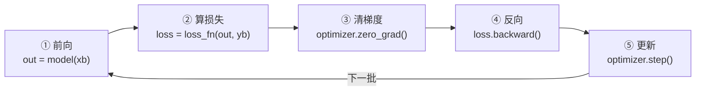
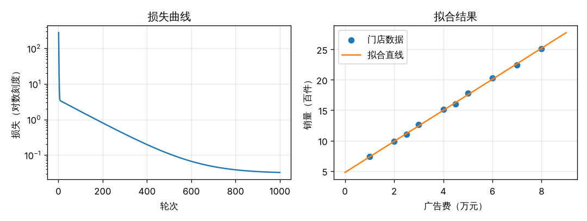
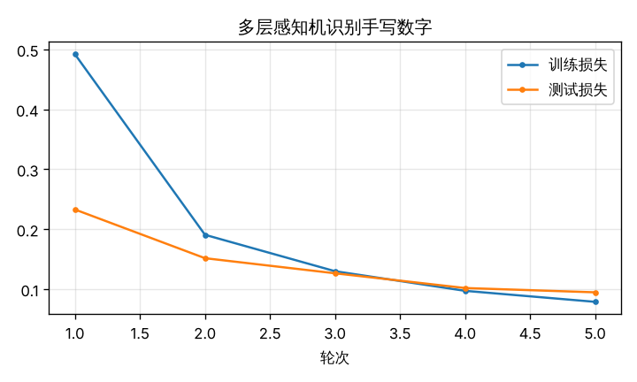
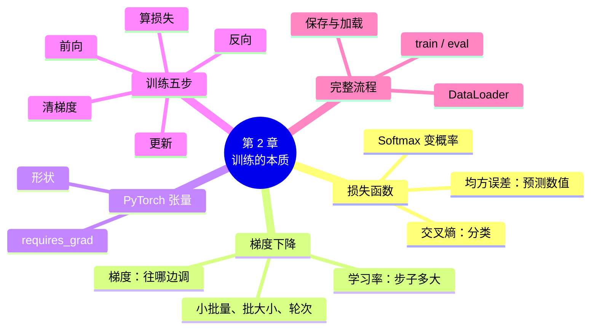

# 第 2 章 训练的本质：损失函数与梯度下降

!!! abstract "本章学时"
    线上理论 3 学时 · 线下 1 学时 · 实验 2 学时（本章共 3 个实验，教师可任选）

## 学习目标

学完本章，你应该能够：

1. **说出**损失函数、梯度、梯度下降、学习率、批大小、轮次的含义（记忆）；
2. **解释**梯度下降为什么能让损失越来越小，学习率太大、太小分别会怎样（理解）；
3. **计算**一组预测的均方误差和交叉熵，手算梯度下降的几步更新（应用）；
4. **编写**PyTorch 的“训练五步”循环，从零训练一个识别手写数字的网络（应用）；
5. 根据训练记录**比较**不同学习率、批大小的效果，选出合适的设置（分析）。

!!! info "先修要求"
    学习本章前，你需要掌握：

    - 本书第 1 章：神经元的计算、多层感知机、`nn.Linear` 的“进几列、出几列”（[1.4 多层感知机与前向传播](../01-neuron/index.md#14)、[1.5 看懂网络的“形状”](../01-neuron/index.md#15)）；
    - 《人工智能数学基础》：知道“斜率”表示一条线有多陡；
    - 《Python 编程》：会写 `for` 循环和函数。

??? abstract "本章概念清单（点击查看定义和例子）"
    写好术语表后运行 python tools/glossary_links.py concepts 2 自动生成

## 情景导入

外卖平台给每一单都估一个“预计送达时间”。新上线的估时程序一开始很不准：明明 25 分钟就到了，它估 50 分钟；下雨天堵车，它又估得太短。工程师并不去一条条改规则，而是让程序每天对照几十万单的“实际送达时间”，自己调整。几周以后，估时越来越准。

程序“越估越准”靠的是两样东西。第一，要有一把**尺子**，量一量它估得有多差：估 50 分钟、实际 25 分钟，差了 25 分钟；差得越多，尺子上的读数越大。第二，要有一个**改进的办法**：知道了差多少、往哪边差，就把程序里的参数往“差得更少”的方向挪一点。每天挪一点，读数就一天天变小。

在神经网络里，这把尺子叫**损失函数**，改进的办法叫**梯度下降**。本章先把这两样东西讲清楚，再学 PyTorch 的基本数据——张量，最后把它们组合成一个固定的“训练五步”，亲手从零训练出第 1 章用过的手写数字识别网络。

## 2.1 什么叫“好”：损失函数

**损失函数**是衡量网络预测值和真实答案之间差距的函数，差距越大，损失越大。训练的目标，就是找到一组参数，让损失尽可能小。不同的任务用不同的尺子，最常用的有两种。

### 2.1.1 均方误差：预测一个数时用

当网络要预测一个数（送达时间、房价、明天的气温）时，最常用**均方误差**（Mean Squared Error，MSE）：每个样本的“预测值 − 真实值”先平方，再求平均。

\[
\text{MSE} = \frac{1}{n}\sum_{i=1}^{n}(\hat{y}_i - y_i)^2
\]

其中 n 是样本个数，ŷ（读作“y 帽”）是预测值，y 是真实值。

!!! example "算一算：三单外卖的均方误差"
    | 订单 | 预测（分钟） | 实际（分钟） | 差 | 差的平方 |
    |---|---|---|---|---|
    | 1 | 30 | 28 | 2 | 4 |
    | 2 | 45 | 40 | 5 | 25 |
    | 3 | 20 | 26 | −6 | 36 |

    MSE = (4 + 25 + 36) / 3 ≈ **21.7**。

为什么要平方？一是让正负误差不互相抵消（+5 和 −5 不能算成“没误差”）；二是让大误差受到更重的惩罚：差 6 分钟的平方是 36，比差 2 分钟的 4 大得多，网络就会优先去改正那些错得离谱的预测。

### 2.1.2 交叉熵：做分类时用

当网络要从几个类别中选一个（这张图是数字几、这条评论是好评还是差评）时，用**交叉熵**。

分类网络的输出层有几个类别就有几个神经元，每个神经元给出一个分数。先用 **Softmax** 函数把这些分数变成加起来等于 1 的概率；然后只看**正确答案那一类**的概率 p，损失就是 −ln p。

| 正确类别的概率 p | 0.9 | 0.7 | 0.5 | 0.1 | 0.01 |
|---|---|---|---|---|---|
| 交叉熵 −ln p | 0.105 | 0.357 | 0.693 | 2.303 | 4.605 |

从表里可以看出交叉熵的脾气：网络对正确答案越有把握（p 越接近 1），损失越接近 0；网络越“自信地答错”（正确答案的概率越接近 0），损失就越大，而且涨得飞快。

!!! example "算一算：认手写数字的交叉熵"
    一张图片真实是数字 3。网络算出的 10 个概率中，“3”的概率是 0.7，交叉熵 = −ln 0.7 ≈ **0.357**。

    训练一段时间后，“3”的概率升到 0.95，交叉熵 = −ln 0.95 ≈ **0.051**，损失变小了，说明网络进步了。

    如果网络把它认成了 8，“3”的概率只有 0.1，交叉熵 = −ln 0.1 ≈ **2.303**，损失很大。

!!! tip "PyTorch 里的交叉熵"
    `nn.CrossEntropyLoss()` 把“Softmax + 取正确类的概率 + 求 −ln”三步合在一起做了，所以网络的最后一层**直接输出分数，不要自己再加 Softmax**。这是初学者最常犯的错误之一。

一个有用的参照：10 个类别时，如果网络完全在瞎猜，每类概率都是 0.1，交叉熵就是 2.303。所以训练刚开始时，手写数字网络的损失总在 2.3 左右（实验 2-3 中学习率太小的那一组，三轮都停在 2.30 附近，说明它几乎没学到东西）。

## 2.2 怎么“变好”：梯度下降

### 2.2.1 蒙着眼睛下山

有了损失函数，训练就变成了一个“找最低点”的问题：参数有千千万万个，每一组参数都对应一个损失值，要找出损失最小的那一组。

想象你蒙着眼睛站在山坡上，要走到山谷最低处。你看不见整座山，但能用脚感觉脚下哪边是下坡。最稳妥的办法是：**每次朝最陡的下坡方向迈一小步，然后重新感觉，再迈一步**。走得足够多，就会来到一个谷底。

这就是**梯度下降**。“脚下的坡度”在数学上叫**梯度**：它告诉我们，把某个参数增大一点点，损失会增加多少。梯度为正，说明参数增大损失会变大，就应该把参数调小；梯度为负，就应该调大。所以每一步的更新规则是：

\[
\text{新参数} = \text{旧参数} - \text{学习率} \times \text{梯度}
\]

这里的减号就是“往下坡走”的意思。**学习率**决定每一步迈多大。

梯度怎么算？对于有几十万个参数的网络，手算是不可能的。好消息是，PyTorch 会自动替我们算出每个参数的梯度，我们只需要调用一行 `loss.backward()`。它背后的原理叫反向传播，是第 3 章的内容。本章只需要记住：**梯度告诉我们往哪边调、调多少**。

<iframe class="sim-frame" src="../../sims/gradient-descent/main.html" height="720" loading="lazy" title="梯度下降下山"></iframe>

动画：在损失的“地形图”上，选择学习率，一步步看梯度下降怎样走到最低点。（数据是《机器学习》第 3 章的 5 套房子，道理与本章完全相同。）[全屏打开](../../sims/gradient-descent/main.html){ target=_blank }
{ .sim-caption }

### 2.2.2 学习率：步子迈多大

学习率是训练中最重要的一个设置，它不是学出来的，而是人事先定好的，这类设置叫**超参数**。

- **学习率太小**：每步只挪一点点，走很久都到不了谷底。实验 2-3 中学习率 0.001 训练 3 轮，损失只从 2.31 降到 2.30，测试准确率 9.7%，和瞎猜差不多。
- **学习率合适**：损失稳稳下降。学习率 0.1 时，3 轮后测试准确率达到 89.1%。
- **学习率太大**：一步迈过了谷底，跳到对面山坡上，甚至越跳越高。学习率 5.0 时，第 1 轮损失高达 8.44，之后一直停在 2.3 左右，网络“学坏了”，准确率只有 11.4%。

2.6 节的示范例题会用一个只有一个参数的例子，手算这三种情况。

### 2.2.3 一批一批地学：批大小与轮次

严格的梯度下降，每走一步都要先用**全部**训练数据算一次损失和梯度。MNIST 有 6 万张图片，每走一步都要算 6 万张，太慢了。

实际中用的是**小批量梯度下降**：每次只拿一小批（比如 64 张）来算梯度、更新一次参数，然后换下一批。一小批里的平均梯度虽然有点“噪声”，但方向大体是对的，而且每一步快得多。

- **批大小**（batch size）：每一批有多少个样本，常用 32、64、128、256；
- **轮次**（epoch）：把全部训练数据完整学一遍叫一轮。6 万张图片、批大小 64，一轮要更新 938 次（60000 ÷ 64，最后一批不满 64 张也算一批）。

批大小也是超参数。实验 2-3 中，同样训练 3 轮、学习率 0.1：批大小 8 更新了 3750 次，准确率 94.3%；批大小 512 只更新了 60 次，准确率 69.8%。批越小，同样轮数下更新的次数越多，但每次更新的计算没有充分利用电脑的并行能力；批越大，每次更新越稳、越快，但同样轮数下走的步数少。实际中一般先取 32～128，再根据显存和效果调整。

!!! cert "证书考点"
    人工智能训练师（三级）“智能训练”模块要求能训练和测试算法、根据结果调整参数；人工智能数据处理工程师（高级）“深度学习实战”考损失函数的选择、学习率和批大小的作用。常见题目：“分类任务应选哪种损失函数”“学习率过大会出现什么现象”（详见[证书考点对照](../../certificate.md)）。

## 2.3 PyTorch 张量 { #23 }

### 2.3.1 张量是什么

PyTorch 里的数据都放在**张量**（tensor）里。张量可以理解为“多维的表格”：

| 维数 | 样子 | 例子 | 形状（shape） |
|---|---|---|---|
| 0 维 | 一个数 | 一个损失值 2.3 | `[]` |
| 1 维 | 一行数 | 10 家门店的广告费 | `[10]` |
| 2 维 | 一张表 | 64 个样本、每个 784 个特征 | `[64, 784]` |
| 3 维 | 一叠表 | 一张彩色图片：3 个颜色通道，每个 32 × 32 | `[3, 32, 32]` |
| 4 维 | 一叠叠表 | 一批 64 张灰度图片 | `[64, 1, 28, 28]` |

实验 2-2 中打印的“一批数据的形状 `torch.Size([64, 1, 28, 28])`”，读法是：64 张图片，每张 1 个颜色通道（灰度），高 28、宽 28。

### 2.3.2 常用操作

在 Python 交互环境中试一试下面几行（`>>>` 后面是输入，下一行是输出）：

```python
>>> import torch
>>> x = torch.tensor([1.0, 2.0, 3.0])        # 从列表创建
>>> x * 2 + 1                               # 每个元素都参与运算
tensor([3., 5., 7.])
>>> x.mean(), x.sum()                       # 平均值、求和
(tensor(2.), tensor(6.))
>>> a = torch.zeros(2, 3)                   # 2 行 3 列的全 0 张量
>>> a.shape
torch.Size([2, 3])
>>> b = torch.arange(6).reshape(2, 3)       # 0～5 排成 2 行 3 列
>>> b
tensor([[0, 1, 2],
        [3, 4, 5]])
>>> b[1, 2], b[:, 0]                        # 取第 2 行第 3 列；取第 1 列
(tensor(5), tensor([0, 3]))
>>> b.float() / 5                           # 整数转小数再除
tensor([[0.0000, 0.2000, 0.4000],
        [0.6000, 0.8000, 1.0000]])
```

张量和 NumPy 数组很像，常用操作几乎一样。不同之处有两点：一是张量可以放到 GPU 上计算；二是张量可以**自动求梯度**——创建时加上 `requires_grad=True`，PyTorch 就会记住它参与的每一步计算，调用 `backward()` 时自动算出它的梯度。实验 2-1 就是这样做的。

!!! warning "易错点"
    - 图片像素原本是 0～255 的整数，送进网络前要转成 0～1 的小数（除以 255），否则训练很难收敛。本书的 `load_mnist()` 已经做了这一步。
    - 整数张量不能求梯度，参数要用小数（`1.0` 而不是 `1`）。

## 2.4 训练五步 { #24 }

不管网络多大、任务是什么，PyTorch 的训练都是同一个循环，每一批数据做五步：



| 步骤 | 代码 | 做什么 | 对应下山的比喻 |
|---|---|---|---|
| ① 前向 | `out = model(xb)` | 用当前参数做预测 | 站在当前位置 |
| ② 算损失 | `loss = loss_fn(out, yb)` | 量一量预测和答案差多少 | 看看自己有多高 |
| ③ 清梯度 | `optimizer.zero_grad()` | 把上一批留下的梯度清零 | 忘掉上一步的坡度 |
| ④ 反向 | `loss.backward()` | 自动算出每个参数的梯度 | 用脚感觉坡度 |
| ⑤ 更新 | `optimizer.step()` | 参数 = 参数 − 学习率 × 梯度 | 往下坡迈一步 |

第③步容易被忽略：PyTorch 默认会把每次 `backward()` 算出的梯度**累加**起来。如果不清零，这一批的梯度就会和上一批的混在一起，参数会朝错误的方向走。

**优化器**（optimizer）负责第③、⑤两步。`torch.optim.SGD(model.parameters(), lr=0.1)` 的意思是：用“随机梯度下降”（Stochastic Gradient Descent，即小批量梯度下降）来更新这个网络的所有参数，学习率 0.1。第 3 章还会介绍更聪明的优化器 Adam。

!!! tip "把五步背下来"
    “**前向、算损失、清梯度、反向、更新**”。本书从这一章到第 10 章，每一个训练程序都是这五步，变的只是数据、网络和损失函数。

## 2.5 实战流程：数据加载—训练—评估 { #25 }

一个完整的训练程序，除了训练五步，还要准备数据、评估效果、保存结果。实验 2-2 的程序分为五块：


**准备数据**。`TensorDataset(x, y)` 把图片和标签配成对；`DataLoader` 负责把数据切成一批批，`shuffle=True` 表示每轮开始时把顺序打乱，避免网络“背顺序”。

```python
train_loader = DataLoader(TensorDataset(x_train, y_train), batch_size=64, shuffle=True)
for xb, yb in train_loader:     # 每次循环拿到一批：xb 是 64 张图片，yb 是 64 个标签
    ...
```

**训练模式和评估模式**。训练前写 `model.train()`，评估前写 `model.eval()`。本章的网络在两种模式下没有区别，但第 4 章的 Dropout、第 5 章的批归一化在两种模式下表现不同，从现在起就养成习惯。评估时还要把代码放在 `with torch.no_grad():` 里，告诉 PyTorch 不用记录计算过程，省内存、算得快。

**评估**。分类任务最直观的指标是**准确率**：认对的样本数 ÷ 样本总数。评估一定要在**训练时没见过的数据**上做，否则就像拿做过的练习题当考试题，分数虚高。本章用测试集评估，第 4 章会进一步讲为什么还需要一个“验证集”。

**保存和加载**。训练好的参数用 `torch.save(model.state_dict(), "文件名.pt")` 保存；使用时先搭出同样结构的网络，再用 `model.load_state_dict(torch.load("文件名.pt"))` 装回去。第 1 章实验 1-2 就是这样加载现成参数的。

## 2.6 示范例题

**例题** 设一个网络只有一个参数 w，损失函数为 L(w) = (w − 3)²，它的梯度为 2(w − 3)。从 w = 0 出发，分别用学习率 0.1、1.0、1.1 做三步梯度下降，写出每一步的 w 和损失，并说明三种学习率的效果。

**解题思路**：每一步都用“新 w = 旧 w − 学习率 × 梯度”，梯度用当前的 w 代入 2(w − 3) 计算。

**学习率 0.1**

| 步 | 当前 w | 梯度 2(w − 3) | 新 w | 新的损失 (w − 3)² |
|---|---|---|---|---|
| 起点 | — | — | 0 | 9 |
| 1 | 0 | −6 | 0 − 0.1 × (−6) = 0.6 | 5.76 |
| 2 | 0.6 | −4.8 | 0.6 + 0.48 = 1.08 | 3.69 |
| 3 | 1.08 | −3.84 | 1.08 + 0.384 = 1.464 | 2.36 |

损失 9 → 5.76 → 3.69 → 2.36，稳步下降，w 一步步靠近 3。

**学习率 1.0**：第 1 步 w = 0 − 1 × (−6) = 6，损失 9；第 2 步梯度 6，w = 6 − 6 = 0，损失 9；第 3 步又回到 6。w 在 0 和 6 之间来回跳，损失一直是 9，**原地踏步**。

**学习率 1.1**：第 1 步 w = 0 + 6.6 = 6.6，损失 12.96；第 2 步梯度 7.2，w = 6.6 − 7.92 = −1.32，损失 18.66；第 3 步 w = −1.32 + 9.504 = 8.184，损失 26.87。损失越来越大，**发散**了。

**答**：学习率 0.1 时损失稳步下降；1.0 时来回跳、不下降；1.1 时越跳越远、损失越来越大。学习率太大是训练失败最常见的原因之一。

**举一反三**：学习率 0.5 时，第 1 步 w = 0 + 0.5 × 6 = 3，一步就到了最低点。这只是因为这个例子特别简单；真实的网络有几十万个参数，没有“一步到位”的学习率，只能通过实验找一个合适的值（实验 2-3）。

## 2.7 前沿视窗

**大模型的训练也是这五步**。DeepSeek、通义千问等大语言模型的训练，核心循环和本章的实验 2-2 完全一样：前向、算损失（预测下一个字的交叉熵）、清梯度、反向、更新。区别在于规模：训练数据是几万亿个字，参数是几百亿到上万亿个，要用几千块 GPU 连续算几周甚至几个月。为了在这种规模下训练，工程师发展出了很多技术，比如把一个模型拆到很多块 GPU 上、用更省显存的数字格式、自动调整学习率等。但只要你看懂了实验 2-2，就看懂了大模型训练最核心的那段代码。

**学习率预热与衰减**。大模型训练很少从头到尾用同一个学习率。常见的做法是开始时让学习率从很小慢慢升高（“预热”），再随着训练逐渐降低（“衰减”）。道理和下山一样：刚出发时地形陌生，先小步试探；快到谷底时，也要放慢脚步，免得一步迈过头。PyTorch 用 `torch.optim.lr_scheduler` 实现这些策略。

## 本章实验

!!! abstract "实验总览"
    | 实验 | 类型 | 建议时长 | 内容 |
    |---|---|---|---|
    | 实验 2-1 | ★ 基础 | 30 分钟 | 用梯度下降拟合广告费与销量的直线，体会“训练五步”和损失曲线 |
    | 实验 2-2 | ★ 基础 | 45 分钟 | 从零训练多层感知机识别手写数字：准备数据、搭网络、训练五步、评估、保存 |
    | 实验 2-3 | ☆ 拓展 | 30 分钟 | 改学习率和批大小，比较训练效果，填写记录表 |

    三个实验都在本机 CPU 上运行：实验 2-1 不到 1 秒，实验 2-2 约 10 秒，实验 2-3 约 1 分钟。代码见配套资源 `labs/ch02/` 目录。

### 实验 2-1 ★ 用梯度下降拟合一条直线 { #2-1 }

**实验目的**

1. 用张量和自动求导实现梯度下降，体会训练五步的每一步在做什么；
2. 观察损失随轮次的变化，理解“训练就是让损失变小”；
3. 用训练好的参数做预测。

**实验环境**：本机 CPU，Python 3.11，PyTorch、Matplotlib。

**实验数据**：10 家门店的月广告费（万元）和月销量（百件），写在代码里（编者为教学编制）。

**实验步骤与代码**

第 1 步，准备数据，参数 w、b 都从 0 开始，并告诉 PyTorch 要为它们求梯度：

```python
x = torch.tensor([1.0, 2.0, 2.5, 3.0, 4.0, 4.5, 5.0, 6.0, 7.0, 8.0])
y = torch.tensor([7.4, 9.9, 11.0, 12.6, 15.1, 16.0, 17.8, 20.3, 22.4, 25.1])
w = torch.tensor(0.0, requires_grad=True)
b = torch.tensor(0.0, requires_grad=True)
lr = 0.01
```

第 2 步，训练 1000 轮。这里还没有用到网络和优化器，五步都是“手写”的：

```python
for epoch in range(1, 1001):
    pred = w * x + b                        # ① 前向
    loss = ((pred - y) ** 2).mean()         # ② 算损失：均方误差
    if w.grad is not None:                  # ③ 清梯度
        w.grad.zero_()
        b.grad.zero_()
    loss.backward()                         # ④ 反向：自动求出 w.grad、b.grad
    with torch.no_grad():                   # ⑤ 更新
        w -= lr * w.grad
        b -= lr * b.grad
```

第 3 步，打印拟合结果，用它预测广告费 5.5 万元时的销量，并画出损失曲线和拟合直线。

完整代码见 `lab2_1_line_fit.py`。

**运行结果**

```text
第    1 轮：w = 1.587，b = 0.315，损失 = 277.7240
第    2 轮：w = 2.415，b = 0.488，损失 = 78.4829
第    3 轮：w = 2.846，b = 0.585，损失 = 24.0022
第   10 轮：w = 3.296，b = 0.785，损失 = 3.3388
第   50 轮：w = 3.193，b = 1.364，损失 = 2.4641
第  100 轮：w = 3.078，b = 1.973，损失 = 1.6898
第  500 轮：w = 2.653，b = 4.234，损失 = 0.1081
第 1000 轮：w = 2.553，b = 4.765，损失 = 0.0323

拟合结果：销量 ≈ 2.55 × 广告费 + 4.77
预测：广告费 5.5 万元时，销量约 18.8 百件
```



几点解读：

- 每行打印的损失是这一轮**更新前**算出的，w、b 是更新**后**的值。
- 前 3 轮损失从 277.7 骤降到 24.0：一开始离谷底很远，坡很陡，梯度大，每步走得远。
- 第 10 轮后下降变慢，而且 w 先冲到 3.3 又慢慢回落到 2.55：w 和 b 在“商量”着分配，斜率大一点、截距小一点，或者反过来，都能让损失差不多。山谷的谷底是一条又窄又长的“沟”，梯度下降要沿着沟慢慢走。
- 损失曲线的纵轴是对数刻度，这样前期的骤降和后期的缓降都能看清楚。

**实验记录表**

| 项目 | 你的结果 |
|---|---|
| 第 1、10、1000 轮的损失 | |
| 最终的 w、b | |
| 广告费 5.5 万元的预测销量 | |
| 学习率改成 0.05 时，第 1000 轮的损失（见思考题 1） | |

**常见问题排查**

| 现象 | 原因 | 解决办法 |
|---|---|---|
| `AttributeError: 'NoneType' object has no attribute 'zero_'` | 第一轮还没有梯度就清零 | 保留代码里的 `if w.grad is not None` 判断 |
| `RuntimeError: a leaf Variable that requires grad is being used in an in-place operation` | 更新参数时没有写 `with torch.no_grad():` | 更新的两行必须放在 `with torch.no_grad():` 里面 |
| 损失变成 `nan` 或越来越大 | 学习率太大 | 学习率改回 0.01 |

**思考与练习**

1. 把学习率改成 0.05 和 0.1，分别运行，损失怎样变化？哪个发散了？
2. 去掉“清梯度”的三行（第③步），损失曲线会变成什么样？为什么？

**实验报告要求**

提交运行结果和图片，填写记录表；用自己的话写出训练五步各做什么（不超过 150 字）。

### 实验 2-2 ★ 训练五步：多层感知机识别手写数字 { #2-2 }

**实验目的**

1. 用 `Dataset` 和 `DataLoader` 准备批数据；
2. 用 `nn.Sequential`、`nn.CrossEntropyLoss`、`torch.optim.SGD` 写出完整的训练程序；
3. 在测试集上评估准确率，保存训练好的参数。

**实验环境**：本机 CPU，Python 3.11，PyTorch、torchvision、Matplotlib。

**实验数据**：MNIST 手写数字，训练集 6 万张、测试集 1 万张，28 × 28 灰度图，第一次运行时自动下载。<sup class="cite">[[5]](#ref2-5)</sup>

**实验步骤与代码**

第 1 步，准备数据。`load_mnist()` 是本书的公共函数（在 `labs/dlbook.py` 里），返回 0～1 之间的图片张量和标签：

```python
x_train, y_train = load_mnist(train=True)
x_test, y_test = load_mnist(train=False)
train_loader = DataLoader(TensorDataset(x_train, y_train), batch_size=64, shuffle=True)
test_loader = DataLoader(TensorDataset(x_test, y_test), batch_size=1000)
```

第 2 步，搭网络、选损失函数和优化器。网络和第 1 章一样，但这次参数是随机初始化的，要从零开始训练：

```python
model = nn.Sequential(nn.Flatten(), nn.Linear(784, 128), nn.ReLU(),
                      nn.Linear(128, 64), nn.ReLU(), nn.Linear(64, 10))
loss_fn = nn.CrossEntropyLoss()                          # 多分类用交叉熵
optimizer = torch.optim.SGD(model.parameters(), lr=0.1)   # 小批量梯度下降
```

第 3 步，训练 5 轮，每轮结束后在测试集上评估一次：

```python
for epoch in range(1, 6):
    model.train()
    for xb, yb in train_loader:
        out = model(xb)              # ① 前向
        loss = loss_fn(out, yb)      # ② 算损失
        optimizer.zero_grad()        # ③ 清梯度
        loss.backward()              # ④ 反向
        optimizer.step()             # ⑤ 更新
    test_loss, test_acc = evaluate(test_loader)
```

`evaluate()` 函数在 `model.eval()` 和 `torch.no_grad()` 下遍历测试集，累计损失和认对的个数（见完整代码）。

第 4 步，画出训练损失和测试损失曲线，保存参数。

完整代码见 `lab2_2_mnist_mlp.py`。

**运行结果**

```text
训练集 60000 张，测试集 10000 张；每轮 938 批，每批 64 张
一批数据的形状：torch.Size([64, 1, 28, 28])
第 1 轮：训练损失 0.4920，测试损失 0.2329，测试准确率 0.9297，累计用时 1.0 秒
第 2 轮：训练损失 0.1907，测试损失 0.1517，测试准确率 0.9524，累计用时 2.0 秒
第 3 轮：训练损失 0.1299，测试损失 0.1265，测试准确率 0.9619，累计用时 3.2 秒
第 4 轮：训练损失 0.0972，测试损失 0.1019，测试准确率 0.9677，累计用时 5.2 秒
第 5 轮：训练损失 0.0788，测试损失 0.0947，测试准确率 0.9699，累计用时 6.4 秒
曲线已保存到 lab2_2_curves.png
模型参数已保存到 my_mnist_mlp.pt（可以替换实验 1-2 的 mnist_mlp.pt 试试）
```



几点解读：

- 训练开始前，网络在瞎猜，损失约 2.3（见 2.1.2 节）。仅仅一轮（938 次更新）后，测试准确率已经到了 93%。
- 5 轮后测试准确率 96.99%，和第 1 章随书提供的网络（97.09%）几乎一样。那个网络用的是 Adam 优化器，第 3 章会介绍。
- 第 1 轮的训练损失（0.49）比测试损失（0.23）还高，这是因为训练损失是一边学一边记的“全轮平均”，包含了刚开始学时的大损失；测试损失是这一轮学完后才算的。
- 不同电脑上用时不同，准确率在小数点后第三位可能略有差别，属于正常现象。

**实验记录表**

| 项目 | 你的结果 |
|---|---|
| 每轮更新多少次 | |
| 第 1 轮、第 5 轮的测试准确率 | |
| 5 轮共用时 | |
| 用 `my_mnist_mlp.pt` 替换实验 1-2 的参数后，能不能认对你写的数字 | |

**常见问题排查**

| 现象 | 原因 | 解决办法 |
|---|---|---|
| `ModuleNotFoundError: No module named 'dlbook'` | 没在 `labs/ch02` 目录下运行 | 先 `cd labs/ch02` |
| 损失一直在 2.30 附近不动 | 学习率太小，或者忘了 `optimizer.step()` | 检查第⑤步，学习率用 0.1 |
| 准确率只有 10% 左右 | 网络最后一层多加了 Softmax，或者损失函数选错 | 用 `nn.CrossEntropyLoss()`，最后一层直接输出分数 |
| 测试时报 `RuntimeError` 与形状有关 | 网络开头漏了 `nn.Flatten()` | 第一层前加 `nn.Flatten()` 把图片摊平 |

**思考与练习**

1. 把训练轮数改为 10 轮，测试准确率还会上升吗？训练损失和测试损失的差距有什么变化？（第 4 章会深入讨论）
2. 把 `shuffle=True` 改成 `shuffle=False`，结果有什么变化？

**实验报告要求**

提交运行结果和损失曲线；对照代码，标出训练五步各在哪一行；说明为什么评估时要用 `torch.no_grad()`。

### 实验 2-3 ☆ 改学习率和批大小 { #2-3 }

**实验目的**

1. 观察学习率太小、合适、太大时的训练表现；
2. 观察批大小对更新次数、用时和效果的影响；
3. 学会用记录表整理调参实验。

**实验环境**：本机 CPU，Python 3.11，PyTorch、torchvision。

**实验数据**：MNIST 训练集的前 1 万张（为了快），测试集 1 万张。

**实验步骤与代码**

把实验 2-2 的训练过程写成一个函数 `run(lr, batch_size)`，每次都用随机种子 42 重新初始化网络，训练 3 轮，返回每轮的训练损失、测试准确率、用时和更新次数：

```python
for lr in [0.001, 0.01, 0.1, 1.0, 5.0]:
    losses, acc, sec, steps = run(lr, 64)
for bs in [8, 64, 512]:
    losses, acc, sec, steps = run(0.1, bs)
```

完整代码见 `lab2_3_lr_batch.py`。

**运行结果**

```text
① 批大小 64，改学习率（每轮的训练损失 → 测试准确率）
  学习率 0.001：损失 2.3106 → 2.3036 → 2.2967；测试准确率 0.0970
  学习率 0.01 ：损失 2.2783 → 2.1677 → 1.9269；测试准确率 0.5603
  学习率 0.1  ：损失 1.2634 → 0.4183 → 0.3359；测试准确率 0.8911
  学习率 1.0  ：损失 2.0408 → 1.7878 → 1.2890；测试准确率 0.5448
  学习率 5.0  ：损失 8.4406 → 2.3233 → 2.3253；测试准确率 0.1135

② 学习率 0.1，改批大小
  批大小 8  ：更新 3750 次，用时 2.2 秒，最后一轮损失 0.1429，测试准确率 0.9432
  批大小 64 ：更新  471 次，用时 0.5 秒，最后一轮损失 0.3359，测试准确率 0.8911
  批大小 512：更新   60 次，用时 0.2 秒，最后一轮损失 1.7035，测试准确率 0.6976
```

几点解读：

- 学习率 0.001 几乎没学到东西；0.01 在学，但太慢；0.1 最好；1.0 损失下降但不稳；5.0 第 1 轮损失冲到 8.44，网络被“打乱”后再也学不回来。这五组正好对应 2.2.2 节说的三种情况。
- 批大小 8 每轮更新 1250 次，3 轮后效果最好，但用时是批大小 64 的 4 倍多；批大小 512 最快，但 3 轮只更新了 60 次，还远没学好。批大小大时，通常要配合更多轮次或更大的学习率。
- 这里只训练了 3 轮、只用了 1 万张图片，结论只说明“在这个设置下”的情况。调参的结论总是和具体设置有关，要养成记录完整设置的习惯。

**实验记录表**

| 学习率 | 批大小 | 第 3 轮训练损失 | 测试准确率 | 用时（秒） | 结论（太小 / 合适 / 太大） |
|---|---|---|---|---|---|
| 0.001 | 64 | | | | |
| 0.01 | 64 | | | | |
| 0.1 | 64 | | | | |
| 1.0 | 64 | | | | |
| 5.0 | 64 | | | | |
| 0.1 | 8 | | | | |
| 0.1 | 512 | | | | |

**常见问题排查**

| 现象 | 原因 | 解决办法 |
|---|---|---|
| 用时和书上差别很大 | 电脑性能不同 | 正常，只比较同一台电脑上的相对快慢 |
| 结果和书上略有不同 | 不同版本、不同电脑的浮点计算顺序不同 | 小数点后两三位的差别是正常的 |

**思考与练习**

1. 批大小 512 时，把学习率提高到 0.5，3 轮后的准确率能赶上批大小 64、学习率 0.1 吗？动手试一试。
2. 如果只有 10 分钟训练时间，你会选哪组设置？为什么？

**实验报告要求**

提交填好的记录表，写出你认为最合适的学习率和批大小，并用实验数据说明理由（不超过 200 字）。

## 本章小结

- **损失函数**衡量预测和答案的差距：预测一个数用**均方误差**，做分类用**交叉熵**。交叉熵在 PyTorch 中是 `nn.CrossEntropyLoss()`，它内部已经包含 **Softmax**。
- **梯度**告诉我们每个参数往哪边调、损失会怎样变。**梯度下降**每一步按“参数 = 参数 − 学习率 × 梯度”更新，像蒙眼下山一样一步步走向损失最低处。
- **学习率**是最重要的**超参数**：太小学得慢，太大会来回跳甚至发散。
- 实际训练用**小批量梯度下降**：每批若干样本更新一次参数；**批大小**决定每批多少样本，全部数据学一遍叫一**轮次**。
- PyTorch 用**张量**存放数据，要读懂形状，例如 `[64, 1, 28, 28]` 是 64 张 1 通道 28 × 28 的图片。
- **训练五步**：前向、算损失、清梯度、反向、更新。**优化器**负责清梯度和更新。
- 完整流程：DataLoader 准备批数据 → 搭网络 → 选损失和优化器 → 训练五步循环 → `eval()` + `no_grad()` 下评估 → 保存参数。



**本章自检**

- [ ] 我能算出三个预测值的均方误差，能查表说出 p = 0.5 时的交叉熵。
- [ ] 我能用“蒙眼下山”解释梯度下降，说出学习率太大、太小各会怎样。
- [ ] 我能说出 6 万张图片、批大小 100 时，一轮更新多少次。
- [ ] 我能读懂形状 `[64, 1, 28, 28]`。
- [ ] 我能不看书写出训练五步的五行代码。

**下一章预告**

本章每次都是一行 `loss.backward()` 就得到了所有参数的梯度，PyTorch 是怎么做到的？下一章揭开这个“黑箱”：用一张计算图和一个两步的小算例，讲清误差怎样从输出一层层“往回传”；再看看网络很深时为什么会训练不动，以及 ReLU、残差连接、Adam 优化器这些对策。

## 参考文献

正文中的上标编号（如<sup class="cite">[[1]](#ref2-1)</sup>）对应下面的文献。

<div class="refs" markdown>

**教材与专著**

- <span id="ref2-1"></span>[1] 邱锡鹏. 神经网络与深度学习[M]. 北京: 机械工业出版社, 2020. https://nndl.github.io/.
    <span class="ref-note">第 2 章“机器学习概述”讲损失函数和梯度下降，第 4 章讲交叉熵与 Softmax，对应 2.1、2.2 节。</span>
- <span id="ref2-2"></span>[2] 阿斯顿·张, 李沐, 扎卡里·C. 立顿, 等. 动手学深度学习（PyTorch 版）[M]. 北京: 人民邮电出版社, 2023. https://zh.d2l.ai/.
    <span class="ref-note">“预备知识”一章讲张量操作，“线性神经网络”一章从零实现训练循环，对应 2.3～2.5 节和实验 2-1、2-2。</span>
- <span id="ref2-3"></span>[3] GOODFELLOW I, BENGIO Y, COURVILLE A. Deep learning[M]. Cambridge: MIT Press, 2016. https://www.deeplearningbook.org/.
    <span class="ref-note">第 4 章“数值计算”讲梯度下降，第 8 章“深度模型中的优化”讨论小批量、学习率等，对应 2.2 节。</span>

**经典论文**

- <span id="ref2-4"></span>[4] ROBBINS H, MONRO S. A stochastic approximation method[J]. The Annals of Mathematical Statistics, 1951, 22(3): 400-407.
    <span class="ref-note">随机梯度下降的理论源头，对应 2.2.3 节。</span>
- <span id="ref2-5"></span>[5] LECUN Y, BOTTOU L, BENGIO Y, et al. Gradient-based learning applied to document recognition[J]. Proceedings of the IEEE, 1998, 86(11): 2278-2324.
    <span class="ref-note">介绍 MNIST 数据集，并用梯度下降训练神经网络识别手写数字，对应实验 2-2。</span>
- <span id="ref2-6"></span>[6] BOTTOU L, CURTIS F E, NOCEDAL J. Optimization methods for large-scale machine learning[J]. SIAM Review, 2018, 60(2): 223-311.
    <span class="ref-note">系统讨论小批量梯度下降、批大小和学习率的选择，对应 2.2.2、2.2.3 节。</span>
- <span id="ref2-7"></span>[7] GOYAL P, DOLLÁR P, GIRSHICK R, et al. Accurate, large minibatch SGD: training ImageNet in 1 hour[EB/OL]. arXiv:1706.02677, 2017.
    <span class="ref-note">提出“批大小增大时学习率按比例增大”和学习率预热，对应实验 2-3 思考题和 2.7 节。</span>

**在线资源与工具**

- <span id="ref2-8"></span>[8] PyTorch. Learn the basics[EB/OL]. [2026-11-01]. https://pytorch.org/tutorials/beginner/basics/intro.html.
    <span class="ref-note">PyTorch 官方入门教程，从张量、数据集与 DataLoader 讲到训练循环与保存模型，对应 2.3～2.5 节。</span>
- <span id="ref2-9"></span>[9] PyTorch. torch.optim[EB/OL]. [2026-11-01]. https://pytorch.org/docs/stable/optim.html.
    <span class="ref-note">优化器与学习率调度器的官方文档，对应 2.4、2.7 节。</span>

</div>

## 课后练习

选择题和判断题可以直接点击选项作答，系统会马上告诉你对错，并展开答案与解析；多选题选好后点“提交答案”。简答和实操题请先自己作答，再点开“答案与解析”核对。

**一、单项选择题**

<div class="quiz" data-answer="B" markdown>

**1.** 三个样本的预测值为 (2, 4, 6)，真实值为 (3, 4, 4)，均方误差是（　　）。

- A. 1
- B. 5/3（约 1.67）
- C. 3
- D. 5

</div>

??? tip "答案与解析"
    **答案：B**

    差为 −1、0、2，平方为 1、0、4，平均 (1 + 0 + 4) / 3 = 5/3。D 是忘了除以 3；C 是用差的绝对值之和。

    考查：均方误差 · 认知层次：应用 · [回看 2.1.1](#211)
    { .quiz-meta }

<div class="quiz" data-answer="C" markdown>

**2.** 识别手写数字（10 类）应该选用哪种损失函数？（　　）

- A. 均方误差
- B. 准确率
- C. 交叉熵
- D. 学习率

</div>

??? tip "答案与解析"
    **答案：C**

    分类任务用交叉熵。准确率是评估指标，它不能求梯度，不能直接用来训练；学习率是超参数。

    考查：交叉熵 · 认知层次：理解 · [回看 2.1.2](#212)
    { .quiz-meta }

<div class="quiz" data-answer="A" markdown>

**3.** 一个 10 分类网络刚开始训练时在“瞎猜”，每类概率都约为 0.1。此时它的交叉熵损失大约是（　　）。

- A. 2.3
- B. 0.1
- C. 0
- D. 10

</div>

??? tip "答案与解析"
    **答案：A**

    交叉熵 = −ln 0.1 ≈ 2.303。这是判断“网络有没有开始学”的一个参照值。

    考查：交叉熵 · 认知层次：应用 · [回看 2.1.2](#212)
    { .quiz-meta }

<div class="quiz" data-answer="D" markdown>

**4.** 梯度下降的更新规则是（　　）。

- A. 新参数 = 旧参数 + 学习率 × 梯度
- B. 新参数 = 学习率 × 梯度
- C. 新参数 = 旧参数 × 学习率
- D. 新参数 = 旧参数 − 学习率 × 梯度

</div>

??? tip "答案与解析"
    **答案：D**

    减号表示朝梯度的反方向，也就是下坡方向走。A 是往上坡走，损失会变大。

    考查：梯度下降 · 认知层次：记忆 · [回看 2.2.1](#221)
    { .quiz-meta }

<div class="quiz" data-answer="B" markdown>

**5.** 训练时发现损失越来越大，最后变成 `nan`，最可能的原因是（　　）。

- A. 学习率太小
- B. 学习率太大
- C. 训练数据太多
- D. 测试集太小

</div>

??? tip "答案与解析"
    **答案：B**

    学习率太大，每一步都迈过了谷底，越跳越高，最终数值溢出变成 nan。学习率太小只会学得慢。

    考查：学习率 · 认知层次：分析 · [回看 2.2.2](#222)
    { .quiz-meta }

<div class="quiz" data-answer="C" markdown>

**6.** 训练集有 50 000 个样本，批大小为 100，训练 10 轮，参数一共更新多少次？（　　）

- A. 500
- B. 1 000
- C. 5 000
- D. 50 000

</div>

??? tip "答案与解析"
    **答案：C**

    每轮 50 000 ÷ 100 = 500 次，10 轮 5 000 次。

    考查：批大小与轮次 · 认知层次：应用 · [回看 2.2.3](#223)
    { .quiz-meta }

<div class="quiz" data-answer="A" markdown>

**7.** 一批图片张量的形状是 `[32, 3, 64, 64]`，它表示（　　）。

- A. 32 张彩色图片，每张高 64、宽 64
- B. 3 张图片，每张 32 × 64 × 64
- C. 64 张灰度图片
- D. 一张 32 × 64 的图片

</div>

??? tip "答案与解析"
    **答案：A**

    四个数依次是：批里的图片数、颜色通道数（3 表示 RGB 彩色）、高、宽。

    考查：张量 · 认知层次：应用 · [回看 2.3.1](#231)
    { .quiz-meta }

<div class="quiz" data-answer="D" markdown>

**8.** 训练五步中，`optimizer.zero_grad()` 的作用是（　　）。

- A. 把网络的参数全部变成 0
- B. 把损失变成 0
- C. 把学习率变成 0
- D. 把上一批留下的梯度清零，避免和这一批的梯度累加

</div>

??? tip "答案与解析"
    **答案：D**

    PyTorch 默认累加梯度，每批开始反向传播前要先清零。它不改变参数本身。

    考查：训练五步 · 认知层次：理解 · [回看 2.4](#24)
    { .quiz-meta }

**二、多项选择题**

<div class="quiz quiz-multi" data-answer="ACD" markdown>

**9.** 下列哪些是超参数（需要人事先设定，不是训练学出来的）？（　　）

- A. 学习率
- B. 神经元的权重
- C. 批大小
- D. 训练轮数

</div>

??? tip "答案与解析"
    **答案：ACD**

    权重是参数，通过训练学出来；学习率、批大小、轮数都是人定的超参数。

    考查：超参数 · 认知层次：理解 · [回看 2.2.2](#222)
    { .quiz-meta }

<div class="quiz quiz-multi" data-answer="ABC" markdown>

**10.** 关于评估模型，下列做法正确的有（　　）。

- A. 评估前调用 `model.eval()`
- B. 把评估代码放在 `with torch.no_grad():` 中
- C. 用训练时没见过的数据评估
- D. 用训练集的准确率代表模型的真实水平

</div>

??? tip "答案与解析"
    **答案：ABC**

    用训练集评估就像拿做过的练习题考试，分数会虚高。

    考查：评估 · 认知层次：应用 · [回看 2.5](#25)
    { .quiz-meta }

<div class="quiz quiz-multi" data-answer="BD" markdown>

**11.** 关于 PyTorch 的 `nn.CrossEntropyLoss()`，下列说法正确的有（　　）。

- A. 网络最后一层必须先加 Softmax
- B. 它内部已经包含 Softmax
- C. 它适合预测房价这类数值任务
- D. 正确类别的概率越高，它算出的损失越小

</div>

??? tip "答案与解析"
    **答案：BD**

    它内部包含 Softmax，最后一层直接输出分数即可；数值预测用均方误差。

    考查：交叉熵、Softmax · 认知层次：理解 · [回看 2.1.2](#212)
    { .quiz-meta }

**三、判断题**

<div class="quiz quiz-judge" data-answer="√" markdown>

**12.** 损失函数的值越小，说明网络的预测和真实答案越接近。

</div>

??? tip "答案与解析"
    **答案：√**

    损失函数就是衡量差距的“尺子”。

    考查：损失函数 · 认知层次：记忆 · [回看 2.1](#21)
    { .quiz-meta }

<div class="quiz quiz-judge" data-answer="×" markdown>

**13.** 学习率越大，训练一定越快、效果一定越好。

</div>

??? tip "答案与解析"
    **答案：×**

    学习率太大会来回跳甚至发散。实验 2-3 中学习率 5.0 的准确率只有 11.4%。

    考查：学习率 · 认知层次：理解 · [回看 2.2.2](#222)
    { .quiz-meta }

<div class="quiz quiz-judge" data-answer="√" markdown>

**14.** 小批量梯度下降每次只用一部分样本计算梯度，比每次用全部样本更新得更频繁。

</div>

??? tip "答案与解析"
    **答案：√**

    同样学一遍数据，小批量能更新很多次，所以收敛快。

    考查：小批量梯度下降 · 认知层次：理解 · [回看 2.2.3](#223)
    { .quiz-meta }

<div class="quiz quiz-judge" data-answer="×" markdown>

**15.** 训练时如果不写 `optimizer.zero_grad()`，PyTorch 会自动清零梯度，所以这一行可有可无。

</div>

??? tip "答案与解析"
    **答案：×**

    PyTorch 默认累加梯度，不清零会让这一批的梯度和以前的混在一起。

    考查：训练五步 · 认知层次：理解 · [回看 2.4](#24)
    { .quiz-meta }

<div class="quiz quiz-judge" data-answer="√" markdown>

**16.** `DataLoader` 中设置 `shuffle=True`，是为了每轮打乱样本顺序，避免网络“背顺序”。

</div>

??? tip "答案与解析"
    **答案：√**

    打乱后每一批的样本组合不同，梯度更有代表性。测试集不需要打乱。

    考查：DataLoader · 认知层次：理解 · [回看 2.5](#25)
    { .quiz-meta }

**四、简答题**

**17.** 用“蒙眼下山”的比喻解释梯度下降，并说明学习率太大和太小各会出现什么现象。

??? tip "答案与解析"
    **参考答案**：蒙眼站在山坡上，看不到整座山，只能感觉脚下哪边往下；每次朝最陡的下坡方向迈一小步，再重新感觉，反复多次就能走到谷底。山的高度就是损失，脚下的坡度就是梯度，每一步迈多远就是学习率。学习率太小，每步只挪一点点，走很久都到不了谷底，损失下降很慢；学习率太大，一步迈过谷底跳到对面，损失来回跳甚至越来越大（发散）。

    评分要点：比喻对应关系 2 分，两种现象各 1 分。

    考查：梯度下降、学习率 · 认知层次：理解 · [回看 2.2](#22)
    { .quiz-meta }

**18.** 写出 PyTorch 训练五步的代码，并说明每一步的作用。

??? tip "答案与解析"
    **参考答案**：

    1. `out = model(xb)`：前向，用当前参数做预测；
    2. `loss = loss_fn(out, yb)`：算损失，衡量预测和答案的差距；
    3. `optimizer.zero_grad()`：清梯度，清掉上一批的梯度；
    4. `loss.backward()`：反向，自动算出每个参数的梯度；
    5. `optimizer.step()`：更新，参数 = 参数 − 学习率 × 梯度。

    考查：训练五步 · 认知层次：记忆 · [回看 2.4](#24)
    { .quiz-meta }

**五、实操题**

**19.** 设损失函数 L(w) = (w − 5)²，梯度为 2(w − 5)。从 w = 1 出发，学习率 0.25，手算三步梯度下降，写出每一步的 w 和损失。再用 PyTorch 验证（提示：仿照实验 2-1，用 `requires_grad=True` 和 `backward()`）。

??? tip "答案与解析"
    **参考答案**：起点 w = 1，损失 16。第 1 步梯度 −8，w = 1 + 2 = 3，损失 4；第 2 步梯度 −4，w = 3 + 1 = 4，损失 1；第 3 步梯度 −2，w = 4 + 0.5 = 4.5，损失 0.25。每步损失变为原来的 1/4。PyTorch 验证代码：

    ```python
    w = torch.tensor(1.0, requires_grad=True)
    for step in range(3):
        loss = (w - 5) ** 2
        if w.grad is not None:
            w.grad.zero_()
        loss.backward()
        with torch.no_grad():
            w -= 0.25 * w.grad
        print(w.item(), ((w - 5) ** 2).item())   # 3.0 4.0 / 4.0 1.0 / 4.5 0.25
    ```

    考查：梯度下降 · 认知层次：应用 · [回看 2.6](#26)
    { .quiz-meta }

**20.** 修改实验 2-2：把优化器的学习率改为 0.01，训练轮数改为 10 轮，记录每轮的测试准确率。和原来的设置（学习率 0.1、5 轮）相比，哪个最终准确率更高？哪个更省时间？

??? tip "答案与解析"
    **参考思路**：只需改两处：`lr=0.01` 和 `range(1, 11)`。编者运行的结果：学习率 0.01 时第 1 轮准确率 82.46%，第 10 轮 93.71%，仍低于学习率 0.1、5 轮的 96.99%，用时 11.9 秒，约是原来（6.4 秒）的 2 倍。结论：合适的学习率既能省时间又能得到更好的效果；学习率偏小时，需要更多轮次才能追上。

    考查：学习率、轮次 · 认知层次：分析 · [回看实验 2-2](#2-2)
    { .quiz-meta }
