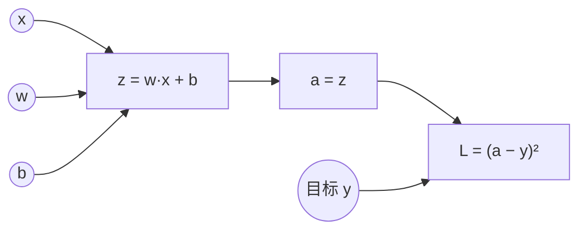
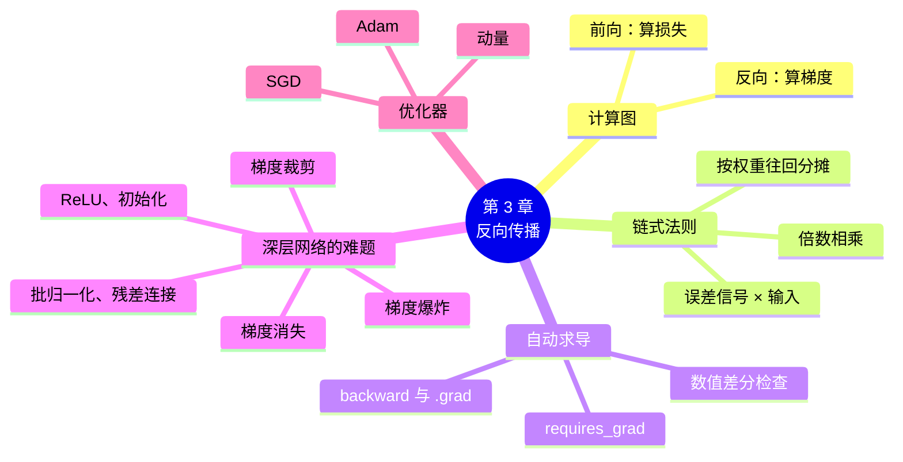

# 第 3 章 反向传播：误差怎么往回传

!!! abstract "本章学时"
    线上理论 2 学时 · 线下 1 学时 · 实验 1 学时（本章共 2 个实验，教师可任选）

## 学习目标

学完本章，你应该能够：

1. **说出**计算图、链式法则、反向传播、自动求导、梯度消失、梯度爆炸、优化器的含义（记忆）；
2. **解释**反向传播怎样把误差从输出一层层往回分摊，为什么深层网络容易出现梯度消失（理解）；
3. **计算**一个两步计算的导数和一个神经元的参数梯度，并用 PyTorch 的自动求导验证（应用）；
4. 根据每层梯度的大小**判断**网络是否出现梯度消失，并选择合适的对策（分析）；
5. **比较** SGD、动量、Adam 三种优化器的训练效果（评价）。

!!! info "先修要求"
    学习本章前，你需要掌握：

    - 本书第 2 章：梯度、梯度下降、训练五步（[2.2 怎么“变好”：梯度下降](../02-training/index.md#22)、[2.4 训练五步](../02-training/index.md#24)）；
    - 《人工智能数学基础》：知道“导数表示变化的快慢”，会求 x²、2x + 1 这类简单函数的导数。

    本章只用到两个求导规则：x² 的导数是 2x；a·x + b 对 x 的导数是 a。

??? abstract "本章概念清单（12 个，点击查看定义和例子）"
    1. [反向传播](../../appendix/glossary.md#g-反向传播)
    2. [计算图](../../appendix/glossary.md#g-计算图)
    3. [链式法则](../../appendix/glossary.md#g-链式法则)
    4. [自动求导](../../appendix/glossary.md#g-自动求导)
    5. [数值差分](../../appendix/glossary.md#g-数值差分)
    6. [梯度消失](../../appendix/glossary.md#g-梯度消失)
    7. [梯度爆炸](../../appendix/glossary.md#g-梯度爆炸)
    8. [批归一化](../../appendix/glossary.md#g-批归一化)
    9. [残差连接](../../appendix/glossary.md#g-残差连接)
    10. [梯度裁剪](../../appendix/glossary.md#g-梯度裁剪)
    11. [动量](../../appendix/glossary.md#g-动量)
    12. [Adam](../../appendix/glossary.md#g-Adam)

## 情景导入

一家连锁超市的季度销售额比目标少了 100 万元。总部要找出问题出在哪里：总部的结果来自三个大区，大区的结果又来自各自的门店，门店的结果又取决于每个店员。

聪明的做法不是一个个店员去查，而是**从结果往回推**：先看三个大区各差了多少；对差得多的大区，再看它下面每家门店差了多少；对差得多的门店，再看具体的环节。每往回推一层，就把“差额”按各自的影响大小分摊下去。推到最后，每个人都知道了自己该对多少差额负责、该往哪个方向改进。

神经网络的训练遇到的是同样的问题。网络的输出错了，损失是 2.3；网络里有十几万个参数，每个参数该对这 2.3 负多大的责任？该调大还是调小？第 2 章说“PyTorch 一行 `loss.backward()` 就能算出所有参数的梯度”，它用的正是“从结果往回推、层层分摊”的办法，叫作[**反向传播**](../../appendix/glossary.md#g-反向传播 "从输出层开始，按链式法则把损失的梯度一层层往回传、算出每个参数梯度的方法"){ .term }。

本章揭开这个黑箱，但不推公式：用一张流程图和两个计算器能算的小例子讲清楚原理，再看看网络很深时为什么会“推不回去”，以及工程师想出的对策。

## 3.1 计算图：把计算画成流程图

要往回推，先得知道“结果是怎么一步步算出来的”。[**计算图**](../../appendix/glossary.md#g-计算图 "把计算过程画成由运算节点和箭头组成的流程图，是自动求导的基础"){ .term }就是把一次计算画成流程图：每个方框是一个中间结果，箭头表示“谁由谁算出来”。

以第 2 章的一个神经元为例：输入 x，参数 w、b，先算 z = w·x + b，再算预测值 a（这里先不加激活函数，a = z），最后和目标 y 比较，算出损失 L = (a − y)²。



**前向传播**沿着箭头从左往右算：给定 x、w、b，一步步算出 z、a、L。**反向传播**逆着箭头从右往左算：从 L 出发，一步步算出“L 对每个中间结果、每个参数的导数”，也就是梯度。

PyTorch 在前向计算时会自动把这张图记下来。实验 3-1 中，打印 `y.grad_fn` 可以看到每个结果是由哪种运算得到的（如 `PowBackward0` 表示乘方，`AddBackward0` 表示加法），这就是 PyTorch 记下的计算图。

## 3.2 链式法则：齿轮传动

### 3.2.1 一个两步的算一算

先看最简单的情况：y = (2x + 1)²。把它拆成两步：

- 第一步：u = 2x + 1；
- 第二步：y = u²。

问：x 变化一点点，y 会变化多少（即 dy/dx 是多少）？

想象两个咬合的齿轮。x 转一圈，u 转 2 圈（因为 u = 2x + 1，u 对 x 的导数是 2）；u 转一圈，y 转 2u 圈（因为 y = u²，y 对 u 的导数是 2u）。那么 x 转一圈，y 转多少圈？**把两级的倍数乘起来**：2 × 2u。

这就是[**链式法则**](../../appendix/glossary.md#g-链式法则 "复合计算的变化率等于各步变化率相乘"){ .term }：一串计算的总导数，等于每一步导数的乘积。

\[
\frac{dy}{dx} = \frac{dy}{du} \times \frac{du}{dx}
\]

!!! example "算一算：x = 1 时的导数"
    前向：u = 2 × 1 + 1 = 3，y = 3² = 9。

    反向：dy/du = 2u = 6，du/dx = 2，所以 dy/dx = 6 × 2 = **12**。

    验证一下：x 从 1 增加到 1.001，u = 3.002，y = 9.012004，y 增加了约 0.012，是 x 增加量 0.001 的 12 倍。实验 3-1 中，PyTorch 自动求出的也是 12.0。

注意计算的顺序：先前向算出 u = 3，反向时才能算出 dy/du = 6。所以**反向传播一定在前向传播之后**，要用到前向时记下的中间结果。

### 3.2.2 一个神经元的梯度

回到 3.1 节的神经元：z = w·x + b，a = z，L = (a − y)²。设 w = 0.5、b = 0、x = 2、目标 y = 3。

**前向**：z = 0.5 × 2 + 0 = 1，a = 1，L = (1 − 3)² = 4。

**反向**，从 L 往回，每一步乘上这一步的“倍数”：

| 往回推到 | 这一步的倍数 | 梯度（损失对它的导数） |
|---|---|---|
| a | L = (a − y)² 对 a 的导数：2(a − y) = 2 × (1 − 3) = −4 | dL/da = −4 |
| z | a = z，倍数是 1 | dL/dz = −4 × 1 = −4 |
| w | z = w·x + b 对 w 的导数是 x = 2 | dL/dw = −4 × 2 = **−8** |
| b | z = w·x + b 对 b 的导数是 1 | dL/db = −4 × 1 = **−4** |

两个梯度都是负数，说明把 w、b 调大，损失会变小。按梯度下降更新一步（学习率 0.05）：w = 0.5 − 0.05 × (−8) = 0.9，b = 0 − 0.05 × (−4) = 0.2。再算一次前向：a = 0.9 × 2 + 0.2 = 2.0，损失 = (2 − 3)² = 1，从 4 降到了 1。

这张表里藏着一个好记的规律：**参数的梯度 = 传到这里的误差信号 × 这个参数连接的输入**。w 连着输入 x = 2，所以 w 的梯度是误差信号 −4 的 2 倍；b 相当于连着一个永远等于 1 的输入，所以 b 的梯度就等于误差信号。输入越大，这个参数对结果的影响越大，分到的“责任”也越大，这就是“按影响大小分摊”的意思。

<iframe class="sim-frame" src="../../sims/backprop-flow/main.html" height="640" loading="lazy" title="误差往回传"></iframe>

动画：一个神经元的计算图。先前向算出损失，再反向把梯度一步步传回来，然后更新一步，看损失怎样变小。默认数值就是本节的例子。[全屏打开](../../sims/backprop-flow/main.html){ target=_blank }
{ .sim-caption }

### 3.2.3 多层网络：误差一层层往回分摊

多层网络的道理完全一样，只是链条更长：

1. 从损失出发，算出输出层的误差信号；
2. 输出层每个参数的梯度 = 误差信号 × 它连接的输入（也就是上一层的输出）；
3. 把误差信号按**连接的权重**分摊给上一层的每个神经元：权重越大，说明这个神经元对输出的影响越大，分到的误差也越多；
4. 每个隐藏神经元收到误差后，还要乘上自己激活函数的“倍数”（ReLU 在 z > 0 时是 1，z ≤ 0 时是 0；Sigmoid 是 a(1 − a)，最大 0.25）；
5. 重复第 2～4 步，直到第一层。

这样，只需要从后往前“走一遍”，就能算出所有参数的梯度，计算量和前向传播差不多。这个高效的方法在 1986 年由鲁梅尔哈特（Rumelhart）、辛顿（Hinton）等人的论文推广开来，此后成为训练神经网络的标准方法。<sup class="cite">[[4]](#ref3-4)</sup>

??? note "选读：手算第 1 章示范例题网络的全部梯度（点击展开）"
    第 1 章 1.6 节的 2-2-1 网络，输入 x = (1, 2)，前向算得隐藏层输出 h = (0.2, 0.4)，网络输出 y = Sigmoid(0.3) ≈ 0.5744。设目标为 1，损失用均方误差 L = (y − 1)² ≈ 0.1811。

    **输出层**：dL/dy = 2(y − 1) ≈ −0.8512；Sigmoid 的倍数 y(1 − y) ≈ 0.5744 × 0.4256 ≈ 0.2445；输出层的误差信号 δ ≈ −0.8512 × 0.2445 ≈ −0.2081。

    - 输出层偏置的梯度 = δ ≈ −0.2081；
    - 输出层两个权重的梯度 = δ × h = −0.2081 × 0.2 ≈ −0.0416，−0.2081 × 0.4 ≈ −0.0832。

    **隐藏层**：把 δ 按输出层权重 (1.0, −0.5) 分摊：h₁ 分到 −0.2081 × 1.0 = −0.2081，h₂ 分到 −0.2081 × (−0.5) ≈ 0.1040。两个隐藏神经元的 z 都大于 0，ReLU 的倍数都是 1。

    - h₁ 的两个权重：−0.2081 × 1 ≈ −0.2081，−0.2081 × 2 ≈ −0.4161；偏置 −0.2081；
    - h₂ 的两个权重：0.1040 × 1 ≈ 0.1040，0.1040 × 2 ≈ 0.2081；偏置 0.1040。

    实验 3-1 第③部分用 PyTorch 求出的 9 个梯度与这里一一对应（例如隐藏层权重 −0.208062、−0.416124、0.104031、0.208062）。会用自动求导之后，这样的手算只需要做一次，体会过程即可。

!!! cert "证书考点"
    人工智能应用工程师（高级）“神经网络与深度学习”考反向传播的基本思想：前向计算损失、反向用链式法则求梯度、再用梯度下降更新参数。一般不要求推导公式，常见题型是“反向传播的作用是什么”“链式法则的含义”（详见[证书考点对照](../../certificate.md)）。

## 3.3 自动求导：让 PyTorch 替你求梯度 { #33 }

几十万个参数的网络，手算梯度是不可能的。深度学习框架最重要的能力之一就是[**自动求导**](../../appendix/glossary.md#g-自动求导 "框架记录计算图后自动按链式法则计算梯度的功能"){ .term }：你只管写前向计算，框架在背后记下计算图，调用 `backward()` 时按链式法则自动算出所有梯度。

用法只有三步：

```python
x = torch.tensor(1.0, requires_grad=True)   # 1. 告诉 PyTorch：要为 x 求梯度
y = (2 * x + 1) ** 2                         # 2. 正常写前向计算
y.backward()                                 # 3. 从 y 出发反向传播
print(x.grad)                                # tensor(12.)
```

在网络中，`nn.Linear` 等层的权重和偏置在创建时就已经设置了 `requires_grad=True`，所以训练五步里只需要 `loss.backward()`，所有参数的 `.grad` 就都有了，接着 `optimizer.step()` 用它们更新参数。

关于自动求导，有三点要记住：

1. **只能从一个数出发反向传播**。`backward()` 要从损失这样的单个数开始，所以损失总是一批样本的平均值。
2. **梯度会累加**。连续调用两次 `backward()`，`.grad` 里是两次梯度之和，所以每批训练前要清梯度（第 2 章训练五步的第③步）。
3. **不需要梯度时要关掉**。评估、预测时写 `with torch.no_grad():`，PyTorch 就不记计算图，省内存、算得快。

怎样确认自动求导算得对？可以用“笨办法”检查：把一个参数加上一个很小的数 ε，算一次损失；再减去 ε，再算一次；两次损失之差除以 2ε，就近似等于这个参数的梯度。这种方法叫[**数值差分**](../../appendix/glossary.md#g-数值差分 "把参数改动一点点，看损失变化多少来估计梯度的方法，常用来核对梯度"){ .term }，每个参数要算两次前向，太慢，不能用来训练，但很适合检查。实验 3-1 中，两种方法对 9 个参数算出的梯度，最大差别只有 3.0 × 10⁻¹¹。

## 3.4 深层网络的难题：梯度消失与梯度爆炸

### 3.4.1 链条越长，问题越大

链式法则说，梯度是一串“倍数”的乘积。网络越深，链条越长，乘的数越多。这会带来两个问题：

- 如果每一步的倍数都**小于 1**，乘很多次后会变得极小。比如 Sigmoid 的倍数最大只有 0.25，10 层就是 0.25¹⁰ ≈ 0.00000095。传到前面几层的梯度几乎为 0，这几层的参数几乎不更新，网络“学不动”。这叫[**梯度消失**](../../appendix/glossary.md#g-梯度消失 "梯度往回传时一层层变小，前面的层几乎学不动的现象"){ .term }。
- 如果每一步的倍数都**大于 1**，乘很多次后会变得极大，参数一更新就“飞”出去，损失变成 `nan`。这叫[**梯度爆炸**](../../appendix/glossary.md#g-梯度爆炸 "梯度往回传时一层层变大，导致参数剧烈跳动、损失变成 nan 的现象"){ .term }。

实验 3-2 搭了一个 10 层的全连接网络，喂入同一批手写数字，测得每一层权重梯度的平均大小：

| 网络 | 第 1 层 | 第 5 层 | 第 10 层 | 第 1 层 ÷ 第 10 层 | 训练 2 轮后的测试准确率 |
|---|---|---|---|---|---|
| Sigmoid | 7.36 × 10⁻¹¹ | 3.83 × 10⁻⁷ | 1.69 × 10⁻² | 4.4 × 10⁻⁹ | 11.35% |
| ReLU（默认初始化） | 5.81 × 10⁻⁷ | 2.24 × 10⁻⁶ | 7.53 × 10⁻⁴ | 7.7 × 10⁻⁴ | 11.35% |
| ReLU + 何恺明初始化 | 3.26 × 10⁻³ | 3.89 × 10⁻³ | 8.34 × 10⁻³ | 0.39 | 90.64% |
| ReLU + 批归一化 | 2.76 × 10⁻² | 1.78 × 10⁻² | 2.14 × 10⁻² | 1.3 | 94.77% |

Sigmoid 网络第 1 层的梯度只有第 10 层的十亿分之四，训练 2 轮后准确率 11.35%，等于在瞎猜。把 Sigmoid 换成 ReLU 有改善，但光换激活函数还不够；再配上合适的初始化或批归一化，梯度在各层就差不多大了，网络很快学会。

### 3.4.2 四个对策

工程师为深层网络想出了一系列办法，本书只要求知道“它们解决什么问题、怎么用”：

| 对策 | 怎么做 | 为什么有效 | PyTorch 写法 |
|---|---|---|---|
| 用 **ReLU** 代替 Sigmoid | 隐藏层激活函数换成 ReLU | ReLU 在 z > 0 时倍数是 1，不会一层层缩小 | `nn.ReLU()` |
| 合适的初始化 | 按层的大小设定初始权重的范围（如何恺明初始化）<sup class="cite">[[6]](#ref3-6)</sup> | 让每层输出和梯度的大小一开始就差不多 | `nn.init.kaiming_normal_(…)` |
| [**批归一化**](../../appendix/glossary.md#g-批归一化 "把每层的输出按一批数据调整为平均值 0、标准差 1 左右，再往下传"){ .term } | 每层输出先调整成平均值 0、标准差 1 左右，再往下传<sup class="cite">[[7]](#ref3-7)</sup> | 不管前面怎么变，每层收到的数都在合适的范围 | `nn.BatchNorm1d(…)`、`nn.BatchNorm2d(…)` |
| [**残差连接**](../../appendix/glossary.md#g-残差连接 "让输入“抄近路”直接加到几层之后的输出上，使梯度能直接传回前面"){ .term } | 让输入“抄近路”直接加到几层之后的输出上<sup class="cite">[[8]](#ref3-8)</sup> | 梯度可以沿近路直接传回前面，不必经过每一层的连乘 | 在第 5 章 ResNet 中介绍 |

对付梯度爆炸，最直接的办法是[**梯度裁剪**](../../appendix/glossary.md#g-梯度裁剪 "梯度太大时把它按比例缩小到规定范围内，防止梯度爆炸"){ .term }：反向传播之后、更新参数之前，检查梯度的总大小，超过一个上限就按比例缩小。写法是在 `loss.backward()` 和 `optimizer.step()` 之间加一行 `torch.nn.utils.clip_grad_norm_(model.parameters(), max_norm=1.0)`。第 6 章的循环神经网络容易梯度爆炸，会用到它。

!!! tip "残差连接为什么重要"
    2015 年，何恺明等人用残差连接训练出了 152 层的网络 ResNet，在 ImageNet 图像识别比赛中夺冠。今天的大语言模型（Transformer）每一层也都有残差连接。可以说，没有残差连接，就没有今天动辄几十上百层的深度网络。

## 3.5 优化器：三种下山方式 { #35 }

梯度只告诉我们“往哪边下坡”，**优化器**决定“具体怎么走”。第 2 章用的是最朴素的 SGD，下面介绍两种改进。

**SGD**（随机梯度下降）：每一步严格按当前这一批的梯度走，步长 = 学习率 × 梯度。缺点是小批量的梯度有噪声，路线左摇右摆；遇到又窄又长的山谷，会在两侧山壁之间来回撞，前进很慢。

[**动量**](../../appendix/glossary.md#g-动量 "更新参数时保留一部分上一次的方向，像下坡时的惯性，减少来回摆动"){ .term }（Momentum）：像一个从山上滚下来的球，每一步不只看当前的坡度，还保留上一步的“冲劲”。方向一致时越滚越快；方向来回变时，冲劲互相抵消，摇摆变小。PyTorch 写法是在 SGD 里加 `momentum=0.9`，意思是每一步保留上一步 90% 的速度。

[**Adam**](../../appendix/glossary.md#g-Adam "结合动量和自适应学习率的优化器，是最常用的默认选择"){ .term }：在动量的基础上，再给每个参数**单独调整步长**：一直梯度很大的参数，步子自动迈小一点；一直梯度很小的参数，步子自动迈大一点。<sup class="cite">[[5]](#ref3-5)</sup> Adam 对学习率不太敏感，默认的 0.001 在大多数任务上都能用，是目前最常用的优化器。

实验 3-2 用同一个 3 层网络比较三者，各训练 2 轮：

| 优化器 | 学习率 | 最后一轮训练损失 | 测试准确率 |
|---|---|---|---|
| SGD | 0.01 | 1.8407 | 69.35% |
| SGD + 动量 0.9 | 0.01 | 0.3282 | 91.94% |
| Adam | 0.001 | 0.2226 | 94.34% |

同样的学习率 0.01，加了动量后准确率从 69% 提高到 92%；Adam 用更小的学习率，效果最好。

!!! tip "怎么选优化器"
    初学时**默认用 Adam，学习率 0.001**。如果效果已经很好，就不必再换；如果是大规模图像任务，很多经典论文用的是“SGD + 动量”，可以照着论文的设置。改用 Adam 只需改一行：`optimizer = torch.optim.Adam(model.parameters(), lr=0.001)`。

## 3.6 示范例题

**例题** 设 y = (3x − 2)²。（1）用链式法则手算 x = 1 时的 dy/dx；（2）写出用 PyTorch 自动求导验证的代码；（3）如果 x 是一个参数、y 是损失，学习率 0.1，更新一步后 x 是多少？损失变成多少？

**解题思路**：拆成两步 u = 3x − 2、y = u²，前向算出 u，反向把两步的倍数相乘。

**第 1 步：前向**。u = 3 × 1 − 2 = 1，y = 1² = 1。

**第 2 步：反向**。dy/du = 2u = 2；du/dx = 3；dy/dx = 2 × 3 = **6**。

**第 3 步：PyTorch 验证**

```python
x = torch.tensor(1.0, requires_grad=True)
y = (3 * x - 2) ** 2
y.backward()
print(x.grad)          # tensor(6.)
```

**第 4 步：更新一步**。x = 1 − 0.1 × 6 = 0.4；u = 3 × 0.4 − 2 = −0.8，y = 0.64。损失从 1 降到 0.64。

**答**：dy/dx = 6；更新后 x = 0.4，损失 0.64。

**举一反三**：y = (3x − 2)² 在 x = 2/3 时最小（等于 0）。从 x = 1 出发，梯度为正，所以 x 往小的方向走，这正是梯度下降“朝梯度反方向走”的意思。

## 3.7 前沿视窗

**大模型训练中的“稳”字诀**。训练一个几百亿参数的大模型要花几周，中途一旦出现梯度爆炸，损失突然变成 `nan`，前面的算力就白费了。所以大模型训练普遍使用三项本章提到的技术：每一层都有残差连接；用一种叫“层归一化”的方法（与批归一化类似，但按每个样本自己归一化）；每一步都做梯度裁剪。工程师还会实时监控“梯度的总大小”这条曲线，一旦出现尖峰，就回退到之前的存档、跳过有问题的数据重新训练。

**混合精度训练**。普通的计算用 32 位小数，大模型训练改用 16 位甚至 8 位小数来存放和计算大部分数据，显存省一半以上、速度快一倍以上。代价是 16 位小数能表示的范围小，很小的梯度会直接变成 0（又一种“梯度消失”）。解决办法是先把损失放大若干倍再反向传播，更新前再缩小回来。PyTorch 用 `torch.autocast` 和 `torch.amp.GradScaler` 实现，在 GPU 上训练时可以试一试。

## 本章实验

!!! abstract "实验总览"
    | 实验 | 类型 | 建议时长 | 内容 |
    |---|---|---|---|
    | 实验 3-1 | ★ 基础 | 45 分钟 | 用自动求导求两步计算、一个神经元、2-2-1 小网络的梯度，与手算和数值差分对照 |
    | 实验 3-2 | ☆ 拓展 | 30 分钟 | 10 层网络中测量每层的梯度，比较 Sigmoid、ReLU、初始化、批归一化；比较 SGD、动量、Adam 三种优化器 |

    两个实验都在本机 CPU 上运行：实验 3-1 不到 1 秒，实验 3-2 约 10 秒。代码见配套资源 `labs/ch03/` 目录。

### 实验 3-1 ★ 用自动求导求梯度，并和手算结果对照 { #3-1 }

**实验目的**

1. 学会 `requires_grad`、`backward()`、`.grad` 的用法；
2. 用自动求导验证 3.2 节的两个手算结果；
3. 用数值差分检查自动求导的结果，体会两种方法的区别。

**实验环境**：本机 CPU，Python 3.11，PyTorch。

**实验数据**：写在代码里的几个数，与 3.2 节和第 1 章 1.6 节相同。

**实验步骤与代码**

第 1 步，两步计算 y = (2x + 1)²：

```python
x = torch.tensor(1.0, requires_grad=True)
u = 2 * x + 1
y = u ** 2
y.backward()
print(x.grad)                              # 12.0
print(y.grad_fn.name(), u.grad_fn.name())  # 看 PyTorch 记下的计算图
```

第 2 步，一个神经元的梯度：w = 0.5、b = 0、x = 2、目标 3，算 L = (w·x + b − 3)² 对 w、b 的梯度。

第 3 步，把第 1 章的 2-2-1 网络参数填进去，目标设为 1，用 `nn.MSELoss()` 算损失，`backward()` 后逐个读出 9 个参数的 `.grad`；再对每个参数做数值差分：

```python
for name, p in net.named_parameters():
    for idx in range(p.numel()):
        with torch.no_grad():
            flat = p.view(-1)
            old = flat[idx].item()
            flat[idx] = old + eps;  up = compute_loss().item()     # 参数加一点点
            flat[idx] = old - eps;  down = compute_loss().item()   # 参数减一点点
            flat[idx] = old                                         # 恢复原值
        num = (up - down) / (2 * eps)                               # 数值差分
```

为了让数值差分足够准，这一步把网络转成了双精度小数（`.double()`）。

完整代码见 `lab3_1_autograd.py`。

**运行结果**

```text
① y = (2x + 1)²，x = 1
  前向：u = 3.0，y = 9.0
  自动求导 dy/dx = 12.0（手算：2u × 2 = 2 × 3 × 2 = 12）
  看看计算图：y 由 PowBackward0 得到，u 由 AddBackward0 得到

② 一个神经元：a = w·x + b，L = (a − y)²，w = 0.5，b = 0，x = 2，y = 3
  前向：a = 1.0，L = 4.0
  自动求导：dL/dw = -8.0，dL/db = -4.0（手算：−8 和 −4）

③ 2-2-1 小网络：输出 0.5744，目标 1，损失（均方误差）0.1811
  参数                       自动求导        数值差分        差别
  隐藏层权重[0]                 -0.208062       -0.208062    3.0e-11
  隐藏层权重[1]                 -0.416124       -0.416124    1.0e-11
  隐藏层权重[2]                  0.104031        0.104031    9.1e-13
  隐藏层权重[3]                  0.208062        0.208062    3.0e-11
  隐藏层偏置[0]                 -0.208062       -0.208062    3.0e-11
  隐藏层偏置[1]                  0.104031        0.104031    9.1e-13
  输出层权重[0]                 -0.041612       -0.041612    2.5e-11
  输出层权重[1]                 -0.083225       -0.083225    1.2e-11
  输出层偏置[0]                 -0.208062       -0.208062    3.0e-11
  最大差别 3.0e-11：两种方法一致，说明自动求导算对了
```

几点解读：

- ①②与 3.2 节的手算完全一致。
- ③中隐藏层权重的顺序是：[0]、[1] 是 h₁ 的两个权重，[2]、[3] 是 h₂ 的两个权重。和 3.2.3 节选读的手算结果一一对应。
- 输出层权重的梯度（−0.04、−0.08）比隐藏层的小，是因为它们连接的输入 h = (0.2, 0.4) 比较小；隐藏层权重连接的输入 x = (1, 2) 比较大。这正是“梯度 = 误差信号 × 连接的输入”。
- 数值差分要对 9 个参数各算 2 次前向，共 18 次；自动求导只要 1 次前向加 1 次反向。参数有十几万个时，差别就是“几秒”和“几天”。

**实验记录表**

| 项目 | 手算结果 | 自动求导结果 |
|---|---|---|
| y = (2x + 1)² 在 x = 1 处的导数 | | |
| 神经元的 dL/dw、dL/db | | |
| 2-2-1 网络输出层偏置的梯度 | | |
| 数值差分与自动求导的最大差别 | — | |

**常见问题排查**

| 现象 | 原因 | 解决办法 |
|---|---|---|
| `x.grad` 是 `None` | 创建 x 时没写 `requires_grad=True`，或者还没调用 `backward()` | 检查这两处 |
| `RuntimeError: grad can be implicitly created only for scalar outputs` | 对一个含多个数的张量调用了 `backward()` | 先求平均或求和，变成一个数再反向传播 |
| 第二次运行 `backward()` 报错 `Trying to backward through the graph a second time` | 计算图用过一次就释放了 | 重新做一次前向计算，再反向传播 |
| 数值差分和自动求导差别有 10⁻⁴ 那么大 | 用了单精度小数，ε 太小时误差大 | 像代码中那样用 `.double()` 转成双精度 |

**思考与练习**

1. 不清梯度，连续对同一个 y 做两次前向和反向，`x.grad` 是多少？为什么？
2. 把 2-2-1 网络的输入改成 x = (0, 2)，h₁ 的 z 变为负数。这时 h₁ 的两个权重的梯度是多少？用 ReLU 的倍数解释原因。

**实验报告要求**

提交运行结果，填写记录表；用“误差信号 × 连接的输入”解释为什么输出层权重的梯度比隐藏层权重的小（不超过 150 字）。

### 实验 3-2 ☆ 深层网络里看梯度消失，再比一比三种优化器 { #3-2 }

**实验目的**

1. 测量 10 层网络每一层的梯度大小，亲眼看到梯度消失；
2. 验证 ReLU、合适的初始化、批归一化对梯度消失的缓解作用；
3. 比较 SGD、动量、Adam 三种优化器的训练效果。

**实验环境**：本机 CPU，Python 3.11，PyTorch、torchvision。

**实验数据**：MNIST 训练集的前 2 万张，测试集 1 万张。

**实验步骤与代码**

第 1 步，写一个函数，按参数搭出“10 层、每层 64 个神经元”的网络，可选激活函数、何恺明初始化和批归一化：

```python
def deep_net(act, depth=10, width=64, he_init=False, batch_norm=False):
    layers, n_in = [nn.Flatten()], 784
    for _ in range(depth - 1):
        layers.append(nn.Linear(n_in, width))
        if batch_norm:
            layers.append(nn.BatchNorm1d(width))
        layers.append(act())
        n_in = width
    layers.append(nn.Linear(n_in, 10))
    ...
```

第 2 步，四个网络各喂入同一批 64 张图片，算一次损失、反向传播一次，读出每个 `nn.Linear` 层权重梯度的平均大小：

```python
grads = [m.weight.grad.abs().mean().item() for m in model if isinstance(m, nn.Linear)]
```

第 3 步，四个网络各用 SGD（学习率 0.1）训练 2 轮，看测试准确率。

第 4 步，同一个 3 层网络分别用 SGD、SGD + 动量、Adam 训练 2 轮：

```python
opt = torch.optim.SGD(model.parameters(), lr=0.01)
opt = torch.optim.SGD(model.parameters(), lr=0.01, momentum=0.9)
opt = torch.optim.Adam(model.parameters(), lr=0.001)
```

完整代码见 `lab3_2_vanishing_optim.py`。

**运行结果**

```text
① 10 层网络，同一批 64 张图片，每一层权重梯度的平均大小
  Sigmoid：第 1 层 7.36e-11，第 5 层 3.83e-07，第 10 层 1.69e-02，第 1 层只有第 10 层的 4.4e-09 倍
  ReLU：第 1 层 5.81e-07，第 5 层 2.24e-06，第 10 层 7.53e-04，第 1 层只有第 10 层的 7.7e-04 倍
  ReLU + 何恺明初始化：第 1 层 3.26e-03，第 5 层 3.89e-03，第 10 层 8.34e-03，第 1 层只有第 10 层的 3.9e-01 倍
  ReLU + 批归一化：第 1 层 2.76e-02，第 5 层 1.78e-02，第 10 层 2.14e-02，第 1 层只有第 10 层的 1.3e+00 倍

② 四个 10 层网络各训练 2 轮（SGD，学习率 0.1）
  Sigmoid：最后一轮训练损失 2.3075，测试准确率 0.1135
  ReLU：最后一轮训练损失 2.3012，测试准确率 0.1135
  ReLU + 何恺明初始化：最后一轮训练损失 0.3035，测试准确率 0.9064
  ReLU + 批归一化：最后一轮训练损失 0.2545，测试准确率 0.9477

③ 3 层网络（784 → 128 → 128 → 10，ReLU），三种优化器各训练 2 轮
  SGD      ：最后一轮训练损失 1.8407，测试准确率 0.6935
  SGD + 动量 ：最后一轮训练损失 0.3282，测试准确率 0.9194
  Adam     ：最后一轮训练损失 0.2226，测试准确率 0.9434
```

几点解读：

- `7.36e-11` 是科学计数法，表示 7.36 × 10⁻¹¹。Sigmoid 网络从第 10 层到第 1 层，梯度缩小了约 2 亿倍。
- 默认初始化的 ReLU 网络梯度也在逐层缩小，训练 2 轮后损失仍是 2.30（瞎猜水平）。PyTorch 的默认初始化对浅层网络够用，对 10 层 ReLU 网络偏小。
- 加了何恺明初始化或批归一化后，各层梯度大小相近，训练正常。批归一化的效果最好，也是实际中最常用的。
- 3 层网络本身不深，三种优化器都能学，但收敛速度差别很大。
- 测试准确率 0.1135 恰好是测试集中数字“1”所占的比例：网络“学坏了”时，往往把所有图片都猜成同一个数字。

**实验记录表**

| 网络 / 优化器 | 第 1 层梯度 | 第 10 层梯度 | 测试准确率 | 是否出现梯度消失 |
|---|---|---|---|---|
| Sigmoid | | | | |
| ReLU | | | | |
| ReLU + 何恺明初始化 | | | | |
| ReLU + 批归一化 | | | | |
| SGD | — | — | | — |
| SGD + 动量 | — | — | | — |
| Adam | — | — | | — |

**常见问题排查**

| 现象 | 原因 | 解决办法 |
|---|---|---|
| 批归一化网络评估时报错或结果怪异 | 评估前没有调用 `model.eval()` | 批归一化在训练和评估时行为不同，评估前必须 `model.eval()` |
| 梯度数值和书上略有差别 | 随机种子或版本不同 | 只比较各层之间的相对大小 |

**思考与练习**

1. 把 Sigmoid 网络的层数从 10 改成 3，第 1 层的梯度变成多少？训练 2 轮的准确率呢？
2. 给 SGD + 动量把学习率提高到 0.05，能赶上 Adam 吗？

**实验报告要求**

提交运行结果，填写记录表；用实验数据说明“梯度消失”是什么现象、怎样缓解（不超过 200 字）。

## 本章小结

- **计算图**把计算画成流程图；前向沿箭头算出损失，**反向传播**逆着箭头算出梯度。
- **链式法则**：一串计算的总导数 = 每一步导数（倍数）的乘积，就像齿轮传动。
- 参数的梯度 = 传到这里的误差信号 × 这个参数连接的输入；误差按权重大小一层层往回分摊，经过激活函数时乘上它的倍数。
- **自动求导**：`requires_grad=True` + 前向计算 + `backward()`，梯度存在 `.grad` 里；梯度会累加，评估时用 `torch.no_grad()`。可以用数值差分检查。
- 网络很深时，连乘让梯度越来越小（**梯度消失**）或越来越大（**梯度爆炸**）。对策：**ReLU**、合适的初始化、**批归一化**、**残差连接**、**梯度裁剪**。
- **优化器**决定怎么走：SGD 最朴素；动量保留冲劲、减少摇摆；**Adam** 给每个参数自动调步长，默认学习率 0.001，最常用。



**本章自检**

- [ ] 我能画出 z = w·x + b、L = (z − y)² 的计算图，并说出前向、反向各沿什么方向。
- [ ] 我能用链式法则算出 y = (2x + 1)² 在 x = 1 处的导数。
- [ ] 我能写出用 PyTorch 求某个参数梯度的三行代码。
- [ ] 我能解释为什么 10 层 Sigmoid 网络很难训练，并说出至少两种对策。
- [ ] 我知道默认该用哪个优化器、学习率设多少。

**下一章预告**

到这里，你已经能把一个网络“训练起来”了。但训练损失变小，就说明网络学好了吗？如果一个网络把训练集里的每张图片都背了下来，换一批新图片就认不出来，那它其实并没有学会。下一章讨论“学得好”和“背得熟”的区别：怎样用验证集发现过拟合，怎样读懂训练曲线，以及 Dropout、数据增强、早停等让模型学得更好的办法。

## 参考文献

正文中的上标编号（如<sup class="cite">[[1]](#ref3-1)</sup>）对应下面的文献。

<div class="refs" markdown>

**教材与专著**

- <span id="ref3-1"></span>[1] 邱锡鹏. 神经网络与深度学习[M]. 北京: 机械工业出版社, 2020. https://nndl.github.io/.
    <span class="ref-note">第 4 章“前馈神经网络”讲反向传播与自动微分，第 7 章“网络优化与正则化”讲优化器、参数初始化和归一化，对应 3.2～3.5 节。</span>
- <span id="ref3-2"></span>[2] 阿斯顿·张, 李沐, 扎卡里·C. 立顿, 等. 动手学深度学习（PyTorch 版）[M]. 北京: 人民邮电出版社, 2023. https://zh.d2l.ai/.
    <span class="ref-note">“自动微分”“前向传播、反向传播和计算图”“数值稳定性和模型初始化”“优化算法”各节对应本章。</span>
- <span id="ref3-3"></span>[3] GOODFELLOW I, BENGIO Y, COURVILLE A. Deep learning[M]. Cambridge: MIT Press, 2016. https://www.deeplearningbook.org/.
    <span class="ref-note">第 6.5 节“反向传播和其他微分算法”系统讲解计算图与链式法则，第 8 章讲优化器，对应 3.1～3.3、3.5 节。</span>

**经典论文**

- <span id="ref3-4"></span>[4] RUMELHART D E, HINTON G E, WILLIAMS R J. Learning representations by back-propagating errors[J]. Nature, 1986, 323(6088): 533-536.
    <span class="ref-note">使反向传播算法广为人知的论文，对应 3.2.3 节。</span>
- <span id="ref3-5"></span>[5] KINGMA D P, BA J. Adam: a method for stochastic optimization[C]//3rd International Conference on Learning Representations. San Diego, 2015.
    <span class="ref-note">提出 Adam 优化器，对应 3.5 节。</span>
- <span id="ref3-6"></span>[6] HE K, ZHANG X, REN S, et al. Delving deep into rectifiers: surpassing human-level performance on ImageNet classification[C]//Proceedings of the IEEE International Conference on Computer Vision. Santiago: IEEE, 2015: 1026-1034.
    <span class="ref-note">提出适合 ReLU 网络的初始化方法（何恺明初始化），对应 3.4.2 节和实验 3-2。</span>
- <span id="ref3-7"></span>[7] IOFFE S, SZEGEDY C. Batch normalization: accelerating deep network training by reducing internal covariate shift[C]//Proceedings of the 32nd International Conference on Machine Learning. Lille: PMLR, 2015: 448-456.
    <span class="ref-note">提出批归一化，对应 3.4.2 节和实验 3-2。</span>
- <span id="ref3-8"></span>[8] HE K, ZHANG X, REN S, et al. Deep residual learning for image recognition[C]//Proceedings of the IEEE Conference on Computer Vision and Pattern Recognition. Las Vegas: IEEE, 2016: 770-778.
    <span class="ref-note">提出残差连接和 ResNet，对应 3.4.2 节，第 5 章还会介绍。</span>
- <span id="ref3-9"></span>[9] PASCANU R, MIKOLOV T, BENGIO Y. On the difficulty of training recurrent neural networks[C]//Proceedings of the 30th International Conference on Machine Learning. Atlanta: PMLR, 2013: 1310-1318.
    <span class="ref-note">分析梯度消失和梯度爆炸，提出梯度裁剪，对应 3.4 节。</span>
- <span id="ref3-10"></span>[10] MICIKEVICIUS P, NARANG S, ALBEN J, et al. Mixed precision training[C]//6th International Conference on Learning Representations. Vancouver, 2018.
    <span class="ref-note">提出混合精度训练和损失缩放，对应 3.7 节。</span>

**在线资源与工具**

- <span id="ref3-11"></span>[11] PyTorch. A gentle introduction to torch.autograd[EB/OL]. [2026-11-01]. https://pytorch.org/tutorials/beginner/blitz/autograd_tutorial.html.
    <span class="ref-note">PyTorch 官方的自动求导入门教程，对应 3.3 节和实验 3-1。</span>

</div>

## 课后练习

选择题和判断题可以直接点击选项作答，系统会马上告诉你对错，并展开答案与解析；多选题选好后点“提交答案”。简答和实操题请先自己作答，再点开“答案与解析”核对。

**一、单项选择题**

<div class="quiz" data-answer="B" markdown>

**1.** 反向传播的作用是（　　）。

- A. 从输入算到输出，得到预测值
- B. 从损失出发往回推，算出每个参数的梯度
- C. 直接把参数更新为最优值
- D. 把训练数据打乱顺序

</div>

??? tip "答案与解析"
    **答案：B**

    A 是前向传播；C 是优化器按梯度更新参数，而且只是“走一步”，不是一步到最优；D 是 DataLoader 的工作。

    考查：反向传播 · 认知层次：记忆 · [回看 3.1](#31)
    { .quiz-meta }

<div class="quiz" data-answer="C" markdown>

**2.** y = (2x + 1)²，x = 2 时 dy/dx 是（　　）。

- A. 5
- B. 10
- C. 20
- D. 25

</div>

??? tip "答案与解析"
    **答案：C**

    u = 2 × 2 + 1 = 5，dy/du = 2u = 10，du/dx = 2，dy/dx = 10 × 2 = 20。D 是 y 本身的值；B 漏乘了 du/dx。

    考查：链式法则 · 认知层次：应用 · [回看 3.2.1](#321)
    { .quiz-meta }

<div class="quiz" data-answer="A" markdown>

**3.** 一个神经元 z = w·x + b，损失 L = (z − y)²。若 w = 1、b = 0、x = 3、y = 1，则 dL/dw 是（　　）。

- A. 12
- B. 4
- C. 6
- D. −12

</div>

??? tip "答案与解析"
    **答案：A**

    z = 3，dL/dz = 2(3 − 1) = 4，dL/dw = 4 × x = 12。B 是 dL/dz（也等于 dL/db），忘了乘 x。

    考查：链式法则 · 认知层次：应用 · [回看 3.2.2](#322)
    { .quiz-meta }

<div class="quiz" data-answer="D" markdown>

**4.** 下列关于 PyTorch 自动求导的说法，错误的是（　　）。

- A. 需要求梯度的张量要设置 `requires_grad=True`
- B. 调用 `loss.backward()` 后，梯度保存在参数的 `.grad` 里
- C. 连续两次 `backward()`，梯度会累加
- D. 评估模型时也必须记录计算图，否则无法得到预测结果

</div>

??? tip "答案与解析"
    **答案：D**

    评估时不需要梯度，应写 `with torch.no_grad():` 关掉计算图记录，预测结果照样能得到，而且更省内存。

    考查：自动求导 · 认知层次：理解 · [回看 3.3](#33)
    { .quiz-meta }

<div class="quiz" data-answer="B" markdown>

**5.** Sigmoid 函数的导数最大值是 0.25。一个 10 层 Sigmoid 网络中，梯度从最后一层传到第一层，仅激活函数这一项最多被乘上约（　　）。

- A. 2.5
- B. 0.25¹⁰ ≈ 10⁻⁶
- C. 0.25 × 10
- D. 1

</div>

??? tip "答案与解析"
    **答案：B**

    链式法则是连乘，10 个不超过 0.25 的数相乘，最大约 9.5 × 10⁻⁷，这就是梯度消失的原因。

    考查：梯度消失 · 认知层次：理解 · [回看 3.4.1](#341)
    { .quiz-meta }

<div class="quiz" data-answer="C" markdown>

**6.** 训练循环神经网络时，损失突然变成 `nan`，在 `loss.backward()` 和 `optimizer.step()` 之间最适合加入的是（　　）。

- A. `model.eval()`
- B. `optimizer.zero_grad()`
- C. `torch.nn.utils.clip_grad_norm_(model.parameters(), max_norm=1.0)`
- D. `torch.no_grad()`

</div>

??? tip "答案与解析"
    **答案：C**

    损失变成 nan 多半是梯度爆炸，梯度裁剪把过大的梯度按比例缩小。B 若放在这里会把刚算好的梯度清掉。

    考查：梯度爆炸、梯度裁剪 · 认知层次：应用 · [回看 3.4.2](#342)
    { .quiz-meta }

<div class="quiz" data-answer="A" markdown>

**7.** 让输入“抄近路”直接加到几层之后的输出上，使梯度可以直接传回前面的层，这种结构叫（　　）。

- A. 残差连接
- B. 批归一化
- C. Dropout
- D. 全连接

</div>

??? tip "答案与解析"
    **答案：A**

    残差连接是 ResNet 的核心，大语言模型的每一层也有残差连接。

    考查：残差连接 · 认知层次：记忆 · [回看 3.4.2](#342)
    { .quiz-meta }

<div class="quiz" data-answer="D" markdown>

**8.** 初学者做一个新的分类任务，最推荐先用的优化器和学习率是（　　）。

- A. SGD，学习率 5.0
- B. SGD，学习率 0.0001
- C. Adam，学习率 1.0
- D. Adam，学习率 0.001

</div>

??? tip "答案与解析"
    **答案：D**

    Adam 对学习率不太敏感，0.001 在大多数任务上都能用。

    考查：优化器 · 认知层次：应用 · [回看 3.5](#35)
    { .quiz-meta }

**二、多项选择题**

<div class="quiz quiz-multi" data-answer="ABCD" markdown>

**9.** 下列哪些方法可以缓解深层网络的梯度消失？（　　）

- A. 隐藏层用 ReLU 代替 Sigmoid
- B. 使用适合 ReLU 的初始化方法
- C. 加入批归一化
- D. 加入残差连接

</div>

??? tip "答案与解析"
    **答案：ABCD**

    四种都是常用对策，实验 3-2 验证了 B、C 的效果。

    考查：梯度消失 · 认知层次：理解 · [回看 3.4.2](#342)
    { .quiz-meta }

<div class="quiz quiz-multi" data-answer="AC" markdown>

**10.** 关于优化器，下列说法正确的有（　　）。

- A. 动量让每一步保留上一步的冲劲，减少来回摇摆
- B. Adam 会让所有参数用完全相同的步长
- C. Adam 会根据每个参数梯度的大小自动调整它的步长
- D. 优化器负责计算梯度

</div>

??? tip "答案与解析"
    **答案：AC**

    Adam 的特点就是给每个参数单独调步长；梯度由反向传播（`backward()`）计算，优化器负责用梯度更新参数。

    考查：优化器 · 认知层次：理解 · [回看 3.5](#35)
    { .quiz-meta }

<div class="quiz quiz-multi" data-answer="BC" markdown>

**11.** 关于数值差分检查梯度，下列说法正确的有（　　）。

- A. 它比自动求导更快，适合用来训练大网络
- B. 它把参数加、减一个很小的数，用损失的变化近似梯度
- C. 它常用来检查自动求导或手写反向传播是否正确
- D. 它不需要做前向计算

</div>

??? tip "答案与解析"
    **答案：BC**

    每个参数要做两次前向计算，参数一多就极慢，只适合检查。

    考查：自动求导 · 认知层次：理解 · [回看 3.3](#33)
    { .quiz-meta }

**三、判断题**

<div class="quiz quiz-judge" data-answer="√" markdown>

**12.** 反向传播要用到前向传播时算出的中间结果，所以必须先做前向传播。

</div>

??? tip "答案与解析"
    **答案：√**

    例如算 dy/du = 2u 时需要知道前向算出的 u。

    考查：反向传播 · 认知层次：理解 · [回看 3.2.1](#321)
    { .quiz-meta }

<div class="quiz quiz-judge" data-answer="×" markdown>

**13.** 链式法则是把每一步的导数相加。

</div>

??? tip "答案与解析"
    **答案：×**

    是相乘，像齿轮传动一样，每一级的倍数乘起来。

    考查：链式法则 · 认知层次：记忆 · [回看 3.2.1](#321)
    { .quiz-meta }

<div class="quiz quiz-judge" data-answer="√" markdown>

**14.** 一个隐藏神经元用 ReLU 激活，如果它的加权和 z 小于 0，那么反向传播时与它相连的前一层权重收不到来自它的梯度。

</div>

??? tip "答案与解析"
    **答案：√**

    z < 0 时 ReLU 的倍数是 0，误差信号乘 0 后就传不过去了。

    考查：反向传播、ReLU · 认知层次：分析 · [回看 3.2.3](#323)
    { .quiz-meta }

<div class="quiz quiz-judge" data-answer="×" markdown>

**15.** 只要把激活函数从 Sigmoid 换成 ReLU，任何深度的网络都一定能训练好。

</div>

??? tip "答案与解析"
    **答案：×**

    实验 3-2 中，10 层 ReLU 网络用默认初始化，训练 2 轮仍在瞎猜；还需要合适的初始化或批归一化。

    考查：梯度消失 · 认知层次：评价 · [回看 3.4.1](#341)
    { .quiz-meta }

<div class="quiz quiz-judge" data-answer="√" markdown>

**16.** 梯度裁剪是在更新参数之前，把过大的梯度按比例缩小。

</div>

??? tip "答案与解析"
    **答案：√**

    它用来防止梯度爆炸。

    考查：梯度裁剪 · 认知层次：记忆 · [回看 3.4.2](#342)
    { .quiz-meta }

**四、简答题**

**17.** 用“从结果往回推、层层分摊”的思路，说明反向传播是怎样算出每个参数的梯度的。

??? tip "答案与解析"
    **参考答案**：先做前向传播，算出各层的中间结果和损失。然后从损失出发，算出输出层的误差信号；输出层每个参数的梯度等于误差信号乘以它连接的输入。再把误差信号按连接权重的大小分摊给上一层的每个神经元，经过激活函数时乘上它的倍数，得到上一层的误差信号，以此类推，一层层往回，直到第一层。这样只要从后往前走一遍，就得到了所有参数的梯度。

    评分要点：先前向 1 分；误差信号 × 输入 1 分；按权重分摊、乘激活函数倍数 1 分；逐层往回 1 分。

    考查：反向传播 · 认知层次：理解 · [回看 3.2.3](#323)
    { .quiz-meta }

**18.** 什么是梯度消失？它是怎样产生的？请列出两种缓解方法。

??? tip "答案与解析"
    **参考答案**：梯度消失是指深层网络中，越靠近输入的层梯度越小，几乎为 0，导致这些层的参数几乎不更新、网络学不动。原因是反向传播按链式法则连乘，每一层都乘上激活函数的倍数和权重，如果这些数大多小于 1（例如 Sigmoid 的倍数最大 0.25），层数一多，乘积就变得极小。缓解方法：用 ReLU 代替 Sigmoid；使用合适的初始化（如何恺明初始化）；加批归一化；加残差连接（任选两种）。

    考查：梯度消失 · 认知层次：理解 · [回看 3.4](#34)
    { .quiz-meta }

**五、实操题**

**19.** 设 L = (w·x + b − y)²，其中 x = 3、y = 10，初始 w = 1、b = 1。（1）手算 dL/dw 和 dL/db；（2）用 PyTorch 自动求导验证；（3）学习率 0.01，更新一步后损失是多少？

??? tip "答案与解析"
    **参考答案**：（1）前向 z = 3 + 1 = 4，L = 36；dL/dz = 2(4 − 10) = −12，dL/dw = −12 × 3 = −36，dL/db = −12。（2）关键代码：

    ```python
    w = torch.tensor(1.0, requires_grad=True)
    b = torch.tensor(1.0, requires_grad=True)
    loss = (w * 3 + b - 10) ** 2
    loss.backward()
    print(w.grad, b.grad)        # tensor(-36.) tensor(-12.)
    ```

    （3）w = 1 + 0.36 = 1.36，b = 1 + 0.12 = 1.12；z = 1.36 × 3 + 1.12 = 5.2，L = (5.2 − 10)² = 23.04，从 36 降到 23.04。

    考查：链式法则、自动求导 · 认知层次：应用 · [回看 3.6](#36)
    { .quiz-meta }

**20.** 修改实验 3-2 的 `deep_net`，把层数从 10 改为 20，比较“ReLU + 何恺明初始化”和“ReLU + 批归一化”两个网络第 1 层的梯度和训练 2 轮的准确率，写出你的结论。

??? tip "答案与解析"
    **参考思路**：把调用改为 `deep_net(act, depth=20, **kw)`，其余不变。层数加倍后，链条更长，可以观察第 1 层梯度与最后一层之比是否变小、准确率是否下降。一般来说，批归一化在更深的网络中更稳定；只靠初始化的网络对深度更敏感。结论要以你自己的运行结果为依据，写清楚两个网络各自的数据。

    考查：梯度消失、批归一化 · 认知层次：分析 · [回看实验 3-2](#3-2)
    { .quiz-meta }
