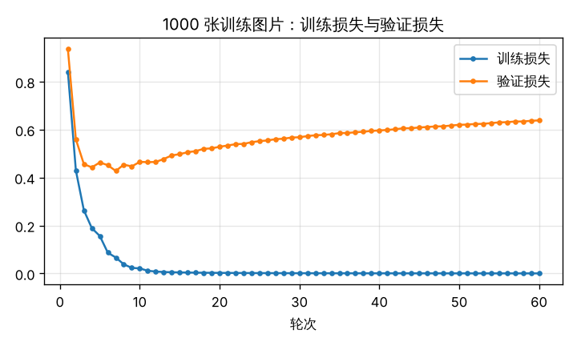
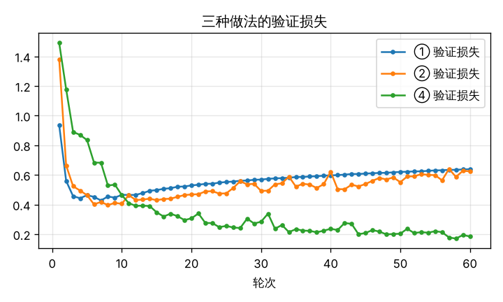
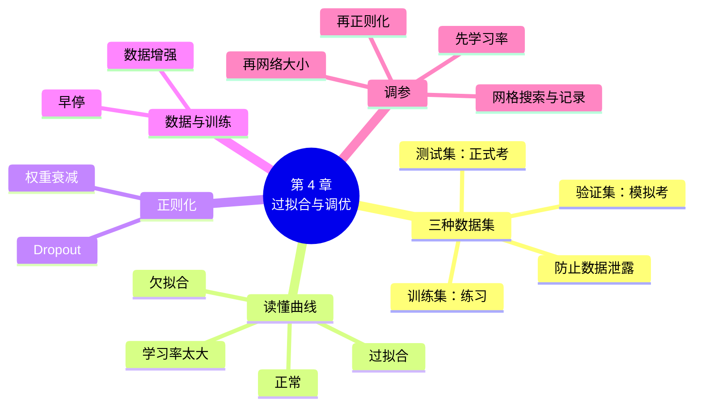

# 第 4 章 把模型训练好：过拟合与调优

!!! abstract "本章学时"
    线上理论 3 学时 · 线下 1 学时 · 实验 2 学时（本章共 3 个实验，教师可任选）

## 学习目标

学完本章，你应该能够：

1. **说出**泛化、过拟合、欠拟合、验证集、正则化、Dropout、权重衰减、数据增强、早停的含义（记忆）；
2. **解释**为什么要把数据分成训练集、验证集和测试集，各自的用途是什么（理解）；
3. 根据训练曲线**诊断**模型是欠拟合、过拟合、学习率太大还是正常，并给出改进办法（分析）；
4. 在 PyTorch 中**使用** Dropout、权重衰减、数据增强和早停（应用）；
5. 按合理的顺序**设计**一组调参实验，并用记录表选出最好的设置（评价）。

!!! info "先修要求"
    学习本章前，你需要掌握：

    - 本书第 2 章：训练五步、评估、超参数（[2.4 训练五步](../02-training/index.md#24)、[2.5 实战流程](../02-training/index.md#25)）；
    - 本书第 3 章：Adam 优化器（[3.5 优化器](../03-backprop/index.md#35)）；
    - 《机器学习》第 3 章学过“过拟合与欠拟合”“正则化”的，本章是同一思想在神经网络上的用法，可以对照着读。

??? abstract "本章概念清单（12 个，点击查看定义和例子）"
    1. [泛化](../../appendix/glossary.md#g-泛化)
    2. [训练集](../../appendix/glossary.md#g-训练集)
    3. [验证集](../../appendix/glossary.md#g-验证集)
    4. [测试集](../../appendix/glossary.md#g-测试集)
    5. [欠拟合](../../appendix/glossary.md#g-欠拟合)
    6. [过拟合](../../appendix/glossary.md#g-过拟合)
    7. [正则化](../../appendix/glossary.md#g-正则化)
    8. [Dropout](../../appendix/glossary.md#g-Dropout)
    9. [权重衰减](../../appendix/glossary.md#g-权重衰减)
    10. [数据增强](../../appendix/glossary.md#g-数据增强)
    11. [早停](../../appendix/glossary.md#g-早停)
    12. [网格搜索](../../appendix/glossary.md#g-网格搜索)

## 情景导入

小王准备考驾照科目一。他把题库里的 1000 道题刷了一遍又一遍，到后来每道题的答案都能脱口而出，模拟练习次次满分。可是正式考试时，题目换了一种问法，他就答不上来了，结果只考了 85 分，没有通过。

同宿舍的小李刷题没那么多遍，但他每做一道题都想一想“为什么”，再找新的题目检验自己是否真的懂了。他的练习成绩没有小王高，考试却轻松考了 96 分。

神经网络也会犯小王的错误。第 2 章的网络在训练集上越练越好，可是“练得好”不等于“学得会”。一个参数很多的网络，完全可能把训练集里的每张图片都“背”下来，换一张没见过的图片就认错。本章要回答三个问题：怎样发现网络在“死记硬背”？怎样让它学到真正的规律？那么多超参数，按什么顺序去调？

## 4.1 训练集、验证集、测试集：模型到底学得怎么样

### 4.1.1 泛化：在没见过的数据上也要表现好

模型在训练时没见过的新数据上表现好的能力，叫[**泛化**](../../appendix/glossary.md#g-泛化 "模型在训练时没见过的新数据上也表现好的能力"){ .term }能力。我们训练模型，最终是为了让它去处理新的数据：新拍的照片、新写的评论、新来的订单。所以，衡量模型好坏的标准，是它的**泛化能力**，而不是训练集上的成绩。

要知道模型的泛化能力，就必须用它没见过的数据来检验。为此，通常把手上的数据分成三份：

| 数据集 | 好比 | 用来做什么 | 一般占比 |
|---|---|---|---|
| [**训练集**](../../appendix/glossary.md#g-训练集 "用来计算损失和梯度、更新参数的数据"){ .term } | 平时的练习题 | 计算损失和梯度，更新参数 | 60%～80% |
| [**验证集**](../../appendix/glossary.md#g-验证集 "训练中用来比较超参数、决定何时停止的数据"){ .term } | 模拟考试 | 训练过程中检查泛化能力；比较不同的超参数，选出最好的一组；决定何时停止训练 | 10%～20% |
| [**测试集**](../../appendix/glossary.md#g-测试集 "一切选择做完后只用一次、报告最终成绩的数据"){ .term } | 正式考试 | 所有选择都做完以后，最后考一次，报告模型的最终成绩 | 10%～20% |

### 4.1.2 为什么需要验证集

第 2 章用测试集来观察训练效果。那为什么还要单独分出一个验证集？

因为调参的过程本身就是在“学习”。如果你试了 20 组超参数，每次都看测试集的成绩，最后挑出测试集成绩最好的一组，那么这组超参数就是“照着测试集挑出来的”，测试集的成绩会偏高，就像考前偷看了正式考卷。

正确的做法是：**所有的选择（选网络结构、选学习率、决定训练多少轮）都只看验证集**；测试集锁在抽屉里，等一切都定下来以后，才拿出来考一次。实验 4-3 就是这样做的：12 组超参数只比验证集，选出最好的一组后，才在测试集上考一次。

!!! warning "常见错误：数据泄露"
    测试集的信息以任何方式“漏”进了训练或选择过程，都叫数据泄露，会让报告的成绩虚高。常见的例子：用全部数据（包括测试集）计算归一化用的平均值；同一个人的多张照片同时出现在训练集和测试集里；反复看测试集成绩来调参。

!!! cert "证书考点"
    人工智能训练师（三级）“智能训练”模块要求“维护训练集与测试集”“撰写测试报告”；人工智能数据处理工程师（高级）考“数据集划分”。常见题型：三种数据集各自的用途，哪种做法会造成数据泄露（详见[证书考点对照](../../certificate.md)）。

## 4.2 过拟合与欠拟合：读懂训练曲线

### 4.2.1 两种“没学好”

- [**欠拟合**](../../appendix/glossary.md#g-欠拟合 "模型连训练集都没学好，训练和验证误差都高"){ .term }：模型连训练集都没学好，训练损失和验证损失都很高。好比学生连练习题都不会做。原因通常是模型太简单、训练轮数太少或学习率不合适。
- [**过拟合**](../../appendix/glossary.md#g-过拟合 "模型把训练集“背”下来，在新数据上表现变差"){ .term }：模型把训练集学得太好了，连其中的偶然细节和噪声都记住了，训练损失很低，验证损失却很高，甚至越训练越高。好比小王把题库背下来，换了问法就不会。原因通常是模型参数太多、训练数据太少、训练太久。

实验 4-1 故意制造了一个过拟合的场景：一个有 66.97 万个参数的网络，只用 1000 张手写数字图片训练 60 轮。

| 轮次 | 训练损失 | 验证损失 | 训练准确率 | 验证准确率 |
|---|---|---|---|---|
| 1 | 0.8409 | 0.9356 | 76.4% | 74.0% |
| 7（验证损失最低） | — | 0.4276 | — | 88.5% |
| 20 | 0.0023 | 0.5286 | 100.0% | 88.7% |
| 60 | 0.0002 | 0.6384 | 100.0% | 89.0% |

第 20 轮起，训练准确率已经是 100%，训练损失还在继续下降，验证损失却从第 7 轮的 0.43 一路上升到 0.64。网络已经开始“死记硬背”。

一个值得注意的细节是：验证损失上升了，验证准确率却几乎没变（88%～89%）。这是因为网络对它认错的那些图片越来越“自信”，正确答案的概率越来越小，交叉熵就越来越大。一个过度自信的模型，在实际使用中是危险的，所以**判断过拟合要看损失，不能只看准确率**。

### 4.2.2 四种典型的训练曲线

训练时把每一轮的训练损失和验证损失画在一张图上，叫**训练曲线**（也叫学习曲线）。学会读这张图，是调参的第一本领。

| 曲线的样子 | 诊断 | 改进办法 |
|---|---|---|
| 两条线都下降，最后都停在**较高**的位置，挨得很近 | 欠拟合 | 加大网络、多训练几轮、调大学习率 |
| 训练损失一直下降，验证损失**先降后升**，两条线越拉越开 | 过拟合 | 加数据或数据增强、Dropout、权重衰减、早停、减小网络 |
| 损失**剧烈跳动**、不降反升，甚至变成 `nan` | 学习率太大 | 学习率缩小到原来的 1/10 |
| 两条线都稳步下降，最后都很低，差距不大 | 正常 | 保持；可以尝试再多训练几轮 |

<iframe class="sim-frame" src="../../sims/curve-doctor/main.html" height="560" loading="lazy" title="训练曲线诊断器"></iframe>

动画：训练曲线诊断器。看四组真实的训练曲线，判断是哪种情况，再看“药方”。（曲线来自《人工智能开发框架技术》中花卉分类的实际训练记录，读图方法与本章完全相同。）[全屏打开](../../sims/curve-doctor/main.html){ target=_blank }
{ .sim-caption }

!!! tip "训练和验证差多少算过拟合"
    没有固定的标准。经验上，看两点：一是验证损失是否已经**开始上升**；二是训练和验证的准确率差距是否明显大于几个百分点。前者出现，就该考虑早停或正则化了。

## 4.3 正则化：Dropout 与权重衰减 { #43 }

所有用来减轻过拟合、提高泛化能力的方法，统称[**正则化**](../../appendix/glossary.md#g-正则化 "减轻过拟合的各种方法的统称"){ .term }。本节介绍两种直接加在网络上的方法。

### 4.3.1 Dropout：训练时随机让一些神经元休息 { #431 }

[**Dropout**](../../appendix/glossary.md#g-Dropout "训练时每一批随机让一部分神经元输出为 0 的正则化方法，也叫随机失活"){ .term } 的做法很简单：训练时，每一批数据都随机挑出一部分神经元（比如一半），让它们暂时“休息”，输出直接变成 0；下一批再重新随机挑选。<sup class="cite">[[5]](#ref4-5)</sup>

为什么这能减轻过拟合？打个比方：一个项目组里，如果每次开会都可能有一半人请假，那么每个人都不能只依赖某一个同事，必须自己也懂一些；整个团队不会把知识集中在少数几个人身上。网络也一样，任何一个神经元都可能缺席，网络就不能靠几个神经元“记住”某张训练图片，只能学习更普遍、更稳定的特征。

在 PyTorch 中，Dropout 是一个层，放在激活函数后面：

```python
model = nn.Sequential(
    nn.Flatten(),
    nn.Linear(784, 512), nn.ReLU(), nn.Dropout(0.5),   # 每次随机让 50% 的神经元休息
    nn.Linear(512, 512), nn.ReLU(), nn.Dropout(0.5),
    nn.Linear(512, 10),
)
```

!!! warning "一定要切换模式"
    Dropout 只在**训练**时起作用；评估和使用时，所有神经元都要上岗。`model.train()` 打开 Dropout，`model.eval()` 关掉 Dropout。忘了写 `model.eval()`，评估结果会忽高忽低。这就是第 2 章强调“养成切换模式习惯”的原因。

Dropout 的比例常用 0.2～0.5。比例越大，正则化越强，但训练也越慢。

### 4.3.2 权重衰减：不让权重长得太大

过拟合的网络，往往有一些权重变得很大，网络对输入的微小变化反应过度。[**权重衰减**](../../appendix/glossary.md#g-权重衰减 "每次更新时把权重往 0 的方向拉一点，让权重保持较小"){ .term }在每次更新时，把所有权重都往 0 的方向“拉”一点点，让权重保持较小，网络就更“平和”，不容易被个别样本带偏。

在 PyTorch 中，只需要给优化器加一个参数：

```python
optimizer = torch.optim.Adam(model.parameters(), lr=1e-3, weight_decay=1e-3)
```

`weight_decay` 越大，拉得越用力。常用 1e-5～1e-3。

你可能在其他资料里见过“L1 正则化”和“L2 正则化”，它们是往损失函数里加上“权重有多大”的惩罚项。权重衰减和 L2 正则化的效果基本相同；L1 正则化会让很多权重变成恰好为 0，在神经网络中用得较少。会用 `weight_decay` 这一个开关就够了。

## 4.4 数据增强与早停

### 4.4.1 数据增强：用旧数据“变”出新数据

过拟合的根本原因是数据太少、模型太大。最直接的办法是收集更多数据，但收集和标注数据很花钱。[**数据增强**](../../appendix/glossary.md#g-数据增强 "对训练样本做不改变答案的随机变换，“变”出更多训练数据"){ .term }是一种“免费”的办法：对训练图片做一些不改变答案的随机变换，比如轻微旋转、平移、缩放、翻转、调亮度，让网络每一轮看到的图片都略有不同。

一张“3”旋转 10 度、往左挪两个像素，仍然是“3”。网络看了很多这样的变体，就会明白“3 的关键是形状，而不是它在图里的确切位置”，这正是我们希望它学到的规律。

```python
from torchvision.transforms import v2
augment = v2.RandomAffine(degrees=10, translate=(0.1, 0.1))   # 随机旋转 ±10 度、平移最多 10%
...
xb = augment(xb)            # 训练时，每一批图片送进网络前先随机变换
```

!!! warning "增强要合理"
    变换不能改变正确答案。手写数字不能左右翻转（翻转后的“3”不再是 3），也不能旋转 180 度（6 会变成 9）；但猫的照片左右翻转仍然是猫。另外，**只对训练集做增强**，验证集和测试集保持原样。

实验 4-2 中，数据增强是效果最好的单项措施：验证准确率从 89.0% 提高到 94.3%，测试准确率从 90.06% 提高到 94.71%。

### 4.4.2 早停：在最好的时候停下来

从 4.2 节的表格可以看到，验证损失在第 7 轮最低，之后越训练越差。那么，干脆在验证损失不再下降的时候停下来，不就好了吗？这就是[**早停**](../../appendix/glossary.md#g-早停 "验证指标连续若干轮不再变好就停止训练，并恢复最好那一轮的参数"){ .term }。

具体做法：每一轮结束后，看一看验证损失有没有创新低；如果连续若干轮（这个轮数叫“耐心”）都没有创新低，就停止训练，并把参数恢复到验证损失最低的那一轮。

早停几乎不用改代码，又能节省大量训练时间，是最常用的做法之一。实验 4-2 中，耐心设为 5 轮时，训练在第 12 轮就停了，只用了 60 轮的五分之一的时间。但它的测试准确率（88.23%）反而比训练满 60 轮的（90.06%）略低：早停按验证**损失**选模型，而这个例子中验证损失最低时，准确率还没有到最高。这提醒我们：**早停该盯哪个指标，要看你最关心什么**；如果更关心准确率，可以改为盯验证准确率，或者把耐心设得大一些。

!!! tip "各种方法一起用"
    这些方法并不冲突，实际中常常组合使用。实验 4-2 中“Dropout + 数据增强 + 早停”的测试准确率为 94.82%，是所有做法中最高的。

## 4.5 调参的基本顺序

一个网络有很多超参数：学习率、批大小、网络层数和宽度、Dropout 比例、权重衰减、训练轮数……如果每个都试 5 个值，组合起来是天文数字。好在它们的重要性差别很大。一个实用的顺序是：

1. **先跑通**：用最简单的设置（Adam、学习率 0.001、批大小 64、一个中等大小的网络）训练几轮，确认损失在下降，代码没有错误。
2. **先调学习率**：它最重要。在 0.0001、0.001、0.01 三个数量级上各试一次，选验证效果最好的。
3. **再调网络大小**：欠拟合就加宽、加深；过拟合就先别急着减小网络，而是进入第 4 步。
4. **再加正则化**：数据增强、Dropout、权重衰减、早停，一项项加，每次只改一项，看验证集有没有变好。
5. **最后微调**：批大小、学习率的细节等。
6. **一切定下来以后**，才在测试集上考一次。

调参时要**每次只改一个地方**，并把每次实验的设置和结果都写进记录表。否则试了一下午，你会记不清哪个设置对应哪个结果。

| 编号 | 学习率 | 隐藏层 | Dropout | 其他改动 | 验证准确率 | 结论 |
|---|---|---|---|---|---|---|
| 1 | 0.001 | 512 | 0 | 基线 | 89.1% | 过拟合明显 |
| 2 | 0.001 | 512 | 0.5 | 加 Dropout | 89.7% | 略有改善 |
| 3 | … | … | … | … | … | … |

当超参数比较多时，可以让程序自动把各种组合都试一遍，这叫[**网格搜索**](../../appendix/glossary.md#g-网格搜索 "把几个超参数的候选值两两组合，逐一训练比较的调参方法"){ .term }。实验 4-3 用网格搜索试了 3 种学习率 × 2 种隐藏层大小 × 2 种 Dropout，共 12 组，在普通笔记本上只用了 16 秒。

## 4.6 示范例题

**例题** 某同学训练一个图片分类网络，记录如下（损失保留两位小数）：

| 轮次 | 1 | 5 | 10 | 15 | 20 | 25 | 30 |
|---|---|---|---|---|---|---|---|
| 训练损失 | 1.20 | 0.60 | 0.30 | 0.12 | 0.05 | 0.02 | 0.01 |
| 验证损失 | 1.25 | 0.70 | 0.55 | 0.58 | 0.66 | 0.75 | 0.83 |

（1）诊断模型的状态；（2）如果使用耐心为 10 轮的早停，训练会在第几轮停下？会使用哪一轮的参数？（3）给出三条改进建议。

**解题思路**：比较两条曲线的走势和差距，找验证损失的最低点。

**第 1 步：诊断**。训练损失一直下降到 0.01；验证损失在第 10 轮降到 0.55 后开始上升，第 30 轮达到 0.83，两条线越拉越开。这是典型的**过拟合**，从第 10 轮左右开始。

**第 2 步：早停**。只看表中这几轮（假设两次记录之间的轮次也一样没有创新低），验证损失最低在第 10 轮。耐心 10 轮，就是第 11～20 轮都没有创新低时停下，所以在**第 20 轮**停止，恢复**第 10 轮**的参数。

**第 3 步：建议**。①做数据增强，或者收集更多训练数据；②在隐藏层后加 Dropout（如 0.3～0.5）；③给优化器加权重衰减（如 1e-4）；④使用早停，避免训练过久。（任答三条即可）

**答**：模型从第 10 轮左右开始过拟合；早停在第 20 轮停下，使用第 10 轮的参数；改进建议见上。

**举一反三**：如果训练损失和验证损失在第 30 轮都停在 1.0 左右、几乎不再下降，就是**欠拟合**，应该加大网络、多训练或调整学习率，而不是加正则化。诊断错了，用错了药，问题会更严重。

## 4.7 前沿视窗

**自动调参工具**。网格搜索的组合数随超参数个数成倍增长。实际项目常用更聪明的自动调参工具，例如开源的 Optuna。它会根据前面几次实验的结果，推测哪片区域更有希望，优先去那里尝试；还能在训练中途发现某组设置明显不行时提前终止它，节省时间。国内的云平台（如百度智能云、阿里云 PAI）也提供自动调参服务。《机器学习》第 9 章用 Optuna 调过经典模型，用法可以直接迁移过来。

**大模型时代的过拟合**。大语言模型的训练数据有几万亿个字，每段文字通常只看一到几遍，很少出现传统意义上的过拟合。但在用少量数据“微调”大模型时（第 8 章会介绍微调的思路），过拟合又成了主要问题：几千条数据训练太多轮，模型就会只会说训练数据里的话。所以微调大模型时，同样要留验证集、看训练曲线、及时早停。

## 本章实验

!!! abstract "实验总览"
    | 实验 | 类型 | 建议时长 | 内容 |
    |---|---|---|---|
    | 实验 4-1 | ★ 基础 | 30 分钟 | 用 1000 张图片训练一个大网络，画出训练与验证损失曲线，诊断过拟合 |
    | 实验 4-2 | ★ 基础 | 45 分钟 | 分别加 Dropout、权重衰减、数据增强、早停，比较它们对过拟合的效果 |
    | 实验 4-3 | ☆ 拓展 | 30 分钟 | 12 组超参数的网格搜索，只用验证集选择，最后在测试集上考一次 |

    三个实验都在本机 CPU 上运行：实验 4-1 约 10 秒，实验 4-2 约 25 秒，实验 4-3 约 20 秒。三个实验共用 `common04.py` 中的数据划分和训练函数。代码见配套资源 `labs/ch04/` 目录。

### 实验 4-1 ★ 故意制造过拟合：读懂损失曲线 { #4-1 }

**实验目的**

1. 把数据分成训练集、验证集和测试集；
2. 观察过拟合时训练曲线的样子；
3. 找出验证损失最低的轮次。

**实验环境**：本机 CPU，Python 3.11，PyTorch、torchvision、Matplotlib。

**实验数据**：从 MNIST 训练集随机取 1000 张作训练集，另取 1000 张作验证集（随机种子 42）；测试集用官方的 1 万张。故意只用 1000 张训练图片，让过拟合容易出现。

**实验步骤与代码**

第 1 步，划分数据（在 `common04.py` 中）：

```python
_x, _y = load_mnist(train=True)
_perm = torch.randperm(len(_x))                 # 把 6 万张的顺序随机打乱
X_TRAIN, Y_TRAIN = _x[_perm[:1000]], _y[_perm[:1000]]          # 前 1000 张作训练集
X_VAL, Y_VAL = _x[_perm[1000:2000]], _y[_perm[1000:2000]]      # 接下来 1000 张作验证集
X_TEST, Y_TEST = load_mnist(train=False)
```

第 2 步，搭一个“784 → 512 → 512 → 10”的网络，用 Adam（学习率 0.001）训练 60 轮。每轮结束后，在训练集和验证集上各评估一次，记下损失和准确率：

```python
for epoch in range(1, epochs + 1):
    model.train()
    ...                                         # 训练五步，与第 2 章相同
    tl, ta = evaluate(model, X_TRAIN, Y_TRAIN)
    vl, va = evaluate(model, X_VAL, Y_VAL)
    if vl < best:                               # 记下验证损失最低的那一轮
        best, best_epoch = vl, epoch
```

第 3 步，画出训练损失和验证损失曲线，并在测试集上评估最后一轮的模型。

完整代码见 `common04.py` 和 `lab4_1_overfit.py`。

**运行结果**

```text
参数个数：669706，训练图片：1000 张
  第  1 轮：训练损失 0.8409，验证损失 0.9356，训练准确率 0.764，验证准确率 0.740
  第  5 轮：训练损失 0.1561，验证损失 0.4631，训练准确率 0.956，验证准确率 0.855
  第 10 轮：训练损失 0.0210，验证损失 0.4655，训练准确率 0.998，验证准确率 0.885
  第 20 轮：训练损失 0.0023，验证损失 0.5286，训练准确率 1.000，验证准确率 0.887
  第 40 轮：训练损失 0.0005，验证损失 0.5966，训练准确率 1.000，验证准确率 0.888
  第 60 轮：训练损失 0.0002，验证损失 0.6384，训练准确率 1.000，验证准确率 0.890

验证损失最低在第 7 轮：0.4276（验证准确率 0.885）
第 60 轮：训练损失 0.00021，验证损失 0.6384，两者相差 3058 倍
第 60 轮的模型在测试集上：损失 0.5552，准确率 0.9006
曲线已保存到 lab4_1_loss.png
```



几点解读：

- 参数 66.97 万个，训练图片只有 1000 张，平均每张图片对应 670 个参数，网络完全有能力把每张图“背”下来。
- 第 7 轮后验证损失开始上升，而训练损失继续下降到 0.0002，两条线分道扬镳，是典型的过拟合曲线。
- 第 60 轮的测试准确率 90.06%，远低于第 2 章用 6 万张图片训练的 96.99%。数据量是最重要的因素。

**实验记录表**

| 项目 | 你的结果 |
|---|---|
| 网络的参数个数 | |
| 验证损失最低在第几轮，是多少 | |
| 第 60 轮的训练损失、验证损失 | |
| 第 60 轮的训练准确率、验证准确率 | |
| 你的诊断（欠拟合 / 过拟合 / 正常） | |

**常见问题排查**

| 现象 | 原因 | 解决办法 |
|---|---|---|
| `ModuleNotFoundError: No module named 'common04'` | 不在 `labs/ch04` 目录下运行 | 先 `cd labs/ch04` |
| 曲线和书上不完全一样 | 版本或电脑不同带来的微小差异 | 只要“先降后升”的趋势一致即可 |

**思考与练习**

1. 把训练图片从 1000 张改成 10 000 张（修改 `common04.py` 中的切片，验证集也相应后移），过拟合还明显吗？
2. 为什么验证损失上升了 50%，验证准确率却几乎没变？

**实验报告要求**

提交损失曲线图和记录表，用不超过 150 字说明你是根据什么判断出过拟合的。

### 实验 4-2 ★ 加 Dropout、权重衰减、数据增强和早停，比一比 { #4-2 }

**实验目的**

1. 学会在 PyTorch 中使用 Dropout、权重衰减、数据增强和早停；
2. 比较各种方法减轻过拟合的效果；
3. 体会“每次只改一处”的对比实验方法。

**实验环境**：本机 CPU，Python 3.11，PyTorch、torchvision、Matplotlib。

**实验数据**：与实验 4-1 相同。

**实验步骤与代码**

`common04.py` 中的 `make_mlp()` 和 `fit()` 已经准备好了四种方法的开关：

```python
model = make_mlp(hidden=512, dropout=0.5)            # Dropout：隐藏层后加 nn.Dropout(0.5)
fit(model, weight_decay=1e-3)                        # 权重衰减：传给 Adam 的 weight_decay
fit(model, augment=v2.RandomAffine(degrees=10, translate=(0.1, 0.1)))   # 数据增强
fit(model, patience=5)                               # 早停：验证损失连续 5 轮不创新低就停
```

早停的核心代码在 `fit()` 中：

```python
if vl < best:                                        # 验证损失创新低：记下这一轮的参数
    best, best_epoch, wait = vl, epoch, 0
    best_state = {k: v.clone() for k, v in model.state_dict().items()}
else:
    wait += 1
    if patience is not None and wait >= patience:    # 等够了还没创新低：停止
        break
...
model.load_state_dict(best_state)                    # 恢复最好那一轮的参数
```

依次训练 6 种做法，每种都用随机种子 42 初始化，最多 60 轮，记录最后的训练准确率、验证损失、验证准确率和测试准确率。

完整代码见 `lab4_2_regularize.py`。

**运行结果**

```text
做法                         训练轮数  训练准确率  验证损失  验证准确率  测试准确率
① 什么都不加                     60      1.000    0.6384      0.890     0.9006
② Dropout 0.5               60      1.000    0.6240      0.892     0.9098
③ 权重衰减 1e-3                 60      1.000    0.4490      0.886     0.9033
④ 数据增强                      60      0.994    0.1841      0.943     0.9471
⑤ 早停（耐心 5 轮）                12      0.993    0.4276      0.885     0.8823
⑥ Dropout + 数据增强 + 早停       60      0.977    0.1750      0.941     0.9482
曲线已保存到 lab4_2_val_loss.png
```



几点解读：

- **数据增强**的效果最好：验证损失从 0.64 降到 0.18，测试准确率提高了约 4.7 个百分点。对“数据太少”这个根本原因，增加数据的多样性是最对症的药。
- **Dropout** 和**权重衰减**在这个例子中作用较小：权重衰减把验证损失从 0.64 降到 0.45，说明它抑制了网络的“过度自信”，但准确率提升不大。
- **早停**在第 12 轮就停了，省下了 80% 的训练时间，但按验证损失选出的第 7 轮模型，测试准确率略低（原因见 4.4.2 节）。
- 组合使用（⑥）的测试准确率最高（94.82%）。耐心设为 10 轮时，训练坚持到了第 60 轮，说明加了增强后，验证损失在整个过程中都还在缓慢下降，没有出现过拟合。
- 各方法的效果和数据、网络有关，换一个任务，排名可能不同。所以要养成“动手比一比”的习惯。

**实验记录表**

| 做法 | 训练轮数 | 验证损失 | 测试准确率 | 和①相比的变化 |
|---|---|---|---|---|
| ① 什么都不加 | | | | — |
| ② Dropout 0.5 | | | | |
| ③ 权重衰减 1e-3 | | | | |
| ④ 数据增强 | | | | |
| ⑤ 早停 | | | | |
| ⑥ 组合 | | | | |

**常见问题排查**

| 现象 | 原因 | 解决办法 |
|---|---|---|
| `ImportError: cannot import name 'v2'` | torchvision 版本太旧 | 升级：`pip install -U torchvision` |
| 加了 Dropout 后，验证准确率忽高忽低 | 评估时没有切换到 `model.eval()` | `evaluate()` 函数第一行就是 `model.eval()`，不要删 |
| 数据增强后训练变慢 | 每批图片都要做变换 | 正常；在 CPU 上本实验约慢 1 倍 |

**思考与练习**

1. 把 Dropout 比例分别改成 0.2 和 0.8，结果怎样变化？
2. 把早停的耐心改成 20 轮，训练会在第几轮停？测试准确率有什么变化？

**实验报告要求**

提交记录表，根据实验数据给出你对这四种方法的排序，并说明理由（不超过 200 字）。

### 实验 4-3 ☆ 小网格调参，写一份调参记录 { #4-3 }

**实验目的**

1. 用网格搜索系统地比较多组超参数；
2. 严格做到“只用验证集选择，最后才看测试集”；
3. 学会整理调参记录。

**实验环境**：本机 CPU，Python 3.11，PyTorch、torchvision。

**实验数据**：与实验 4-1 相同。

**实验步骤与代码**

用 `itertools.product` 生成 3 × 2 × 2 = 12 组组合，各训练 30 轮，记下每组验证准确率最高的那一轮：

```python
for i, (lr, hidden, dropout) in enumerate(itertools.product([1e-4, 1e-3, 1e-2], [64, 512], [0.0, 0.5]), 1):
    set_seed(42)
    model = make_mlp(hidden=hidden, dropout=dropout)
    hist = fit(model, epochs=30, lr=lr)
    best_acc = max(hist["val_acc"])
    ...
```

选出验证准确率最高的一组，用同样的设置重新训练到那一轮，最后在测试集上考一次。

完整代码见 `lab4_3_grid.py`。

**运行结果**

```text
编号  学习率   隐藏层  Dropout  最高验证准确率（第几轮）
  1   0.0001     64     0.0      0.810（第 30 轮）
  2   0.0001     64     0.5      0.719（第 29 轮）
  3   0.0001    512     0.0      0.880（第 28 轮）
  4   0.0001    512     0.5      0.868（第 29 轮）
  5   0.001      64     0.0      0.876（第 25 轮）
  6   0.001      64     0.5      0.870（第 30 轮）
  7   0.001     512     0.0      0.891（第 9 轮）
  8   0.001     512     0.5      0.897（第 30 轮）
  9   0.01       64     0.0      0.892（第 25 轮）
 10   0.01       64     0.5      0.877（第 22 轮）
 11   0.01      512     0.0      0.895（第 19 轮）
 12   0.01      512     0.5      0.887（第 6 轮）
12 组共用时 16 秒

验证集上最好的是第 8 组：学习率 0.001，隐藏层 512，Dropout 0.5，第 30 轮验证准确率 0.897
用这组设置重新训练 30 轮，在测试集上考一次：准确率 0.9077
```

几点解读：

- 学习率 0.0001 的四组，最好的一轮都在第 28～30 轮，说明还没学完，30 轮对这么小的学习率不够。
- 学习率 0.001 和 0.01 的差别不大，说明在这个任务上，学习率只要在合适的数量级就行。
- 最好的第 8 组和第 11 组只差 0.2 个百分点（验证集 1000 张，相当于只差 2 张图片），这种差别很可能是偶然的。验证集小的时候，不要过分相信微小的差别。
- 网格搜索没有包含数据增强，所以最好成绩（90.77%）不如实验 4-2 中加了增强的结果。**调参调不过数据**：先想办法让数据更多、更好，再细调超参数。

**实验记录表**

请把 12 组结果整理成表格，并补充一列“结论”（如“学习率太小，还没学完”）。

**常见问题排查**

| 现象 | 原因 | 解决办法 |
|---|---|---|
| 用时远超书上的 16 秒 | 电脑较慢 | 把轮数改为 20，或减少组合数 |
| 两次运行选出的“最好的一组”不同 | 不同电脑的浮点误差使几组结果的排名互换 | 正常；它们的差距本来就在误差范围内 |

**思考与练习**

1. 给网格加上“数据增强 开 / 关”这一维，变成 24 组，最好的组合是什么？
2. 如果只给你 5 分钟训练时间，你会怎样缩小网格？

**实验报告要求**

提交整理后的调参记录表，写出最终选择的超参数和测试准确率，并说明为什么不能根据测试集来选（不超过 150 字）。

## 本章小结

- 模型的好坏看**泛化**能力，即在没见过的数据上的表现。数据分为**训练集**（练习题）、**验证集**（模拟考）、**测试集**（正式考）；所有选择只看验证集，测试集最后只考一次，避免数据泄露。
- **欠拟合**：训练集都没学好，两条损失曲线都高。**过拟合**：训练损失一直降、验证损失先降后升。判断过拟合要看损失，不能只看准确率。
- **正则化**是减轻过拟合方法的统称：**Dropout** 训练时随机让部分神经元休息，评估时要 `model.eval()` 关掉；**权重衰减**用优化器的 `weight_decay` 让权重保持较小。
- **数据增强**对训练图片做不改变答案的随机变换，是数据少时最有效的办法；只对训练集做。
- **早停**在验证指标连续若干轮不再变好时停止，并恢复最好那一轮的参数。
- 调参顺序：先跑通 → 先调学习率 → 再调网络大小 → 再加正则化 → 最后微调；每次只改一处，做好记录。超参数多时可以用**网格搜索**。



**本章自检**

- [ ] 我能说出训练集、验证集、测试集各自的用途，并举出一个数据泄露的例子。
- [ ] 给我一张训练曲线，我能判断是欠拟合、过拟合、学习率太大还是正常。
- [ ] 我能在网络中加 Dropout，并知道评估时为什么要 `model.eval()`。
- [ ] 我能说出数据增强时哪些变换对手写数字不合理。
- [ ] 我能按合理的顺序设计一组调参实验，并填写记录表。

**下一章预告**

本章的网络在 1000 张手写数字上只有 90% 左右的准确率，用了数据增强才到 95%。问题的一部分出在网络结构上：多层感知机把图片“摊平”成 784 个数，像素之间“谁挨着谁”的信息全丢了。下一章学习专门为图像设计的卷积神经网络：它用一个小窗口在图上滑动，抓住局部的线条和形状，参数少得多，效果却好得多。

## 参考文献

正文中的上标编号（如<sup class="cite">[[1]](#ref4-1)</sup>）对应下面的文献。

<div class="refs" markdown>

**教材与专著**

- <span id="ref4-1"></span>[1] 邱锡鹏. 神经网络与深度学习[M]. 北京: 机械工业出版社, 2020. https://nndl.github.io/.
    <span class="ref-note">第 7 章“网络优化与正则化”讲权重衰减、Dropout、数据增强和早停，对应 4.3、4.4 节。</span>
- <span id="ref4-2"></span>[2] 阿斯顿·张, 李沐, 扎卡里·C. 立顿, 等. 动手学深度学习（PyTorch 版）[M]. 北京: 人民邮电出版社, 2023. https://zh.d2l.ai/.
    <span class="ref-note">“模型选择、欠拟合和过拟合”“权重衰减”“暂退法（Dropout）”各节对应 4.1～4.3 节。</span>
- <span id="ref4-3"></span>[3] GOODFELLOW I, BENGIO Y, COURVILLE A. Deep learning[M]. Cambridge: MIT Press, 2016. https://www.deeplearningbook.org/.
    <span class="ref-note">第 7 章“深度学习中的正则化”系统讨论各种正则化方法，第 11 章“实践方法论”讲调参顺序，对应 4.3～4.5 节。</span>

**经典论文**

- <span id="ref4-4"></span>[4] PRECHELT L. Early stopping—but when?[M]//ORR G B, MÜLLER K R. Neural networks: tricks of the trade. Berlin: Springer, 1998: 55-69.
    <span class="ref-note">系统比较早停的各种判断标准，对应 4.4.2 节。</span>
- <span id="ref4-5"></span>[5] SRIVASTAVA N, HINTON G, KRIZHEVSKY A, et al. Dropout: a simple way to prevent neural networks from overfitting[J]. Journal of Machine Learning Research, 2014, 15: 1929-1958.
    <span class="ref-note">系统介绍 Dropout 的做法和效果，对应 4.3.1 节。</span>
- <span id="ref4-6"></span>[6] LOSHCHILOV I, HUTTER F. Decoupled weight decay regularization[C]//7th International Conference on Learning Representations. New Orleans, 2019.
    <span class="ref-note">分析权重衰减与 L2 正则化在 Adam 中的区别，提出 AdamW，对应 4.3.2 节。</span>
- <span id="ref4-7"></span>[7] SHORTEN C, KHOSHGOFTAAR T M. A survey on image data augmentation for deep learning[J]. Journal of Big Data, 2019, 6: 60.
    <span class="ref-note">图像数据增强方法的综述，对应 4.4.1 节。</span>
- <span id="ref4-8"></span>[8] BERGSTRA J, BENGIO Y. Random search for hyper-parameter optimization[J]. Journal of Machine Learning Research, 2012, 13: 281-305.
    <span class="ref-note">比较网格搜索与随机搜索，说明不同超参数的重要性差别很大，对应 4.5 节。</span>
- <span id="ref4-9"></span>[9] AKIBA T, SANO S, YANASE T, et al. Optuna: a next-generation hyperparameter optimization framework[C]//Proceedings of the 25th ACM SIGKDD International Conference on Knowledge Discovery & Data Mining. Anchorage: ACM, 2019: 2623-2631.
    <span class="ref-note">介绍 Optuna 自动调参框架，对应 4.7 节。</span>

**在线资源与工具**

- <span id="ref4-10"></span>[10] PyTorch. Transforming and augmenting images[EB/OL]. [2026-11-01]. https://pytorch.org/vision/stable/transforms.html.
    <span class="ref-note">torchvision 图像变换与数据增强的官方文档，对应 4.4.1 节和实验 4-2。</span>

</div>

## 课后练习

选择题和判断题可以直接点击选项作答，系统会马上告诉你对错，并展开答案与解析；多选题选好后点“提交答案”。简答和实操题请先自己作答，再点开“答案与解析”核对。

**一、单项选择题**

<div class="quiz" data-answer="B" markdown>

**1.** 训练过程中用来比较不同超参数、决定何时停止训练的数据集是（　　）。

- A. 训练集
- B. 验证集
- C. 测试集
- D. 任何一个都可以

</div>

??? tip "答案与解析"
    **答案：B**

    验证集好比模拟考，用来做选择；测试集只在最后考一次；训练集用来更新参数。

    考查：验证集 · 认知层次：记忆 · [回看 4.1.1](#411)
    { .quiz-meta }

<div class="quiz" data-answer="C" markdown>

**2.** 训练损失持续下降，验证损失先下降后上升，这说明模型（　　）。

- A. 欠拟合
- B. 学习率太小
- C. 过拟合
- D. 训练正常

</div>

??? tip "答案与解析"
    **答案：C**

    两条曲线分道扬镳是过拟合的典型特征。

    考查：过拟合 · 认知层次：分析 · [回看 4.2.2](#422)
    { .quiz-meta }

<div class="quiz" data-answer="A" markdown>

**3.** 训练了 50 轮，训练损失和验证损失都停在 1.5 左右，几乎不再下降，而且两者很接近。最合适的改进是（　　）。

- A. 加大网络或调整学习率
- B. 加 Dropout
- C. 加权重衰减
- D. 提前停止训练

</div>

??? tip "答案与解析"
    **答案：A**

    这是欠拟合，模型能力不够或没学好；B、C、D 都是治过拟合的，用在这里会更糟。

    考查：欠拟合 · 认知层次：评价 · [回看 4.2.2](#422)
    { .quiz-meta }

<div class="quiz" data-answer="D" markdown>

**4.** 关于 Dropout，下列说法正确的是（　　）。

- A. 训练和评估时都随机让一部分神经元休息
- B. 它会永久删除一部分神经元
- C. 它主要用来加快训练速度
- D. 只在训练时起作用，评估前要调用 `model.eval()` 关掉它

</div>

??? tip "答案与解析"
    **答案：D**

    Dropout 每批重新随机挑选休息的神经元，评估时全部上岗；它的作用是减轻过拟合，训练反而会慢一些。

    考查：Dropout · 认知层次：理解 · [回看 4.3.1](#431)
    { .quiz-meta }

<div class="quiz" data-answer="B" markdown>

**5.** 在 PyTorch 中使用权重衰减，最简单的写法是（　　）。

- A. `nn.Dropout(0.001)`
- B. `torch.optim.Adam(model.parameters(), lr=1e-3, weight_decay=1e-4)`
- C. `model.eval()`
- D. `nn.BatchNorm1d(128)`

</div>

??? tip "答案与解析"
    **答案：B**

    权重衰减是优化器的一个参数。

    考查：权重衰减 · 认知层次：应用 · [回看 4.3.2](#432)
    { .quiz-meta }

<div class="quiz" data-answer="C" markdown>

**6.** 训练手写数字识别网络时，下列数据增强方法中**不合适**的是（　　）。

- A. 随机旋转 ±10 度
- B. 随机平移 2 个像素
- C. 随机左右翻转
- D. 随机缩放 0.9～1.1 倍

</div>

??? tip "答案与解析"
    **答案：C**

    数字左右翻转后可能变成另一个形状（如 2、3、7），改变了正确答案。

    考查：数据增强 · 认知层次：评价 · [回看 4.4.1](#441)
    { .quiz-meta }

<div class="quiz" data-answer="A" markdown>

**7.** 使用早停，耐心为 5 轮。验证损失在第 12 轮最低，之后一直没有创新低，训练会在第几轮停下？使用哪一轮的参数？（　　）

- A. 第 17 轮停下，使用第 12 轮的参数
- B. 第 12 轮停下，使用第 12 轮的参数
- C. 第 17 轮停下，使用第 17 轮的参数
- D. 第 5 轮停下，使用第 5 轮的参数

</div>

??? tip "答案与解析"
    **答案：A**

    第 13～17 轮连续 5 轮没有创新低，在第 17 轮停下，恢复最好的第 12 轮的参数。

    考查：早停 · 认知层次：应用 · [回看 4.4.2](#442)
    { .quiz-meta }

<div class="quiz" data-answer="B" markdown>

**8.** 调参时，一般最先调整的超参数是（　　）。

- A. Dropout 比例
- B. 学习率
- C. 权重衰减系数
- D. 随机种子

</div>

??? tip "答案与解析"
    **答案：B**

    学习率对训练效果影响最大，应在几个数量级上先找到合适的范围。

    考查：调参顺序 · 认知层次：记忆 · [回看 4.5](#45)
    { .quiz-meta }

**二、多项选择题**

<div class="quiz quiz-multi" data-answer="ABD" markdown>

**9.** 下列哪些做法会造成数据泄露？（　　）

- A. 反复查看测试集成绩来挑选超参数
- B. 同一位病人的多张 X 光片，一部分在训练集，一部分在测试集
- C. 测试集只在最后评估一次
- D. 用全部数据（包括测试集）计算归一化用的平均值

</div>

??? tip "答案与解析"
    **答案：ABD**

    C 是正确做法。B 中同一个人的特征会被模型“记住”，测试成绩虚高。

    考查：数据泄露 · 认知层次：分析 · [回看 4.1.2](#412)
    { .quiz-meta }

<div class="quiz quiz-multi" data-answer="ACD" markdown>

**10.** 下列方法中，可以减轻过拟合的有（　　）。

- A. 数据增强
- B. 把网络加得更大
- C. Dropout
- D. 早停

</div>

??? tip "答案与解析"
    **答案：ACD**

    加大网络会让模型更容易死记硬背，通常加重过拟合。

    考查：正则化 · 认知层次：理解 · [回看 4.3](#43)
    { .quiz-meta }

<div class="quiz quiz-multi" data-answer="BC" markdown>

**11.** 实验 4-1 中，第 7 轮到第 60 轮，验证损失从 0.43 升到 0.64，验证准确率却一直在 88%～89%。下列解释正确的有（　　）。

- A. 网络在验证集上认对的图片越来越少
- B. 网络对认错的图片越来越“自信”，正确答案的概率越来越小
- C. 判断过拟合要看损失，不能只看准确率
- D. 验证损失上升说明代码写错了

</div>

??? tip "答案与解析"
    **答案：BC**

    准确率几乎不变，说明认对的数量差不多；交叉熵变大，是因为错的那些错得越来越“自信”。这是过拟合的正常表现。

    考查：过拟合 · 认知层次：分析 · [回看 4.2.1](#421)
    { .quiz-meta }

**三、判断题**

<div class="quiz quiz-judge" data-answer="×" markdown>

**12.** 模型在训练集上的准确率达到 100%，说明它已经训练得非常好了。

</div>

??? tip "答案与解析"
    **答案：×**

    训练集 100% 可能只是“背下来了”，要看验证集上的表现。

    考查：泛化 · 认知层次：评价 · [回看 4.1.1](#411)
    { .quiz-meta }

<div class="quiz quiz-judge" data-answer="√" markdown>

**13.** 数据增强只对训练集做，验证集和测试集保持原样。

</div>

??? tip "答案与解析"
    **答案：√**

    验证和测试要反映模型在真实数据上的表现。

    考查：数据增强 · 认知层次：理解 · [回看 4.4.1](#441)
    { .quiz-meta }

<div class="quiz quiz-judge" data-answer="√" markdown>

**14.** 权重衰减会在每次更新时把权重往 0 的方向拉一点点。

</div>

??? tip "答案与解析"
    **答案：√**

    这样权重保持较小，网络不容易被个别样本带偏。

    考查：权重衰减 · 认知层次：记忆 · [回看 4.3.2](#432)
    { .quiz-meta }

<div class="quiz quiz-judge" data-answer="×" markdown>

**15.** 调参时，一次同时改学习率、网络大小和 Dropout 三处，可以更快找到最好的设置。

</div>

??? tip "答案与解析"
    **答案：×**

    一次改多处，结果变好或变坏都不知道是哪一处的作用。应每次只改一处并记录。

    考查：调参 · 认知层次：理解 · [回看 4.5](#45)
    { .quiz-meta }

<div class="quiz quiz-judge" data-answer="√" markdown>

**16.** 早停可以节省训练时间，同时减轻过拟合。

</div>

??? tip "答案与解析"
    **答案：√**

    实验 4-2 中耐心 5 轮的早停只训练了 12 轮。

    考查：早停 · 认知层次：理解 · [回看 4.4.2](#442)
    { .quiz-meta }

**四、简答题**

**17.** 为什么在训练集和测试集之外，还需要一个验证集？如果直接用测试集来调参，会有什么问题？

??? tip "答案与解析"
    **参考答案**：调参、选模型、决定训练轮数这些选择，本身也是根据数据在“学习”。如果每次都看测试集的成绩来做选择，最后挑出的设置就是“照着测试集挑的”，测试集的成绩会偏高，不能代表模型在真正的新数据上的表现，这是一种数据泄露。所以要另外分出验证集，所有选择都只看验证集，测试集等一切定下来后只考一次，才能得到可信的最终成绩。

    考查：验证集、数据泄露 · 认知层次：理解 · [回看 4.1.2](#412)
    { .quiz-meta }

**18.** 用“项目组开会”的比喻解释 Dropout 为什么能减轻过拟合，并说明使用时要注意什么。

??? tip "答案与解析"
    **参考答案**：如果每次开会都可能有一半人请假，每个人就不能只依赖某个同事，都得自己懂一些，团队的知识不会集中在少数人身上。Dropout 训练时每批随机让一部分神经元休息，网络就不能靠少数几个神经元记住某张训练图片，只能学习更普遍、更稳定的特征，因此泛化更好。注意：Dropout 只在训练时起作用，评估前必须调用 `model.eval()` 关掉它，否则评估结果会随机波动；比例常用 0.2～0.5。

    考查：Dropout · 认知层次：理解 · [回看 4.3.1](#431)
    { .quiz-meta }

**五、实操题**

**19.** 某次训练的验证损失为：第 1～10 轮依次是 0.90、0.62、0.50、0.45、0.44、0.46、0.43、0.47、0.49、0.52。耐心为 2 轮的早停会在第几轮停下？耐心为 3 轮呢？两种情况各使用哪一轮的参数？

??? tip "答案与解析"
    **参考答案**：耐心 2 轮：第 5 轮 0.44 创新低；第 6 轮 0.46 没有创新低（等了 1 轮）；第 7 轮 0.43 创新低（重新计数）；第 8、9 轮都没有创新低，等够 2 轮，在**第 9 轮**停下，使用**第 7 轮**的参数。耐心 3 轮：第 8、9、10 轮都没有创新低，在**第 10 轮**停下，同样使用第 7 轮的参数。注意第 6 轮虽然没有创新低，但第 7 轮又创新低了，计数要清零。

    考查：早停 · 认知层次：应用 · [回看 4.4.2](#442)
    { .quiz-meta }

**20.** 修改实验 4-2：把数据增强改为“随机旋转 ±20 度、平移最多 20%”，测试准确率比 ±10 度、10% 时高还是低？再试一次“随机旋转 ±180 度”，结果如何？根据结果说明“增强要合理”的含义。

??? tip "答案与解析"
    **参考思路**：只需修改 `v2.RandomAffine(degrees=20, translate=(0.2, 0.2))` 和 `degrees=180`。适度加大增强幅度可能略有提高，也可能略有下降；旋转 ±180 度时，6 和 9 会互相混淆，“倒过来的 7”也不再像 7，准确率会明显下降。结论：增强的变换必须不改变正确答案，而且幅度要接近真实数据可能出现的变化。具体数字以你的运行结果为准。

    考查：数据增强 · 认知层次：评价 · [回看实验 4-2](#4-2)
    { .quiz-meta }
