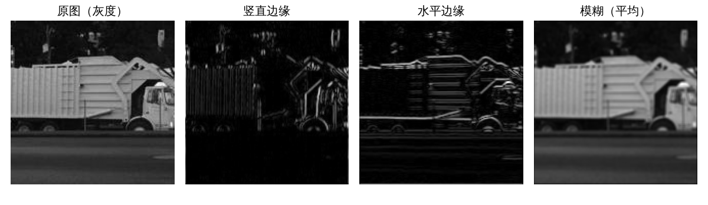
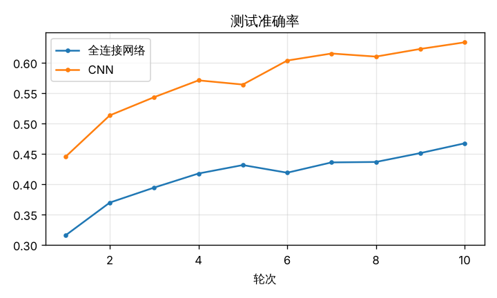
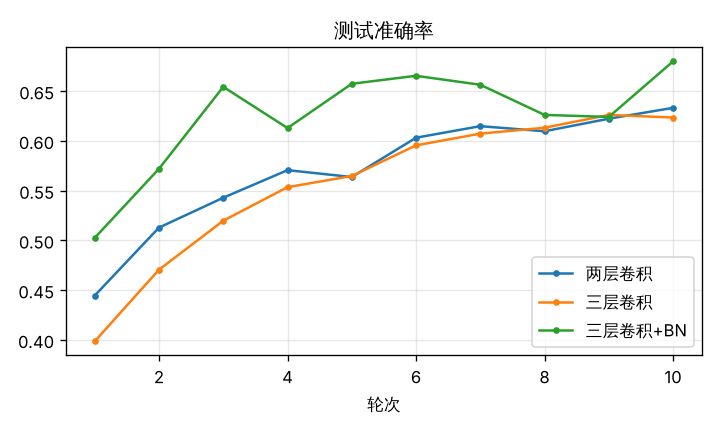
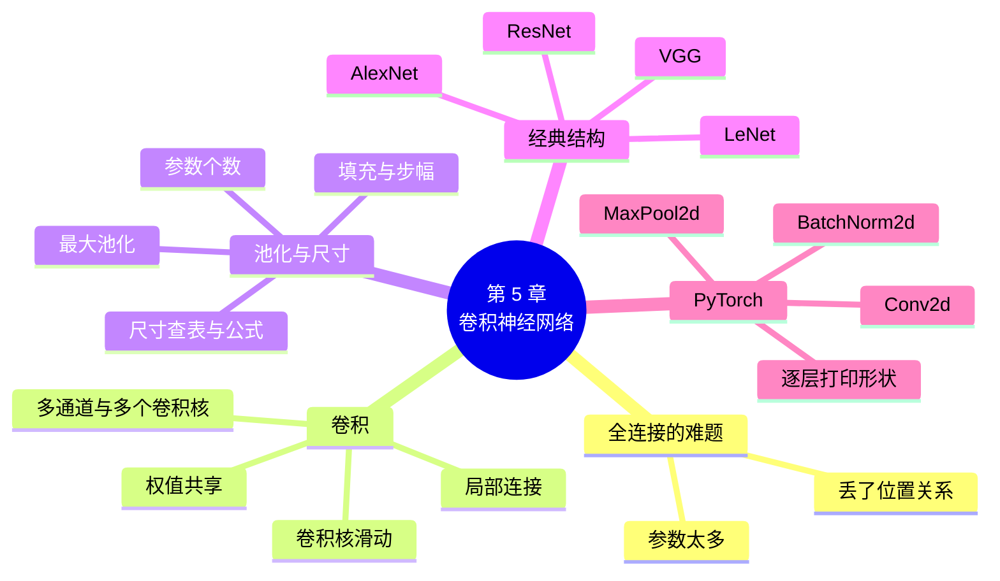

# 第 5 章 卷积神经网络：为图像而生

!!! abstract "本章学时"
    线上理论 3 学时 · 线下 1 学时 · 实验 2 学时（本章共 3 个实验，教师可任选）

## 学习目标

学完本章，你应该能够：

1. **说出**卷积、卷积核、特征图、步幅、填充、通道、池化、卷积神经网络的含义（记忆）；
2. **解释**全连接网络处理图像时的两个难题，以及卷积的局部连接、权值共享怎样解决它们（理解）；
3. **计算**卷积层、池化层输出的形状和卷积层的参数个数（应用）；
4. 用 PyTorch 的 `Conv2d`、`MaxPool2d` **搭建**一个卷积神经网络，并完成训练和评估（应用）；
5. **比较**全连接网络和卷积神经网络在图片分类上的参数量和准确率，说出 LeNet、AlexNet、VGG、ResNet 各自的贡献（分析）。

!!! info "先修要求"
    学习本章前，你需要掌握：

    - 本书第 2 章：张量的形状、训练五步（[2.3 张量](../02-training/index.md#23)、[2.4 训练五步](../02-training/index.md#24)）；
    - 本书第 3 章：批归一化、残差连接（[3.4.2 四个对策](../03-backprop/index.md#342)）；
    - 本书第 4 章：训练集、验证集、测试集，过拟合（[4.1](../04-generalization/index.md#41)、[4.2](../04-generalization/index.md#42)）。

??? abstract "本章概念清单（点击查看定义和例子）"
    写好术语表后运行 python tools/glossary_links.py concepts 5 自动生成

## 情景导入

小张在一家物流公司做仓库管理。公司想用摄像头自动识别传送带上的包裹是纸箱、编织袋还是泡沫箱。小张想起刚学过的多层感知机，就把每张照片缩成 224×224 像素，摊平成一长串数字喂给网络。

结果令人失望：网络第一层就有 1.5 亿个参数，电脑训练得很慢；更奇怪的是，同一个纸箱在画面左边能认出来，挪到画面右边就认错了。

问题出在哪里？我们看一张图片时，不会一个像素一个像素地记，而是先看到边缘、角落、纹理，再把它们组合成“箱子的棱角”“编织袋的条纹”，最后认出是什么东西。而且，一个纸箱不管出现在画面的哪个位置，它的棱角长得都一样。

卷积神经网络正是按照这个思路设计的：用一个小窗口在图上滑动，到处寻找同一种图案。本章先说清楚全连接网络处理图像的难处，再学习卷积和池化这两个“零件”，然后认识几个著名的网络结构，最后亲手搭一个卷积神经网络，在彩色小图上和全连接网络比一比。

## 5.1 全连接网络搞不定图像的两个原因 { #51 }

第 1～4 章的网络叫**全连接网络**（也叫多层感知机）：每一层的每个神经元都和上一层的所有神经元相连。它处理 28×28 的手写数字效果不错，但用来处理真实照片，会遇到两个难题。

### 5.1.1 难题一：参数太多

一张 224×224 的彩色照片，有红、绿、蓝三个**通道**，一共 224 × 224 × 3 = 150 528 个数。如果第一个隐藏层有 1000 个神经元，每个神经元都要和这 15 万多个数相连：

$$150\,528 \times 1000 + 1000 \approx 1.5 \text{ 亿个参数}$$

这还只是第一层。参数太多，一是训练慢、占内存；二是第 4 章说过，参数多、数据少，网络就容易“死记硬背”，也就是过拟合。

### 5.1.2 难题二：丢了位置关系

全连接网络的第一步是把图片“摊平”成一长串数（`nn.Flatten()`）。摊平以后，原来上下相邻的两个像素在这串数里相隔 224 个位置，网络并不知道它们是“邻居”。如果把所有图片的像素按同一种方式打乱顺序，全连接网络的训练效果几乎不受影响，这说明它根本没用上“谁挨着谁”这个信息。

可是图片里最重要的信息恰恰在相邻的像素之间：一条边缘，是相邻像素亮度的突变；一个角，是两条边缘的交汇。同时，同一个图案（比如猫的眼睛）可能出现在图片的任何位置，全连接网络要在每个位置分别学一遍，非常浪费。

| 难题 | 原因 | 卷积的解决办法 |
|---|---|---|
| 参数太多 | 每个神经元连接所有像素 | **局部连接**：每次只看一小块；**权值共享**：同一个小窗口在全图重复使用 |
| 丢了位置关系 | 一开始就把图片摊平 | 保持“高×宽”的形状一层层处理，最后才摊平 |

## 5.2 卷积：一个小窗口在图上滑动 { #52 }

### 5.2.1 算一算：3×3 卷积核在 5×5 图片上滑动 { #521 }

**卷积**的做法是：准备一个小的数字方阵，叫**卷积核**（也叫滤波器），比如 3×3；把它放在图片的左上角，对应位置的数两两相乘，再全部加起来，得到一个数；然后向右挪一格，再算一次；一行算完了，往下挪一格，从左边重新开始。所有位置算出来的数排成一张新的“图”，叫**特征图**。<sup class="cite">[[1]](#ref5-1)</sup>

下面是一张 5×5 的小图（左边两列暗，记为 0；右边三列亮，记为 1），和一个 3×3 的卷积核：

```text
图片（5×5）            卷积核（3×3）
0 0 1 1 1             -1  0  1
0 0 1 1 1             -1  0  1
0 0 1 1 1             -1  0  1
0 0 1 1 1
0 0 1 1 1
```

**第 1 个位置（左上角）**：卷积核盖住图片第 1～3 行、第 1～3 列。每一行都是 $0 \times (-1) + 0 \times 0 + 1 \times 1 = 1$，三行加起来得 **3**。

**第 3 个位置（第一行最右）**：卷积核盖住第 1～3 列之后的第 3～5 列，每一行都是 $1 \times (-1) + 1 \times 0 + 1 \times 1 = 0$，三行加起来得 **0**。

把 3×3 = 9 个位置全部算完，得到 3×3 的特征图：

```text
3 3 0
3 3 0
3 3 0
```

特征图前两列是 3，最后一列是 0。回头看图片：暗和亮的分界线在第 2、3 列之间，前两列的窗口正好跨在分界线上。这个卷积核“左边减、右边加”，只有窗口里左暗右亮时才输出大数，所以它是一个**竖直边缘检测器**。实验 5-1 用 PyTorch 验证了这个结果。

<iframe class="sim-frame" src="../../sims/conv-calculator/main.html" height="640" loading="lazy" title="卷积计算器"></iframe>

动画：卷积计算器。选输入图和卷积核，点“下一个位置”，看卷积核一格一格滑动，每一步的乘加算式都写在下面。[全屏打开](../../sims/conv-calculator/main.html){ target=_blank }
{ .sim-caption }

### 5.2.2 局部连接与权值共享 { #522 }

把卷积看成一层神经网络：特征图上的每个数，就是一个神经元的输出；这个神经元只和图片上的 3×3 = 9 个像素相连（**局部连接**），卷积核里的 9 个数就是它的权重。

更关键的是，特征图上所有位置的神经元，用的是**同一个**卷积核，这叫**权值共享**。一个 3×3 卷积核只有 9 个权重加 1 个偏置，共 10 个参数，不管图片是 5×5 还是 1000×1000，参数都是这 10 个。

权值共享还带来一个好处：同一个卷积核在全图各处找同一种图案，竖直边缘不管出现在左边还是右边，都能被找出来。这正好解决了 5.1.2 节的问题。

在卷积神经网络里，卷积核的数值**不是人设计的，而是训练出来的**。实验 5-1 为了让大家看懂，手工设置了“竖直边缘”“水平边缘”“模糊”三个卷积核；而在实验 5-2 的网络里，卷积核一开始是随机数，和全连接层的权重一样，通过反向传播和梯度下降自动学习，网络自己会学出边缘、颜色块、纹理这类有用的卷积核。

### 5.2.3 通道：彩色图片和多个卷积核 { #523 }

**输入有多个通道**。彩色图片有红、绿、蓝 3 个通道，形状是 3×高×宽。这时卷积核也要有 3 层，形状是 3×3×3：每一层和对应的通道做乘加，3 层的结果再加起来，最后加上偏置，得到特征图上的一个数。所以，**不管输入有几个通道，一个卷积核只输出一张特征图**。

**多个卷积核**。一个卷积核只找一种图案，要找很多种图案，就用很多个卷积核。用 16 个卷积核，就得到 16 张特征图，叠在一起，形状是 16×高×宽。这 16 张特征图就是下一层的 16 个输入通道。

在 PyTorch 中，卷积层这样写：

```python
from torch import nn
conv = nn.Conv2d(in_channels=3, out_channels=16, kernel_size=3, padding=1)
# 输入 3 个通道，16 个卷积核（输出 16 个通道），卷积核大小 3×3，四周填充 1 圈
print(conv.weight.shape)    # torch.Size([16, 3, 3, 3])：16 个卷积核，每个 3×3×3
```

| 参数 | 含义 | 常用值 |
|---|---|---|
| `in_channels` | 输入的通道数 | 彩色图 3，灰度图 1，或上一层的卷积核个数 |
| `out_channels` | 卷积核个数，也就是输出的通道数 | 16、32、64、128…… |
| `kernel_size` | 卷积核大小 | 3（最常用）、5、7 |
| `stride` | **步幅**：每次挪几格 | 1（默认），2 可以让特征图缩小一半 |
| `padding` | **填充**：在图片四周补几圈 0 | 卷积核 3 配 1，卷积核 5 配 2，可让尺寸不变 |

注意 PyTorch 中图片张量的形状是“**批量×通道×高×宽**”，例如 64 张 CIFAR-10 图片是 64×3×32×32。这和用 Matplotlib 显示图片时的“高×宽×通道”不同，第 2 章读 MNIST 时已经见过。

!!! cert "证书考点"
    卷积层的参数个数和输出尺寸是各类人工智能证书理论考试中的常见计算题，例如“输入 3 通道、32 个 3×3 卷积核的卷积层有多少参数”“32×32 的图经过步幅 2 的卷积后多大”。按 5.3 节的方法计算即可（详见[证书考点对照](../../certificate.md)）。

## 5.3 池化与特征图尺寸 { #53 }

### 5.3.1 池化：把特征图缩小 { #531 }

卷积之后，通常会接一个**池化**层，把特征图缩小。最常用的是 2×2 **最大池化**：把特征图切成一个个 2×2 的小块，每块只留下最大的那个数。

```text
特征图（4×4）           2×2 最大池化后（2×2）
1 3 | 2 0
4 2 | 1 1              4  2
----+----       →
0 1 | 5 2              2  5
2 2 | 3 4
```

左上块 {1, 3, 4, 2} 中最大是 4，右上块 {2, 0, 1, 1} 中最大是 2，以此类推。

池化有三个作用：

1. **缩小尺寸、减少计算**：2×2 池化把高和宽各减半，数据量变为四分之一；
2. **容忍小的位置变化**：图案在 2×2 的小块里挪动一格，最大值往往不变；
3. **让后面的卷积看得更大**：图缩小了一半，后面同样 3×3 的卷积核，相当于看原图上更大的一片区域。

池化层**没有参数**，不需要训练。PyTorch 中写作 `nn.MaxPool2d(2)`。另有一种**平均池化**（`nn.AvgPool2d`），每块取平均值。

### 5.3.2 特征图尺寸：查表或用公式 { #532 }

搭网络时最常遇到的错误，就是算错特征图的尺寸，导致后面的全连接层“接不上”。下表列出最常用的几种设置，记住它们就够用了：

| 层的设置 | 边长怎么变 | 例：输入 32×32 |
|---|---|---|
| 卷积 3×3，步幅 1，填充 1 | **不变** | 32×32 |
| 卷积 5×5，步幅 1，填充 2 | **不变** | 32×32 |
| 卷积 3×3，步幅 1，填充 0 | 减 2 | 30×30 |
| 卷积 5×5，步幅 1，填充 0 | 减 4 | 28×28 |
| 卷积 3×3，步幅 2，填充 1 | **减半** | 16×16 |
| 最大池化 2×2 | **减半**（除不尽时舍去小数） | 16×16 |

遇到其他设置，用这个公式（⌊ ⌋ 表示舍去小数取整）：

$$\text{输出边长} = \left\lfloor \frac{\text{输入边长} + 2 \times \text{填充} - \text{卷积核大小}}{\text{步幅}} \right\rfloor + 1$$

例如输入 160×160，卷积核 5×5、步幅 1、不填充：$(160 + 0 - 5) \div 1 + 1 = 156$，实验 5-1 第 4 步的运行结果正是 156×156。

**通道数**看卷积核个数：卷积层输出的通道数 = 卷积核个数；池化层不改变通道数。

### 5.3.3 参数个数怎么算 { #533 }

一个卷积核的权重个数 = 输入通道数 × 卷积核大小 × 卷积核大小，再加 1 个偏置。所以：

$$\text{卷积层参数} = \text{卷积核个数} \times (\text{输入通道数} \times k \times k + 1)$$

例如 `nn.Conv2d(3, 16, 3)`：$16 \times (3 \times 3 \times 3 + 1) = 448$。

可以看到，卷积层的参数和图片大小**无关**。实验 5-2 的 CNN 里，两个卷积层加起来只有 5088 个参数，而后面的一个全连接层就有 26 万多个，这也是后来的网络尽量把全连接层做小的原因。

<iframe class="sim-frame" src="../../sims/feature-map-size/main.html" height="720" loading="lazy" title="CNN 尺寸与参数计算器"></iframe>

动画：CNN 尺寸与参数计算器。选一个输入，往下加卷积、池化、摊平、全连接层，表格自动算出每层的输出形状和参数；点“尺寸出错的例子”，看全连接层“接不上”时是什么情况。[全屏打开](../../sims/feature-map-size/main.html){ target=_blank }
{ .sim-caption }

## 5.4 经典结构：一步步变深 { #54 }

把“卷积 → 激活 → 池化”看成一个**卷积块**，反复叠几个，最后摊平、接全连接层输出类别，就是一个**卷积神经网络**（Convolutional Neural Network，CNN）。它的形状规律是：**越往后，特征图越小、通道越多**。前面的层找边缘、颜色这类简单图案，后面的层把它们组合成眼睛、轮子、文字这类复杂图案。

从 1998 年到 2015 年，有四个网络在 CNN 的发展中特别重要：

| 网络 | 年份 | 层数 | 解决了什么问题 | 一句话记住它 |
|---|---|---|---|---|
| **LeNet** | 1998 | 5 | 第一次用卷积网络识别手写数字，用在银行支票识别上<sup class="cite">[[4]](#ref5-4)</sup> | 定下了“卷积—池化—全连接”的基本结构 |
| **AlexNet** | 2012 | 8 | 第一次在 ImageNet（100 多万张照片、1000 类）上大幅领先传统方法<sup class="cite">[[5]](#ref5-5)</sup> | 用 GPU 训练、用 ReLU 和 Dropout，掀起深度学习热潮 |
| **VGG** | 2014 | 16～19 | 证明网络越深效果越好<sup class="cite">[[6]](#ref5-6)</sup> | 全部用 3×3 小卷积核，结构整齐，便于模仿 |
| **ResNet** | 2015 | 18～152 | 网络太深反而训练不动<sup class="cite">[[7]](#ref5-7)</sup> | 加“残差连接”让输入抄近路（第 3 章 3.4.2 节），网络可以上百层 |

为什么要用两个 3×3 卷积代替一个 5×5 卷积（VGG 的思路）？两个 3×3 卷积叠在一起，第二层的每个数也能“看到”原图上 5×5 的区域，但参数更少（2 × 9 = 18 比 25），中间还多了一次激活，表达能力更强。

到了 ResNet，网络的结构基本定型：开头一个卷积把图缩小，中间是几十个带残差连接的卷积块，结尾用“全局平均池化”把每张特征图平均成一个数，再接一个全连接层输出类别。第 7 章做迁移学习时用到的预训练网络，就是这一类结构。

!!! tip "这些网络要背吗"
    不用记层数和细节，记住“一句话”那一列就够了。CNN 的更多结构和目标检测、图像分割等应用，在《计算机视觉及应用实战》中详细学习；本书重点是理解卷积的原理，并能自己搭建、训练一个 CNN。

## 5.5 用 PyTorch 搭一个 CNN { #55 }

下面是实验 5-2 用来给 CIFAR-10（10 类 32×32 彩色小图）分类的 CNN。用 `nn.Sequential` 把各层按顺序排好，注释写出了每层输出的形状：

```python
from torch import nn

cnn = nn.Sequential(
    nn.Conv2d(3, 16, kernel_size=3, padding=1), nn.ReLU(),   # 3×32×32 → 16×32×32
    nn.MaxPool2d(2),                                         # → 16×16×16
    nn.Conv2d(16, 32, kernel_size=3, padding=1), nn.ReLU(),  # → 32×16×16
    nn.MaxPool2d(2),                                         # → 32×8×8
    nn.Flatten(),                                            # → 2048
    nn.Linear(32 * 8 * 8, 128), nn.ReLU(),                   # → 128
    nn.Linear(128, 10),                                      # → 10 个类别的得分
)
```

搭网络时最容易出错的是 `nn.Linear(32 * 8 * 8, 128)` 里的输入个数：它必须等于摊平后的长度。如果算错了，运行时会报类似 `mat1 and mat2 shapes cannot be multiplied (64x2048 and 1024x128)` 的错误，意思是“实际送来 2048 个数，这一层却写着要 1024 个”。

不会算也没关系，可以让 PyTorch 逐层打印形状：

```python
x = torch.zeros(1, 3, 32, 32)       # 造一张假图片，批量 1
for layer in cnn:
    x = layer(x)
    print(layer.__class__.__name__, tuple(x.shape))
```

训练 CNN 的代码和第 2 章训练全连接网络的五步**完全一样**：前向计算、算损失、梯度清零、反向传播、更新参数。唯一的区别是：全连接网络的第一层是 `nn.Flatten()`，图片一进来就摊平；CNN 则把 `Flatten` 放到卷积块之后。

## 5.6 示范例题 { #56 }

**例题** 一个处理手写数字（1×28×28）的 LeNet 风格网络如下，算出每一层输出的形状和每层的参数个数：

```python
nn.Sequential(
    nn.Conv2d(1, 6, kernel_size=5, padding=2), nn.MaxPool2d(2),
    nn.Conv2d(6, 16, kernel_size=5), nn.MaxPool2d(2),
    nn.Flatten(), nn.Linear(?, 120), nn.Linear(120, 84), nn.Linear(84, 10),
)
```

问号处应该填多少？

**解题思路**：从输入开始逐层往下推。卷积层用查表或公式算边长，通道数等于卷积核个数；池化减半、通道不变；摊平把三个数相乘。参数只有卷积层和全连接层有。

| 层 | 输出形状 | 怎么算 | 参数 |
|---|---|---|---|
| 输入 | 1×28×28 | | 0 |
| Conv2d(1, 6, 5, 填充 2) | 6×28×28 | 卷积核 5 配填充 2，边长不变 | 6 × (1×5×5 + 1) = 156 |
| MaxPool2d(2) | 6×14×14 | 减半 | 0 |
| Conv2d(6, 16, 5) | 16×10×10 | (14 − 5) ÷ 1 + 1 = 10 | 16 × (6×5×5 + 1) = 2416 |
| MaxPool2d(2) | 16×5×5 | 减半 | 0 |
| Flatten | 400 | 16 × 5 × 5 = 400 | 0 |
| Linear(400, 120) | 120 | | 120 × (400 + 1) = 48 120 |
| Linear(120, 84) | 84 | | 84 × (120 + 1) = 10 164 |
| Linear(84, 10) | 10 | | 10 × (84 + 1) = 850 |

**答**：问号处填 400；全网共 156 + 2416 + 48 120 + 10 164 + 850 = 61 706 个参数。编者用 PyTorch 核对，参数总数相同。

**举一反三**：两个卷积层一共只有 2572 个参数，三个全连接层却有 59 134 个，占了 96%。在 5.3 节的动画里点“LeNet 风格”可以核对每一行；再试着把第二个卷积层的填充改成 2，看看问号处要改成多少。

## 5.7 前沿视窗 { #57 }

**视觉 Transformer**。2020 年，谷歌的研究人员提出了视觉 Transformer（ViT）：把一张图片切成许多 16×16 的小方块，每个小方块当作一个“词”，然后用第 6 章将要学到的 Transformer 来处理。<sup class="cite">[[8]](#ref5-8)</sup> 它没有卷积，靠“注意力”让每个小方块去看其他所有小方块。在数据量特别大（上亿张图片）时，ViT 的效果超过了 CNN；数据少时，CNN 仍然更容易训练。今天的多模态大模型（能看图说话的大模型）大多用 ViT 把图片变成一串向量，再交给语言模型处理。

**CNN 并没有过时**。手机拍照的美颜、扫码、车牌识别、工厂里的缺陷检测，由于要在手机或小型设备上实时运行，大量使用的仍是 CNN 或 CNN 与 Transformer 的混合结构。国产的飞桨 PaddleOCR、PaddleDetection 等工具中，也大量使用为手机设计的轻量 CNN。

## 本章实验

!!! abstract "实验总览"
    | 实验 | 类型 | 建议时长 | 内容 |
    |---|---|---|---|
    | 实验 5-1 | ★ 基础 | 30 分钟 | 手算卷积并用 `Conv2d` 验证；用三个卷积核处理一张照片，看特征图；观察步幅、填充、池化对尺寸的影响 |
    | 实验 5-2 | ★ 基础 | 45 分钟 | CIFAR-10 小图分类：同样的数据和训练方法，比较全连接网络与 CNN 的参数个数和准确率 |
    | 实验 5-3 | ☆ 拓展 | 30 分钟 | 把 CNN 加深为三层卷积，再加批归一化，比较准确率和训练速度 |

    三个实验都在本机 CPU 上运行：实验 5-1 几秒钟，实验 5-2 约 1～3 分钟，实验 5-3 约 2～5 分钟（编者用 4 核 CPU 实测分别约 1 分钟和 2.5 分钟）。第一次运行会自动下载 Imagenette（约 100 MB）和 CIFAR-10（约 140 MB）数据，见附录 B。代码见配套资源 `labs/ch05/` 目录。

### 实验 5-1 ★ 用 Conv2d 给图片做边缘检测，看特征图 { #5-1 }

**实验目的**

1. 用 `nn.Conv2d` 验证 5.2.1 节手算的卷积结果；
2. 看懂不同卷积核“找”的是什么图案；
3. 验证步幅、填充、池化对特征图尺寸的影响。

**实验环境**：本机 CPU，Python 3.11，PyTorch、Matplotlib。

**实验数据**：5.2.1 节的 5×5 小图；Imagenette 验证集中的一张“垃圾车”照片（160×160）。Imagenette 是从 ImageNet 中挑出的 10 类照片，由 fast.ai 整理公开。<sup class="cite">[[9]](#ref5-9)</sup>

**实验步骤与代码**

第 1 步，手工设置卷积核，与手算结果对照：

```python
conv = nn.Conv2d(1, 1, kernel_size=3, bias=False)        # 1 个输入通道、1 个卷积核，不要偏置
with torch.no_grad():
    conv.weight[:] = k_vertical                           # 把竖直边缘卷积核填进去
out = conv(img5.reshape(1, 1, 5, 5))                      # 输入形状：批量×通道×高×宽
```

第 2 步，读一张照片并转成灰度图（按 0.299 红 + 0.587 绿 + 0.114 蓝加权）。

第 3 步，用一个有 3 个卷积核的卷积层，分别装入“竖直边缘”“水平边缘”“模糊”三个卷积核，得到 3 张特征图：

```python
kernels = {
    "竖直边缘": k_vertical,
    "水平边缘": k_vertical.T,                # 转置：左右变上下
    "模糊（平均）": torch.full((3, 3), 1 / 9),   # 9 个数都是 1/9，相当于求平均
}
conv3 = nn.Conv2d(1, 3, kernel_size=3, padding=1, bias=False)
with torch.no_grad():
    for i, k in enumerate(kernels.values()):
        conv3.weight[i, 0] = k
    maps = conv3(gray)                        # 形状 1×3×160×160
```

第 4 步，对同一张图试 5 种不同的层，打印输出尺寸；再对 5.3.1 节的 4×4 小例子做最大池化。

完整代码见 `lab5_1_conv_edge.py`。

**运行结果**

```text
第 1 步：5×5 图片与竖直边缘卷积核的卷积结果（3×3）：
tensor([[3., 3., 0.],
        [3., 3., 0.],
        [3., 3., 0.]])
左上角的值 = 3.0 （左上 3×3 区域与卷积核对应相乘再相加）

第 2 步：照片（ 垃圾车 ）灰度图形状： (1, 1, 160, 160)
第 3 步：卷积层权重形状 (3, 1, 3, 3) → 输出特征图形状 (1, 3, 160, 160)
特征图已保存到 lab5_1_feature_maps.png

第 4 步：输入 1×1×160×160，看不同设置的输出尺寸
  3×3，步幅 1，不填充   → (1, 1, 158, 158)
  3×3，步幅 1，填充 1  → (1, 1, 160, 160)
  3×3，步幅 2，填充 1  → (1, 1, 80, 80)
  5×5，步幅 1，不填充   → (1, 1, 156, 156)
  2×2 最大池化       → (1, 1, 80, 80)

4×4 小例子做 2×2 最大池化：
tensor([[4., 2.],
        [2., 5.]])
```



几点解读：

- 第 1 步的结果与 5.2.1 节手算的完全一样。
- “竖直边缘”特征图里，车厢侧面的竖条纹、车头的竖边很亮；“水平边缘”特征图里，车顶、车厢底边、路沿这些横线很亮。一个卷积核只对一种方向的边缘敏感。
- “模糊”卷积核把每个点换成周围 9 个点的平均值，图变得柔和，细节变少。
- 第 4 步的 5 个尺寸都和 5.3.2 节的表、公式一致。

**实验记录表**

| 项目 | 你的结果 |
|---|---|
| 第 1 步特征图的 9 个数 | |
| 你选的照片类别和编号 | |
| “竖直边缘”特征图里最亮的是照片的哪些部分 | |
| “水平边缘”特征图里最亮的是照片的哪些部分 | |
| 3×3、步幅 2、填充 1 时的输出尺寸 | |

**常见问题排查**

| 现象 | 原因 | 解决办法 |
|---|---|---|
| 下载 Imagenette 很慢或失败 | 网络问题 | 按附录 B 手动下载 `imagenette160.zip`，放到 `labs/data/` |
| `RuntimeError: a leaf Variable that requires grad is being used in an in-place operation` | 给 `conv.weight` 赋值时没有放在 `torch.no_grad()` 里 | 按代码在 `with torch.no_grad():` 下面赋值 |
| `Expected 4D input` 之类的报错 | 送进 `Conv2d` 的张量不是“批量×通道×高×宽”四维 | 用 `reshape(1, 1, 高, 宽)` 补上批量和通道两维 |

**思考与练习**

1. 把照片换成其他类别（修改 `photo = x[y == 6][0]` 中的 6，或把 `[0]` 换成别的编号），哪个类别的竖直边缘最多？
2. 自己设计一个“斜线”卷积核（提示：主对角线为 1，其余为 −0.5 左右），看看特征图里什么最亮。

**实验报告要求**

提交特征图图片和记录表，用不超过 150 字说明“竖直边缘”卷积核为什么能找出竖直的边缘。

### 实验 5-2 ★ CIFAR-10 小图分类：全连接网络与 CNN 比一比 { #5-2 }

**实验目的**

1. 用 `nn.Sequential` 搭建一个两层卷积的 CNN，逐层打印输出形状；
2. 在同样的条件下比较全连接网络与 CNN 的参数个数、准确率和训练时间；
3. 学会查看每一类的准确率，找出模型的薄弱环节。

**实验环境**：本机 CPU，Python 3.11，PyTorch、Matplotlib。

**实验数据**：CIFAR-10 是 10 类 32×32 彩色小图（飞机、汽车、鸟、猫、鹿、狗、青蛙、马、船、卡车），训练集 5 万张、测试集 1 万张。<sup class="cite">[[3]](#ref5-3)</sup> 为了在 CPU 上较快跑完，训练集每类取 2000 张（共 2 万张），测试集用全部 1 万张。数据读取写在 `common05.py` 中。

**实验步骤与代码**

第 1 步，读入数据（`common05.py`）：

```python
X_TRAIN, Y_TRAIN = load_cifar10(train=True, n_per_class=2000)   # 20000×3×32×32
X_TEST, Y_TEST = load_cifar10(train=False)                      # 10000×3×32×32
```

第 2 步，搭建两个网络。全连接网络把 3×32×32 = 3072 个数摊平后接两个隐藏层（256、128 个神经元）；CNN 的代码见 5.5 节。

```python
mlp = nn.Sequential(
    nn.Flatten(),
    nn.Linear(3 * 32 * 32, 256), nn.ReLU(),
    nn.Linear(256, 128), nn.ReLU(),
    nn.Linear(128, 10),
)
```

第 3 步，两个网络用同样的训练函数（`common05.py` 中的 `train`）：Adam，学习率 0.001，批量 64，训练 10 轮，每轮结束在测试集上评估一次。

第 4 步，统计 CNN 在每一类上的准确率。

完整代码见 `common05.py` 和 `lab5_2_mlp_vs_cnn.py`。

**运行结果**

```text
训练集 (20000, 3, 32, 32) 测试集 (10000, 3, 32, 32)

逐层查看 CNN 的输出形状：
  Conv2d     → (1, 16, 32, 32)
  ReLU       → (1, 16, 32, 32)
  MaxPool2d  → (1, 16, 16, 16)
  Conv2d     → (1, 32, 16, 16)
  ReLU       → (1, 32, 16, 16)
  MaxPool2d  → (1, 32, 8, 8)
  Flatten    → (1, 2048)
  Linear     → (1, 128)
  ReLU       → (1, 128)
  Linear     → (1, 10)

全连接网络参数：820874，CNN 参数：268650
CNN 各层参数： [432, 16, 4608, 32, 262144, 128, 1280, 10]
  [全连接] 第  1 轮：训练损失 1.9662，测试准确率 0.3152
  ……
  [全连接] 第 10 轮：训练损失 1.4365，测试准确率 0.4669
  [CNN] 第  1 轮：训练损失 1.7460，测试准确率 0.4446
  ……
  [CNN] 第 10 轮：训练损失 0.8332，测试准确率 0.6332

全连接网络：参数 820874，最终测试准确率 0.4669，用时 15 秒
CNN       ：参数 268650，最终测试准确率 0.6332，用时 36 秒
曲线已保存到 lab5_2_acc.png

CNN 每一类的测试准确率：
  飞机：0.686  汽车：0.783  鸟：0.540  猫：0.357  鹿：0.644  狗：0.595  青蛙：0.712  马：0.695  船：0.709  卡车：0.611
CNN 参数已保存到 cifar_cnn.pt
```



几点解读：

- CNN 的参数只有全连接网络的三分之一（26.9 万比 82.1 万），测试准确率却高出 16.6 个百分点（63.32% 比 46.69%）。CNN 第 1 轮的准确率（44.46%）就接近全连接网络训练 10 轮的结果。
- CNN 用时更长（36 秒比 15 秒）：卷积层参数少，但要在每个位置都算一遍，计算量并不小。这正是 GPU 擅长的并行计算，第 7 章会讨论算力。
- 每一类的准确率差别很大：汽车 78.3%，猫只有 35.7%。猫和狗的样子相近，32×32 的小图又很模糊，最容易混淆。实验 7-3 会专门做这种“错误分析”。
- 63% 远不是 CIFAR-10 的最好成绩。增加训练数据和轮数、加数据增强、加深网络，都能继续提高。

**实验记录表**

| 项目 | 全连接网络 | CNN |
|---|---|---|
| 参数个数 | | |
| 第 1 轮测试准确率 | | |
| 第 10 轮测试准确率 | | |
| 用时 | | |
| CNN 准确率最高和最低的类别 | — | |

**常见问题排查**

| 现象 | 原因 | 解决办法 |
|---|---|---|
| `mat1 and mat2 shapes cannot be multiplied` | 改了卷积层或池化层后，`nn.Linear` 的输入个数没跟着改 | 用逐层打印形状的方法看 `Flatten` 后的长度，填到 `nn.Linear` 第一个参数 |
| 第一次运行很久没有输出 | 正在下载、解压 CIFAR-10 并读入 3 万张图片 | 耐心等待；之后读取缓存文件，几秒钟就好 |
| 训练太慢 | 电脑较旧 | 把 `common05.py` 中的 `n_per_class=2000` 改成 1000，结果会低几个百分点 |

**思考与练习**

1. 把全连接网络的隐藏层加大到 1024、512 个神经元，参数变成多少？准确率能追上 CNN 吗？
2. 把 CNN 的训练轮数改为 20 轮，测试准确率还会上升吗？结合第 4 章的知识，你认为应该怎样判断训练多少轮合适？

**实验报告要求**

提交准确率曲线图和记录表，用不超过 200 字说明 CNN 用更少的参数取得更高准确率的原因。

### 实验 5-3 ☆ 把 CNN 加深一层、加批归一化，看准确率变化 { #5-3 }

**实验目的**

1. 用一个函数批量生成不同深度的 CNN；
2. 观察加深网络、加批归一化对准确率和训练速度的影响；
3. 体会“改一处、比一次”的实验方法。

**实验环境**：本机 CPU，Python 3.11，PyTorch、Matplotlib。

**实验数据**：与实验 5-2 相同。

**实验步骤与代码**

第 1 步，把“卷积 →（批归一化）→ ReLU → 池化”写成一个卷积块函数，再用它拼出整个网络：

```python
def block(c_in, c_out, bn=False):
    layers = [nn.Conv2d(c_in, c_out, kernel_size=3, padding=1)]
    if bn:
        layers.append(nn.BatchNorm2d(c_out))     # 批归一化，放在卷积和激活之间
    layers += [nn.ReLU(), nn.MaxPool2d(2)]
    return layers

def make_cnn(channels, bn=False):
    layers, c_in = [], 3
    for c in channels:                           # channels 如 [16, 32, 64]，几个数就是几个卷积块
        layers += block(c_in, c, bn)
        c_in = c
    size = 32 // 2 ** len(channels)              # 每个卷积块把边长减半
    layers += [nn.Flatten(), nn.Linear(c_in * size * size, 128), nn.ReLU(), nn.Linear(128, 10)]
    return nn.Sequential(*layers)
```

第 2 步，比较三个网络：① 两层卷积 [16, 32]（与实验 5-2 相同）；② 三层卷积 [16, 32, 64]；③ 三层卷积加批归一化。训练方法与实验 5-2 完全相同。

完整代码见 `lab5_3_deeper_bn.py`。

**运行结果**（省略了每轮的输出）

```text
汇总：
  两层卷积     参数 268650  第 5 轮 0.5637  第 10 轮 0.6332  最好 0.6332  用时 37 秒
  三层卷积     参数 156074  第 5 轮 0.5647  第 10 轮 0.6235  最好 0.6261  用时 43 秒
  三层卷积+BN  参数 156298  第 5 轮 0.6574  第 10 轮 0.6799  最好 0.6799  用时 54 秒
曲线已保存到 lab5_3_acc.png
```



几点解读：

- 加深一层后参数反而变少了（15.6 万比 26.9 万）：多了一次池化，摊平后的长度从 2048 降到 64×4×4 = 1024，最大的那个全连接层变小了。
- 只加深、不加批归一化，10 轮后准确率和两层网络差不多（62.35%）。网络越深越难训练，第 3 章讲过这个问题。
- 加上批归一化后，第 1 轮就到 50.26%（不加时为 39.86%），第 10 轮达到 67.99%，是三个网络中最好的；批归一化只多了 224 个参数。
- 加批归一化的网络，测试准确率在第 7～9 轮有起伏（65.64%、62.61%、62.41%），而训练损失一直在下降（0.6285 → 0.5107）。结合第 4 章的知识，这是开始过拟合的迹象，可以加数据增强或早停。

**实验记录表**

| 网络 | 参数个数 | 第 5 轮准确率 | 第 10 轮准确率 | 用时 |
|---|---|---|---|---|
| 两层卷积 | | | | |
| 三层卷积 | | | | |
| 三层卷积 + BN | | | | |

**常见问题排查**

| 现象 | 原因 | 解决办法 |
|---|---|---|
| 改成四层卷积后报尺寸错误 | 32 经过 4 次减半是 2，5 次是 1，6 次就变成 0 | 卷积块不要超过 5 个；或者第一个卷积块之后不池化 |
| 加批归一化的网络评估结果忽高忽低 | 评估前没有调用 `model.eval()` | `evaluate` 函数里已经调用，自己写代码时注意 |

**思考与练习**

1. 再试一个四层卷积 [16, 32, 64, 128] 加批归一化的网络，记录参数个数和准确率。
2. 给“三层卷积+BN”加上第 4 章的数据增强（随机水平翻转），测试准确率能否超过 70%？为什么 CIFAR-10 可以做水平翻转，而手写数字不行？

**实验报告要求**

提交准确率曲线图和记录表，用不超过 200 字总结“加深”和“加批归一化”各自的效果。

## 本章小结

- 全连接网络处理图像有两个难题：**参数太多**、**丢了位置关系**。
- **卷积**用一个小的**卷积核**在图上滑动，每个位置对应相乘再相加，得到**特征图**。**局部连接**和**权值共享**让参数大大减少，同一个卷积核能在图的任何位置找到同一种图案。卷积核的数值是训练出来的。
- 一个卷积核输出一张特征图；卷积核个数 = 输出通道数。PyTorch 中图片张量的形状是“批量×通道×高×宽”。
- **最大池化**把特征图缩小，没有参数。3×3 卷积配填充 1 尺寸不变，步幅 2 或 2×2 池化尺寸减半；卷积层参数 = 卷积核个数 ×（输入通道 × k × k + 1），与图片大小无关。
- **卷积神经网络**由若干卷积块加全连接层组成，越往后特征图越小、通道越多。LeNet 定下基本结构，AlexNet 掀起深度学习热潮，VGG 证明越深越好，ResNet 用残差连接让网络可以上百层。
- 实验中，CNN 用三分之一的参数，比全连接网络的准确率高 16.6 个百分点；加深网络时配合批归一化效果更好。



**本章自检**

- [ ] 我能手算一个 3×3 卷积核在 5×5 图片上的卷积结果。
- [ ] 我能说出局部连接和权值共享分别是什么意思，为什么能减少参数。
- [ ] 给我一个 CNN 的代码，我能算出每层的输出形状和参数个数。
- [ ] 遇到 `shapes cannot be multiplied` 报错，我知道怎么找到并改正。
- [ ] 我能用一句话说出 LeNet、AlexNet、VGG、ResNet 各自的贡献。

**下一章预告**

图片是一个“面”，像素在上下左右排开；而一句话、一段语音、一串每天的气温，是一个“序列”，有先后顺序，后面的内容要结合前面的才能理解。下一章学习处理序列的网络：循环神经网络一个字一个字地读，LSTM 用“门”记住重要的信息，注意力机制让网络学会“该看哪里”，最后认识当今大模型的基础结构 Transformer。

## 参考文献

正文中的上标编号（如<sup class="cite">[[1]](#ref5-1)</sup>）对应下面的文献。

<div class="refs" markdown>

**教材与专著**

- <span id="ref5-1"></span>[1] 邱锡鹏. 神经网络与深度学习[M]. 北京: 机械工业出版社, 2020. https://nndl.github.io/.
    <span class="ref-note">第 5 章“卷积神经网络”讲卷积、池化和几种典型的卷积网络，对应 5.2～5.4 节。</span>
- <span id="ref5-2"></span>[2] 阿斯顿·张, 李沐, 扎卡里·C. 立顿, 等. 动手学深度学习（PyTorch 版）[M]. 北京: 人民邮电出版社, 2023. https://zh.d2l.ai/.
    <span class="ref-note">第 6 章“卷积神经网络”、第 7 章“现代卷积神经网络”有完整的 PyTorch 代码，对应 5.2～5.5 节。</span>

**数据集与经典论文**

- <span id="ref5-3"></span>[3] KRIZHEVSKY A. Learning multiple layers of features from tiny images[R]. Toronto: University of Toronto, 2009.
    <span class="ref-note">介绍 CIFAR-10 数据集，对应实验 5-2、5-3。</span>
- <span id="ref5-4"></span>[4] LECUN Y, BOTTOU L, BENGIO Y, et al. Gradient-based learning applied to document recognition[J]. Proceedings of the IEEE, 1998, 86(11): 2278-2324.
    <span class="ref-note">提出 LeNet-5，对应 5.4 节和 5.6 节例题。</span>
- <span id="ref5-5"></span>[5] KRIZHEVSKY A, SUTSKEVER I, HINTON G E. ImageNet classification with deep convolutional neural networks[C]//Advances in Neural Information Processing Systems 25. Lake Tahoe, 2012: 1097-1105.
    <span class="ref-note">提出 AlexNet，对应 5.4 节。</span>
- <span id="ref5-6"></span>[6] SIMONYAN K, ZISSERMAN A. Very deep convolutional networks for large-scale image recognition[C]//3rd International Conference on Learning Representations. San Diego, 2015.
    <span class="ref-note">提出 VGG，说明用 3×3 小卷积核加深网络的好处，对应 5.4 节。</span>
- <span id="ref5-7"></span>[7] HE K, ZHANG X, REN S, et al. Deep residual learning for image recognition[C]//Proceedings of the IEEE Conference on Computer Vision and Pattern Recognition. Las Vegas: IEEE, 2016: 770-778.
    <span class="ref-note">提出 ResNet，对应 5.4 节。</span>
- <span id="ref5-8"></span>[8] DOSOVITSKIY A, BEYER L, KOLESNIKOV A, et al. An image is worth 16x16 words: Transformers for image recognition at scale[C]//9th International Conference on Learning Representations. Virtual Event, 2021.
    <span class="ref-note">提出视觉 Transformer（ViT），对应 5.7 节。</span>

**在线资源与工具**

- <span id="ref5-9"></span>[9] fast.ai. Imagenette[EB/OL]. [2026-11-01]. https://github.com/fastai/imagenette.
    <span class="ref-note">Imagenette 数据集的说明，对应实验 5-1，第 7 章还会用到。</span>
- <span id="ref5-10"></span>[10] PyTorch. Conv2d[EB/OL]. [2026-11-01]. https://pytorch.org/docs/stable/generated/torch.nn.Conv2d.html.
    <span class="ref-note">卷积层的官方文档，含输出尺寸公式，对应 5.2.3 节、5.3.2 节。</span>

</div>

## 课后练习

选择题和判断题可以直接点击选项作答，系统会马上告诉你对错，并展开答案与解析；多选题选好后点“提交答案”。简答和实操题请先自己作答，再点开“答案与解析”核对。

**一、单项选择题**

<div class="quiz" data-answer="B" markdown>

**1.** 一张 224×224 的彩色照片摊平后有多少个数？（　　）

- A. 50 176
- B. 150 528
- C. 224
- D. 672

</div>

??? tip "答案与解析"
    **答案：B**

    224 × 224 × 3 = 150 528，彩色照片有红、绿、蓝 3 个通道。

    考查：通道 · 认知层次：应用 · [回看 5.1.1](#511)
    { .quiz-meta }

<div class="quiz" data-answer="C" markdown>

**2.** 图片 `[[1, 0], [0, 1]]` 与卷积核 `[[1, 2], [3, 4]]` 在唯一的位置上做卷积（不加偏置），结果是（　　）。

- A. 10
- B. 2
- C. 5
- D. 0

</div>

??? tip "答案与解析"
    **答案：C**

    对应位置相乘再相加：1×1 + 0×2 + 0×3 + 1×4 = 5。

    考查：卷积 · 认知层次：应用 · [回看 5.2.1](#521)
    { .quiz-meta }

<div class="quiz" data-answer="A" markdown>

**3.** 特征图上所有位置都使用同一个卷积核，这叫做（　　）。

- A. 权值共享
- B. 局部连接
- C. 池化
- D. 填充

</div>

??? tip "答案与解析"
    **答案：A**

    权值共享让参数个数与图片大小无关，也让同一图案在任何位置都能被找到。局部连接指每个输出只看一小块区域。

    考查：权值共享 · 认知层次：记忆 · [回看 5.2.2](#522)
    { .quiz-meta }

<div class="quiz" data-answer="D" markdown>

**4.** `nn.Conv2d(3, 16, kernel_size=3)` 的权重张量形状是（　　）。

- A. 3×16×3×3
- B. 16×3×3
- C. 3×3×16
- D. 16×3×3×3

</div>

??? tip "答案与解析"
    **答案：D**

    16 个卷积核，每个卷积核有 3 层（对应 3 个输入通道），每层 3×3。实验 5-1 中 `nn.Conv2d(1, 3, 3)` 的权重形状是 (3, 1, 3, 3)，规律相同。

    考查：通道 · 认知层次：理解 · [回看 5.2.3](#523)
    { .quiz-meta }

<div class="quiz" data-answer="B" markdown>

**5.** 输入 32×32，经过“卷积 3×3、步幅 1、填充 0”后，边长是（　　）。

- A. 32
- B. 30
- C. 16
- D. 29

</div>

??? tip "答案与解析"
    **答案：B**

    (32 + 0 − 3) ÷ 1 + 1 = 30，即不填充的 3×3 卷积边长减 2。

    考查：特征图尺寸 · 认知层次：应用 · [回看 5.3.2](#532)
    { .quiz-meta }

<div class="quiz" data-answer="C" markdown>

**6.** 对 `[[2, 8], [5, 1]]` 做 2×2 最大池化，结果是（　　）。

- A. 2
- B. 4
- C. 8
- D. 16

</div>

??? tip "答案与解析"
    **答案：C**

    最大池化取每块中的最大值，这里只有一块，最大值是 8。如果是平均池化，结果是 4。

    考查：池化 · 认知层次：应用 · [回看 5.3.1](#531)
    { .quiz-meta }

<div class="quiz" data-answer="A" markdown>

**7.** 卷积层 `nn.Conv2d(16, 32, kernel_size=3)` 的参数个数是（　　）。

- A. 4640
- B. 4608
- C. 512
- D. 288

</div>

??? tip "答案与解析"
    **答案：A**

    32 × (16 × 3 × 3 + 1) = 32 × 145 = 4640。实验 5-2 打印的第二个卷积层权重 4608 个、偏置 32 个，合计 4640。B 漏掉了偏置。

    考查：参数个数 · 认知层次：应用 · [回看 5.3.3](#533)
    { .quiz-meta }

<div class="quiz" data-answer="D" markdown>

**8.** 用“残差连接”让网络可以达到上百层的经典结构是（　　）。

- A. LeNet
- B. AlexNet
- C. VGG
- D. ResNet

</div>

??? tip "答案与解析"
    **答案：D**

    ResNet（2015）用残差连接解决了“网络太深反而训练不动”的问题。

    考查：经典结构 · 认知层次：记忆 · [回看 5.4](#54)
    { .quiz-meta }

**二、多项选择题**

<div class="quiz quiz-multi" data-answer="ABD" markdown>

**9.** 关于池化层，下列说法正确的有（　　）。

- A. 2×2 最大池化把特征图的高和宽各减半
- B. 池化层没有需要训练的参数
- C. 池化层会改变通道数
- D. 池化能让网络容忍图案的小幅位置变化

</div>

??? tip "答案与解析"
    **答案：ABD**

    池化在每个通道上分别进行，通道数不变。

    考查：池化 · 认知层次：理解 · [回看 5.3.1](#531)
    { .quiz-meta }

<div class="quiz quiz-multi" data-answer="ACD" markdown>

**10.** 下列设置中，能让 32×32 的特征图尺寸**保持不变**的有（　　）。

- A. 卷积 3×3，步幅 1，填充 1
- B. 卷积 3×3，步幅 2，填充 1
- C. 卷积 5×5，步幅 1，填充 2
- D. 卷积 1×1，步幅 1，填充 0

</div>

??? tip "答案与解析"
    **答案：ACD**

    B 会让边长减半为 16。D：(32 + 0 − 1) ÷ 1 + 1 = 32，1×1 卷积不改变尺寸，只改变通道数。

    考查：特征图尺寸 · 认知层次：应用 · [回看 5.3.2](#532)
    { .quiz-meta }

<div class="quiz quiz-multi" data-answer="BC" markdown>

**11.** 实验 5-2 中，CNN 参数只有全连接网络的三分之一，准确率却高 16.6 个百分点。下列解释正确的有（　　）。

- A. CNN 训练用了更大的学习率
- B. 卷积保留了像素的位置关系，能找出局部的边缘和纹理
- C. 权值共享让同一个卷积核在全图各处找同一种图案，参数少而有效
- D. CNN 的训练时间更短

</div>

??? tip "答案与解析"
    **答案：BC**

    两个网络用同样的训练方法（A 错）；CNN 用时 36 秒，比全连接网络的 15 秒更长（D 错）。

    考查：卷积神经网络 · 认知层次：分析 · [回看实验 5-2](#5-2)
    { .quiz-meta }

**三、判断题**

<div class="quiz quiz-judge" data-answer="×" markdown>

**12.** 卷积神经网络里卷积核的数值，需要工程师根据经验手工设计。

</div>

??? tip "答案与解析"
    **答案：×**

    卷积核的数值和全连接层的权重一样，是通过反向传播和梯度下降训练出来的。实验 5-1 手工设置卷积核只是为了演示。

    考查：卷积核 · 认知层次：理解 · [回看 5.2.2](#522)
    { .quiz-meta }

<div class="quiz quiz-judge" data-answer="√" markdown>

**13.** 不管输入有几个通道，一个卷积核只输出一张特征图。

</div>

??? tip "答案与解析"
    **答案：√**

    卷积核各层与对应通道的乘加结果会加在一起，再加偏置，得到一张特征图。

    考查：通道 · 认知层次：理解 · [回看 5.2.3](#523)
    { .quiz-meta }

<div class="quiz quiz-judge" data-answer="×" markdown>

**14.** 输入图片越大，同样设置的卷积层参数就越多。

</div>

??? tip "答案与解析"
    **答案：×**

    卷积层参数 = 卷积核个数 ×（输入通道 × k × k + 1），与图片的高和宽无关。

    考查：参数个数 · 认知层次：理解 · [回看 5.3.3](#533)
    { .quiz-meta }

<div class="quiz quiz-judge" data-answer="√" markdown>

**15.** 在 PyTorch 中，送进 `nn.Conv2d` 的图片张量形状是“批量×通道×高×宽”。

</div>

??? tip "答案与解析"
    **答案：√**

    例如 64 张 CIFAR-10 图片是 64×3×32×32。

    考查：PyTorch 搭建 CNN · 认知层次：记忆 · [回看 5.2.3](#523)
    { .quiz-meta }

<div class="quiz quiz-judge" data-answer="×" markdown>

**16.** 实验 5-3 说明，网络加深一层，参数一定变多、准确率一定提高。

</div>

??? tip "答案与解析"
    **答案：×**

    实验 5-3 中加深一层后参数反而从 26.9 万降到 15.6 万（摊平后的长度变小了），不加批归一化时准确率也没有提高。

    考查：卷积神经网络 · 认知层次：评价 · [回看实验 5-3](#5-3)
    { .quiz-meta }

**四、简答题**

**17.** 全连接网络处理照片有哪两个难题？卷积是怎样解决的？

??? tip "答案与解析"
    **参考答案**：一是参数太多：每个神经元连接所有像素，224×224 的彩色照片接 1000 个神经元就要约 1.5 亿个参数，训练慢、容易过拟合。二是丢了位置关系：图片一进来就摊平，相邻像素的关系没有被利用，同一图案在不同位置要分别学习。卷积用局部连接（每个输出只看一小块）和权值共享（同一个卷积核在全图滑动）解决：参数只有卷积核里的几个数，与图片大小无关；卷积保持“高×宽”的形状，能抓住相邻像素构成的边缘、纹理，而且同一图案出现在任何位置都能被找到。

    考查：局部连接、权值共享 · 认知层次：理解 · [回看 5.1](#51)
    { .quiz-meta }

**18.** 用自己的话说明一个 CNN 中“越往后，特征图越小、通道越多”的原因。

??? tip "答案与解析"
    **参考答案**：越往后越小，是因为池化（或步幅 2 的卷积）一次次把高和宽减半，这样可以减少计算，并让后面的卷积核看到原图上更大的区域。越往后通道越多，是因为前面的层只找边缘、颜色这类简单图案，种类不多；后面的层把简单图案组合成眼睛、轮子这类复杂图案，种类多得多，需要更多的卷积核（每个卷积核找一种图案，输出一个通道）。

    考查：卷积神经网络 · 认知层次：理解 · [回看 5.4](#54)
    { .quiz-meta }

**五、实操题**

**19.** 输入 3×224×224 的照片，先经过 `nn.Conv2d(3, 64, kernel_size=7, stride=2, padding=3)`，再经过 `nn.MaxPool2d(2)`。分别算出两层输出的形状和卷积层的参数个数，并用 5.3 节的动画或 PyTorch 核对。

??? tip "答案与解析"
    **参考答案**：卷积层边长 ⌊(224 + 2×3 − 7) ÷ 2⌋ + 1 = ⌊111.5⌋ + 1 = 112，输出 64×112×112；参数 64 × (3 × 7 × 7 + 1) = 64 × 148 = 9472。池化后 64×56×56。编者用 PyTorch 核对结果相同。ResNet 的第一层就是这样的卷积。

    考查：特征图尺寸、参数个数 · 认知层次：应用 · [回看 5.3.2](#532)
    { .quiz-meta }

**20.** 修改实验 5-2，把 CNN 第一个卷积层的卷积核个数从 16 改成 32（第二个卷积层的输入通道也要跟着改成 32），网络总参数变成多少？重新训练，测试准确率有什么变化？

??? tip "答案与解析"
    **参考答案**：需要改两处：`nn.Conv2d(3, 32, ...)` 和 `nn.Conv2d(32, 32, ...)`。参数：第一层 32 × (3×9 + 1) = 896，第二层 32 × (32×9 + 1) = 9248，两个全连接层 262 272 + 1290 不变，共 273 706 个，比原来只多了约 5000 个（编者用 PyTorch 核对相同）。准确率通常会略有提高，用时会变长，具体数字以你的运行结果为准。说明卷积层加宽对总参数影响很小，主要的参数在全连接层。

    考查：PyTorch 搭建 CNN · 认知层次：应用 · [回看实验 5-2](#5-2)
    { .quiz-meta }
