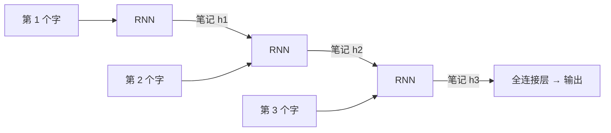
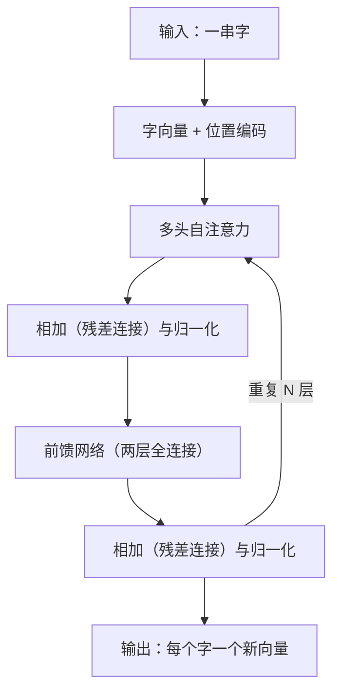
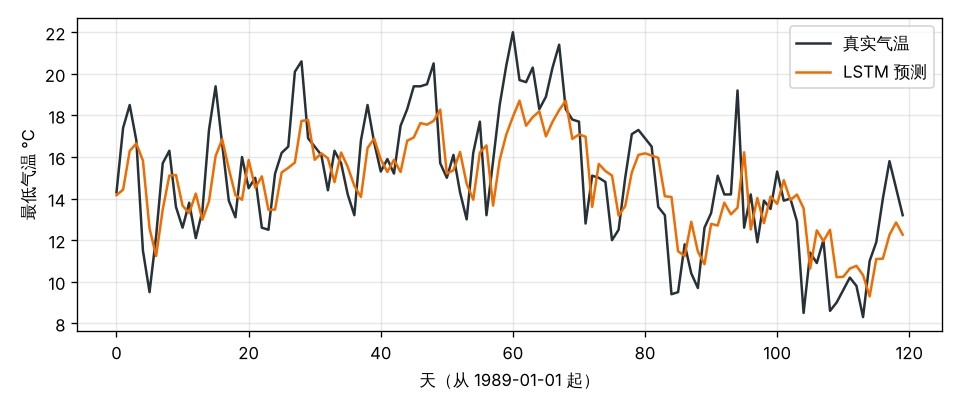
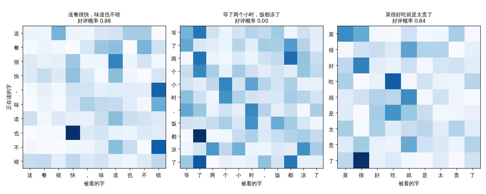
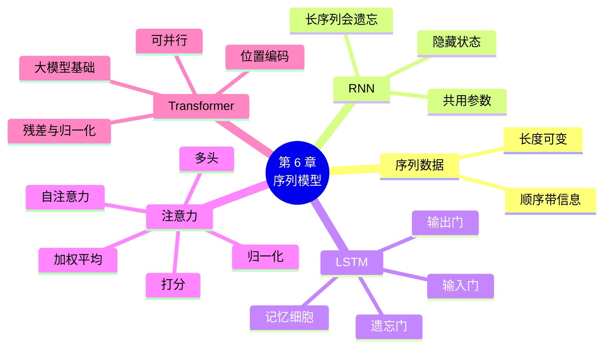

# 第 6 章 序列模型：从 RNN 到 Transformer

!!! abstract "本章学时"
    线上理论 3 学时 · 线下 1 学时 · 实验 2 学时（本章共 3 个实验，教师可任选）

## 学习目标

学完本章，你应该能够：

1. **说出**序列数据、循环神经网络、隐藏状态、LSTM、门、注意力、自注意力、多头注意力、位置编码、Transformer 的含义（记忆）；
2. **解释**简单 RNN 为什么记不住长序列前面的信息，LSTM 的三道门各起什么作用（理解）；
3. **计算**一个小例子的注意力权重，并从注意力热力图中读出每个词在关注谁（应用）；
4. 用 PyTorch 的 `nn.LSTM`、`nn.MultiheadAttention`、`nn.TransformerEncoder` **搭建**序列模型并完成训练（应用）；
5. 根据任务特点**选择** CNN、RNN 或 Transformer（评价）。

!!! info "先修要求"
    学习本章前，你需要掌握：

    - 本书第 3 章：梯度消失、残差连接（[3.4 深层网络的难题](../03-backprop/index.md#34)）；
    - 本书第 5 章：卷积神经网络的结构（[5.4 经典结构](../05-cnn/index.md#54)）；
    - 学过《自然语言处理导论》的同学，本章 6.4、6.5 节是复习；本章不讲文本处理的细节，那些在第 8 章和《自然语言处理导论》中学习。

??? abstract "本章概念清单（13 个，点击查看定义和例子）"
    1. [序列数据](../../appendix/glossary.md#g-序列数据)
    2. [循环神经网络](../../appendix/glossary.md#g-循环神经网络)
    3. [隐藏状态](../../appendix/glossary.md#g-隐藏状态)
    4. [LSTM](../../appendix/glossary.md#g-LSTM)
    5. [记忆细胞](../../appendix/glossary.md#g-记忆细胞)
    6. [遗忘门](../../appendix/glossary.md#g-遗忘门)
    7. [输入门](../../appendix/glossary.md#g-输入门)
    8. [输出门](../../appendix/glossary.md#g-输出门)
    9. [注意力](../../appendix/glossary.md#g-注意力)
    10. [自注意力](../../appendix/glossary.md#g-自注意力)
    11. [多头注意力](../../appendix/glossary.md#g-多头注意力)
    12. [位置编码](../../appendix/glossary.md#g-位置编码)
    13. [Transformer](../../appendix/glossary.md#g-Transformer)

## 情景导入

用手机打字时，输入法会猜你下一个字要打什么。打“今天天气”，它会提示“很好”“怎么样”；打“我想吃火”，它会提示“锅”。输入法能猜对，是因为它记住了你前面打的字，而且知道哪些字和下一个字关系最大。

再看一句话：“我在成都长大，大学毕业后去了上海工作，过年回家最想吃的还是家乡的＿＿。”要填出“火锅”或“串串”，你必须记住句子开头的“成都”，哪怕它和空格之间隔了二十多个字。

一句话、一段语音、一个月的气温、一只股票每天的价格，都是有先后顺序的数据，叫**序列**。处理序列的网络要解决两个问题：一是怎样把前面读过的内容“记”下来；二是在需要的时候，怎样找到前面最相关的那部分。本章沿着历史的顺序，介绍三代解决办法：循环神经网络（RNN）、长短期记忆网络（[LSTM](../../appendix/glossary.md#g-LSTM "长短期记忆网络，用记忆细胞和三道门管理信息，能记住更长距离的内容"){ .term }）和 Transformer。今天的大语言模型，都是用第三种搭起来的。

## 6.1 序列数据与循环神经网络 { #61 }

### 6.1.1 什么是序列数据 { #611 }

[**序列数据**](../../appendix/glossary.md#g-序列数据 "按顺序排列、顺序本身带有信息的数据"){ .term }是按顺序排列的一串数据，顺序本身带着信息。把“我爱你”的顺序打乱成“你爱我”，意思就变了；把一个月的气温顺序打乱，就看不出“越来越冷”的趋势了。

| 序列 | 每一步是什么 | 常见任务 |
|---|---|---|
| 一句话 | 一个字或一个词 | 情感分类、翻译、写文章 |
| 一段语音 | 每 10 毫秒的声音特征 | 语音识别 |
| 每天的气温、销量、股价 | 一天的数值 | 预测明天 |
| 一段视频 | 一帧画面 | 动作识别 |

第 1～5 章的网络都是一次看完整个输入，输入的大小也是固定的。可是一句话可长可短；而且同一个词出现在句首还是句尾，作用应该一样，就像第 5 章中同一个图案出现在图的哪里都要认出来。

### 6.1.2 循环神经网络：同一个网络一步步读 { #612 }

[**循环神经网络**](../../appendix/glossary.md#g-循环神经网络 "一步步读序列、每一步把当前输入和旧的隐藏状态结合成新隐藏状态的网络"){ .term }（Recurrent Neural Network，RNN）的做法，和人读书很像：一个字一个字地读，边读边在心里记“笔记”。这份笔记叫[**隐藏状态**](../../appendix/glossary.md#g-隐藏状态 "RNN 读到某一步时的“笔记”，概括了到目前为止读过的内容"){ .term }，是一个向量。每读一个字，网络就做一件事：

$$\text{新笔记} = \tanh(\,W \times \text{当前的字} + U \times \text{旧笔记} + b\,)$$

也就是：把当前的字和旧笔记结合起来，写成新笔记。读完最后一个字，最后那份笔记就“概括”了整个序列，再接一个全连接层，就能做分类或预测。



图中画了三个方框，但它们是**同一个网络**，用的是**同一套参数** $W$、$U$、$b$，只是在不同的时刻重复使用。这和卷积核在图上滑动、到处使用同一套参数的道理相同。所以，不管序列有多长，RNN 的参数个数都不变。

### 6.1.3 在 PyTorch 中使用 RNN { #613 }

PyTorch 中，循环层的输入形状是“**批量 × 步数 × 每步的特征数**”（要写 `batch_first=True`）。实验 6-1 用前 30 天的气温预测第 31 天，64 个样本一批，输入形状就是 64 × 30 × 1：

```python
from torch import nn
rnn = nn.RNN(input_size=1, hidden_size=32, batch_first=True)   # 每步 1 个数，笔记是 32 维
out, h = rnn(x)              # x：64×30×1
# out：64×30×32，每一步的笔记都在里面；h：最后一步的笔记
pred = head(out[:, -1])      # 取最后一步的笔记，接全连接层 head = nn.Linear(32, 1)
```

## 6.2 RNN 的困境：长句子前面的信息忘了 { #62 }

简单 RNN 在短序列上效果不错，但序列一长，就记不住前面的内容了。原因和第 3 章讲的梯度消失一样。

每读一个字，旧笔记都要乘上 $U$ 再经过 $\tanh$。这就像传话游戏：第一个人说的话，经过一个人传一次就走样一点，传过二十个人，基本就面目全非了。反过来训练时，误差要从最后一步一步步传回第一步，每传一步都要乘一次，第 3 章算过，很多个小于 1 的数连乘，会迅速变得接近 0。于是开头那个字对结果的影响几乎是 0，网络也就学不会利用它。<sup class="cite">[[4]](#ref6-4)</sup>

回到情景导入的例子：读到空格时，“成都”已经隔了二十多个字，简单 RNN 的笔记里早就没有它了。

## 6.3 LSTM：用三道门管住记忆 { #63 }

**长短期记忆网络**（Long Short-Term Memory，LSTM）在 1997 年提出，专门解决“记不长”的问题。<sup class="cite">[[5]](#ref6-5)</sup> 它的公式比较长，这里只讲直觉。

LSTM 在隐藏状态之外，多了一条[**记忆细胞**](../../appendix/glossary.md#g-记忆细胞 "LSTM 中贯穿各步的“传送带”，信息可以几乎不变地往后传"){ .term }，可以想象成一条贯穿始终的传送带，或者一本“重点笔记本”。信息在传送带上往后传时，不再每一步都被乘一遍、改一遍，而是由三道**门**来管理。门是一个 0 到 1 之间的数（用 Sigmoid 算出来），0 表示“关”，1 表示“开”：

| 门 | 管什么 | 打个比方 | 例子 |
|---|---|---|---|
| [**遗忘门**](../../appendix/glossary.md#g-遗忘门 "LSTM 中决定旧记忆保留多少的门"){ .term } | 旧的记忆留多少 | 笔记本上哪些内容可以擦掉 | 读到新的主语时，忘掉旧的主语 |
| [**输入门**](../../appendix/glossary.md#g-输入门 "LSTM 中决定写入多少新内容的门"){ .term } | 新的内容写多少 | 哪些新内容值得记下来 | 读到“成都”时，记下来 |
| [**输出门**](../../appendix/glossary.md#g-输出门 "LSTM 中决定这一步拿出多少记忆来用的门"){ .term } | 这一步拿出多少记忆来用 | 这一步需要翻看哪些笔记 | 要填空时，把“成都”拿出来用 |

关键在遗忘门：当它接近 1、输入门接近 0 时，记忆细胞几乎原样往后传，就像传送带上的箱子没人动它，传多远都不会走样。门的开关不是人设定的，而是网络从数据中学出来的：网络自己学会“什么时候该记、什么时候该忘”。

<iframe class="sim-frame" src="../../sims/rnn-lstm/main.html" height="720" loading="lazy" title="RNN 与 LSTM 逐步展开"></iframe>

动画：RNN 与 LSTM 逐步展开。选第二个例句（开头是“中奖”，后面是 15 个普通的词），先用简单 RNN 读，再切换成 LSTM 读，比较开头的词对最终判断的影响还剩多少。[全屏打开](../../sims/rnn-lstm/main.html){ target=_blank }
{ .sim-caption }

在 PyTorch 中，把 `nn.RNN` 换成 `nn.LSTM` 即可，用法几乎一样（返回的最后状态多了记忆细胞）：

```python
lstm = nn.LSTM(input_size=1, hidden_size=32, batch_first=True)
out, (h, c) = lstm(x)        # h 是最后一步的隐藏状态，c 是最后一步的记忆细胞
```

LSTM 的参数大约是同样大小的简单 RNN 的 4 倍（实验 6-1 中分别是 4513 个和 1153 个），因为三道门和候选记忆各有一套参数。2014 年提出的 **GRU** 把三道门简化成两道，参数少一些，效果和 LSTM 差不多，PyTorch 中是 `nn.GRU`。

## 6.4 注意力：读到这里时该看哪里 { #64 }

### 6.4.1 不再只靠一份笔记 { #641 }

LSTM 记得更久了，但还有一个限制：不管句子多长，读完后所有内容都要挤进一份固定大小的笔记里。翻译一句 50 个字的长句子时，这份笔记就不够用了。

2014 年，研究人员提出了[**注意力**](../../appendix/glossary.md#g-注意力 "回头看所有位置，按相关程度打分、归一化后加权平均的计算方法"){ .term }机制：不要只依赖最后一份笔记，而是把每一步的笔记都留着；需要的时候，回头看所有的字，按“与当前任务有多相关”打分，相关的多看，不相关的少看。<sup class="cite">[[6]](#ref6-6)</sup> 这就像考试时开卷查资料，不用把整本书背下来，只要知道该翻到哪一页。

### 6.4.2 算一算：三个词的自注意力 { #642 }

一句话里的每个词都去“看”同一句话里的所有词（包括自己），叫[**自注意力**](../../appendix/glossary.md#g-自注意力 "一句话中的每个词都去看同一句话里的所有词的注意力"){ .term }。计算分三步：

1. **打分**：两个词的向量做点积（对应位置相乘再相加），点积越大说明越相关；再除以向量长度的平方根，让分数不至于太大；
2. **归一化**：每一行用 Softmax 变成加起来等于 1 的**注意力权重**（第 1 章学过 Softmax）；
3. **加权平均**：按权重把所有词的向量加起来，得到这个词新的向量。

看一个最小的例子。三个词 A、B、C，每个词用 2 个数表示：A = (1, 0)，B = (0, 1)，C = (1, 1)。

**第 1 步，打分**。A 和 A 的点积是 1×1 + 0×0 = 1，A 和 B 是 0，A 和 C 是 1；除以 √2 ≈ 1.414，得到 A 这一行的分数 (0.707, 0, 0.707)。

**第 2 步，归一化**。$e^{0.707} \approx 2.028$，$e^{0} = 1$，A 这一行的权重是：

$$\left(\frac{2.028}{5.056},\ \frac{1}{5.056},\ \frac{2.028}{5.056}\right) \approx (0.401,\ 0.198,\ 0.401)$$

A 主要看自己和 C（它们都有“第一个数是 1”这个特点），较少看 B。

**第 3 步，加权平均**。A 的新向量 = 0.401 × (1, 0) + 0.198 × (0, 1) + 0.401 × (1, 1) = (0.802, 0.599)。

实验 6-2 第 1 部分用 PyTorch 的 `nn.MultiheadAttention` 算了同一个例子，三行权重和输出与手算完全一致。

<iframe class="sim-frame" src="../../sims/self-attention/main.html" height="720" loading="lazy" title="自注意力热力图"></iframe>

动画：自注意力热力图。每一行是一个词对所有词的注意力权重，颜色越深权重越大。点“它”这一行，看看“它”最关注哪个词。[全屏打开](../../sims/self-attention/main.html){ target=_blank }
{ .sim-caption }

真实的注意力层还多了一步：每个词的向量先分别乘上三个矩阵，变成**查询**（我想找什么）、**键**（我有什么特点）、**值**（我能提供什么内容）三个向量，用查询和键打分，再对值加权平均。这三个矩阵是训练出来的，网络因此能学会“按什么标准”去找相关的词。上面的小例子相当于把三个矩阵都设成了“原样不变”。

## 6.5 Transformer：看懂一张结构图 { #65 }

2017 年，谷歌的研究人员发表论文《注意力就是你所需要的一切》，提出了 [**Transformer**](../../appendix/glossary.md#g-Transformer "完全基于注意力的序列模型，由多头自注意力、前馈网络、残差连接与归一化重复堆叠而成"){ .term }：完全去掉循环，只用注意力来处理序列。<sup class="cite">[[7]](#ref6-7)</sup> 今天的大语言模型几乎都建立在它的基础上。下图是 Transformer 编码器的结构：



图中每个部分，用一句话说明：

| 部分 | 一句话说明 |
|---|---|
| [**位置编码**](../../appendix/glossary.md#g-位置编码 "给每个位置加上的向量，告诉网络每个字在第几位"){ .term } | 注意力本身不管顺序（把字打乱，每个字算出的结果不变），所以要给每个位置加一个“位置向量”，告诉网络每个字在第几位 |
| [**多头注意力**](../../appendix/glossary.md#g-多头注意力 "同时做多组注意力、结果拼起来，不同的头关注不同的关系"){ .term } | 同时做好几组注意力（比如 8 个“头”），有的头关注语法关系，有的头关注指代关系，最后把结果拼起来 |
| **残差连接与归一化** | 第 3 章讲过的两个对策，让几十上百层的网络也能稳定训练 |
| **前馈网络** | 每个字的向量各自经过两层全连接网络，做进一步加工 |
| **重复 N 层** | 原论文 6 层，大语言模型有几十到上百层 |

Transformer 比 RNN 强在两点：一是**任意两个字之间一步就能“看到”**，不用像 RNN 那样一步步传，长距离的信息不会丢；二是**可以并行计算**，RNN 必须读完第 1 个字才能读第 2 个字，而 Transformer 中所有字的注意力可以同时算，非常适合在 GPU 上大规模训练。

Transformer 有两种用法：只用编码器的（如 BERT），擅长“读懂”一段文字，用来做分类、抽取，第 8 章会用到；只用解码器的（如 GPT 系列、国产的通义千问、DeepSeek），在注意力中加了“掩码”，每个字只能看到前面的字，擅长一个字一个字地“写”。Transformer 的详细计算和大语言模型的原理，在《自然语言处理导论》第 9 章学习。

在 PyTorch 中，可以直接使用现成的 Transformer 编码器层（实验 6-3）：

```python
layer = nn.TransformerEncoderLayer(d_model=32, nhead=4, dim_feedforward=64, batch_first=True)
encoder = nn.TransformerEncoder(layer, num_layers=2)    # 叠 2 层
```

!!! cert "证书考点"
    RNN、LSTM、Transformer 的特点比较，以及“自注意力”“多头注意力”“位置编码”的作用，是人工智能训练师（三级）和各类人工智能应用工程师证书理论考试中的常见概念题。可以对照 6.6 节的表格复习（详见[证书考点对照](../../certificate.md)）。

## 6.6 CNN、RNN、Transformer 怎么选 { #66 }

| 比较项 | CNN | RNN / LSTM | Transformer |
|---|---|---|---|
| 擅长的数据 | 图像这类“面”状数据，局部图案重要 | 不太长的序列 | 长序列、大数据 |
| 怎样看全局 | 一层层叠加，越往后看得越大 | 一步步传，前面的信息会慢慢减弱 | 任意两个位置一步就能互相看到 |
| 能否并行计算 | 能 | 不能，必须一步接一步 | 能 |
| 数据量要求 | 中等 | 小到中等 | 大，数据少时容易过拟合 |
| 典型应用 | 图片分类、目标检测 | 小规模的时间序列预测、简单文本分类 | 大语言模型、机器翻译、视觉 Transformer |

实际项目中可以这样选：处理图片，先试 CNN 或预训练好的视觉模型（第 7 章）；处理文本，优先用预训练好的 Transformer 模型（第 8 章）；数据量小、序列不长、设备算力有限时（比如单片机上预测传感器读数），LSTM 依然是简单实用的选择。

## 6.7 示范例题 { #67 }

**例题** 一个训练好的情感分类模型读评论“外卖 / 送 / 得 / 很 / 慢”时，某个注意力头的权重如下（示意数据，每行是“正在读的词”对所有词的注意力）：

| 正在读的词 ＼ 被看的词 | 外卖 | 送 | 得 | 很 | 慢 |
|---|---|---|---|---|---|
| 外卖 | 0.40 | 0.30 | 0.05 | 0.05 | 0.20 |
| 送 | 0.35 | 0.20 | 0.05 | 0.10 | 0.30 |
| 得 | 0.10 | 0.30 | 0.20 | 0.10 | 0.30 |
| 很 | 0.05 | 0.05 | 0.05 | 0.25 | 0.60 |
| 慢 | 0.10 | 0.35 | 0.05 | 0.15 | ？ |

（1）表中“？”应是多少？（2）读“很”时最关注哪个词？说明什么？（3）读“慢”时，除了自己，最关注哪个词？（4）哪个词平均“被看”得最多？

**解题思路**：注意力权重每行加起来等于 1；读某一行，找最大的数；“被看”得多少看列。

**第 1 步**：1 − (0.10 + 0.35 + 0.05 + 0.15) = **0.35**。

**第 2 步**：“很”这一行最大的是 0.60，对应“慢”。程度副词“很”在修饰“慢”，注意力把两者联系起来了。

**第 3 步**：“慢”这一行，除了自己（0.35），最大的是“送”（0.35）。模型知道“慢”说的是“送得慢”。

**第 4 步**：各列平均值：外卖 (0.40 + 0.35 + 0.10 + 0.05 + 0.10) ÷ 5 = 0.20；送 0.24；得 0.08；很 0.13；慢 (0.20 + 0.30 + 0.30 + 0.60 + 0.35) ÷ 5 = 0.35。“慢”被看得最多，这也是决定这条评论是差评的关键词。

**答**：（1）0.35；（2）“慢”，说明“很”修饰“慢”；（3）“送”；（4）“慢”。

**举一反三**：注意力权重大，只说明模型计算时“参考”这个词多，并不一定等于“这个词就是判断的理由”。实验 6-2 中会看到，一个小模型的注意力有时会落在“了”“，”这类字上。读热力图时要结合常识判断，不要过度解读。

## 6.8 前沿视窗 { #68 }

**大模型为什么都用 Transformer**。原因主要有三个：一是可以并行计算，能把成千上万块 GPU 同时用起来；二是“规模越大效果越好”的规律在 Transformer 上特别明显，参数和数据加大十倍，效果会稳定地提升；三是同一种结构既能处理文字，也能处理图片（第 5 章的视觉 Transformer）、语音，便于做多模态大模型。

**状态空间模型**。Transformer 的注意力要让每两个字都打一次分，句子长度翻一倍，计算量就变成四倍，处理几十万字的长文档很吃力。2023 年提出的 Mamba 等“状态空间模型”，又回到了“一步步读、边读边记”的思路，但用新的方法让它也能并行训练，计算量只随长度成倍增长。<sup class="cite">[[8]](#ref6-8)</sup> 现在已有把 Transformer 和状态空间模型混合使用的大模型。可以说，RNN 的思想并没有过时。

## 本章实验

!!! abstract "实验总览"
    | 实验 | 类型 | 建议时长 | 内容 |
    |---|---|---|---|
    | 实验 6-1 | ★ 基础 | 40 分钟 | 用前 30 天的气温预测第 31 天，比较“明天和今天一样”、简单 RNN、LSTM |
    | 实验 6-2 | ★ 基础 | 40 分钟 | 用 `nn.MultiheadAttention` 核对手算的注意力；训练一个外卖评论注意力分类器，画注意力热力图 |
    | 实验 6-3 | ☆ 拓展 | 25 分钟 | 同一气温预测任务换成 Transformer 编码器，与 LSTM 比较误差和速度 |

    三个实验都在本机 CPU 上运行，每个都在 30 秒内完成。第一次运行会自动下载气温数据（约 70 KB）和外卖评论数据（约 1 MB），见附录 B。代码见配套资源 `labs/ch06/` 目录。

### 实验 6-1 ★ 用 LSTM 预测下一天的气温 { #6-1 }

**实验目的**

1. 把一串时间序列切成“前 30 天 → 第 31 天”的样本；
2. 用 `nn.RNN` 和 `nn.LSTM` 搭建预测模型，理解输入输出的形状；
3. 和最简单的猜法比较，判断模型是否真的有用。

**实验环境**：本机 CPU，Python 3.11，PyTorch、Matplotlib。

**实验数据**：澳大利亚墨尔本 1981—1990 年每天的最低气温，共 3650 天，来自澳大利亚气象局，由 Jason Brownlee 整理公开。<sup class="cite">[[9]](#ref6-9)</sup> 前 8 年（2920 天）训练，后 2 年（730 天）测试。

**实验步骤与代码**

第 1 步，标准化并切分样本（在 `common06.py` 中）。注意平均值和标准差**只用训练部分**来算，不能偷看测试部分（第 4 章讲过的数据泄露）：

```python
MEAN, STD = TEMPS[:N_TRAIN].mean(), TEMPS[:N_TRAIN].std()
Z = torch.tensor((TEMPS - MEAN) / STD)            # 标准化

def make_windows(start, end):                     # 目标日期在 [start, end) 之间的样本
    xs = torch.stack([Z[t - WINDOW:t] for t in range(max(start, WINDOW), end)])   # 前 30 天
    ys = torch.stack([Z[t] for t in range(max(start, WINDOW), end)])              # 第 31 天
    return xs.unsqueeze(-1), ys                   # 输入加一维，变成 N×30×1
```

第 2 步，先算最简单的猜法“明天和今天一样”的误差，作为**基准**。模型如果连它都比不过，就没有用。

第 3 步，搭建模型：循环层读完 30 天，取最后一步的隐藏状态接全连接层，输出一个数。

```python
class SeqModel(nn.Module):
    def __init__(self, cell="lstm", hidden=32):
        super().__init__()
        rnn_class = nn.LSTM if cell == "lstm" else nn.RNN
        self.rnn = rnn_class(input_size=1, hidden_size=hidden, batch_first=True)
        self.head = nn.Linear(hidden, 1)

    def forward(self, x):                         # x：批量×30×1
        out, _ = self.rnn(x)                      # out：批量×30×32
        return self.head(out[:, -1]).squeeze(-1)  # 只用最后一天的隐藏状态
```

第 4 步，用均方误差损失、Adam（学习率 0.005）训练 20 轮，计算测试集上的平均绝对误差（换算回摄氏度），画出测试期前 120 天的预测曲线。

完整代码见 `common06.py` 和 `lab6_1_lstm_temperature.py`。

**运行结果**

```text
共 3650 天，1981-01-01 到 1990-12-31；训练部分平均 11.11 ℃，标准差 4.06 ℃
训练样本 (2890, 30, 1)，测试样本 (730, 30, 1)（样本数 × 天数 × 每天 1 个数）

① 猜“明天和今天一样”：平均误差 1.953 ℃

② 简单 RNN：参数 1153
  [② 简单 RNN] 第  1 轮：测试集平均误差 1.785 ℃
  [② 简单 RNN] 第  5 轮：测试集平均误差 1.764 ℃
  [② 简单 RNN] 第 10 轮：测试集平均误差 1.899 ℃
  [② 简单 RNN] 第 15 轮：测试集平均误差 1.758 ℃
  [② 简单 RNN] 第 20 轮：测试集平均误差 1.771 ℃
② 简单 RNN：测试集平均误差 1.771 ℃，用时 3 秒

③ LSTM：参数 4513
  [③ LSTM] 第  1 轮：测试集平均误差 1.898 ℃
  [③ LSTM] 第  5 轮：测试集平均误差 1.755 ℃
  [③ LSTM] 第 10 轮：测试集平均误差 1.811 ℃
  [③ LSTM] 第 15 轮：测试集平均误差 1.731 ℃
  [③ LSTM] 第 20 轮：测试集平均误差 1.744 ℃
③ LSTM：测试集平均误差 1.744 ℃，用时 2 秒

预测曲线已保存到 lab6_1_forecast.png

测试期前 5 天：
  1989-01-01：真实 14.3 ℃，LSTM 预测 14.2 ℃
  1989-01-02：真实 17.4 ℃，LSTM 预测 14.4 ℃
  1989-01-03：真实 18.5 ℃，LSTM 预测 16.3 ℃
  1989-01-04：真实 16.8 ℃，LSTM 预测 16.6 ℃
  1989-01-05：真实 11.5 ℃，LSTM 预测 15.8 ℃
```



几点解读：

- 两个模型的误差（约 1.75 ℃）都比“明天和今天一样”（1.95 ℃）小约 0.2 ℃，说明它们确实从前 30 天中学到了一些规律，比如季节的变化趋势。
- 在这个任务上，LSTM 只比简单 RNN 好一点点。30 天不算长，而且预测明天主要靠最近几天，简单 RNN 记得住。LSTM 的优势要在长序列中才明显（看 6.3 节的动画）。
- 从曲线看，预测线比真实线平滑，而且常常“慢半拍”：气温突然升降（比如冷空气来了）时，模型只靠过去的气温是猜不到的。要预测得更准，需要加入气压、风向等更多信息。这是“数据决定上限”的又一个例子。

**实验记录表**

| 做法 | 参数个数 | 测试集平均误差（℃） | 用时 |
|---|---|---|---|
| 明天和今天一样 | 0 | | — |
| 简单 RNN | | | |
| LSTM | | | |

**常见问题排查**

| 现象 | 原因 | 解决办法 |
|---|---|---|
| 下载 `daily-min-temperatures.csv` 失败 | 访问 GitHub 不稳定 | 按附录 B 手动下载后放到 `labs/data/` |
| `input.size(-1) must be equal to input_size` | 输入少了最后一维，形状是 N×30 而不是 N×30×1 | 用 `unsqueeze(-1)` 补上 |
| 误差比书上大很多，预测线是一条直线 | 忘了标准化，或学习率太大 | 检查是否用了标准化后的 `Z`；学习率改为 0.001 试试 |

**思考与练习**

1. 把 `hidden_size` 从 32 改成 8 和 128，误差有什么变化？
2. 为什么一定要和“明天和今天一样”比较？只报告“LSTM 的误差是 1.74 ℃”有什么问题？

**实验报告要求**

提交预测曲线图和记录表，用不超过 200 字分析：模型在哪些日子预测得不好，为什么？

### 实验 6-2 ★ 用现成的多头注意力层，画一句话的注意力热力图 { #6-2 }

**实验目的**

1. 用 `nn.MultiheadAttention` 验证 6.4.2 节手算的注意力；
2. 搭建一个“字向量 + 位置向量 + 多头自注意力”的文本分类器；
3. 画出注意力热力图，学会读图，也认识到注意力的局限。

**实验环境**：本机 CPU，Python 3.11，PyTorch、Matplotlib。

**实验数据**：第 1 部分是 6.4.2 节的 3 个词；第 2 部分是外卖平台用户评论数据集 waimai_10k，约 1.2 万条，其中好评约 4000 条、差评约 8000 条。<sup class="cite">[[10]](#ref6-10)</sup> 随机取 2000 条作测试集，其余训练。第 8 章还会用这份数据做完整的文本分类项目。

**实验步骤与代码**

第 1 步，手算注意力，再用 PyTorch 核对。`nn.MultiheadAttention` 内部会把输入乘上查询、键、值三个矩阵，这里把它们都设成单位矩阵（原样不变），就和手算的完全一样了：

```python
scores = X @ X.T / 2 ** 0.5             # 打分：点积 ÷ √2
weights = scores.softmax(dim=-1)        # 归一化
out = weights @ X                       # 加权平均

mha = nn.MultiheadAttention(embed_dim=2, num_heads=1, bias=False, batch_first=True)
with torch.no_grad():
    mha.in_proj_weight[:] = torch.cat([torch.eye(2)] * 3)    # 查询、键、值矩阵都设为单位矩阵
    mha.out_proj.weight[:] = torch.eye(2)
out2, w2 = mha(X[None], X[None], X[None])                    # 查询、键、值都是同一句话
```

第 2 步，把评论按字编号（每条最多 40 个字，不足的补 0），搭建注意力分类器：

```python
class AttnClassifier(nn.Module):
    def __init__(self, vocab_size, dim=64, heads=4):
        super().__init__()
        self.emb = nn.Embedding(vocab_size, dim, padding_idx=0)   # 字向量（第 8 章详细讲）
        self.pos = nn.Embedding(MAXLEN, dim)                      # 位置向量
        self.attn = nn.MultiheadAttention(dim, heads, batch_first=True)
        self.head = nn.Linear(dim, 2)

    def forward(self, x, return_attn=False):
        pad = x == 0                                              # 补齐的位置不参与注意力
        h = self.emb(x) + self.pos(torch.arange(x.shape[1]))
        a, w = self.attn(h, h, h, key_padding_mask=pad)           # w 是注意力权重（4 个头的平均）
        h = h + a                                                 # 残差连接
        ...                                                       # 对所有字取平均，接全连接层
```

第 3 步，用 Adam 训练 5 轮；然后输入三条自己写的评论，取出注意力权重画成热力图。

完整代码见 `lab6_2_attention_heatmap.py`。

**运行结果**

```text
第 1 部分：手算注意力
打分（点积 ÷ √2）：
 tensor([[0.707, 0.000, 0.707],
        [0.000, 0.707, 0.707],
        [0.707, 0.707, 1.414]])
注意力权重（每行加起来等于 1）：
 tensor([[0.401, 0.198, 0.401],
        [0.198, 0.401, 0.401],
        [0.248, 0.248, 0.503]])
输出：
 tensor([[0.802, 0.599],
        [0.599, 0.802],
        [0.752, 0.752]])
nn.MultiheadAttention 的注意力权重：
 tensor([[0.401, 0.198, 0.401],
        [0.198, 0.401, 0.401],
        [0.248, 0.248, 0.503]])
两种算法的输出最大相差： 0.0

第 2 部分：外卖评论好评 / 差评分类
评论 11987 条（训练 9987，测试 2000），不同的字 2558 个，每条最多取 40 个字
  第 1 轮：测试准确率 0.8525
  第 2 轮：测试准确率 0.8745
  第 3 轮：测试准确率 0.8705
  第 4 轮：测试准确率 0.8785
  第 5 轮：测试准确率 0.8795

“送餐很快，味道也不错”：好评概率 0.877；最受关注的字：道(0.17)、错(0.17)、快(0.15)

“等了两个小时，饭都凉了”：好评概率 0.003；最受关注的字：了(0.16)、都(0.12)、时(0.10)

“菜很好吃就是太贵了”：好评概率 0.839；最受关注的字：很(0.18)、就(0.17)、吃(0.14)

热力图已保存到 lab6_2_heatmap.png
```



几点解读：

- 第 1 部分：PyTorch 算出的权重和手算的一样，输出相差 0。
- 一个只有一层注意力的小模型，训练 5 轮，测试准确率达到 87.95%。
- 看第一张热力图：“不”这一行最深的格子在“错”，模型把“不”和“错”联系起来了，“不错”是好评；“，”这一行也主要看“错”。第三条评论里，“好”这一行主要看“很”。这些都符合我们的语感。
- 也有不太好解释的地方：第二条评论里，“了”和“都”最受关注，而真正表达不满的“凉”“两个小时”反而不突出。这说明注意力权重只是模型计算的中间结果，**不一定等于模型做判断的理由**。第三条评论“菜很好吃就是太贵了”褒贬都有，模型判为好评（0.839），人看可能觉得偏中性。

**实验记录表**

| 项目 | 你的结果 |
|---|---|
| 手算的 A 行权重与 PyTorch 结果是否一致 | |
| 第 5 轮测试准确率 | |
| 你自己写的一条评论及好评概率 | |
| 这条评论中最受关注的 3 个字 | |
| 你认为这些字是否合理 | |

**常见问题排查**

| 现象 | 原因 | 解决办法 |
|---|---|---|
| 热力图中的中文显示成方框 | 电脑上没有中文字体 | 见附录 B“Matplotlib 中文显示” |
| `key_padding_mask` 相关的报错 | 掩码的形状或类型不对 | 掩码形状要是“批量 × 字数”，类型是布尔值（`x == 0`） |
| 每次运行热力图都不一样 | 模型训练的随机性 | 已用 `set_seed(42)` 固定；换了电脑或版本，热力图会有差异，整体规律相近即可 |

**思考与练习**

1. 修改 `examples` 列表，输入一条带“但是”的评论（如“包装很好但是菜太咸了”），看看模型判为好评还是差评，注意力落在哪里。
2. 把注意力头数 `heads` 从 4 改为 1，准确率有什么变化？

**实验报告要求**

提交热力图和记录表，用不超过 200 字说明：从热力图中你能读出什么？为什么说“注意力不等于理由”？

### 实验 6-3 ☆ 同一任务换成 Transformer 编码器，对比效果和速度 { #6-3 }

**实验目的**

1. 用 `nn.TransformerEncoder` 搭建一个时间序列预测模型；
2. 理解位置编码的作用和写法；
3. 在小数据、CPU 上比较 LSTM 和 Transformer 的效果与速度。

**实验环境**：本机 CPU，Python 3.11，PyTorch。

**实验数据**：与实验 6-1 相同。

**实验步骤与代码**

第 1 步，搭建 Transformer 模型：每天的 1 个气温值先用全连接层变成 32 维向量，加上可学习的位置向量，经过 2 层 Transformer 编码器，取最后一天的输出做预测。

```python
class TransformerModel(nn.Module):
    def __init__(self, dim=32, heads=4, layers=2):
        super().__init__()
        self.inp = nn.Linear(1, dim)
        self.pos = nn.Parameter(torch.zeros(WINDOW, dim))      # 可学习的位置向量，每个位置一个
        layer = nn.TransformerEncoderLayer(d_model=dim, nhead=heads, dim_feedforward=64,
                                           dropout=0.0, batch_first=True)
        self.encoder = nn.TransformerEncoder(layer, num_layers=layers)
        self.head = nn.Linear(dim, 1)

    def forward(self, x):
        h = self.inp(x) + self.pos           # 加上位置向量
        h = self.encoder(h)
        return self.head(h[:, -1]).squeeze(-1)
```

第 2 步，LSTM 与实验 6-1 相同。两个模型都训练 20 轮；Transformer 的学习率用 0.001（太大时训练不稳定），LSTM 用 0.005。

完整代码见 `lab6_3_transformer.py`。

**运行结果**（省略了每轮的输出）

```text
汇总：
  LSTM         参数   4513  测试集平均误差 1.744 ℃  训练用时 2.6 秒
  Transformer  参数  18145  测试集平均误差 1.728 ℃  训练用时 7.9 秒
```

几点解读：

- 两个模型的误差几乎一样（相差 0.016 ℃）。这个任务的难点在于天气本身的随机性，换什么模型都差不多。
- Transformer 参数是 LSTM 的 4 倍，在 CPU 上训练用时约 3 倍。在短序列、小数据、没有 GPU 的情况下，Transformer 并不占优。它的优势在长序列、大数据和 GPU 并行计算时才能发挥出来（6.6 节）。
- 实际项目中，选模型要“量体裁衣”，最新的不一定最合适。

**实验记录表**

| 模型 | 参数个数 | 测试集平均误差（℃） | 训练用时 |
|---|---|---|---|
| LSTM | | | |
| Transformer | | | |

**常见问题排查**

| 现象 | 原因 | 解决办法 |
|---|---|---|
| `embed_dim must be divisible by num_heads` | 向量维数不能被头数整除 | `dim` 要是 `heads` 的整数倍，如 32 和 4 |
| Transformer 误差很大、不收敛 | 学习率太大 | 用 0.001 或更小 |

**思考与练习**

1. 去掉位置向量（`forward` 中不加 `self.pos`），误差有什么变化？为什么？
2. 把编码器层数从 2 改成 1 和 4，记录参数、误差和用时。

**实验报告要求**

提交记录表，用不超过 200 字说明：在什么情况下你会选 LSTM，什么情况下会选 Transformer？

## 本章小结

- **序列数据**有先后顺序，顺序本身带着信息。
- **循环神经网络**一步步读，每一步把当前输入和旧的**隐藏状态**结合成新的隐藏状态；所有时刻共用同一套参数。序列一长，前面的信息会因为反复相乘而消失。
- **LSTM** 增加一条记忆细胞，用**遗忘门**、**输入门**、**输出门**管理记忆；遗忘门接近 1 时，信息可以传得很远。GRU 是两道门的简化版。
- **注意力**：回头看所有位置，按相关程度打分（点积 ÷ √d）、Softmax 归一化、加权平均。每个词看同一句话里的所有词，叫**自注意力**；同时做多组，叫**多头注意力**。注意力权重不一定等于模型判断的理由。
- **Transformer** = 位置编码 + 多头自注意力 + 前馈网络 + 残差连接与归一化，重复 N 层。任意两个位置一步可见，可以并行计算，是大语言模型的基础。
- 选模型要看数据：图片用 CNN，长文本和大数据用 Transformer，小规模序列 LSTM 依然实用。实验中，LSTM 和 Transformer 在气温预测上效果相近，但 Transformer 在 CPU 上更慢。



**本章自检**

- [ ] 我能说出 RNN 每一步用到哪两样东西，为什么说它“共用一套参数”。
- [ ] 我能用“传话游戏”解释简单 RNN 为什么记不住长句子。
- [ ] 我能说出 LSTM 三道门各管什么。
- [ ] 我能手算一个 2～3 个词的小例子的注意力权重。
- [ ] 我能读一张注意力热力图，并说出注意力权重的局限。
- [ ] 我能说出 Transformer 结构图中每个部分的作用，以及它比 RNN 强在哪里。

**下一章预告**

从第 7 章开始进入“实战”部分。第 7 章做一个完整的图像分类项目：从收集整理照片、划分数据，到训练、评估、保存模型；你会发现，只有几百张照片时从零训练效果有限，而“借用”别人在上百万张照片上训练好的模型，稍加调整就能大幅提高准确率，这就是迁移学习。

## 参考文献

正文中的上标编号（如<sup class="cite">[[1]](#ref6-1)</sup>）对应下面的文献。

<div class="refs" markdown>

**教材与专著**

- <span id="ref6-1"></span>[1] 邱锡鹏. 神经网络与深度学习[M]. 北京: 机械工业出版社, 2020. https://nndl.github.io/.
    <span class="ref-note">第 6 章“循环神经网络”讲 RNN、LSTM、GRU，第 8 章“注意力机制与外部记忆”讲注意力和自注意力，对应 6.1～6.4 节。</span>
- <span id="ref6-2"></span>[2] 阿斯顿·张, 李沐, 扎卡里·C. 立顿, 等. 动手学深度学习（PyTorch 版）[M]. 北京: 人民邮电出版社, 2023. https://zh.d2l.ai/.
    <span class="ref-note">“循环神经网络”“现代循环神经网络”“注意力机制”三章有完整的 PyTorch 代码，对应 6.1～6.5 节。</span>
- <span id="ref6-3"></span>[3] 车万翔, 郭江, 崔一鸣. 自然语言处理：基于预训练模型的方法[M]. 北京: 电子工业出版社, 2021.
    <span class="ref-note">系统介绍 RNN、Transformer 和预训练语言模型在中文自然语言处理中的用法，对应 6.5 节，第 8 章还会用到。</span>

**经典论文**

- <span id="ref6-4"></span>[4] BENGIO Y, SIMARD P, FRASCONI P. Learning long-term dependencies with gradient descent is difficult[J]. IEEE Transactions on Neural Networks, 1994, 5(2): 157-166.
    <span class="ref-note">分析 RNN 难以学习长距离依赖的原因，对应 6.2 节。</span>
- <span id="ref6-5"></span>[5] HOCHREITER S, SCHMIDHUBER J. Long short-term memory[J]. Neural Computation, 1997, 9(8): 1735-1780.
    <span class="ref-note">提出 LSTM，对应 6.3 节。</span>
- <span id="ref6-6"></span>[6] BAHDANAU D, CHO K, BENGIO Y. Neural machine translation by jointly learning to align and translate[C]//3rd International Conference on Learning Representations. San Diego, 2015.
    <span class="ref-note">在机器翻译中引入注意力机制，对应 6.4.1 节。</span>
- <span id="ref6-7"></span>[7] VASWANI A, SHAZEER N, PARMAR N, et al. Attention is all you need[C]//Advances in Neural Information Processing Systems 30. Long Beach, 2017: 5998-6008.
    <span class="ref-note">提出 Transformer，对应 6.5 节。</span>
- <span id="ref6-8"></span>[8] GU A, DAO T. Mamba: linear-time sequence modeling with selective state spaces[EB/OL]. (2023-12-01)[2026-11-01]. https://arxiv.org/abs/2312.00752.
    <span class="ref-note">提出 Mamba 状态空间模型，对应 6.8 节。</span>

**数据集**

- <span id="ref6-9"></span>[9] BROWNLEE J. Daily minimum temperatures in Melbourne[DS/OL]. [2026-11-01]. https://github.com/jbrownlee/Datasets.
    <span class="ref-note">墨尔本 1981—1990 年每日最低气温，原始数据来自澳大利亚气象局，对应实验 6-1、6-3。</span>
- <span id="ref6-10"></span>[10] SophonPlus. ChineseNlpCorpus: waimai_10k[DS/OL]. [2026-11-01]. https://github.com/SophonPlus/ChineseNlpCorpus.
    <span class="ref-note">外卖平台用户评论情感数据集，对应实验 6-2，第 8 章还会用到。</span>

</div>

## 课后练习

选择题和判断题可以直接点击选项作答，系统会马上告诉你对错，并展开答案与解析；多选题选好后点“提交答案”。简答和实操题请先自己作答，再点开“答案与解析”核对。

**一、单项选择题**

<div class="quiz" data-answer="C" markdown>

**1.** 下列数据中，**不属于**序列数据的是（　　）。

- A. 一段录音
- B. 一个月每天的销量
- C. 一张证件照
- D. 一条微博评论

</div>

??? tip "答案与解析"
    **答案：C**

    一张照片是“面”状数据，用 CNN 处理；其他三种都有先后顺序。

    考查：序列数据 · 认知层次：理解 · [回看 6.1.1](#611)
    { .quiz-meta }

<div class="quiz" data-answer="B" markdown>

**2.** RNN 读到第 t 个字时，计算新的隐藏状态要用到（　　）。

- A. 只有第 t 个字
- B. 第 t 个字和上一步的隐藏状态
- C. 整句话的所有字
- D. 下一个字

</div>

??? tip "答案与解析"
    **答案：B**

    新笔记 = tanh(W × 当前的字 + U × 旧笔记 + b)。

    考查：循环神经网络 · 认知层次：记忆 · [回看 6.1.2](#612)
    { .quiz-meta }

<div class="quiz" data-answer="A" markdown>

**3.** 实验 6-1 中，64 个样本、每个样本 30 天、每天 1 个气温值，送入 `nn.LSTM(..., batch_first=True)` 的输入形状是（　　）。

- A. 64×30×1
- B. 30×64×1
- C. 64×1×30
- D. 64×30

</div>

??? tip "答案与解析"
    **答案：A**

    `batch_first=True` 时形状为“批量 × 步数 × 每步的特征数”。D 少了最后一维，会报错。

    考查：循环神经网络 · 认知层次：应用 · [回看 6.1.3](#613)
    { .quiz-meta }

<div class="quiz" data-answer="D" markdown>

**4.** 简单 RNN 记不住长序列前面信息的主要原因是（　　）。

- A. 参数太多
- B. 没有使用 GPU
- C. 学习率太小
- D. 信息和梯度一步步反复相乘，越传越小

</div>

??? tip "答案与解析"
    **答案：D**

    与第 3 章的梯度消失道理相同，像传话游戏一样越传越走样。

    考查：梯度消失 · 认知层次：理解 · [回看 6.2](#62)
    { .quiz-meta }

<div class="quiz" data-answer="B" markdown>

**5.** LSTM 中决定“旧的记忆留多少”的是（　　）。

- A. 输入门
- B. 遗忘门
- C. 输出门
- D. 注意力

</div>

??? tip "答案与解析"
    **答案：B**

    遗忘门接近 1 时，旧记忆几乎原样保留。

    考查：LSTM · 认知层次：记忆 · [回看 6.3](#63)
    { .quiz-meta }

<div class="quiz" data-answer="C" markdown>

**6.** 某一行的注意力分数经 Softmax 归一化后为 (0.2, 0.5, ?, 0.1)，问号处是（　　）。

- A. 0.1
- B. 0.3
- C. 0.2
- D. 无法确定

</div>

??? tip "答案与解析"
    **答案：C**

    每行的注意力权重加起来等于 1：1 − 0.2 − 0.5 − 0.1 = 0.2。

    考查：注意力 · 认知层次：应用 · [回看 6.4.2](#642)
    { .quiz-meta }

<div class="quiz" data-answer="A" markdown>

**7.** Transformer 中加入位置编码的原因是（　　）。

- A. 注意力本身不区分字的先后顺序
- B. 为了减少参数
- C. 为了加快训练速度
- D. 为了防止过拟合

</div>

??? tip "答案与解析"
    **答案：A**

    把字的顺序打乱，自注意力算出的每个字的结果不变，所以要额外告诉网络每个字在第几位。

    考查：位置编码 · 认知层次：理解 · [回看 6.5](#65)
    { .quiz-meta }

<div class="quiz" data-answer="D" markdown>

**8.** 要在一块单片机上，根据最近 20 次的传感器读数预测下一次读数，数据只有几千条。最合适的选择通常是（　　）。

- A. 几十层的 Transformer
- B. 大语言模型
- C. 视觉 Transformer
- D. 小型 LSTM

</div>

??? tip "答案与解析"
    **答案：D**

    序列短、数据少、设备算力有限，小型 LSTM 简单实用。实验 6-3 也说明，小数据、CPU 上 Transformer 并不占优。

    考查：模型选择 · 认知层次：评价 · [回看 6.6](#66)
    { .quiz-meta }

**二、多项选择题**

<div class="quiz quiz-multi" data-answer="ABD" markdown>

**9.** 与 RNN 相比，Transformer 的优点有（　　）。

- A. 任意两个位置一步就能互相“看到”
- B. 可以并行计算，适合 GPU 大规模训练
- C. 在任何数据量下都比 LSTM 效果好
- D. 长距离的信息不容易丢失

</div>

??? tip "答案与解析"
    **答案：ABD**

    数据量小时 Transformer 容易过拟合，未必比 LSTM 好（实验 6-3 中两者相近）。

    考查：Transformer · 认知层次：分析 · [回看 6.5](#65)
    { .quiz-meta }

<div class="quiz quiz-multi" data-answer="ABC" markdown>

**10.** 计算自注意力的步骤包括（　　）。

- A. 两两向量做点积并除以向量长度的平方根
- B. 每行用 Softmax 归一化
- C. 按权重对向量加权平均
- D. 把所有向量按顺序逐个相乘

</div>

??? tip "答案与解析"
    **答案：ABC**

    打分、归一化、加权平均三步。

    考查：自注意力 · 认知层次：记忆 · [回看 6.4.2](#642)
    { .quiz-meta }

<div class="quiz quiz-multi" data-answer="BCD" markdown>

**11.** 关于实验 6-1 的结果，下列说法正确的有（　　）。

- A. LSTM 的误差比简单 RNN 小得多，说明 LSTM 总是远好于 RNN
- B. 两个模型都比“明天和今天一样”的误差小
- C. 预测线比真实线平滑，突然的升降温很难预测
- D. 标准化用的平均值和标准差只能用训练部分计算

</div>

??? tip "答案与解析"
    **答案：BCD**

    LSTM（1.744 ℃）只比 RNN（1.771 ℃）好一点点，30 天的序列不算长，体现不出 LSTM 的优势。

    考查：LSTM、数据泄露 · 认知层次：分析 · [回看实验 6-1](#6-1)
    { .quiz-meta }

**三、判断题**

<div class="quiz quiz-judge" data-answer="√" markdown>

**12.** RNN 在每个时刻使用同一套参数，所以参数个数与序列长度无关。

</div>

??? tip "答案与解析"
    **答案：√**

    这与卷积核在图上到处使用同一套参数的道理相同。

    考查：循环神经网络 · 认知层次：理解 · [回看 6.1.2](#612)
    { .quiz-meta }

<div class="quiz quiz-judge" data-answer="×" markdown>

**13.** LSTM 的三道门的开关程度是工程师根据经验手工设定的。

</div>

??? tip "答案与解析"
    **答案：×**

    门的值由网络根据当前输入和隐藏状态计算，相关参数是从数据中学出来的。

    考查：LSTM · 认知层次：理解 · [回看 6.3](#63)
    { .quiz-meta }

<div class="quiz quiz-judge" data-answer="×" markdown>

**14.** 注意力热力图中权重最大的词，一定就是模型做出判断的原因。

</div>

??? tip "答案与解析"
    **答案：×**

    注意力权重只是模型计算的中间结果。实验 6-2 中，小模型的注意力有时落在“了”“都”这类字上。

    考查：注意力 · 认知层次：评价 · [回看实验 6-2](#6-2)
    { .quiz-meta }

<div class="quiz quiz-judge" data-answer="√" markdown>

**15.** GPT 一类的生成式大模型使用 Transformer 解码器，每个字只能看到它前面的字。

</div>

??? tip "答案与解析"
    **答案：√**

    这是通过注意力中的“掩码”实现的，写文章时不能偷看后面的字。

    考查：Transformer · 认知层次：记忆 · [回看 6.5](#65)
    { .quiz-meta }

<div class="quiz quiz-judge" data-answer="×" markdown>

**16.** 实验 6-3 说明 Transformer 比 LSTM 先进，所以任何序列任务都应该用 Transformer。

</div>

??? tip "答案与解析"
    **答案：×**

    实验 6-3 中两者误差几乎相同，Transformer 的参数是 LSTM 的 4 倍，用时约 3 倍。选模型要量体裁衣。

    考查：模型选择 · 认知层次：评价 · [回看实验 6-3](#6-3)
    { .quiz-meta }

**四、简答题**

**17.** 用“重点笔记本”的比喻，说明 LSTM 为什么比简单 RNN 记得更久。

??? tip "答案与解析"
    **参考答案**：简单 RNN 只有一份笔记，每读一个字就整份改写一遍，旧内容一次次被改动，传得越远越走样。LSTM 另有一本“重点笔记本”（记忆细胞），由三道门管理：遗忘门决定擦掉哪些旧内容，输入门决定记下哪些新内容，输出门决定这一步拿出哪些内容来用。遇到不重要的字时，遗忘门接近 1、输入门接近 0，笔记本几乎原样往后传，开头记下的重要内容（如“成都”）就能保留到很远的地方。

    考查：LSTM · 认知层次：理解 · [回看 6.3](#63)
    { .quiz-meta }

**18.** 说出 Transformer 结构图中“位置编码”“多头注意力”“残差连接与归一化”各自的作用。

??? tip "答案与解析"
    **参考答案**：位置编码：注意力本身不管字的顺序，加上位置向量告诉网络每个字在第几位。多头注意力：同时做几组注意力，不同的头可以关注不同的关系（如语法、指代），结果拼起来，信息更全面。残差连接与归一化：第 3 章讲过的对策，让信息和梯度可以“抄近路”，每层的数值保持在合适范围，使几十上百层的网络也能稳定训练。

    考查：Transformer · 认知层次：理解 · [回看 6.5](#65)
    { .quiz-meta }

**五、实操题**

**19.** 两个词 A = (1, 0)、B = (0, 1)，手算自注意力（打分时除以 √2）：写出注意力权重矩阵和 A 的输出向量，并用实验 6-2 第 1 部分的代码核对。

??? tip "答案与解析"
    **参考答案**：打分：A·A = 1，A·B = 0，B·B = 1，除以 √2 后为 [[0.707, 0], [0, 0.707]]。Softmax：$e^{0.707} \approx 2.028$，A 行权重 = (2.028 ÷ 3.028, 1 ÷ 3.028) ≈ (0.670, 0.330)，B 行 ≈ (0.330, 0.670)。A 的输出 = 0.670 × (1, 0) + 0.330 × (0, 1) = (0.670, 0.330)。编者用 PyTorch 核对结果相同。把代码中的 `X` 改成 `torch.tensor([[1.0, 0.0], [0.0, 1.0]])`，`in_proj_weight` 的设置不变即可。

    考查：自注意力 · 认知层次：应用 · [回看 6.4.2](#642)
    { .quiz-meta }

**20.** 把 `common06.py` 中的 `WINDOW = 30` 改成 7（只看前 7 天），重新运行实验 6-1，LSTM 的误差有什么变化？这说明了什么？

??? tip "答案与解析"
    **参考答案**：编者实测：只看前 7 天时，LSTM 测试集平均误差 1.759 ℃，简单 RNN 1.758 ℃，与看前 30 天（1.744 ℃、1.771 ℃）几乎相同。说明预测明天的最低气温主要靠最近几天，更早的信息帮助不大；这个任务不需要“长记忆”，所以 LSTM 相对 RNN 的优势体现不出来。你的结果可能略有不同，以实际运行为准。

    考查：LSTM、序列数据 · 认知层次：分析 · [回看实验 6-1](#6-1)
    { .quiz-meta }
