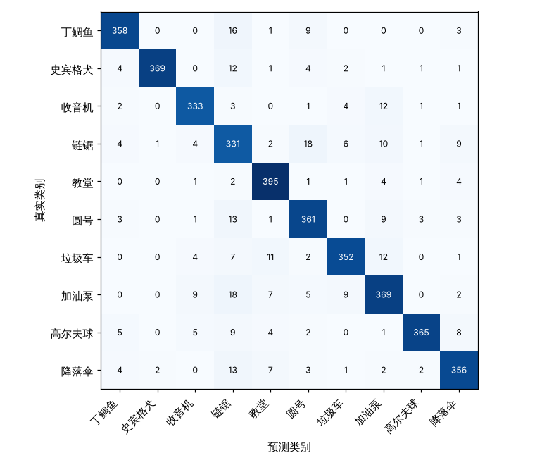
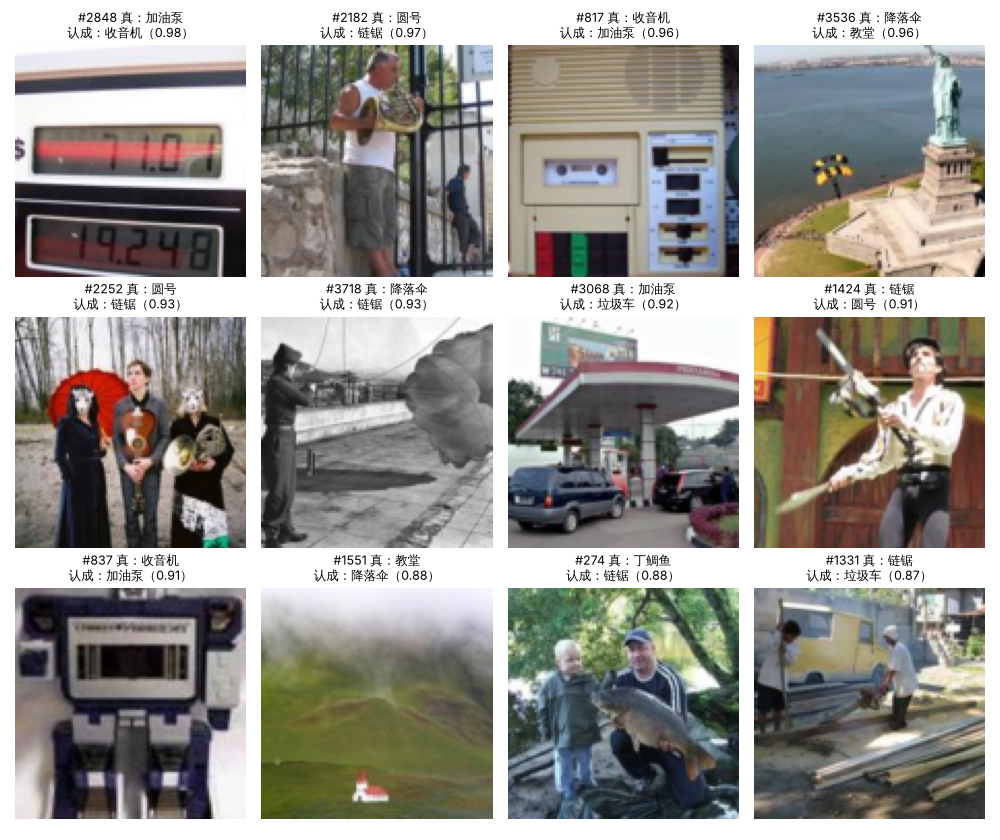
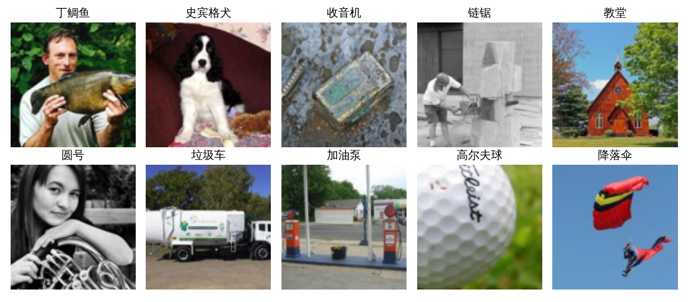
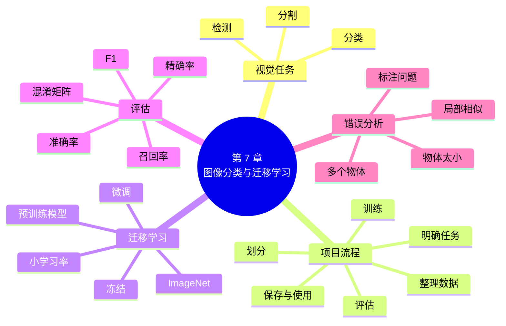

# 第 7 章 图像分类实战与迁移学习

!!! abstract "本章学时"
    线上理论 2 学时 · 线下 1 学时 · 实验 2 学时（本章共 3 个实验，教师可任选）

## 学习目标

学完本章，你应该能够：

1. **说出**图像分类、目标检测、图像分割的区别，以及迁移学习、预训练模型、冻结、微调的含义（记忆）；
2. 按“收数据—划分—训练—评估—保存”的流程**完成**一个图像分类项目（应用）；
3. 用 PyTorch 加载预训练的 ResNet18，**实现**冻结训练和解冻微调（应用）；
4. 根据混淆矩阵**计算**准确率、精确率、召回率，找出模型最常认错的类别（分析）；
5. 对认错的图片进行归类，**提出**有针对性的改进办法（评价）。

!!! info "先修要求"
    学习本章前，你需要掌握：

    - 本书第 4 章：训练集、验证集、测试集，数据增强，早停（[4.1](../04-generalization/index.md#41)、[4.4](../04-generalization/index.md#44)）；
    - 本书第 5 章：卷积神经网络、ResNet（[5.4 经典结构](../05-cnn/index.md#54)、[5.5 用 PyTorch 搭一个 CNN](../05-cnn/index.md#55)）；
    - 《机器学习》中学过的混淆矩阵、精确率、召回率，本章 7.4 节是同一套指标，可以对照着复习。

??? abstract "本章概念清单（12 个，点击查看定义和例子）"
    1. [图像分类](../../appendix/glossary.md#g-图像分类)
    2. [目标检测](../../appendix/glossary.md#g-目标检测)
    3. [图像分割](../../appendix/glossary.md#g-图像分割)
    4. [迁移学习](../../appendix/glossary.md#g-迁移学习)
    5. [预训练模型](../../appendix/glossary.md#g-预训练模型)
    6. [ImageNet](../../appendix/glossary.md#g-ImageNet)
    7. [冻结](../../appendix/glossary.md#g-冻结)
    8. [微调](../../appendix/glossary.md#g-微调)
    9. [混淆矩阵](../../appendix/glossary.md#g-混淆矩阵)
    10. [精确率](../../appendix/glossary.md#g-精确率)
    11. [召回率](../../appendix/glossary.md#g-召回率)
    12. [F1 值](../../appendix/glossary.md#g-F1-值)

## 情景导入

老陈在山东经营一个果园，种了苹果、梨和桃。每到采摘季，他都要雇人把混在一起的水果分拣开。他听说可以用摄像头加人工智能自动分拣，就请做技术的侄子小陈帮忙。

小陈学过第 5 章，信心满满：拍照、搭一个 CNN、训练，不就行了吗？可是他忙了一个周末，只拍了 600 多张照片，训练出来的网络在新照片上只能认对六成。要想达到实用的水平，按书上的说法得有几万张照片，这得拍到什么时候？

一位做视觉算法的朋友告诉他：“你不用从零开始。有人已经用一百多万张照片训练好了一个网络，它早就学会了看边缘、看颜色、看纹理。你把它‘借’过来，只改最后一层，用你那几百张照片稍微训练一下就行。”小陈照着做，准确率一下子提高到九成以上。

这就是本章的主题：[**迁移学习**](../../appendix/glossary.md#g-迁移学习 "把在大数据集上训练好的模型借来，用于新任务的方法"){ .term }。本章先完整走一遍图像分类项目的流程（实验 7-1 从零训练），再用迁移学习把准确率大幅提高（实验 7-2），最后学会用混淆矩阵分析模型错在哪里（实验 7-3）。

## 7.1 计算机视觉的三类任务 { #71 }

让计算机“看懂”图像和视频的技术，叫**计算机视觉**。按“看懂到什么程度”，最常见的任务有三类：

| 任务 | 回答的问题 | 输出 | 应用举例 |
|---|---|---|---|
| [**图像分类**](../../appendix/glossary.md#g-图像分类 "判断一张图片属于哪一类的任务"){ .term } | 这张图里是什么？ | 一个类别（和它的概率） | 水果分拣、垃圾分类、病虫害识别 |
| [**目标检测**](../../appendix/glossary.md#g-目标检测 "找出图中有哪些物体并用方框标出位置的任务"){ .term } | 图里有哪些东西，各在哪里？ | 若干个方框，每个方框一个类别 | 自动驾驶看行人和车辆、工地安全帽检测 |
| [**图像分割**](../../appendix/glossary.md#g-图像分割 "判断每个像素属于哪一类的任务"){ .term } | 每个像素属于什么？ | 和原图一样大的“上色图” | 医学影像勾画病灶、抠图换背景 |

三类任务从易到难，但核心都是 CNN 或 Transformer 提取的图像特征。本书只做图像分类，因为它最简单，也是另外两类任务的基础；目标检测、图像分割的原理和实战（如 YOLO 系列），在《计算机视觉及应用实战》中详细学习。

## 7.2 一个图像分类项目的完整流程 { #72 }

一个图像分类项目，不只是“搭网络、训练”两步。实际工作中，下面六步每一步都很重要：

| 步骤 | 要做的事 | 常见的坑 |
|---|---|---|
| 1. 明确任务 | 分哪几类？用在什么场景（手机、工厂流水线）？要多快、多准？ | 类别定义不清，比如“烂苹果”算不算苹果 |
| 2. 收集和整理数据 | 拍照或下载，每类放一个文件夹；检查有没有放错类、重复、看不清的图 | 各类数量相差太大；训练照片和实际使用场景差别大 |
| 3. 划分数据 | 分成训练集、验证集、测试集（第 4 章） | 同一个水果的几张照片分到了不同的集里，造成数据泄露 |
| 4. 选模型、训练 | 先试迁移学习；加数据增强、早停 | 一上来就从零训练大网络 |
| 5. 评估 | 在测试集上算准确率，看混淆矩阵，分析认错的图片 | 只看总的准确率 |
| 6. 保存与使用 | 保存参数和类别名，写好读图预测的代码 | 只保存了参数，忘了类别的顺序 |

**数据怎么放**。最常见的做法是“一个类别一个文件夹”：

```text
fruits/
├── train/
│   ├── 苹果/   001.jpg  002.jpg ……
│   ├── 梨/     ……
│   └── 桃/     ……
└── test/
    ├── 苹果/   ……
    ├── 梨/     ……
    └── 桃/     ……
```

本章实验用的 Imagenette 数据集就是这样组织的，`dlbook.py` 中的 `load_imagenette` 按文件夹读取图片、缩放、编号。你自己的数据只要按这个结构放好，就能用同样的方法读进来。

**模型怎么保存**。训练好的模型要保存下来，下次直接读取使用，不必重新训练。PyTorch 推荐只保存参数（`state_dict`），同时把类别名等信息一起存进去：

```python
torch.save({"state_dict": model.state_dict(), "classes": CLASSES}, "model.pt")   # 保存
saved = torch.load("model.pt", weights_only=True)                                  # 读取
model.load_state_dict(saved["state_dict"])                # 先搭好同样结构的网络，再装入参数
```

`weights_only=True` 表示只读取数字和文字，不执行文件里可能藏着的代码。从网上下载别人的模型文件时，一定要这样读取，这是基本的安全习惯。

## 7.3 迁移学习：借用别人训练好的模型 { #73 }

### 7.3.1 为什么能“借” { #731 }

第 5 章说过，CNN 前面的层学的是边缘、颜色、纹理这类简单图案，越往后越复杂，最后一层才把这些特征组合成具体的类别。研究人员发现，在大量照片上训练好的网络，前面那些层学到的特征是**通用**的：不管认水果、认动物还是认零件，都需要先看出边缘和纹理。<sup class="cite">[[4]](#ref7-4)</sup>

所以，可以把在大数据集上训练好的网络拿过来，保留它学到的“看图本领”，只把最后一层换成自己的类别，再用自己的少量数据训练。这就是**迁移学习**。拿来的网络叫[**预训练模型**](../../appendix/glossary.md#g-预训练模型 "已经在大规模数据上训练好、可以拿来迁移或微调的模型"){ .term }，最常用的是在 [**ImageNet**](../../appendix/glossary.md#g-ImageNet "约 128 万张照片、1000 类的大型图像数据集，常用于预训练"){ .term } 上训练的模型。ImageNet 有 1000 类、128 万张照片，2009 年由李飞飞团队发布，是计算机视觉发展史上最重要的数据集之一。<sup class="cite">[[3]](#ref7-3)</sup>

打个比方：一个会骑自行车的人学骑电动车，不用从头学平衡，只要学会拧车把加速就行。预训练模型就是那个“会骑自行车的人”。

### 7.3.2 冻结与微调 { #732 }

借用预训练模型有两种做法：

- [**冻结**](../../appendix/glossary.md#g-冻结 "训练时让预训练部分的参数保持不变，只训练新加的层"){ .term }：预训练模型的参数全部不动，只训练新换上的最后一层。要训练的参数很少，速度快，数据很少时也不容易过拟合。
- [**微调**](../../appendix/glossary.md#g-微调 "在预训练模型基础上，用小学习率继续训练部分或全部参数"){ .term }：在冻结训练的基础上，再把全部（或后面几层）参数解冻，用**很小的学习率**一起训练几轮，让“看图本领”也稍微适应一下新数据。学习率要小，否则会把预训练学到的东西破坏掉。

在 PyTorch 中，冻结就是把参数的 `requires_grad` 设为 `False`，这样反向传播时不计算它的梯度，优化器也不会更新它：

```python
model = load_pretrained_resnet18()          # 加载预训练 ResNet18（dlbook.py 中）
for p in model.parameters():
    p.requires_grad = False                 # 冻结全部参数
model.fc = nn.Linear(512, 10)               # 换上新的最后一层（新建的层默认 requires_grad=True）
opt = torch.optim.Adam(model.fc.parameters(), lr=0.001)       # 只把最后一层交给优化器

# 冻结训练几轮后，解冻全部，用小学习率微调
for p in model.parameters():
    p.requires_grad = True
opt = torch.optim.Adam(model.parameters(), lr=0.0001)
```

该冻结多少、要不要微调，主要看数据量：

| 你的数据 | 建议做法 |
|---|---|
| 很少（每类几十张） | 冻结，只训练最后一层 |
| 中等（每类几百张） | 先冻结训练，再解冻后面几层或全部，用小学习率微调 |
| 很多（每类几千张以上） | 全部微调，或者从零训练也可以 |

<iframe class="sim-frame" src="../../sims/freeze-layers/main.html" height="460" loading="lazy" title="冻结几层好"></iframe>

动画：冻结几层好。选择解冻最后几层，看要训练的参数个数和验证准确率怎样变化。（数据来自《人工智能开发框架技术》中用 MobileNetV2 给 750 张花卉照片分类的实际训练结果，道理与本章相同。）[全屏打开](../../sims/freeze-layers/main.html){ target=_blank }
{ .sim-caption }

### 7.3.3 去哪里找预训练模型 { #733 }

| 来源 | 说明 |
|---|---|
| torchvision | PyTorch 官方的视觉库，`torchvision.models` 中有 ResNet、MobileNet、ViT 等几十种模型，可自动下载权重 |
| timm | 最流行的开源图像模型库，有上千个预训练模型，本书实验用的 ResNet18 权重就来自它<sup class="cite">[[5]](#ref7-5)</sup> |
| 飞桨 PaddleClas | 百度飞桨的图像分类工具库，有很多为手机等设备优化的轻量模型，中文文档齐全 |
| 魔搭 ModelScope、Hugging Face | 国内外的开源模型社区，可以按任务搜索下载各种模型 |

!!! warning "迁移学习的提升会不会被高估"
    实验 7-2 中，迁移学习把准确率从 59% 提高到 91%。但要注意，Imagenette 的 10 类照片本来就是从 ImageNet 里挑出来的，预训练模型相当于“见过”这些类别，提升会偏大。为此，实验 7-2 的补充程序换用了不来自 ImageNet 的 CIFAR-10 小图，每类只用 100 张训练：从零训练的准确率 46.00%，冻结预训练 ResNet18 只训练最后一层 77.70%。提升仍然很明显。你自己的数据（比如果园的水果、工厂的零件）和 ImageNet 差别越大，提升会越小，但通常仍比从零训练好。

!!! cert "证书考点"
    人工智能训练师（三级）要求能“使用预训练模型完成模型训练”；各类人工智能应用工程师考试常考迁移学习的概念、冻结与微调的区别、数据量与做法的对应关系（详见[证书考点对照](../../certificate.md)）。

## 7.4 评估指标：不只看准确率 { #74 }

### 7.4.1 混淆矩阵 { #741 }

总的准确率只说明“认对了多少”，不说明“错在哪里”。[**混淆矩阵**](../../appendix/glossary.md#g-混淆矩阵 "按“真实类别 × 预测类别”统计样本数的表，对角线是认对的"){ .term }把结果按“真实类别 × 预测类别”排成一张表：第 i 行第 j 列的数，是“真实是第 i 类、被认成第 j 类”的张数。对角线上是认对的，对角线外是认错的。



上图是实验 7-3 的混淆矩阵。“链锯”这一列对角线外的数字最多：丁鲷鱼、史宾格犬、圆号、加油泵、降落伞，都有十几张被认成了链锯。一眼就能看出，模型的主要问题是“动不动就猜链锯”。

### 7.4.2 准确率、精确率、召回率 { #742 }

以某一类（比如“链锯”）为例：

| 指标 | 怎么算 | 回答的问题 | 实验 7-3 中“链锯”的值 |
|---|---|---|---|
| **准确率** | 所有认对的 ÷ 总张数 | 总的来说认对了多少？ | 全部 10 类：3589 ÷ 3925 = 0.914 |
| [**精确率**](../../appendix/glossary.md#g-精确率 "模型判为某类的样本中，真正属于该类的比例（看列）"){ .term } | 这一列对角线上的数 ÷ 这一列的总和 | 模型说“是链锯”的，有多少真是链锯？ | 0.781 |
| [**召回率**](../../appendix/glossary.md#g-召回率 "真正属于某类的样本中，被模型找出来的比例（看行）"){ .term } | 这一行对角线上的数 ÷ 这一行的总和 | 真的链锯，有多少被找出来了？ | 0.858 |

“链锯”的召回率还可以，精确率却是 10 类中最低的，因为很多别的东西被误认成了链锯。

两个指标的侧重点不同：做水果分拣时，如果把烂果错当好果卖出去会砸招牌，就要看重“好果”的精确率；做病虫害检测时，漏掉一棵病树可能传染一片，就要看重“病树”的召回率。两者兼顾时，可以用它们的调和平均数 [**F1 值**](../../appendix/glossary.md#g-F1-值 "精确率与召回率的调和平均数，兼顾两者"){ .term }：$F1 = 2 \times \text{精确率} \times \text{召回率} \div (\text{精确率} + \text{召回率})$。

### 7.4.3 看认错的图片 { #743 }

指标告诉你错了多少，只有看图片才知道为什么错。实验 7-3 把“最有把握却认错”的 12 张排成一张图：



把这些错误归类，就能找到改进的方向：

| 错误类型 | 例子 | 改进办法 |
|---|---|---|
| 图里有多个物体，模型看了“另一个” | #2182、#2252 是人拿着圆号，背景还有铁栏杆、人物，被认成链锯（链锯类的照片里大多有人） | 收集更多“物体 + 人”的训练图；或者改用目标检测 |
| 物体太小，只占画面一角 | #3536 的降落伞只是自由女神像旁边的一个小点；#1551 的教堂是草原上的一个小房子 | 拍照时让物体占画面的主要部分；训练时加入这类图片 |
| 只拍到局部，和别的类很像 | #2848 只拍到加油机的数字屏，认成收音机；#817 收音机的按键、刻度像加油机 | 训练图里加入更多局部特写 |
| 标注本身值得商榷 | #3068 加油站的照片，画面里看不到加油泵，主要是汽车和顶棚 | 检查并清理数据 |

!!! tip "做项目的经验"
    提高准确率最有效的办法，往往不是换更复杂的网络，而是**看错误案例、改数据**。很多公司的算法工程师，一半以上的时间都花在整理数据上。

## 7.5 示范例题 { #75 }

**例题** 果园水果分拣模型在 150 张测试照片上的混淆矩阵如下：

| 真实 ＼ 预测 | 苹果 | 梨 | 桃 |
|---|---|---|---|
| 苹果 | 45 | 3 | 2 |
| 梨 | 5 | 38 | 7 |
| 桃 | 0 | 4 | 46 |

（1）总准确率是多少？（2）“梨”的精确率和召回率各是多少？（3）模型最常犯的是哪种错误？给一条改进建议。

**解题思路**：准确率看对角线；精确率看列，召回率看行；最常犯的错误找对角线外最大的数。

**第 1 步**：准确率 = (45 + 38 + 46) ÷ 150 = 129 ÷ 150 = **0.86**。

**第 2 步**：“梨”这一列总和 3 + 38 + 4 = 45，精确率 = 38 ÷ 45 ≈ **0.844**；“梨”这一行总和 5 + 38 + 7 = 50，召回率 = 38 ÷ 50 = **0.76**。

**第 3 步**：对角线外最大的是 7，即“梨被认成桃”。梨的召回率（0.76）是三类中最低的。建议：先看这 7 张图，找出原因，比如是不是青皮的桃和梨颜色接近、或者光线偏暗，再针对性地补充这类照片，或在训练时加入亮度变化的数据增强。

**答**：（1）0.86；（2）精确率约 0.844，召回率 0.76；（3）最常见的错误是把梨认成桃，改进建议见上。

**举一反三**：算一算“苹果”和“桃”的精确率、召回率（苹果都是 0.90；桃的精确率 46 ÷ 55 ≈ 0.836，召回率 0.92）。总准确率 0.86，但各类的指标并不相同，这就是要看混淆矩阵的原因。

## 7.6 前沿视窗 { #76 }

**视觉大模型**。2023 年以来出现了一批“视觉基础模型”，它们在几亿到几十亿张图片上训练，一个模型就能完成分类、检测、分割等多种任务，甚至能根据文字描述找出图里的东西（比如“把图中所有的红色苹果框出来”），不需要为每种水果专门收集照片。国内也有不少开源的视觉大模型和多模态大模型，比如阿里的通义千问视觉语言模型、上海人工智能实验室的“书生”系列。

**迁移学习已成默认做法**。今天，除非数据量特别大，几乎没有人从零训练图像模型。工作中常见的做法是：先在 timm、飞桨 PaddleClas、魔搭等模型库里找一个和任务接近的预训练模型，微调后部署。所以，“会选模型、会微调、会分析错误”比“会从零搭网络”更常用。第 8 章会看到，文本处理也是同样的思路。

## 本章实验

!!! abstract "实验总览"
    | 实验 | 类型 | 建议时长 | 内容 |
    |---|---|---|---|
    | 实验 7-1 | ★ 基础 | 45 分钟 | 10 类图片分类完整项目：读数据、划分、从零训练 CNN（数据增强 + 早停）、评估、保存、读回预测 |
    | 实验 7-2 | ★ 基础 | 40 分钟 | 迁移学习：加载预训练 ResNet18，先冻结训练、再解冻微调，与从零训练比较；补充程序换用 CIFAR-10 验证 |
    | 实验 7-3 | ☆ 拓展 | 40 分钟 | 画混淆矩阵，算精确率、召回率，找出最常认错的类别，分析认错的图片，写错误案例报告 |

    三个实验都可以在本机 CPU 上运行（编者用 4 核 CPU 实测：实验 7-1 约 5 分钟，实验 7-2 约 3 分钟，补充程序约 30 秒，实验 7-3 约 30 秒）。有 GPU 或使用云算力平台会更快。第一次运行会自动下载 Imagenette（约 100 MB）和 ResNet18 预训练权重（约 45 MB），见附录 B。实验 7-2 要用实验 7-1 保存的结果，实验 7-3 要用实验 7-2 保存的模型，请按顺序运行。代码见配套资源 `labs/ch07/` 目录。

### 实验 7-1 ★ 10 类图片分类完整项目 { #7-1 }

**实验目的**

1. 按“读数据—划分—训练—评估—保存—预测”的流程完成一个图像分类项目；
2. 练习使用数据增强、早停和全局平均池化；
3. 学会保存模型，并读回模型预测新图片。

**实验环境**：本机 CPU，Python 3.11，PyTorch、torchvision、Matplotlib。

**实验数据**：Imagenette（160 像素版），从 ImageNet 中挑出的 10 类照片：丁鲷鱼、史宾格犬、收音机、链锯、教堂、圆号、垃圾车、加油泵、高尔夫球、降落伞。<sup class="cite">[[6]](#ref7-6)</sup> 从官方训练文件夹每类取 300 张，随机分成训练集 2400 张、验证集 600 张；官方验证文件夹的 3925 张作为测试集。所有图片裁成正方形，缩放到 112×112。

**实验步骤与代码**

第 1 步，读数据、划分，并看几张样例（`common07.py`）：

```python
_x, _y, CLASSES = load_imagenette(train=True, n_per_class=300, size=SIZE)
_perm = torch.randperm(len(_x))
X_TRAIN, Y_TRAIN = _x[_perm[:2400]], _y[_perm[:2400]]       # 训练集
X_VAL, Y_VAL = _x[_perm[2400:]], _y[_perm[2400:]]           # 验证集
X_TEST, Y_TEST, _ = load_imagenette(train=False, size=SIZE)  # 测试集
```

第 2 步，搭网络：4 个卷积块（卷积、批归一化、ReLU、池化），边长 112 → 56 → 28 → 14 → 7；最后用**全局平均池化**把每张 7×7 的特征图平均成 1 个数，这样全连接层只需要 256 个输入（ResNet 也是这样做的）。

```python
model = nn.Sequential(
    *block(3, 32), *block(32, 64), *block(64, 128), *block(128, 256),
    nn.AdaptiveAvgPool2d(1),         # 全局平均池化：256×7×7 → 256×1×1
    nn.Flatten(),
    nn.Dropout(0.3),
    nn.Linear(256, 10),
)
```

第 3 步，训练：Adam，学习率 0.001，批量 32；训练时对每张图做随机裁剪放大、随机水平翻转；验证准确率连续 6 轮不提高就停止，恢复最好那一轮的参数（`common07.py` 中的 `fit` 函数）。

```python
AUGMENT = v2.Compose([v2.RandomResizedCrop(SIZE, scale=(0.6, 1.0), antialias=True),
                      v2.RandomHorizontalFlip()])
```

第 4 步，在测试集上评估一次；第 5 步，保存模型和类别名；第 6 步，读回模型，预测测试集中的一张图，列出概率最高的 3 个类别。

完整代码见 `common07.py` 和 `lab7_1_image_project.py`。

**运行结果**

```text
类别： 丁鲷鱼、史宾格犬、收音机、链锯、教堂、圆号、垃圾车、加油泵、高尔夫球、降落伞
训练集 (2400, 3, 112, 112)，验证集 (600, 3, 112, 112)，测试集 (3925, 3, 112, 112)
训练集每类张数： [243, 231, 242, 236, 243, 233, 245, 244, 237, 246]
样例图片已保存到 lab7_1_samples.png

网络参数：391946
  [从零训练] 第  1 轮：训练损失 1.8993，验证准确率 0.2033，已用 22 秒
  [从零训练] 第  2 轮：训练损失 1.5950，验证准确率 0.4067，已用 44 秒
  [从零训练] 第  3 轮：训练损失 1.4731，验证准确率 0.3117，已用 66 秒
  [从零训练] 第  4 轮：训练损失 1.3790，验证准确率 0.5033，已用 87 秒
  [从零训练] 第  5 轮：训练损失 1.3224，验证准确率 0.3067，已用 109 秒
  [从零训练] 第  6 轮：训练损失 1.2820，验证准确率 0.4767，已用 130 秒
  [从零训练] 第  7 轮：训练损失 1.2483，验证准确率 0.4683，已用 151 秒
  [从零训练] 第  8 轮：训练损失 1.1738，验证准确率 0.5717，已用 172 秒
  [从零训练] 第  9 轮：训练损失 1.1564，验证准确率 0.3967，已用 193 秒
  [从零训练] 第 10 轮：训练损失 1.1217，验证准确率 0.5700，已用 216 秒
  [从零训练] 第 11 轮：训练损失 1.0826，验证准确率 0.5100，已用 237 秒
  [从零训练] 第 12 轮：训练损失 1.1048，验证准确率 0.4517，已用 258 秒
  [从零训练] 第 13 轮：训练损失 1.0311，验证准确率 0.4583，已用 279 秒
  [从零训练] 第 14 轮：训练损失 1.0112，验证准确率 0.4133，已用 300 秒
  验证准确率连续 6 轮没有提高，提前停止
  [从零训练] 验证准确率最好在第 8 轮：0.5717，共用时 300 秒

测试集（3925 张）准确率：0.5931
模型已保存到 imagenette_cnn.pt

测试集第 1234 张，真实类别：链锯
  链锯：0.568
  高尔夫球：0.145
  史宾格犬：0.123
```



几点解读：

- 从零训练，2400 张训练图片，测试准确率 59.31%。比瞎猜（10%）好得多，但离实用还远。
- 验证准确率忽高忽低（第 8 轮 57%，第 9 轮 40%），而训练损失一直平稳下降。数据少、批量小时，批归一化在训练和评估时用的统计量差别较大，就会这样。早停在这里很有用：它记住了第 8 轮的参数，没有被后面的波动带偏。
- 第 6 步读回模型后，预测结果和训练结束时完全一样，说明保存和读取都正确。“链锯”的概率只有 0.568，模型并不很有把握。

**实验记录表**

| 项目 | 你的结果 |
|---|---|
| 网络参数个数 | |
| 在第几轮停止，验证准确率最好的是第几轮 | |
| 测试集准确率 | |
| 你选的一张图片的真实类别和前 3 个预测 | |

**常见问题排查**

| 现象 | 原因 | 解决办法 |
|---|---|---|
| 第一次运行停在读数据很久 | 正在下载、解压并读入几千张照片 | 耐心等待；之后会直接读缓存文件 |
| 内存不足（程序被系统结束） | 电脑内存较小 | 把 `SIZE` 改成 96，或把 `n_per_class=300` 改成 200 |
| 训练太慢 | 电脑较旧，或数据增强逐张处理较慢 | 把 `epochs` 改小；或使用云算力平台（附录 B） |

**思考与练习**

1. 去掉数据增强（`fit` 的 `augment=False`），测试准确率有什么变化？训练损失呢？
2. 换一张测试图片（修改 `X_TEST[1234]` 的编号），找一张模型认错的，说说可能的原因。

**实验报告要求**

提交记录表和训练输出，用不超过 200 字说明：本实验的六个步骤各做了什么，你认为哪一步最容易出错？

### 实验 7-2 ★ 迁移学习：用预训练 ResNet18 微调，和从零训练比 { #7-2 }

**实验目的**

1. 加载预训练的 ResNet18，替换最后一层；
2. 实现冻结训练和解冻微调；
3. 比较从零训练、冻结、微调三种做法的准确率和用时。

**实验环境**：本机 CPU，Python 3.11，PyTorch、torchvision。

**实验数据**：与实验 7-1 相同。预训练权重是 timm 项目公开的 ResNet18 权重（在 ImageNet 上训练，文件名 `resnet18_a1_0-d63eafa0.pth`）。<sup class="cite">[[5]](#ref7-5)</sup><sup class="cite">[[7]](#ref7-7)</sup>

**实验步骤与代码**

第 1 步，加载预训练 ResNet18，把原来输出 1000 类的最后一层换成输出 10 类。预训练模型要求输入按 ImageNet 的平均值和标准差标准化：

```python
class Pretrained(nn.Module):
    def __init__(self):
        super().__init__()
        self.net = load_pretrained_resnet18()
        self.net.fc = nn.Linear(512, 10)          # 换成新的最后一层

    def forward(self, x):
        return self.net(IMAGENET_NORM(x))         # 先标准化，再送进 ResNet18
```

第 2 步，冻结全部参数，只训练最后一层，学习率 0.001，训练 5 轮。

第 3 步，解冻全部参数，学习率改为 0.0001，再训练 3 轮。保存模型给实验 7-3 使用。

第 4 步（补充程序 `lab7_2_extra_cifar.py`）：换用 CIFAR-10，每类 100 张训练，比较从零训练和冻结预训练 ResNet18 的准确率。

完整代码见 `lab7_2_transfer.py` 和 `lab7_2_extra_cifar.py`。

**运行结果**

```text
① 从零训练（实验 7-1）：测试准确率 0.5931
  预训练 ResNet18 参数：11689512，原来的最后一层：Linear(in_features=512, out_features=1000, bias=True)

② 冻结特征提取部分：要训练的参数 5130 个
  [冻结] 第  1 轮：训练损失 1.6261，验证准确率 0.7933，已用 11 秒
  [冻结] 第  2 轮：训练损失 0.9362，验证准确率 0.8533，已用 23 秒
  [冻结] 第  3 轮：训练损失 0.7360，验证准确率 0.8650，已用 34 秒
  [冻结] 第  4 轮：训练损失 0.6114，验证准确率 0.8733，已用 44 秒
  [冻结] 第  5 轮：训练损失 0.5573，验证准确率 0.8767，已用 57 秒
  [冻结] 验证准确率最好在第 5 轮：0.8767，共用时 57 秒
② 冻结、只训练最后一层：测试准确率 0.8843

③ 解冻全部参数微调：要训练的参数 11181642 个
  [微调] 第  1 轮：训练损失 0.4562，验证准确率 0.9117，已用 25 秒
  [微调] 第  2 轮：训练损失 0.3660，验证准确率 0.9283，已用 50 秒
  [微调] 第  3 轮：训练损失 0.3222，验证准确率 0.9283，已用 75 秒
  [微调] 验证准确率最好在第 2 轮：0.9283，共用时 75 秒
③ 解冻微调：测试准确率 0.9144
微调后的模型已保存到 imagenette_resnet18.pt（实验 7-3 要用）

汇总：
  ① 从零训练            测试准确率 0.5931
  ② 冻结，只训练最后一层  测试准确率 0.8843  训练用时 57 秒
  ③ 再解冻全部微调 3 轮   测试准确率 0.9144  训练用时 75 秒
```

补充程序的结果：

```text
训练 1000 张，测试 2000 张
① 从零训练（20 轮）：测试准确率 0.4600，用时 6 秒
② 冻结预训练 ResNet18，只训练最后一层：测试准确率 0.7770，用时 12 秒
```

几点解读：

- 冻结时只训练 5130 个参数（512 × 10 + 10），第 1 轮验证准确率就达到 79%，5 轮后测试准确率 88.43%，比从零训练高约 29 个百分点，用时却只有 1 分钟。
- 解冻微调 3 轮后达到 91.44%，又提高了 3 个百分点。微调的学习率是冻结时的十分之一。
- 补充程序说明，换成不来自 ImageNet 的数据，迁移学习依然有效（46.00% → 77.70%），但这个结果要谨慎看待：CIFAR-10 的类别（飞机、猫、狗……）在 ImageNet 中也有相近的类别。

**实验记录表**

| 做法 | 要训练的参数 | 测试准确率 | 训练用时 |
|---|---|---|---|
| ① 从零训练（实验 7-1） | | | |
| ② 冻结，只训练最后一层 | | | |
| ③ 解冻全部微调 | | | |
| 补充：CIFAR-10 从零训练 | — | | |
| 补充：CIFAR-10 冻结预训练 | — | | |

**常见问题排查**

| 现象 | 原因 | 解决办法 |
|---|---|---|
| 下载 ResNet18 权重失败 | 访问 GitHub 不稳定 | 按附录 B 手动下载 `resnet18_a1_0-d63eafa0.pth` 放到 `labs/data/` |
| `FileNotFoundError: imagenette_cnn.pt` | 没有先运行实验 7-1 | 先运行 `lab7_1_image_project.py` |
| 微调后准确率反而下降很多 | 学习率太大，破坏了预训练的参数 | 微调学习率用 0.0001 或更小 |
| 准确率只有 10% 左右 | 忘了按 ImageNet 的平均值和标准差标准化 | 检查 `forward` 中是否用了 `IMAGENET_NORM` |

**思考与练习**

1. 只解冻 ResNet18 的最后一组卷积（`self.net.layer4`）和最后一层，其余保持冻结，结果和解冻全部相比如何？
2. 把补充程序中每类的训练张数从 100 改成 20，从零训练和迁移学习的差距是变大还是变小？

**实验报告要求**

提交记录表，用不超过 200 字回答：如果你是情景导入中的小陈，只有 600 张照片，你会怎么做？为什么？

### 实验 7-3 ☆ 分析认错的图片，写错误案例报告 { #7-3 }

**实验目的**

1. 画混淆矩阵，计算每一类的精确率和召回率；
2. 找出最常认错的类别对；
3. 查看认错的图片，归纳错误类型，提出改进办法。

**实验环境**：本机 CPU，Python 3.11，PyTorch、torchvision、Matplotlib。

**实验数据**：实验 7-2 微调后的模型 `imagenette_resnet18.pt`，以及 Imagenette 测试集 3925 张。

**实验步骤与代码**

第 1 步，读入模型，对测试集预测，统计混淆矩阵：

```python
prob = predict(model, X_TEST).softmax(1)
conf, pred = prob.max(1)                    # conf：把握（最大概率），pred：预测类别
cm = torch.zeros(10, 10, dtype=torch.long)
for t, p in zip(Y_TEST, pred):
    cm[t, p] += 1                           # 真实 t、预测 p 的格子加 1
```

第 2 步，按 7.4.2 节的方法计算每一类的精确率（看列）和召回率（看行）：

```python
precision = cm[c, c] / cm[:, c].sum()       # 第 c 列
recall = cm[c, c] / cm[c].sum()             # 第 c 行
```

第 3 步，把对角线清零，找出最大的 5 个格子，就是最常认错的 5 对。

第 4 步，在认错的图片中，按“把握”从大到小排序，取前 12 张画成一张图。

完整代码见 `lab7_3_error_analysis.py`。

**运行结果**

```text
测试集 3925 张，认对 3589 张，准确率 0.9144
混淆矩阵已保存到 lab7_3_confusion.png

类别        精确率   召回率   测试张数
  丁鲷鱼     0.942    0.925    387
  史宾格犬    0.992    0.934    395
  收音机     0.933    0.933    357
  链锯      0.781    0.858    386
  教堂      0.921    0.966    409
  圆号      0.889    0.916    394
  垃圾车     0.939    0.905    389
  加油泵     0.879    0.881    419
  高尔夫球    0.976    0.915    399
  降落伞     0.918    0.913    390

最常认错的 5 对（真实 → 预测：张数）：
  链锯 → 圆号：18 张
  加油泵 → 链锯：18 张
  丁鲷鱼 → 链锯：16 张
  圆号 → 链锯：13 张
  降落伞 → 链锯：13 张

最有把握却认错的 12 张已保存到 lab7_3_wrong.png：
  #2848：真实 加油泵，认成 收音机，把握 0.98
  #2182：真实 圆号，认成 链锯，把握 0.97
  #817：真实 收音机，认成 加油泵，把握 0.96
  #3536：真实 降落伞，认成 教堂，把握 0.96
  #2252：真实 圆号，认成 链锯，把握 0.93
  #3718：真实 降落伞，认成 链锯，把握 0.93
  #3068：真实 加油泵，认成 垃圾车，把握 0.92
  #1424：真实 链锯，认成 圆号，把握 0.91
  #837：真实 收音机，认成 加油泵，把握 0.91
  #1551：真实 教堂，认成 降落伞，把握 0.88
  #274：真实 丁鲷鱼，认成 链锯，把握 0.88
  #1331：真实 链锯，认成 垃圾车，把握 0.87
```

混淆矩阵和认错的图片见 7.4 节。几点解读：

- 史宾格犬的精确率 0.992 最高，模型说是史宾格犬的几乎都对；链锯的精确率 0.781 最低。
- 最常认错的 5 对中，有 4 对和“链锯”有关。看图片可以发现，链锯类的训练照片大多是“一个人拿着工具在户外”，模型可能学到了“有人在户外拿着东西 = 链锯”这个捷径，于是拿着圆号的人、拿着鱼的人也被认成链锯。
- 最有把握却认错的图片，很多是“物体太小”或“画面里有好几样东西”，这类图本身就难，有的连人都要看一会儿。

**实验记录表（错误案例报告）**

| 编号 | 真实类别 | 认成 | 把握 | 错误类型 | 你的分析和改进建议 |
|---|---|---|---|---|---|
| | | | | | |
| | | | | | |
| | | | | | |

**常见问题排查**

| 现象 | 原因 | 解决办法 |
|---|---|---|
| `FileNotFoundError: imagenette_resnet18.pt` | 没有先运行实验 7-2 | 先运行 `lab7_2_transfer.py` |
| 精确率出现 `nan` | 某一类一次都没被预测到，除数为 0 | 说明模型完全不会猜这一类，需要检查数据和训练 |

**思考与练习**

1. 把实验 7-1 从零训练的模型也做一遍错误分析，它最常认错的是哪几对？和微调后的模型有什么不同？
2. 如果要减少“认成链锯”的错误，你会补充什么样的训练图片？

**实验报告要求**

从认错的图片中挑 5 张，填写错误案例报告表，并写一段不超过 200 字的总结：模型主要错在哪里？下一步最值得做的改进是什么？

## 本章小结

- 计算机视觉的三类常见任务：**图像分类**（是什么）、**目标检测**（有什么、在哪里）、**图像分割**（每个像素是什么）。
- 图像分类项目六步：明确任务、收集整理数据、划分数据、选模型训练、评估、保存与使用。下载的模型文件用 `weights_only=True` 读取。
- **迁移学习**：借用在大数据集（如 ImageNet）上训练好的**预训练模型**，换掉最后一层。**冻结**只训练最后一层，快、不易过拟合；**微调**再解冻部分或全部参数，用很小的学习率训练。实验中准确率从 59.31% 提高到 88.43%（冻结）、91.44%（微调）。
- **混淆矩阵**按“真实 × 预测”统计；**精确率**看列（说是 A 的有多少真是 A），**召回率**看行（真的 A 找出来多少），F1 兼顾两者。
- 看认错的图片、归纳错误类型，往往比换网络更能提高准确率。



**本章自检**

- [ ] 我能说出图像分类、目标检测、图像分割的区别，各举一个应用。
- [ ] 我能说出图像分类项目的六个步骤，以及每步常见的坑。
- [ ] 我能用 PyTorch 加载预训练模型、替换最后一层、冻结和解冻参数。
- [ ] 我能根据数据量选择冻结、微调还是从零训练。
- [ ] 给我一个混淆矩阵，我能算出准确率和每一类的精确率、召回率。
- [ ] 我能对认错的图片进行归类，并提出改进办法。

**下一章预告**

本章的“借用预训练模型”在文本处理中同样好用，而且更加重要。下一章做一个外卖评论好评 / 差评分类的项目：先学习怎样把文字变成数字（分词、编号、词向量），用 LSTM 从零训练一个分类器；再认识 BERT 这类预训练语言模型，看看“先读万卷书，再做小练习”的思路怎样改变了自然语言处理。

## 参考文献

正文中的上标编号（如<sup class="cite">[[1]](#ref7-1)</sup>）对应下面的文献。

<div class="refs" markdown>

**教材与专著**

- <span id="ref7-1"></span>[1] 阿斯顿·张, 李沐, 扎卡里·C. 立顿, 等. 动手学深度学习（PyTorch 版）[M]. 北京: 人民邮电出版社, 2023. https://zh.d2l.ai/.
    <span class="ref-note">“计算机视觉”一章中的“微调”一节用热狗识别演示迁移学习，对应 7.3 节。</span>
- <span id="ref7-2"></span>[2] 周志华. 机器学习[M]. 北京: 清华大学出版社, 2016.
    <span class="ref-note">第 2 章“模型评估与选择”讲混淆矩阵、精确率、召回率、F1，对应 7.4 节。</span>

**数据集与经典论文**

- <span id="ref7-3"></span>[3] DENG J, DONG W, SOCHER R, et al. ImageNet: a large-scale hierarchical image database[C]//2009 IEEE Conference on Computer Vision and Pattern Recognition. Miami: IEEE, 2009: 248-255.
    <span class="ref-note">介绍 ImageNet 数据集，对应 7.3.1 节。</span>
- <span id="ref7-4"></span>[4] YOSINSKI J, CLUNE J, BENGIO Y, et al. How transferable are features in deep neural networks?[C]//Advances in Neural Information Processing Systems 27. Montréal, 2014: 3320-3328.
    <span class="ref-note">用实验说明 CNN 前面的层学到通用特征、后面的层越来越专门，是迁移学习的重要依据，对应 7.3.1 节。</span>
- <span id="ref7-5"></span>[5] WIGHTMAN R, TOUVRON H, JÉGOU H. ResNet strikes back: an improved training procedure in timm[EB/OL]. (2021-10-01)[2026-11-01]. https://arxiv.org/abs/2110.00476.
    <span class="ref-note">本书实验所用 ResNet18 权重（A1 训练方法）的出处，对应实验 7-2。</span>

**在线资源与工具**

- <span id="ref7-6"></span>[6] fast.ai. Imagenette[EB/OL]. [2026-11-01]. https://github.com/fastai/imagenette.
    <span class="ref-note">Imagenette 数据集的说明，对应实验 7-1～7-3。</span>
- <span id="ref7-7"></span>[7] WIGHTMAN R. PyTorch image models (timm)[EB/OL]. [2026-11-01]. https://github.com/huggingface/pytorch-image-models.
    <span class="ref-note">开源图像模型库，提供上千个预训练模型，对应 7.3.3 节和实验 7-2。</span>
- <span id="ref7-8"></span>[8] PyTorch. Saving and loading models[EB/OL]. [2026-11-01]. https://pytorch.org/tutorials/beginner/saving_loading_models.html.
    <span class="ref-note">PyTorch 官方的模型保存与读取教程，对应 7.2 节。</span>
- <span id="ref7-9"></span>[9] 飞桨. PaddleClas 图像识别套件[EB/OL]. [2026-11-01]. https://github.com/PaddlePaddle/PaddleClas.
    <span class="ref-note">国产开源图像分类工具库和预训练模型，对应 7.3.3 节。</span>

</div>

## 课后练习

选择题和判断题可以直接点击选项作答，系统会马上告诉你对错，并展开答案与解析；多选题选好后点“提交答案”。简答和实操题请先自己作答，再点开“答案与解析”核对。

**一、单项选择题**

<div class="quiz" data-answer="B" markdown>

**1.** 工地上要用摄像头找出没戴安全帽的工人，并标出他们在画面中的位置，这属于（　　）。

- A. 图像分类
- B. 目标检测
- C. 图像分割
- D. 图像生成

</div>

??? tip "答案与解析"
    **答案：B**

    既要知道“是什么”，又要知道“在哪里”（画方框），是目标检测。

    考查：计算机视觉任务 · 认知层次：理解 · [回看 7.1](#71)
    { .quiz-meta }

<div class="quiz" data-answer="C" markdown>

**2.** 迁移学习中，“冻结”是指（　　）。

- A. 把模型保存到硬盘
- B. 停止训练
- C. 让预训练模型的参数在训练中保持不变
- D. 把学习率设为 0.1

</div>

??? tip "答案与解析"
    **答案：C**

    冻结就是把参数的 `requires_grad` 设为 `False`，不计算梯度、不更新。

    考查：冻结 · 认知层次：记忆 · [回看 7.3.2](#732)
    { .quiz-meta }

<div class="quiz" data-answer="A" markdown>

**3.** 解冻预训练模型进行微调时，学习率通常应该（　　）。

- A. 比冻结训练时小得多
- B. 比冻结训练时大得多
- C. 和从零训练时一样
- D. 越大越好

</div>

??? tip "答案与解析"
    **答案：A**

    学习率太大会破坏预训练学到的特征。实验 7-2 微调用 0.0001，是冻结时的十分之一。

    考查：微调 · 认知层次：理解 · [回看 7.3.2](#732)
    { .quiz-meta }

<div class="quiz" data-answer="D" markdown>

**4.** 实验 7-2 中，冻结 ResNet18 后要训练的参数只有 5130 个，这是因为（　　）。

- A. ResNet18 本来就只有 5130 个参数
- B. 图片缩小到了 112×112
- C. 只用了 2400 张图片
- D. 只训练新换上的最后一层：512 × 10 + 10

</div>

??? tip "答案与解析"
    **答案：D**

    ResNet18 有 1169 万个参数，冻结后只剩最后一层（512 个输入、10 个输出）参与训练。

    考查：冻结 · 认知层次：应用 · [回看实验 7-2](#7-2)
    { .quiz-meta }

<div class="quiz" data-answer="B" markdown>

**5.** 混淆矩阵中，“某一类的精确率”应该（　　）来算。

- A. 用这一行对角线上的数除以这一行的总和
- B. 用这一列对角线上的数除以这一列的总和
- C. 用对角线之和除以总数
- D. 用这一行的总和除以总数

</div>

??? tip "答案与解析"
    **答案：B**

    精确率问的是“模型说是这一类的里面，有多少真是”，模型说是这一类的都在这一列。A 是召回率，C 是准确率。

    考查：精确率 · 认知层次：理解 · [回看 7.4.2](#742)
    { .quiz-meta }

<div class="quiz" data-answer="C" markdown>

**6.** 某类真实有 50 张，模型认出了 40 张，另外还把 10 张别的类认成了这一类。这一类的召回率是（　　）。

- A. 0.5
- B. 0.6
- C. 0.8
- D. 1.0

</div>

??? tip "答案与解析"
    **答案：C**

    召回率 = 40 ÷ 50 = 0.8。精确率 = 40 ÷ (40 + 10) = 0.8，两者这里恰好相等。

    考查：召回率 · 认知层次：应用 · [回看 7.4.2](#742)
    { .quiz-meta }

<div class="quiz" data-answer="A" markdown>

**7.** 从网上下载别人的模型文件，用 `torch.load` 读取时加上 `weights_only=True`，主要是为了（　　）。

- A. 防止执行文件中可能藏着的恶意代码
- B. 让读取更快
- C. 让模型准确率更高
- D. 节省硬盘空间

</div>

??? tip "答案与解析"
    **答案：A**

    `weights_only=True` 只读取数字和文字，不执行文件中的代码，是基本的安全习惯。

    考查：模型保存 · 认知层次：理解 · [回看 7.2](#72)
    { .quiz-meta }

<div class="quiz" data-answer="D" markdown>

**8.** 每类只有 30 张照片，最合适的做法是（　　）。

- A. 从零训练一个很深的网络
- B. 解冻预训练模型的全部参数，用大学习率训练
- C. 不用验证集，全部用来训练
- D. 冻结预训练模型，只训练最后一层

</div>

??? tip "答案与解析"
    **答案：D**

    数据很少时，冻结训练参数少、不容易过拟合。

    考查：迁移学习 · 认知层次：评价 · [回看 7.3.2](#732)
    { .quiz-meta }

**二、多项选择题**

<div class="quiz quiz-multi" data-answer="ABC" markdown>

**9.** 迁移学习有效的原因包括（　　）。

- A. CNN 前面的层学到的边缘、纹理等特征是通用的
- B. 预训练模型在大量图片上训练过，“看图本领”强
- C. 只需训练少量参数，数据少也不容易过拟合
- D. 预训练模型一定见过你要识别的所有类别

</div>

??? tip "答案与解析"
    **答案：ABC**

    预训练模型不一定见过你的类别（比如工厂的零件），但它学到的通用特征依然有用。

    考查：迁移学习 · 认知层次：理解 · [回看 7.3.1](#731)
    { .quiz-meta }

<div class="quiz quiz-multi" data-answer="ACD" markdown>

**10.** 实验 7-3 中，最有把握却认错的图片可以归纳为（　　）。

- A. 画面里有多个物体，模型看了“另一个”
- B. 程序写错了，所以认错
- C. 物体太小，只占画面一角
- D. 只拍到局部，和别的类很像

</div>

??? tip "答案与解析"
    **答案：ACD**

    这些错误来自图片本身的难度和训练数据的特点，不是程序错误。

    考查：错误分析 · 认知层次：分析 · [回看 7.4.3](#743)
    { .quiz-meta }

<div class="quiz quiz-multi" data-answer="BD" markdown>

**11.** 关于实验 7-1 中验证准确率忽高忽低（第 8 轮 57%，第 9 轮 40%），下列说法正确的有（　　）。

- A. 说明程序有错误，必须重写
- B. 数据少、批量小时，批归一化在训练和评估时的统计量差别较大，容易出现这种情况
- C. 应该取最后一轮的参数
- D. 早停会记住验证准确率最好那一轮的参数，不会被后面的波动带偏

</div>

??? tip "答案与解析"
    **答案：BD**

    波动是正常现象；取最后一轮（第 14 轮验证准确率 41%）反而更差。

    考查：早停 · 认知层次：分析 · [回看实验 7-1](#7-1)
    { .quiz-meta }

**三、判断题**

<div class="quiz quiz-judge" data-answer="√" markdown>

**12.** 图像分类、目标检测、图像分割三类任务中，图像分类最简单，也是另外两类的基础。

</div>

??? tip "答案与解析"
    **答案：√**

    检测和分割通常以分类网络为“骨干”提取特征。

    考查：计算机视觉任务 · 认知层次：理解 · [回看 7.1](#71)
    { .quiz-meta }

<div class="quiz quiz-judge" data-answer="×" markdown>

**13.** 只要总准确率高，就说明模型在每一类上都表现很好。

</div>

??? tip "答案与解析"
    **答案：×**

    实验 7-3 中总准确率 91.44%，但链锯的精确率只有 0.781。要看混淆矩阵和每一类的指标。

    考查：混淆矩阵 · 认知层次：评价 · [回看 7.4.1](#741)
    { .quiz-meta }

<div class="quiz quiz-judge" data-answer="×" markdown>

**14.** 使用预训练模型时，输入图片怎样预处理都可以，不影响结果。

</div>

??? tip "答案与解析"
    **答案：×**

    要按预训练时的方式标准化（如 ImageNet 的平均值和标准差），否则效果会很差。

    考查：预训练模型 · 认知层次：理解 · [回看实验 7-2](#7-2)
    { .quiz-meta }

<div class="quiz quiz-judge" data-answer="√" markdown>

**15.** 保存模型时，除了参数，还应该把类别名的顺序一起保存。

</div>

??? tip "答案与解析"
    **答案：√**

    模型只输出类别编号，没有类别名的顺序，就不知道编号 3 是什么。

    考查：模型保存 · 认知层次：理解 · [回看 7.2](#72)
    { .quiz-meta }

<div class="quiz quiz-judge" data-answer="×" markdown>

**16.** 实验 7-2 中迁移学习提升了约 32 个百分点，所以用在任何自己的数据上都能提升这么多。

</div>

??? tip "答案与解析"
    **答案：×**

    Imagenette 来自 ImageNet，预训练模型“见过”这些类别，提升偏大。自己的数据和 ImageNet 差别越大，提升越小，但通常仍比从零训练好。

    考查：迁移学习 · 认知层次：评价 · [回看 7.3.3](#733)
    { .quiz-meta }

**四、简答题**

**17.** 用“会骑自行车学电动车”的比喻解释迁移学习，并说明冻结和微调的区别。

??? tip "答案与解析"
    **参考答案**：会骑自行车的人已经掌握了平衡，学电动车只需学加速、刹车，不用从头学起。预训练模型在大量图片上学会了看边缘、纹理、形状这些通用本领，迁移到新任务时，只需学会“这些特征组合起来是哪一类”。冻结：预训练部分的参数不动，只训练新换上的最后一层，速度快、不易过拟合，适合数据很少时。微调：在冻结训练的基础上，解冻部分或全部参数，用很小的学习率一起训练，让特征也适应新数据，效果通常更好，适合数据中等时。

    考查：迁移学习、冻结、微调 · 认知层次：理解 · [回看 7.3](#73)
    { .quiz-meta }

**18.** 一个图像分类项目包含哪些步骤？举出其中两步的常见错误。

??? tip "答案与解析"
    **参考答案**：六步：明确任务、收集整理数据、划分数据、选模型训练、评估、保存与使用。常见错误举例：划分数据时，同一个物体的几张照片分到了训练集和测试集，造成数据泄露，测试成绩虚高；评估时只看总准确率，不看混淆矩阵，不知道模型错在哪里；保存时只存了参数，没存类别名的顺序。（任举两条即可）

    考查：项目流程 · 认知层次：理解 · [回看 7.2](#72)
    { .quiz-meta }

**五、实操题**

**19.** 根据实验 7-3 的混淆矩阵（7.4.1 节的图），计算“教堂”的精确率和召回率。（提示：“教堂”这一行是 0、0、1、2、395、1、1、4、1、4；“教堂”这一列是 1、1、0、2、395、1、11、7、4、7）

??? tip "答案与解析"
    **参考答案**：召回率 = 395 ÷ (0 + 0 + 1 + 2 + 395 + 1 + 1 + 4 + 1 + 4) = 395 ÷ 409 ≈ 0.966；精确率 = 395 ÷ (1 + 1 + 0 + 2 + 395 + 1 + 11 + 7 + 4 + 7) = 395 ÷ 429 ≈ 0.921。与程序输出的 0.921、0.966 一致。“教堂”这一列中最大的错误是 11 张垃圾车被认成教堂。

    考查：精确率、召回率 · 认知层次：应用 · [回看 7.4.2](#742)
    { .quiz-meta }

**20.** 修改实验 7-2，只解冻 `layer4`（ResNet18 最后一组卷积）和 `fc`，其余保持冻结，微调 3 轮。记录要训练的参数个数和测试准确率，与解冻全部比较，说明你的发现。

??? tip "答案与解析"
    **参考思路**：在③之前，先全部冻结，再对 `model.net.layer4.parameters()` 和 `model.net.fc.parameters()` 设 `requires_grad = True`，并把这两部分的参数交给优化器。要训练的参数约 840 万个（layer4 约 839.4 万，加 fc 的 5130）。训练用时会比解冻全部少一些。准确率可能与解冻全部相近，也可能略低，具体以你的运行结果为准。结论：数据中等时，只微调后面几层往往就够了，还能节省时间、降低过拟合风险。

    考查：微调 · 认知层次：评价 · [回看 7.3.2](#732)
    { .quiz-meta }
