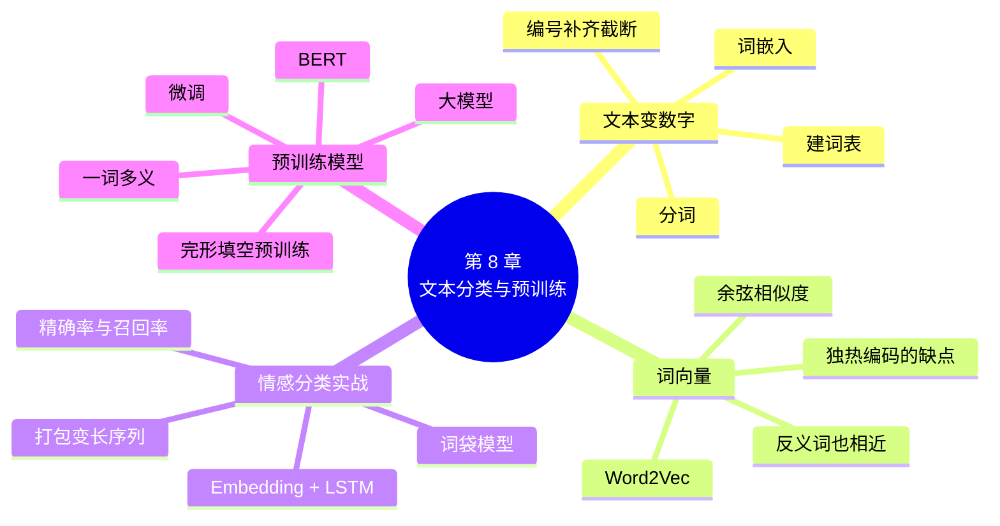

# 第 8 章 文本分类实战与预训练模型

!!! abstract "本章学时"
    线上理论 3 学时 · 线下 1 学时 · 实验 2 学时（本章共 3 个实验，教师可任选）

## 学习目标

学完本章，你应该能够：

1. **说出**分词、词表、补齐、截断、词嵌入、词向量、余弦相似度、预训练语言模型、BERT 的含义（记忆）；
2. **解释**独热编码的缺点，以及词向量为什么能表示“意思相近”（理解）；
3. **计算**两个词向量的余弦相似度（应用）；
4. 用 jieba 和 PyTorch **完成**一个中文文本分类项目：分词、建词表、编号、训练 Embedding + LSTM 模型并评估（应用）；
5. **比较**从零训练、词袋模型、预训练模型微调几种做法的特点，为实际任务选择合适的方案（评价）。

!!! info "先修要求"
    学习本章前，你需要掌握：

    - 本书第 6 章：LSTM、注意力、Transformer（[6.3 LSTM](../06-sequence/index.md#63)、[6.5 Transformer](../06-sequence/index.md#65)）；
    - 本书第 7 章：迁移学习、精确率与召回率（[7.3 迁移学习](../07-image-transfer/index.md#73)、[7.4 评估指标](../07-image-transfer/index.md#74)）；
    - 学过《自然语言处理导论》的同学，8.1 节是复习，可以直接做实验；本章重点在用 PyTorch 动手实现。

??? abstract "本章概念清单（11 个，点击查看定义和例子）"
    1. [分词](../../appendix/glossary.md#g-分词)
    2. [词表](../../appendix/glossary.md#g-词表)
    3. [补齐](../../appendix/glossary.md#g-补齐)
    4. [独热编码](../../appendix/glossary.md#g-独热编码)
    5. [词嵌入](../../appendix/glossary.md#g-词嵌入)
    6. [词向量](../../appendix/glossary.md#g-词向量)
    7. [Word2Vec](../../appendix/glossary.md#g-Word2Vec)
    8. [余弦相似度](../../appendix/glossary.md#g-余弦相似度)
    9. [情感分类](../../appendix/glossary.md#g-情感分类)
    10. [预训练语言模型](../../appendix/glossary.md#g-预训练语言模型)
    11. [BERT](../../appendix/glossary.md#g-BERT)

## 情景导入

小林在一家外卖平台的客服部门实习。平台每天收到上万条评论，其中有夸奖，也有投诉：“等了两个小时，饭都凉了”“送餐员态度很差”“分量太少，不会再点了”。客服主管希望差评能被尽快找出来、及时处理，可是靠人一条条看，十几个人也看不完。

主管交给小林一个任务：用平台已经标注好的 1.2 万条评论（每条标了“好评”或“差评”），训练一个模型，自动把新评论分成好评和差评。

小林已经会用神经网络给图片分类了，但文字和图片不一样：图片本来就是一堆数字，文字却是一个个汉字和词语。“好吃”和“美味”意思相近，计算机怎么知道？“好吃”和“不好吃”只差一个字，意思却相反，网络又怎么分辨？

本章先解决“文字怎么变成数字”的问题，再从零训练一个外卖评论分类器；最后认识 BERT 这类预训练语言模型：它们先读了海量的文章，“懂”了语言，再用少量数据稍加训练，就能完成各种文本任务。这和第 7 章的迁移学习是同一个思路。

## 8.1 文本怎么变成数字 { #81 }

把一条评论变成网络能处理的数字，一般分四步：分词、建[词表](../../appendix/glossary.md#g-词表 "训练集中出现的词及其编号的对照表，只能用训练集来建"){ .term }、编号与[补齐](../../appendix/glossary.md#g-补齐 "把短序列在后面补 0，使一批数据长度相同"){ .term }、词嵌入。

### 8.1.1 分词 { #811 }

英文的词和词之间有空格，中文却没有。所以处理中文的第一步，是把句子切成一个个词，叫[**分词**](../../appendix/glossary.md#g-分词 "把句子切成一个个词的处理，中文需要专门的分词工具"){ .term }。最常用的中文分词工具是开源的 jieba（结巴分词）：

```python
import jieba
print(jieba.lcut("很快，好吃，味道足，量大"))
# ['很快', '，', '好吃', '，', '味道', '足', '，', '量', '大']
```

也可以不分词，直接按字处理（第 6 章实验 6-2 就是按字处理的）。按字处理不需要分词工具，也不会因为分词出错而受影响；按词处理的序列更短，每个单位的意思更完整。两种做法在实际中都很常见。

### 8.1.2 建词表、编号与补齐 { #812 }

**建词表**：统计训练集中出现过的所有词，给每个词一个编号。出现次数太少的词（比如只出现 1 次）通常不放进词表。另外预留两个特殊编号：0 号给“补齐”，1 号给“未知”（词表里没有的词）。

**编号**：把每条评论的每个词换成它的编号，比如“豆腐脑 / 味道 / 感觉 / 很 / 一般”变成 [2, 3, 4, 5, 6]。

**补齐与截断**：网络要求一批数据的长度相同，所以要规定一个最大长度（比如 40 个词）。短的评论在后面补 0，长的评论截掉后面的部分：

```text
[2, 3, 4, 5, 6, 0, 0, 0, …, 0]      ← 补齐到 40 个
```

注意：词表**只能用训练集**来建，和第 6 章“标准化只能用训练部分算平均值”是同一个道理，避免偷看测试数据。

### 8.1.3 词嵌入：从编号到向量 { #813 }

编号只是一个代号，“3 号词”和“4 号词”并不表示两个词意思相近。早期的做法是[**独热编码**](../../appendix/glossary.md#g-独热编码 "用只有一个位置是 1、其余全是 0 的长向量表示一个词"){ .term }：词表有 4000 个词，每个词就用一个 4000 维的向量表示，只有自己的位置是 1，其余全是 0。它有两个缺点：一是太长、太浪费；二是任意两个词的向量都互相垂直，看不出“好吃”和“美味”比“好吃”和“米饭”更接近。

[**词嵌入**](../../appendix/glossary.md#g-词嵌入 "给每个词分配一个短而稠密的向量的方法，PyTorch 中是 nn.Embedding"){ .term }的做法是：给每个词分配一个短的、稠密的向量（比如 64 维），叫[**词向量**](../../appendix/glossary.md#g-词向量 "词嵌入得到的向量，意思或用法相近的词向量也相近"){ .term }，让意思相近的词，向量也相近。在 PyTorch 中，`nn.Embedding` 就是一张“查找表”：第 i 行就是 i 号词的词向量。

```python
emb = nn.Embedding(num_embeddings=4334, embedding_dim=64, padding_idx=0)   # 4334 个词，每个词 64 维
x = torch.tensor([[2, 3, 4, 5, 6, 0, 0]])     # 一条评论的编号，形状 1×7
print(emb(x).shape)                            # torch.Size([1, 7, 64])：每个编号换成了 64 维向量
```

这张表里的数是网络的参数，开始是随机数，和其他层一起通过训练学出来。`padding_idx=0` 表示 0 号（补齐）的向量固定为全 0，不参与训练。

### 8.1.4 词向量是怎么学出来的 { #814 }

词向量可以随着分类任务一起训练，也可以先单独训练好。最著名的单独训练方法是 2013 年提出的 [**Word2Vec**](../../appendix/glossary.md#g-Word2Vec "根据一个词周围经常出现哪些词来学习词向量的方法"){ .term }。<sup class="cite">[[4]](#ref8-4)</sup> 它的思路是“看一个词经常和哪些词一起出现”：“好吃”和“美味”经常出现在相似的上下文里（“菜很＿＿”“味道＿＿”），训练后它们的向量就会靠近。

两个词向量有多相近，常用[**余弦相似度**](../../appendix/glossary.md#g-余弦相似度 "两个向量点积除以长度之积，只看方向不看长短，范围 −1～1"){ .term }来衡量：

$$\cos(\boldsymbol{a}, \boldsymbol{b}) = \frac{\boldsymbol{a} \cdot \boldsymbol{b}}{|\boldsymbol{a}| \times |\boldsymbol{b}|}$$

分子是点积（对应位置相乘再相加），分母是两个向量长度的乘积。结果在 −1 到 1 之间：越接近 1，方向越一致，意思越接近。它只看方向、不看长短。

<iframe class="sim-frame" src="../../sims/word-vectors/main.html" height="820" loading="lazy" title="词向量与余弦相似度"></iframe>

动画：词向量与余弦相似度。左图拖动两支箭头，看余弦值怎样随方向变化；右图点一个词，找出和它最相近的词。（右图是编者编写的二维示意坐标。）[全屏打开](../../sims/word-vectors/main.html){ target=_blank }
{ .sim-caption }

!!! warning "词向量相近，不等于意思相同"
    实验 8-1 中，和“快”最相近的词里，除了“超快”“神速”，还有“巨慢”“很慢”。这是因为“快”和“慢”经常出现在一模一样的上下文里（“送得很＿＿”）。Word2Vec 学到的是“用法相近”，反义词的用法往往也很相近。所以，只靠词向量分不清好评和差评，还需要用标注好的数据训练分类器。

## 8.2 案例实战：外卖评论情感分类 { #82 }

把评论分成好评、差评，叫[**情感分类**](../../appendix/glossary.md#g-情感分类 "判断一段文字表达的是正面还是负面态度的任务"){ .term }，是最常见的文本分类任务之一。实验 8-2 用 waimai_10k 数据集（约 1.2 万条外卖评论）完成这个项目，比较两种模型：

**① 词袋模型**：把一条评论中所有词的词向量取平均，再接一个全连接层。它不管词的顺序，就像把词倒进一个袋子里摇一摇。

**② LSTM 模型**：词向量按顺序送进 LSTM，取读完最后一个真实词时的隐藏状态，接全连接层。

```python
class LSTMModel(nn.Module):
    def __init__(self, v, dim=64, hidden=64):
        super().__init__()
        self.emb = nn.Embedding(v, dim, padding_idx=0)
        self.lstm = nn.LSTM(dim, hidden, batch_first=True)
        self.head = nn.Linear(hidden, 2)

    def forward(self, x, lengths):
        packed = pack_padded_sequence(self.emb(x), lengths, batch_first=True, enforce_sorted=False)
        _, (h, _) = self.lstm(packed)    # 读到真实的最后一个词就停，不读后面补的 0
        return self.head(h[-1])
```

`pack_padded_sequence`（打包）告诉 LSTM 每条评论的真实长度。如果不打包，一条 5 个词的评论后面补了 35 个 0，LSTM 会一直读到第 40 个位置，最后的隐藏状态被一串“补齐”冲淡了。

实验结果（测试集 1987 条）：

| 模型 | 准确率 | 差评的精确率 | 差评的召回率 | 训练用时 |
|---|---|---|---|---|
| 词袋 | 88.83% | 0.894 | 0.942 | 2 秒 |
| LSTM | 88.83% | 0.901 | 0.933 | 10 秒 |

两个模型的准确率完全相同。外卖评论大多很短，“好吃”“太慢了”这几个关键词就能决定好坏，顺序不那么重要。但看下面两条自己写的评论，区别就出来了：

| 评论 | 词袋：好评概率 | LSTM：好评概率 |
|---|---|---|
| 味道不错，就是送得太慢了 | 0.888 | 0.904 |
| 送得太慢了，不过味道不错 | 0.812 | 0.360 |

两条评论用的词几乎一样，词袋模型给出的结果也差不多；LSTM 则对两种说法给出了不同的判断。人读这两句话，重点往往落在后半句，第二句应该偏好评，LSTM 在这里其实判断反了。这说明：LSTM **能**利用顺序，但它学到的规律不一定都对。对短文本，简单的词袋模型往往已经够用，而且快得多。

!!! tip "数据不均衡时看什么"
    waimai_10k 中好评约占三分之一、差评约占三分之二。如果模型把所有评论都判为差评，准确率也有 66.6%。所以要同时看差评（或好评）的精确率和召回率。客服关心的是“差评别漏掉”，所以差评的召回率尤其重要。

## 8.3 预训练语言模型：先读万卷书，再做小练习 { #83 }

### 8.3.1 一词多义的难题 { #831 }

Word2Vec 给每个词一个**固定**的向量。可是很多词的意思要看上下文：“这家的苹果很甜”和“我的苹果手机没电了”中的“苹果”，意思完全不同；“东西很好，就是太贵了”和“太贵了，东西也不好”中的“好”，分量也不一样。

### 8.3.2 BERT：完形填空练出来的语言能力 { #832 }

2018 年，谷歌发布了 [**BERT**](../../appendix/glossary.md#g-BERT "2018 年提出的 Transformer 编码器预训练模型，通过“完形填空”学习语言"){ .term }。<sup class="cite">[[5]](#ref8-5)</sup> 它是一个多层的 Transformer 编码器（第 6 章），训练分两个阶段：

**第一阶段：预训练**。用海量的文章（维基百科、新闻、图书……）做“完形填空”：随机遮住句子中 15% 的字，让模型根据上下文猜被遮住的是什么。比如“今天天[遮]很好”，模型要猜出“气”。这个任务不需要人工标注，文章本身就是答案，所以可以用几十亿字来训练。做了大量的完形填空，模型就学会了字词的用法、语法，甚至一些常识。

**第二阶段：微调**。在 BERT 后面接一个分类层，用你自己的少量标注数据（比如几千条评论）训练几轮，学习率很小，和第 7 章的微调一样。

因为每个字的向量是 Transformer 结合整句话算出来的，同一个“苹果”在不同的句子里会得到不同的向量，一词多义的问题就解决了。这类先用大量文本预训练、再针对具体任务微调的模型，叫[**预训练语言模型**](../../appendix/glossary.md#g-预训练语言模型 "先用海量文本预训练、再针对具体任务微调的语言模型"){ .term }。

### 8.3.3 文本任务的几种做法 { #833 }

| 做法 | 怎么做 | 优点 | 缺点 |
|---|---|---|---|
| 从零训练（实验 8-2） | 词向量和分类器都用自己的数据训练 | 模型小、速度快，CPU 就能跑 | 数据少时效果有限；难以理解复杂的语言 |
| 预训练模型微调（实验 8-3） | BERT 等模型接分类层，用自己的数据微调 | 效果通常明显更好，数据要求低 | 模型大，训练和使用最好有 GPU |
| 直接问大模型 | 把评论发给大语言模型，让它判断好评还是差评 | 不需要训练，甚至不需要标注数据 | 成本高、速度慢，结果需要抽查；数据安全要注意 |

常用的中文预训练模型有：哈工大讯飞联合实验室的中文 BERT-wwm、RoBERTa-wwm 系列（实验 8-3 用的 `hfl/rbt3` 是其中只有 3 层的小模型）<sup class="cite">[[6]](#ref8-6)</sup>，百度的文心 ERNIE 系列等。它们可以从 Hugging Face、魔搭 ModelScope、飞桨 PaddleNLP 下载。

!!! cert "证书考点"
    人工智能训练师（三级）、AI 应用工程师等证书常考：文本预处理的步骤（分词、去停用词、编号、补齐）、词向量与独热编码的区别、预训练与微调的概念（详见[证书考点对照](../../certificate.md)）。

## 8.4 示范例题 { #84 }

**例题** 三个词的词向量（3 维，示意数据）为：好吃 = (0.8, 0.6, 0.1)，美味 = (0.7, 0.7, 0.2)，难吃 = (−0.6, 0.5, 0.1)。分别计算“好吃”与“美味”、“好吃”与“难吃”的余弦相似度。

**解题思路**：先算点积，再算两个向量的长度，相除。

**第 1 步，算长度**：

- |好吃| = √(0.64 + 0.36 + 0.01) = √1.01 ≈ 1.005；
- |美味| = √(0.49 + 0.49 + 0.04) = √1.02 ≈ 1.010；
- |难吃| = √(0.36 + 0.25 + 0.01) = √0.62 ≈ 0.787。

**第 2 步，算点积**：

- 好吃 · 美味 = 0.8×0.7 + 0.6×0.7 + 0.1×0.2 = 0.56 + 0.42 + 0.02 = 1.00；
- 好吃 · 难吃 = 0.8×(−0.6) + 0.6×0.5 + 0.1×0.1 = −0.48 + 0.30 + 0.01 = −0.17。

**第 3 步，相除**：

- cos(好吃, 美味) = 1.00 ÷ (1.005 × 1.010) ≈ **0.985**；
- cos(好吃, 难吃) = −0.17 ÷ (1.005 × 0.787) ≈ **−0.215**。

**答**：“好吃”与“美味”的余弦相似度约 0.985，方向几乎一致；与“难吃”约 −0.215，方向相反。编者用 NumPy 核对结果相同。

**举一反三**：向量 (1, 2) 和 (2, 4) 的余弦相似度是多少？（答案是 1：方向完全相同，只是长短不同。）这就是“余弦相似度只看方向不看长短”的含义。实验 8-1 中真实训练出的“好吃”和“难吃”的余弦相似度是 0.4865，并不是负数，原因见 8.1.4 节的提示框。

## 8.5 前沿视窗 { #85 }

**中文预训练模型与大模型**。BERT 之后，预训练模型越做越大：从 BERT 的 1 亿参数，到今天动辄几百亿、上千亿参数的大语言模型。国产大模型如百度文心、阿里通义千问、智谱 GLM、DeepSeek 等，都是在海量中文和多语言文本上预训练的 Transformer 解码器。它们不仅能分类，还能总结差评的原因、自动生成回复。大模型的原理、提示词和微调方法，在《自然语言处理导论》中详细学习。

**小模型仍有用武之地**。如果每天要处理上千万条评论，全部交给大模型，成本和速度都难以接受。常见的做法是“大模型帮忙标注，小模型负责干活”：先用大模型给几万条评论打上标签，再用这些数据训练一个像实验 8-2 这样的小模型，部署到线上。这也是一种知识的“迁移”。

## 本章实验

!!! abstract "实验总览"
    | 实验 | 类型 | 建议时长 | 内容 |
    |---|---|---|---|
    | 实验 8-1 | ★ 基础 | 30 分钟 | 用外卖评论训练 Word2Vec 词向量，找出相近的词，手算余弦相似度 |
    | 实验 8-2 | ★ 基础 | 45 分钟 | 外卖评论情感分类：分词、建词表、编号补齐，比较词袋模型和 LSTM |
    | 实验 8-3 | ☆ 拓展（待实测） | 45 分钟 | 用中文预训练模型 `hfl/rbt3` 微调同一任务，建议在云算力平台上运行 |

    实验 8-1、8-2 在本机 CPU 上运行，各约 1 分钟（包括第一次运行时 jieba 加载词典的时间）。实验 8-3 需要下载约 150 MB 的预训练模型，建议在有 GPU 的云算力平台上运行（附录 B）。编者的实验环境无法访问模型下载网站，实验 8-3 的代码尚未完整运行，书中不给出运行结果。代码见配套资源 `labs/ch08/` 目录。

### 实验 8-1 ★ 训练一个小词向量，看哪些词挨得近 { #8-1 }

**实验目的**

1. 用 jieba 对中文评论分词；
2. 用 gensim 的 Word2Vec 训练词向量；
3. 查找相近的词，手算余弦相似度并核对。

**实验环境**：本机 CPU，Python 3.11，jieba、gensim、NumPy。

**实验数据**：waimai_10k 外卖评论，共 11 987 条。<sup class="cite">[[7]](#ref8-7)</sup>

**实验步骤与代码**

第 1 步，分词：

```python
reviews, labels = load_waimai()
sentences = [jieba.lcut(r) for r in reviews]      # 每条评论变成一个词的列表
```

第 2 步，训练 50 维词向量。`window=5` 表示看前后各 5 个词；`min_count=5` 表示出现少于 5 次的词不要；`sg=1` 表示用“由中间的词猜周围的词”的方法：

```python
model = Word2Vec(sentences, vector_size=50, window=5, min_count=5, sg=1, epochs=10, seed=42, workers=1)
wv = model.wv
```

第 3 步，用 `wv.most_similar(词, topn=5)` 找出最相近的 5 个词。

第 4 步，按公式手算“好吃”和“难吃”的余弦相似度，与 `wv.similarity` 的结果核对：

```python
a, b = wv["好吃"], wv["难吃"]
cos = float(a @ b / (np.linalg.norm(a) * np.linalg.norm(b)))
```

完整代码见 `lab8_1_word_vectors.py`。

**运行结果**

```text
分词示例：
  很快 / ， / 好吃 / ， / 味道 / 足 / ， / 量 / 大
  没有 / 送水 / 没有 / 送水 / 没有 / 送水
  非常 / 快 / ， / 态度 / 好 / 。
共 11987 条评论，202031 个词

词表大小（出现至少 5 次的词）：2650；每个词是 50 维向量
“好吃”的词向量前 5 个数： [-0.507 -0.195 -0.55   0.483  0.014]
和“好吃”最相近：正宗(0.79)、推荐(0.78)、很香(0.75)、健康(0.75)、地道(0.74)
和“难吃”最相近：失败(0.70)、郁闷(0.67)、咸(0.67)、没吃过(0.66)、恶心(0.66)
和“快”最相近：超快(0.78)、巨慢(0.71)、神速(0.70)、很慢(0.70)、比较慢(0.69)
和“慢”最相近：很慢(0.71)、巨慢(0.68)、无敌(0.67)、近(0.66)、超慢(0.66)
和“米饭”最相近：酱料(0.73)、不大(0.72)、蒸(0.72)、夹生(0.71)、土豆片(0.70)

手算 cos(好吃, 难吃) = 0.4865；gensim 计算 = 0.4865
  相似度(好吃, 美味) = 0.6827
  相似度(快, 及时) = 0.4434
```

几点解读：

- 和“好吃”相近的“正宗”“很香”“地道”，和“难吃”相近的“失败”“恶心”，都很合理：只用 1.2 万条评论，词向量就学到了不少词的用法。
- 和“快”相近的词里有“巨慢”“很慢”，这正是 8.1.4 节提示框说的：反义词的上下文往往相同，Word2Vec 分不清褒贬。
- 和“米饭”相近的词有“夹生”“蒸”“酱料”，说的都是饭菜本身。词向量反映的是这份数据中的用法，换成新闻数据训练，结果会很不一样。
- 手算的余弦相似度和 gensim 的结果完全相同。

**实验记录表**

| 项目 | 你的结果 |
|---|---|
| 词表大小 | |
| 你选的一个词，以及和它最相近的 5 个词 | |
| 你认为哪个结果最合理，哪个最奇怪 | |
| 手算的余弦相似度与 gensim 结果是否一致 | |

**常见问题排查**

| 现象 | 原因 | 解决办法 |
|---|---|---|
| `KeyError: "Key '某词' not present"` | 这个词出现次数少于 5 次，或者 jieba 把它和别的字分在了一起 | 换一个常见的词；或把 `min_count` 改小 |
| 每次运行结果略有不同 | 多线程训练带来的随机性 | 已设 `workers=1` 和 `seed=42`；换了版本仍可能有小差异 |
| `pip install gensim` 失败 | 网络问题或 Python 版本太新 | 用国内镜像安装；或使用附录 B 推荐的 Python 版本 |

**思考与练习**

1. 把 `vector_size` 改成 10 和 200，“好吃”的相近词有什么变化？
2. 试试 `wv.most_similar(positive=["好吃", "慢"], negative=["快"])`，结果说明了什么？

**实验报告要求**

提交记录表，用不超过 150 字说明：为什么“快”和“慢”的词向量很相近？这对情感分类有什么影响？

### 实验 8-2 ★ 外卖评论情感分类 { #8-2 }

**实验目的**

1. 完成文本预处理：分词、建词表、编号、补齐与截断；
2. 搭建并训练词袋模型和 Embedding + LSTM 模型；
3. 在不均衡的数据上，用精确率和召回率评估模型；
4. 用自己写的评论测试模型，观察词序的影响。

**实验环境**：本机 CPU，Python 3.11，jieba、PyTorch。

**实验数据**：waimai_10k，随机分成训练集 8000 条、验证集 2000 条、测试集 1987 条（随机种子 42）。

**实验步骤与代码**

第 1 步，分词并划分数据。

第 2 步，只用训练集建词表，保留出现至少 2 次的词；每条评论最多取 40 个词，不足的补 0：

```python
counter = Counter(w for i in idx_train for w in tokens[i])
vocab = {"<补齐>": 0, "<未知>": 1}
for w, c in counter.items():
    if c >= 2:
        vocab[w] = len(vocab)

def encode(words):
    ids = [vocab.get(w, 1) for w in words[:MAXLEN]]            # 词表里没有的词记为 1
    return ids + [0] * (MAXLEN - len(ids)), max(len(ids), 1)   # 补齐，并记下真实长度
```

第 3 步，搭建词袋模型和 LSTM 模型（LSTM 的代码见 8.2 节），各训练 5 轮（Adam，学习率 0.002），保留验证准确率最好的一轮。

第 4 步，在测试集上计算准确率，以及差评的精确率、召回率；再用 5 条自己写的评论测试两个模型。

完整代码见 `lab8_2_waimai_lstm.py`。

**运行结果**

```text
训练 8000 条，验证 2000 条，测试 1987 条；好评占 33.4%
词表大小：4334；每条评论最多取 40 个词
示例： 豆腐脑 / 味道 / 感觉 / 很 / 一般
编号： [2, 3, 4, 5, 6, 0, 0, 0, 0, 0, 0, 0, 0, 0, 0] ……，真实长度 5

① 词袋：参数 277506
  [① 词袋] 第 1 轮：验证准确率 0.8045
  [① 词袋] 第 2 轮：验证准确率 0.8485
  [① 词袋] 第 3 轮：验证准确率 0.8630
  [① 词袋] 第 4 轮：验证准确率 0.8695
  [① 词袋] 第 5 轮：验证准确率 0.8785

② LSTM：参数 310786
  [② LSTM] 第 1 轮：验证准确率 0.8450
  [② LSTM] 第 2 轮：验证准确率 0.8635
  [② LSTM] 第 3 轮：验证准确率 0.8795
  [② LSTM] 第 4 轮：验证准确率 0.8800
  [② LSTM] 第 5 轮：验证准确率 0.8830

测试集结果：
  ① 词袋：准确率 0.8883，差评的精确率 0.894、召回率 0.942，训练用时 2 秒
  ② LSTM：准确率 0.8883，差评的精确率 0.901、召回率 0.933，训练用时 10 秒

自己写的评论（好评概率）：
  好吃               词袋 1.000   LSTM 0.828
  不好吃              词袋 0.030   LSTM 0.083
  味道不错，就是送得太慢了     词袋 0.888   LSTM 0.904
  送得太慢了，不过味道不错     词袋 0.812   LSTM 0.360
  一般般吧             词袋 0.002   LSTM 0.126
```

几点解读：

- 词袋模型的参数几乎全在词向量表上（4334 × 64 = 277 376 个）；LSTM 只多了 3 万多个参数。
- 两个模型的测试准确率都是 88.83%，差评的召回率都在 93% 以上，100 条差评能找出 93 条以上。
- “不好吃”被分成“不 / 好吃”两个词，两个模型都判为差评。词袋模型不管顺序也能判对，是因为它学到了“不”本身就是一个很强的差评信号（差评里“不”出现得多）；但这也意味着“不错”“不贵”这类说法有可能被它误判。
- 两条词语几乎相同、顺序不同的评论，词袋模型的判断差不多（0.888、0.812），LSTM 却差别很大（0.904、0.360）。详见 8.2 节的讨论。

**实验记录表**

| 模型 | 参数个数 | 测试准确率 | 差评精确率 | 差评召回率 | 用时 |
|---|---|---|---|---|---|
| 词袋 | | | | | |
| LSTM | | | | | |

| 你自己写的评论 | 词袋：好评概率 | LSTM：好评概率 | 你认为谁更对 |
|---|---|---|---|
| | | | |
| | | | |

**常见问题排查**

| 现象 | 原因 | 解决办法 |
|---|---|---|
| `lengths` 相关的报错 | 某条评论分词后长度为 0 | `encode` 中已用 `max(len(ids), 1)` 处理 |
| 准确率一直是 0.666 左右 | 模型把所有评论都判成差评 | 检查学习率和标签；看差评、好评的召回率 |
| 自己写的评论结果很奇怪 | 评论中的词不在词表中，被当成“未知” | 打印 `encode` 的结果，看有多少个 1 |

**思考与练习**

1. 不用 `pack_padded_sequence`，直接把补齐后的序列送进 LSTM、取最后一个位置的输出，准确率有什么变化？为什么？
2. 改成按字处理（不用 jieba，直接用 `list(评论)`），重新训练，比较准确率。

**实验报告要求**

提交两张记录表，用不超过 200 字说明：在这个任务上，你会选词袋模型还是 LSTM？理由是什么？

### 实验 8-3 ☆ 用中文预训练模型微调同一任务（待实测） { #8-3 }

!!! warning "本实验待实测"
    编者的实验环境无法访问 Hugging Face 等模型下载网站，本实验的代码已按 transformers 库的标准用法编写并检查过语法，但尚未完整运行，书中不给出运行结果。请在能下载模型的环境中运行，以你的结果为准。欢迎任课教师把实测结果反馈给编者，再版时补充。

**实验目的**

1. 用 transformers 库加载中文预训练模型和它自带的分词器；
2. 微调预训练模型完成情感分类；
3. 与实验 8-2 的结果比较。

**实验环境**：建议使用有 GPU 的云算力平台（如百度 AI Studio、阿里云 PAI、魔搭 Notebook），Python 3.10 以上，PyTorch，另外安装 `pip install transformers`。CPU 也能运行，但可能要半小时以上。

**实验数据**：与实验 8-2 相同（同样的随机种子和划分）。预训练模型 `hfl/rbt3`：哈工大讯飞联合实验室发布的 3 层中文 RoBERTa 模型，约 3800 万参数。<sup class="cite">[[6]](#ref8-6)</sup>

**实验步骤与代码**

第 1 步，国内访问 Hugging Face 较慢时，先设置镜像（Linux / macOS 用 `export`，Windows 用 `set`）：

```bash
export HF_ENDPOINT=https://hf-mirror.com
```

第 2 步，加载分词器和模型。预训练模型有自己的分词器（中文一般按字切分），不需要 jieba，也不需要自己建词表：

```python
from transformers import AutoModelForSequenceClassification, AutoTokenizer
tokenizer = AutoTokenizer.from_pretrained("hfl/rbt3")
model = AutoModelForSequenceClassification.from_pretrained("hfl/rbt3", num_labels=2)   # 自动接上 2 类的分类层
```

第 3 步，把一批评论交给分词器，它会自动完成编号、补齐、截断：

```python
enc = tokenizer(texts, padding=True, truncation=True, max_length=64, return_tensors="pt")
loss = model(**enc, labels=y).loss          # 模型自带交叉熵损失
```

第 4 步，用 AdamW 优化器、学习率 0.00002 微调 2 轮，每轮看验证准确率，最后在测试集上评估。

完整代码见 `lab8_3_bert_finetune.py`。

**运行结果**：待实测。请把你的结果填入下表。根据公开资料，预训练模型在这类中文情感分类任务上通常能比实验 8-2 的模型高出几个百分点，但具体数值以实测为准。

**实验记录表**

| 项目 | 你的结果 |
|---|---|
| 运行平台和设备（CPU / GPU 型号） | |
| 模型参数个数 | |
| 每轮训练用时 | |
| 第 1、2 轮验证准确率 | |
| 测试准确率（与实验 8-2 的 88.83% 比较） | |

**常见问题排查**

| 现象 | 原因 | 解决办法 |
|---|---|---|
| 下载模型时连接超时 | 访问 Hugging Face 不稳定 | 设置 `HF_ENDPOINT` 镜像；或从魔搭 ModelScope 搜索同名模型下载到本地，`from_pretrained` 改为本地文件夹路径 |
| `CUDA out of memory` | 显存不够 | 把批量从 32 改成 16 或 8 |
| CPU 上运行太慢 | 预训练模型计算量大 | 先只用 2000 条训练（`idx_train[:2000]`）试一试 |

**思考与练习**

1. 只用 1000 条训练数据微调，和实验 8-2 只用 1000 条从零训练比，哪个效果更好？
2. 预训练模型的分词器是按字切分的，为什么它不需要 jieba？

**实验报告要求**

提交记录表，用不超过 200 字比较实验 8-2 和实验 8-3：准确率、训练用时、对设备的要求各有什么不同？

## 本章小结

- 文本变成数字四步：**分词**（jieba）、**建词表**（只用训练集，预留补齐和未知两个编号）、**编号与补齐截断**、**词嵌入**。
- **独热编码**又长又看不出词的相近程度；**词向量**是短而稠密的向量，意思相近的词向量也相近。`nn.Embedding` 是一张可训练的查找表。
- **Word2Vec** 根据“经常和哪些词一起出现”学习词向量；**余弦相似度**只看方向不看长短。反义词的上下文相似，词向量也可能很相近。
- 外卖评论分类实验中，词袋模型和 LSTM 准确率都是 88.83%；LSTM 能利用词序，但学到的规律不一定都对；短文本用简单模型往往就够了。不均衡数据要看精确率和召回率。
- **预训练语言模型**（如 **BERT**）先用海量文本做“完形填空”，再用少量标注数据**微调**；同一个词在不同句子里得到不同的向量，解决了一词多义。



**本章自检**

- [ ] 我能说出中文文本变成数字的四个步骤，以及为什么词表只能用训练集来建。
- [ ] 我能说出独热编码的两个缺点，以及 `nn.Embedding` 是什么。
- [ ] 我能手算两个词向量的余弦相似度。
- [ ] 我能解释为什么“快”和“慢”的词向量很相近。
- [ ] 我能用 PyTorch 完成一个 Embedding + LSTM 的文本分类项目。
- [ ] 我能说出 BERT 预训练和微调两个阶段各做什么。

**下一章预告**

到目前为止，我们的网络都在做“判断题”：这张图是什么，这条评论是好是坏。下一章让网络学会“创作”：自编码器先把图片压缩再还原，还能给图片去噪；生成对抗网络让“造假者”和“鉴定师”互相比赛，画出以假乱真的手写数字；最后了解今天 AI 绘画背后的扩散模型。

## 参考文献

正文中的上标编号（如<sup class="cite">[[1]](#ref8-1)</sup>）对应下面的文献。

<div class="refs" markdown>

**教材与专著**

- <span id="ref8-1"></span>[1] 车万翔, 郭江, 崔一鸣. 自然语言处理：基于预训练模型的方法[M]. 北京: 电子工业出版社, 2021.
    <span class="ref-note">系统介绍词向量、预训练语言模型和中文文本处理，对应 8.1 节和 8.3 节。</span>
- <span id="ref8-2"></span>[2] 阿斯顿·张, 李沐, 扎卡里·C. 立顿, 等. 动手学深度学习（PyTorch 版）[M]. 北京: 人民邮电出版社, 2023. https://zh.d2l.ai/.
    <span class="ref-note">“自然语言处理：预训练”“自然语言处理：应用”两章有词嵌入、BERT 和情感分析的完整代码，对应 8.1～8.3 节。</span>
- <span id="ref8-3"></span>[3] 邱锡鹏. 神经网络与深度学习[M]. 北京: 机械工业出版社, 2020. https://nndl.github.io/.
    <span class="ref-note">介绍词嵌入、循环神经网络和语言模型的原理，对应 8.1.3、8.1.4 节。</span>

**经典论文**

- <span id="ref8-4"></span>[4] MIKOLOV T, CHEN K, CORRADO G, et al. Efficient estimation of word representations in vector space[EB/OL]. (2013-01-16)[2026-11-01]. https://arxiv.org/abs/1301.3781.
    <span class="ref-note">提出 Word2Vec，对应 8.1.4 节和实验 8-1。</span>
- <span id="ref8-5"></span>[5] DEVLIN J, CHANG M W, LEE K, et al. BERT: pre-training of deep bidirectional transformers for language understanding[C]//Proceedings of NAACL-HLT 2019. Minneapolis: ACL, 2019: 4171-4186.
    <span class="ref-note">提出 BERT，对应 8.3.2 节。</span>
- <span id="ref8-6"></span>[6] CUI Y, CHE W, LIU T, et al. Pre-training with whole word masking for Chinese BERT[J]. IEEE/ACM Transactions on Audio, Speech, and Language Processing, 2021, 29: 3504-3514.
    <span class="ref-note">中文 BERT-wwm、RoBERTa-wwm 系列模型（含 rbt3）的出处，对应 8.3.3 节和实验 8-3。</span>

**数据集与工具**

- <span id="ref8-7"></span>[7] SophonPlus. ChineseNlpCorpus: waimai_10k[DS/OL]. [2026-11-01]. https://github.com/SophonPlus/ChineseNlpCorpus.
    <span class="ref-note">外卖平台用户评论情感数据集，对应实验 8-1～8-3。</span>
- <span id="ref8-8"></span>[8] SUN J. jieba 中文分词[EB/OL]. [2026-11-01]. https://github.com/fxsjy/jieba.
    <span class="ref-note">开源中文分词工具，对应 8.1.1 节。</span>
- <span id="ref8-9"></span>[9] ŘEHŮŘEK R, SOJKA P. Software framework for topic modelling with large corpora[C]//Proceedings of the LREC 2010 Workshop on New Challenges for NLP Frameworks. Valletta: ELRA, 2010: 45-50.
    <span class="ref-note">gensim 工具包的出处，对应实验 8-1。</span>

</div>

## 课后练习

选择题和判断题可以直接点击选项作答，系统会马上告诉你对错，并展开答案与解析；多选题选好后点“提交答案”。简答和实操题请先自己作答，再点开“答案与解析”核对。

**一、单项选择题**

<div class="quiz" data-answer="A" markdown>

**1.** 中文文本处理的第一步通常是分词，主要原因是（　　）。

- A. 中文的词和词之间没有空格
- B. 中文的字太多
- C. 网络只能处理英文
- D. 为了减少标点符号

</div>

??? tip "答案与解析"
    **答案：A**

    英文天然以空格分隔单词，中文需要专门的分词工具（如 jieba）切分。

    考查：分词 · 认知层次：理解 · [回看 8.1.1](#811)
    { .quiz-meta }

<div class="quiz" data-answer="C" markdown>

**2.** 建词表时预留的“0 号”通常用来表示（　　）。

- A. 最常见的词
- B. 句号
- C. 补齐
- D. 好评

</div>

??? tip "答案与解析"
    **答案：C**

    0 号给补齐，1 号给“未知”（词表里没有的词）。`padding_idx=0` 让补齐的向量恒为 0。

    考查：建词表 · 认知层次：记忆 · [回看 8.1.2](#812)
    { .quiz-meta }

<div class="quiz" data-answer="B" markdown>

**3.** 下列关于独热编码的说法，正确的是（　　）。

- A. 意思相近的词，独热向量也相近
- B. 任意两个词的独热向量互相垂直，看不出词的相近程度
- C. 独热向量很短
- D. 独热向量的值是训练出来的

</div>

??? tip "答案与解析"
    **答案：B**

    独热向量长度等于词表大小，只有一个位置是 1，任意两个不同词的点积都是 0。

    考查：独热编码 · 认知层次：理解 · [回看 8.1.3](#813)
    { .quiz-meta }

<div class="quiz" data-answer="D" markdown>

**4.** `nn.Embedding(5000, 64)` 的参数个数是（　　）。

- A. 5000
- B. 64
- C. 5064
- D. 320 000

</div>

??? tip "答案与解析"
    **答案：D**

    它是一张 5000 行、64 列的查找表，5000 × 64 = 320 000，没有偏置。

    考查：词嵌入 · 认知层次：应用 · [回看 8.1.3](#813)
    { .quiz-meta }

<div class="quiz" data-answer="A" markdown>

**5.** 向量 (3, 4) 和 (4, 3) 的余弦相似度是（　　）。

- A. 0.96
- B. 1
- C. 0
- D. 24

</div>

??? tip "答案与解析"
    **答案：A**

    点积 3×4 + 4×3 = 24，两个向量长度都是 5，24 ÷ 25 = 0.96。D 是点积，不是余弦相似度。

    考查：余弦相似度 · 认知层次：应用 · [回看 8.4](#84)
    { .quiz-meta }

<div class="quiz" data-answer="C" markdown>

**6.** Word2Vec 训练出的“快”和“慢”的词向量很相近，原因是（　　）。

- A. 程序写错了
- B. 训练轮数太少
- C. 两个词经常出现在相同的上下文中
- D. 两个词的字数相同

</div>

??? tip "答案与解析"
    **答案：C**

    “送得很快”“送得很慢”，上下文一模一样，Word2Vec 学到的是用法相近。

    考查：词向量 · 认知层次：理解 · [回看 8.1.4](#814)
    { .quiz-meta }

<div class="quiz" data-answer="B" markdown>

**7.** 使用 `pack_padded_sequence` 的目的是（　　）。

- A. 压缩模型文件
- B. 让 LSTM 读到每条评论真实的最后一个词就停，不读补齐的 0
- C. 打乱数据顺序
- D. 加快分词速度

</div>

??? tip "答案与解析"
    **答案：B**

    不打包时，短评论后面一长串补齐会冲淡最后的隐藏状态。

    考查：补齐 · 认知层次：理解 · [回看 8.2](#82)
    { .quiz-meta }

<div class="quiz" data-answer="D" markdown>

**8.** BERT 预训练时做的“完形填空”任务是指（　　）。

- A. 判断评论是好评还是差评
- B. 把中文翻译成英文
- C. 给文章写摘要
- D. 遮住句子中的一些字，根据上下文猜出被遮住的字

</div>

??? tip "答案与解析"
    **答案：D**

    这个任务不需要人工标注，文章本身就是答案，所以能用海量文本训练。

    考查：BERT · 认知层次：记忆 · [回看 8.3.2](#832)
    { .quiz-meta }

**二、多项选择题**

<div class="quiz quiz-multi" data-answer="ABD" markdown>

**9.** 把中文评论变成网络能处理的数字，需要的步骤有（　　）。

- A. 分词
- B. 建词表并编号
- C. 把评论翻译成英文
- D. 补齐与截断到相同长度

</div>

??? tip "答案与解析"
    **答案：ABD**

    还有最后一步词嵌入，由网络中的 `nn.Embedding` 完成。

    考查：文本预处理 · 认知层次：记忆 · [回看 8.1](#81)
    { .quiz-meta }

<div class="quiz quiz-multi" data-answer="AC" markdown>

**10.** 关于实验 8-2 的结果，下列说法正确的有（　　）。

- A. 词袋模型和 LSTM 的测试准确率相同
- B. LSTM 对所有评论的判断都比词袋模型更准
- C. 词袋模型不管词序，所以对两条词语相同、顺序不同的评论给出相近的结果
- D. 词袋模型的训练用时比 LSTM 长

</div>

??? tip "答案与解析"
    **答案：AC**

    LSTM 对“送得太慢了，不过味道不错”判为偏差评，并不比词袋更对；词袋用时 2 秒，比 LSTM 的 10 秒短。

    考查：情感分类 · 认知层次：分析 · [回看实验 8-2](#8-2)
    { .quiz-meta }

<div class="quiz quiz-multi" data-answer="BCD" markdown>

**11.** 与从零训练相比，微调预训练语言模型的特点有（　　）。

- A. 不需要任何标注数据
- B. 通常效果更好
- C. 模型更大，最好使用 GPU
- D. 同一个词在不同句子中能得到不同的向量

</div>

??? tip "答案与解析"
    **答案：BCD**

    微调仍然需要标注数据，只是需要得少。不需要标注数据的是“直接问大模型”。

    考查：预训练语言模型 · 认知层次：理解 · [回看 8.3.3](#833)
    { .quiz-meta }

**三、判断题**

<div class="quiz quiz-judge" data-answer="×" markdown>

**12.** 建词表时应该把训练集和测试集的所有词都统计进去，这样未知的词更少。

</div>

??? tip "答案与解析"
    **答案：×**

    词表只能用训练集来建，否则就偷看了测试数据。

    考查：建词表 · 认知层次：理解 · [回看 8.1.2](#812)
    { .quiz-meta }

<div class="quiz quiz-judge" data-answer="√" markdown>

**13.** `nn.Embedding` 中的词向量，开始是随机数，在训练中和其他参数一起学习。

</div>

??? tip "答案与解析"
    **答案：√**

    也可以用预先训练好的词向量（如 Word2Vec）作为初始值。

    考查：词嵌入 · 认知层次：理解 · [回看 8.1.3](#813)
    { .quiz-meta }

<div class="quiz quiz-judge" data-answer="√" markdown>

**14.** 余弦相似度只看两个向量的方向，不看它们的长短。

</div>

??? tip "答案与解析"
    **答案：√**

    (1, 2) 和 (2, 4) 长度不同，余弦相似度是 1。

    考查：余弦相似度 · 认知层次：理解 · [回看 8.4](#84)
    { .quiz-meta }

<div class="quiz quiz-judge" data-answer="×" markdown>

**15.** 好评占三分之一的数据集上，模型准确率达到 66% 就说明它已经学会了分辨好评和差评。

</div>

??? tip "答案与解析"
    **答案：×**

    全部猜差评准确率就有约 66.6%，要看好评、差评各自的精确率和召回率。

    考查：精确率、召回率 · 认知层次：评价 · [回看 8.2](#82)
    { .quiz-meta }

<div class="quiz quiz-judge" data-answer="√" markdown>

**16.** Word2Vec 给每个词一个固定的向量，无法区分“苹果手机”和“吃苹果”中“苹果”的不同含义。

</div>

??? tip "答案与解析"
    **答案：√**

    BERT 这类预训练模型结合上下文计算每个词的向量，才解决了一词多义。

    考查：一词多义 · 认知层次：理解 · [回看 8.3.1](#831)
    { .quiz-meta }

**四、简答题**

**17.** 说明独热编码的两个缺点，以及词向量是怎样克服它们的。

??? tip "答案与解析"
    **参考答案**：缺点一：向量长度等于词表大小（几千到几万维），只有一个 1，又长又浪费。缺点二：任意两个不同词的独热向量都互相垂直，看不出“好吃”和“美味”比“好吃”和“米饭”更接近。词向量用一个短而稠密的向量（如 64 维）表示一个词，向量的值从数据中学出来，经常出现在相似上下文中的词，向量也相近，这样既节省空间，又能用余弦相似度衡量词的相近程度。

    考查：独热编码、词向量 · 认知层次：理解 · [回看 8.1.3](#813)
    { .quiz-meta }

**18.** 用“先读万卷书，再做小练习”解释 BERT 的预训练和微调。

??? tip "答案与解析"
    **参考答案**：“读万卷书”是预训练：BERT 用海量的文章做完形填空，随机遮住一些字，根据上下文去猜，这不需要人工标注；做多了，模型就掌握了字词的用法、语法和一些常识。“做小练习”是微调：在 BERT 后面接一个分类层，用少量标注好的数据（如几千条评论）以很小的学习率训练几轮，让它学会具体的任务。因为已有扎实的语言基础，少量数据就能达到很好的效果，这和第 7 章图像的迁移学习是同一个思路。

    考查：BERT、预训练、微调 · 认知层次：理解 · [回看 8.3.2](#832)
    { .quiz-meta }

**五、实操题**

**19.** 词向量“快” = (0.9, 0.2)，“及时” = (0.8, 0.4)，“慢” = (0.7, −0.6)。计算“快”与另外两个词的余弦相似度，并判断哪个词与“快”更相近。

??? tip "答案与解析"
    **参考答案**：|快| = √(0.81 + 0.04) = √0.85 ≈ 0.922；|及时| = √(0.64 + 0.16) = √0.80 ≈ 0.894；|慢| = √(0.49 + 0.36) = √0.85 ≈ 0.922。快 · 及时 = 0.72 + 0.08 = 0.80，余弦 = 0.80 ÷ (0.922 × 0.894) ≈ 0.970；快 · 慢 = 0.63 − 0.12 = 0.51，余弦 = 0.51 ÷ (0.922 × 0.922) = 0.51 ÷ 0.85 = 0.600。“及时”与“快”更相近。（示意数据）

    考查：余弦相似度 · 认知层次：应用 · [回看 8.4](#84)
    { .quiz-meta }

**20.** 修改实验 8-2，把最大长度 `MAXLEN` 从 40 改成 10，重新训练两个模型，测试准确率有什么变化？结合评论的长度说明原因。

??? tip "答案与解析"
    **参考思路**：只需修改 `MAXLEN = 10`。可以先统计评论的分词长度（如 `sorted(len(t) for t in tokens)[len(tokens) // 2]` 得到中位数），了解有多少评论超过 10 个词。截断后，较长评论后面的内容会丢掉；如果表达态度的关键词在后半句，模型就可能判断错误，所以准确率通常会有所下降，下降多少取决于长评论所占的比例。具体数字以你的运行结果为准。

    考查：补齐与截断 · 认知层次：分析 · [回看实验 8-2](#8-2)
    { .quiz-meta }
