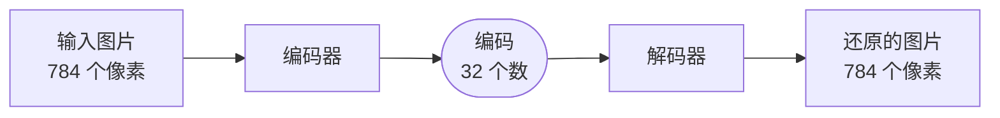
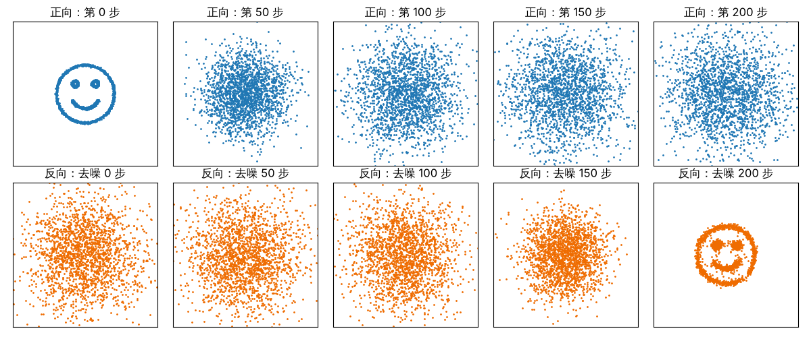
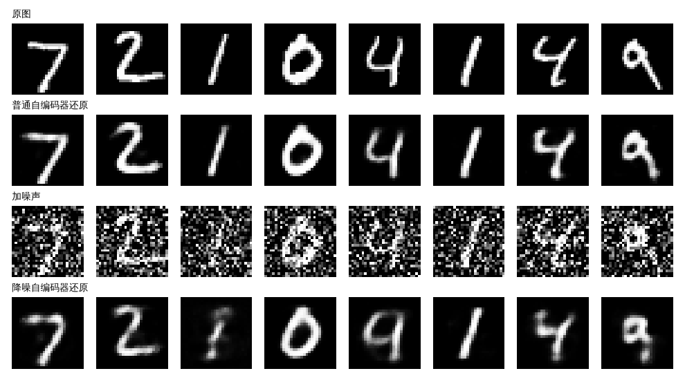
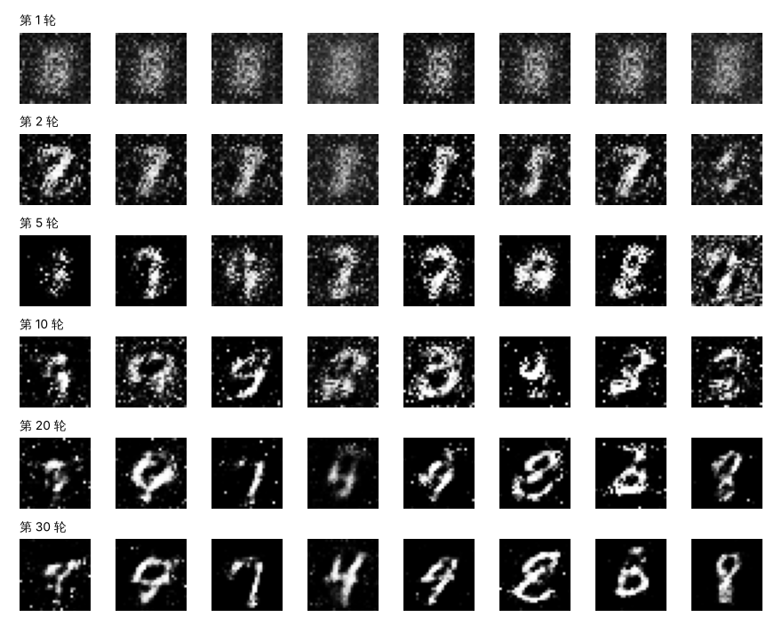
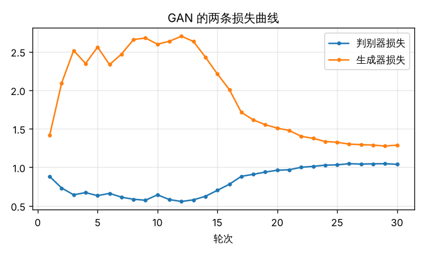
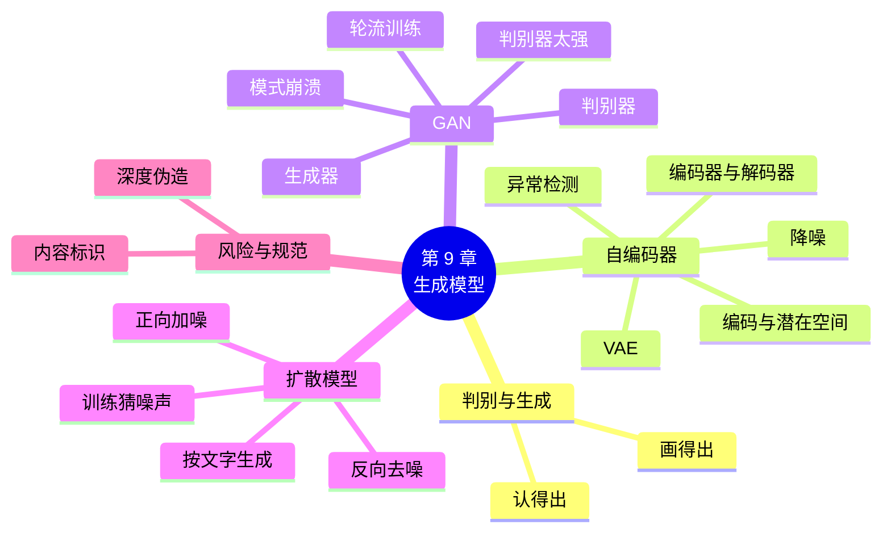

# 第 9 章 生成模型：让网络学会“创作”

!!! abstract "本章学时"
    线上理论 3 学时 · 线下 1 学时 · 实验 2 学时（本章共 3 个实验，教师可任选）

## 学习目标

学完本章，你应该能够：

1. **说出**判别模型、生成模型、自编码器、编码、潜在空间、生成对抗网络、生成器、判别器、扩散模型的含义（记忆）；
2. **解释**自编码器为什么能降噪和做异常检测，GAN 的两个网络怎样互相比赛，扩散模型怎样从噪声中生成数据（理解）；
3. 用 PyTorch **实现**自编码器和一个简单的 GAN，并完成训练（应用）；
4. 根据 GAN 的两条损失曲线和生成的图片，**判断**训练是否正常（分析）；
5. **说出**深度伪造的风险和我国的相关规定，在使用生成式人工智能时遵守标识要求（评价）。

!!! info "先修要求"
    学习本章前，你需要掌握：

    - 本书第 2 章：均方误差、交叉熵损失、训练五步（[2.1 损失函数](../02-training/index.md#21)、[2.4 训练五步](../02-training/index.md#24)）；
    - 本书第 4 章：过拟合、读训练曲线（[4.2 过拟合与欠拟合](../04-generalization/index.md#42)）；
    - 本书第 6 章：Transformer（[6.5](../06-sequence/index.md#65)），9.4 节会提到。

??? abstract "本章概念清单（点击查看定义和例子）"
    写好术语表后运行 python tools/glossary_links.py concepts 9 自动生成

## 情景导入

小周在一家照相馆工作。最近，老顾客张阿姨拿来一张泛黄的老照片，是她父母年轻时的合影，上面布满了折痕和斑点。张阿姨问：“现在不是有人工智能吗，能不能帮我修一修？”小周用一款修图软件试了试，几秒钟后，折痕和斑点都不见了，黑白照片还被自动上了色。

同一天，小周的朋友在手机上用一个 AI 绘画应用，输入“江南水乡，细雨，油画风格”，几秒钟就得到了一幅像模像样的油画。

前面八章的网络，做的都是“判断题”：这张图是什么，这条评论是好是坏。而修复老照片、按文字画画，要求网络“写出”一张新的图片，这是另一类模型：**生成模型**。

本章介绍三种生成模型：先把图片压缩再还原的**自编码器**，让两个网络互相比赛的**生成对抗网络**，以及今天 AI 绘画背后的**扩散模型**。每一种都会动手做一个小实验。最后，我们也要讨论：当 AI 能以假乱真时，会带来什么风险。

## 9.1 判别与生成：认得出和画得出 { #91 }

| | 判别模型 | 生成模型 |
|---|---|---|
| 做什么 | 给一个输入，判断它属于哪一类 | 生成新的、和训练数据“长得像”的数据 |
| 好比 | 鉴定一幅画是不是名家真迹 | 自己画一幅名家风格的画 |
| 输出 | 一个类别或数值 | 一张图、一段文字、一段声音 |
| 本书例子 | 第 1～8 章的分类和预测模型 | 本章的自编码器、GAN、扩散模型；大语言模型也是生成模型 |

“认得出”比“画得出”容易得多。认出一只猫，只要抓住几个关键特征；而画出一只猫，要把每个像素都安排得合情合理：毛发的纹理、眼睛的位置、光线的明暗，一处不对，看起来就很别扭。所以，生成模型的发展比判别模型晚，也更难训练。

## 9.2 自编码器：先压缩，再还原 { #92 }

### 9.2.1 结构：一个“沙漏” { #921 }

**自编码器**由两部分组成，形状像一个沙漏：

- **编码器**：把输入（比如 784 个像素的手写数字）压缩成很少的几个数（比如 32 个），这几个数叫**编码**；
- **解码器**：再把这 32 个数还原成 784 个像素。



训练的目标很简单：让还原的图片尽量和输入一样，损失用第 2 章的均方误差。训练时**不需要任何标签**，图片自己就是答案。

为什么要先压缩再还原，绕一个圈子？关键在中间的“瓶颈”：784 个数要挤进 32 个数里，网络不可能把每个像素都记下来，只能学会抓住最重要的信息，比如“这是一个向右倾斜的 7，笔画较粗”。编码所在的空间叫**潜在空间**，相近的编码对应相似的图片。实验 9-1 中，32 个数就能把手写数字还原得相当清楚，压缩了 24.5 倍。<sup class="cite">[[4]](#ref9-4)</sup>

### 9.2.2 三种用法 { #922 }

**降噪**。训练时故意给输入加上噪声，但要求输出还原出**干净的**原图。网络就学会了“去掉噪声、保留笔画”，这叫**降噪自编码器**。<sup class="cite">[[5]](#ref9-5)</sup> 修复老照片中的斑点和划痕，就是同样的思路。实验 9-1 中，加了噪声的图片误差是 0.1211，降噪自编码器还原后降到 0.0185。

**异常检测**。自编码器只在手写数字上训练过，它只会还原“像手写数字”的东西。给它一张衣服的图片，它还原不好，还原误差就会很大。所以，**还原误差大，就说明输入“不正常”**。工厂里，可以只用合格产品的照片训练自编码器，还原误差特别大的就是可能有缺陷的产品；银行也可以用类似的方法发现异常交易。好处是不需要收集大量的“次品”样本。实验 9-1 中，服装图片的平均还原误差（0.0982）是手写数字（0.0087）的 11 倍多。

**压缩与降维**。编码可以当作数据的“精简版”，用于后续的分类、聚类或可视化，和《机器学习》中学过的主成分分析（PCA）作用相似，但能处理更复杂的关系。

!!! note "自编码器能“创作”吗"
    普通自编码器的潜在空间是“东一块西一块”的，随便取一组编码送进解码器，往往得到一团乱七八糟的图。2013 年提出的**变分自编码器**（VAE）对潜在空间加了约束，让编码集中、连续，从中随机取一组编码就能生成像样的新图片。<sup class="cite">[[6]](#ref9-6)</sup> 今天的 AI 绘画模型（如 Stable Diffusion）中，也用到了 VAE 来压缩和还原图片。

## 9.3 生成对抗网络：造假者和鉴定师的比赛 { #93 }

### 9.3.1 两个网络，一场比赛 { #931 }

2014 年，伊恩·古德费洛提出了**生成对抗网络**（Generative Adversarial Network，GAN）。<sup class="cite">[[7]](#ref9-7)</sup> 它由两个网络组成：

- **生成器**（造假者）：输入一组随机数，输出一张图片，目标是画得以假乱真；
- **判别器**（鉴定师）：输入一张图片，判断它是真图（来自训练数据）还是假图（生成器画的），输出“是真图”的概率。

两个网络轮流训练：

1. **训练判别器**：拿一批真图和一批生成器画的假图给它看，让它把真图判为 1、假图判为 0。这一步只更新判别器。
2. **训练生成器**：让生成器画一批假图交给判别器，目标是让判别器把假图判为 1。这一步只更新生成器，梯度要“穿过”判别器传回生成器。

```python
# 第 1 步：训练判别器
fake = G(torch.randn(b, 100))
d_loss = bce(D(real), ones) + bce(D(fake.detach()), zeros)   # detach：这一步不更新生成器
# 第 2 步：训练生成器
g_loss = bce(D(fake), ones)                                  # 让判别器把假图当成真图
```

就像造假者和鉴定师在比赛中一起进步：鉴定师眼光越来越毒，造假者的手艺也越来越精。理想情况下，最后生成器画的图连判别器也分不出来，判别器对真图和假图都只能给出 0.5 左右的概率。

### 9.3.2 GAN 为什么难训练 { #932 }

GAN 生成的图片清晰，但出了名地难训练：

| 问题 | 表现 | 原因 |
|---|---|---|
| **判别器太强** | 判别器损失很快接近 0，生成器损失越来越大，生成的图一直是噪声 | 鉴定师一眼就能识破，造假者得不到“往哪里改”的有用信号 |
| **模式崩溃** | 不管输入什么随机数，生成的图都差不多（比如全是“1”） | 造假者发现某一种假图能骗过鉴定师，就只画这一种 |
| **来回震荡** | 两条损失曲线大起大落，图片质量时好时坏 | 两个网络你追我赶，难以稳定在平衡点 |

所以，GAN 的损失曲线不能像分类那样“越低越好”地读。两条曲线都相对平稳、判别器给真图和假图的概率都不太极端，再配合**看生成的图片**，才能判断训练是否正常。

实践中常用一些经验来让训练稳定：学习率取小一些（如 0.0002），Adam 的参数 `betas=(0.5, 0.999)`，用 LeakyReLU 代替 ReLU，生成器最后用 Tanh、把图片像素缩放到 −1～1 之间。这些经验来自 2016 年的 DCGAN 论文，实验 9-2 都用上了。<sup class="cite">[[8]](#ref9-8)</sup>

!!! cert "证书考点"
    人工智能训练师（三级）和各类人工智能应用工程师证书常考：判别模型与生成模型的区别，自编码器的结构与用途，GAN 中生成器和判别器的作用（详见[证书考点对照](../../certificate.md)）。

## 9.4 扩散模型：一点点加噪声，再一点点去掉 { #94 }

2020 年以后，**扩散模型**逐渐取代 GAN，成为图像生成的主流方法。<sup class="cite">[[9]](#ref9-9)</sup> 今天的 AI 绘画（Stable Diffusion 等）、AI 视频生成，大多基于扩散模型。它的思路分三步：

**第一步，正向加噪**。拿一张清晰的图片，每一步加一点点随机噪声；加几百步以后，图片就变成了一片完全随机的“雪花”。这一步不需要学习，按公式算就行。

**第二步，训练去噪网络**。随机取一张图片、一个步数，按公式给它加上对应的噪声，让网络看着“加了噪声的图”和“步数”，猜出加的是什么噪声。猜得越准，损失越小。这和 9.2 节的降噪自编码器很像，只是要学会处理各种强度的噪声。

**第三步，反向生成**。从一片随机的“雪花”出发，用网络猜出噪声，减去一点；再猜、再减……几百步以后，一张全新的、清晰的图片就“浮现”出来了。因为出发点是随机的，每次生成的图片都不一样。



上图是实验 9-3 的结果。图片的扩散模型要用 GPU 训练很久，实验 9-3 用同样的方法处理最简单的数据：平面上排成“笑脸”的 2000 个点。上排是正向加噪，笑脸 200 步后变成一团乱点；下排是反向去噪，从一团随机点出发，200 步后又变回了笑脸。注意，下排的点不是上排的点“倒放”回去的，而是网络从全新的随机点生成的。

**怎样“按文字画画”**？去噪网络除了看“加了噪声的图”和“步数”，还会看一段文字的向量（用第 6、8 章的 Transformer 编码得到）。这样，网络去噪时会往“符合这段文字”的方向去，最后得到符合描述的图片。为了加快速度，Stable Diffusion 先用 VAE 把图片压缩成小得多的编码，在编码上做扩散，最后再还原成图片。<sup class="cite">[[10]](#ref9-10)</sup>

| 比较 | 自编码器（VAE） | GAN | 扩散模型 |
|---|---|---|---|
| 思路 | 压缩再还原 | 造假者与鉴定师比赛 | 加噪声再一步步去掉 |
| 图片质量 | 较模糊 | 清晰 | 清晰、细节丰富 |
| 训练难度 | 容易 | 难，不稳定 | 稳定，但计算量大 |
| 生成速度 | 快 | 快（一步生成） | 较慢（要几十到几百步） |
| 今天的地位 | 常作为其他模型的组成部分 | 在实时、轻量场景中仍有使用 | 图像、视频生成的主流 |

扩散模型在图像修复、超分辨率等方面的应用，在《计算机视觉及应用实战》中有更多介绍。

## 9.5 示范例题 { #95 }

**例题** 两位同学各训练了一个生成手写数字的 GAN，记录如下（D 表示判别器，G 表示生成器）：

| 轮次 | 1 | 5 | 10 | 20 | 30 |
|---|---|---|---|---|---|
| 甲：D 损失 | 0.88 | 0.63 | 0.64 | 0.96 | 1.04 |
| 甲：G 损失 | 1.42 | 2.56 | 2.60 | 1.51 | 1.29 |
| 乙：D 损失 | 0.52 | 0.05 | 0.01 | 0.002 | 0.001 |
| 乙：G 损失 | 2.10 | 4.80 | 6.90 | 8.50 | 9.20 |

已知：乙同学的生成器第 30 轮画出的图仍是一片噪点。（1）谁的训练更正常？（2）乙出了什么问题？（3）给乙两条建议。

**解题思路**：GAN 的损失不是越低越好。看两个网络是否“势均力敌”，再结合生成的图片判断。

**第 1 步**：甲的两条损失在一个范围内起伏，最后都比较平稳（D 约 1.0、G 约 1.3），说明两个网络势均力敌，训练比较正常（这正是实验 9-2 的实际记录）。

**第 2 步**：乙的判别器损失迅速降到接近 0，生成器损失一路涨到 9 以上，说明判别器太强，每张假图都被轻松识破，生成器得不到有用的改进信号，所以一直画不出像样的图。

**第 3 步**：建议（任答两条）：①把判别器的学习率调小，或者让判别器小一些（少几层、少几个神经元）；②检查生成器最后是否用了 Tanh，真实图片是否也缩放到了 −1～1，两者范围不一致时判别器很容易识破；③采用 DCGAN 的经验，用 LeakyReLU、Adam 的 `betas=(0.5, 0.999)`。

**答**：甲的训练更正常；乙的判别器太强，生成器学不到东西；建议见上。

**举一反三**：如果损失曲线看起来正常，但生成的 32 张图全是同一个数字，这是什么问题？（答案：模式崩溃。所以一定要看生成的图片，不能只看曲线。）

## 9.6 前沿视窗 { #96 }

**国产文生图、文生视频模型**。国内已有多款文生图、文生视频产品，如百度的文心一格、阿里的通义万相、字节跳动的即梦、快手的可灵等，可以根据文字描述生成图片或几秒到几分钟的视频，在广告设计、短视频制作、游戏美术、电商商品图等领域广泛使用。同时，“会用 AI 生成工具”正在成为设计、新媒体等岗位的一项基本技能。

**深度伪造与它的识别**。生成模型也能被用来造假：伪造某人的照片、视频和声音，冒充亲友进行诈骗，或者制造虚假新闻，这类内容叫**深度伪造**。识别深度伪造本身也是一个研究方向，检测方法包括寻找不自然的眨眼、光影、边缘痕迹，以及检查内容中的隐藏标识等。我国 2023 年起施行的《互联网信息服务深度合成管理规定》要求，提供深度合成服务的，应对生成内容进行显著标识；2025 年 9 月起施行的《人工智能生成合成内容标识办法》进一步规定了文字、图片、音频、视频等生成内容的标识方法。作为使用者，发布 AI 生成的内容时要如实标注，不用它冒充他人、编造事实。第 10 章会进一步讨论人工智能的伦理与安全。

## 本章实验

!!! abstract "实验总览"
    | 实验 | 类型 | 建议时长 | 内容 |
    |---|---|---|---|
    | 实验 9-1 | ★ 基础 | 40 分钟 | 自编码器压缩与还原手写数字；降噪自编码器去噪；用还原误差找出服装图片（异常检测） |
    | 实验 9-2 | ★ 基础 | 45 分钟 | 训练一个小 GAN 生成手写数字，观察生成效果随轮数的变化，读两条损失曲线 |
    | 实验 9-3 | ☆ 拓展 | 30 分钟 | 二维点的扩散模型：正向加噪、训练去噪网络、从随机点生成“笑脸” |

    三个实验都在本机 CPU 上运行（编者用 4 核 CPU 实测：实验 9-1 约 30 秒，实验 9-2 约 2.5 分钟，实验 9-3 约 1 分钟）。实验 9-1 第一次运行会下载 Fashion-MNIST 测试集（约 4 MB）。代码见配套资源 `labs/ch09/` 目录。图片的扩散模型（如 Stable Diffusion）需要较大的 GPU，建议教师在云算力平台上演示，或使用 9.6 节提到的国产在线产品体验。

### 实验 9-1 ★ 自编码器压缩与还原手写数字，并给图片去噪 { #9-1 }

**实验目的**

1. 搭建并训练一个“784 → 32 → 784”的自编码器；
2. 训练降噪自编码器，比较去噪效果；
3. 用还原误差做异常检测。

**实验环境**：本机 CPU，Python 3.11，PyTorch、torchvision、Matplotlib。

**实验数据**：MNIST 手写数字（训练集 6 万张、测试集 1 万张）；Fashion-MNIST 测试集的前 1000 张服装图片（与 MNIST 一样是 28×28 灰度图），只用来做异常检测。<sup class="cite">[[11]](#ref9-11)</sup>

**实验步骤与代码**

第 1 步，搭建自编码器。解码器最后用 Sigmoid，让输出在 0～1 之间，和像素的范围一致：

```python
encoder = nn.Sequential(nn.Linear(784, 256), nn.ReLU(), nn.Linear(256, 32))                  # 压缩
decoder = nn.Sequential(nn.Linear(32, 256), nn.ReLU(), nn.Linear(256, 784), nn.Sigmoid())   # 还原
ae = nn.Sequential(encoder, decoder)
```

第 2 步，训练 5 轮，损失是还原图与原图的均方误差。降噪自编码器结构相同，只是输入加了噪声，目标仍是干净的原图：

```python
noisy = (clean + 0.5 * torch.randn_like(clean)).clamp(0, 1)   # 加噪声，再把像素限制在 0～1
loss = loss_fn(model(noisy), clean)                           # 目标是干净的原图
```

第 3 步，给 8 张测试图片加噪声，比较“什么都不做”、普通自编码器、降噪自编码器三者的误差，并画出对比图。

第 4 步，分别计算 1000 张手写数字和 1000 张服装图片的还原误差；以手写数字误差的 95% 分位数为门槛，统计服装图片被判为“异常”的比例。

完整代码见 `lab9_1_autoencoder.py`。

**运行结果**

```text
普通自编码器：784 → 32 → 784，参数 419120
  [普通] 第 1 轮：还原误差（均方误差）0.0401，已用 1 秒
  [普通] 第 2 轮：还原误差（均方误差）0.0151，已用 3 秒
  [普通] 第 3 轮：还原误差（均方误差）0.0112，已用 4 秒
  [普通] 第 4 轮：还原误差（均方误差）0.0097，已用 6 秒
  [普通] 第 5 轮：还原误差（均方误差）0.0087，已用 7 秒
第 1 张测试图片压缩后的 32 个数（前 8 个）： [1.13, -1.38, -8.28, 1.39, 5.67, 2.36, -1.05, 3.49]
测试集还原误差：0.0082；压缩比 784 ÷ 32 = 24.5 倍
  [降噪] 第 1 轮：还原误差（均方误差）0.0494，已用 2 秒
  [降噪] 第 2 轮：还原误差（均方误差）0.0266，已用 3 秒
  [降噪] 第 3 轮：还原误差（均方误差）0.0224，已用 5 秒
  [降噪] 第 4 轮：还原误差（均方误差）0.0203，已用 7 秒
  [降噪] 第 5 轮：还原误差（均方误差）0.0190，已用 9 秒
8 张加噪图片：降噪自编码器还原误差 0.0185，普通自编码器 0.0753，什么都不做 0.1211
对比图已保存到 lab9_1_reconstruct.png

还原误差平均值：手写数字 0.0087，服装图片 0.0982
门槛（手写数字误差的 95% 分位数）0.0179：服装图片被判为“异常”的比例 97.7%
```



几点解读：

- 32 个数就能把数字还原得相当清楚，只是边缘略模糊。压缩后的 32 个数本身看不出含义，但解码器“读得懂”。
- 普通自编码器没见过噪声，去噪效果有限（误差 0.0753）；降噪自编码器把误差降到 0.0185。但看第 3、5 张图，降噪后的“1”变得模糊、“4”有点像“9”：噪声太大时，网络只能“脑补”，可能补错。修老照片时也会出现类似的问题。
- 1000 张服装图片中有 97.7% 的还原误差超过了门槛，异常检测效果很好。代价是：按照这个门槛，也有 5% 的手写数字会被误判为异常。门槛定高定低，要在“漏检”和“误报”之间权衡。

**实验记录表**

| 项目 | 你的结果 |
|---|---|
| 普通自编码器第 5 轮的还原误差 | |
| 加噪图片：什么都不做 / 普通 / 降噪 的误差 | |
| 手写数字、服装图片的平均还原误差 | |
| 服装图片被判为异常的比例 | |

**常见问题排查**

| 现象 | 原因 | 解决办法 |
|---|---|---|
| 还原出的图片全是灰色 | 学习率太大或训练太少 | 学习率用 0.001，至少训练 3 轮 |
| 下载 Fashion-MNIST 失败 | 网络问题 | 按附录 B 手动下载放到 `labs/data/FashionMNIST/raw/` |

**思考与练习**

1. 把编码的长度从 32 改成 2 和 128，还原效果有什么变化？
2. 把噪声强度从 0.5 改成 0.8，降噪自编码器还能把数字认出来吗？

**实验报告要求**

提交对比图和记录表，用不超过 200 字说明：自编码器为什么能用来做异常检测？在工厂质检中怎么用？

### 实验 9-2 ★ 训练一个小 GAN 生成手写数字 { #9-2 }

**实验目的**

1. 用全连接层搭建生成器和判别器；
2. 实现两个网络轮流训练的过程；
3. 观察生成的图片随训练轮数的变化，读懂两条损失曲线。

**实验环境**：本机 CPU，Python 3.11，PyTorch、Matplotlib。

**实验数据**：MNIST 训练集 6 万张，像素从 0～1 缩放到 −1～1。

**实验步骤与代码**

第 1 步，搭建两个网络。生成器把 100 个随机数变成 784 个像素，最后用 Tanh 输出 −1～1；判别器输出一个分数，经过 Sigmoid 就是“是真图”的概率（Sigmoid 放在损失函数 `BCEWithLogitsLoss` 里面）：

```python
G = nn.Sequential(nn.Linear(100, 256), nn.LeakyReLU(0.2), nn.Linear(256, 512), nn.LeakyReLU(0.2),
                  nn.Linear(512, 784), nn.Tanh())
D = nn.Sequential(nn.Linear(784, 512), nn.LeakyReLU(0.2), nn.Linear(512, 256), nn.LeakyReLU(0.2),
                  nn.Linear(256, 1))
opt_g = torch.optim.Adam(G.parameters(), lr=0.0002, betas=(0.5, 0.999))
opt_d = torch.optim.Adam(D.parameters(), lr=0.0002, betas=(0.5, 0.999))
```

第 2 步，每一批数据先训练判别器、再训练生成器（代码见 9.3.1 节），共 30 轮。

第 3 步，固定 32 组随机数，在第 1、2、5、10、20、30 轮用它们各画一次图，观察同样的输入画出的图怎样变化；同时记录判别器给真图和假图的平均概率。

完整代码见 `lab9_2_gan.py`。

**运行结果**

```text
生成器参数 559632，判别器参数 533505
  第  1 轮：判别器损失 0.881，生成器损失 1.416，判别器认为真图是真的概率 0.84、假图是真的概率 0.33，已用 5 秒
  第  2 轮：判别器损失 0.732，生成器损失 2.094，判别器认为真图是真的概率 0.87、假图是真的概率 0.12，已用 9 秒
  第  5 轮：判别器损失 0.632，生成器损失 2.561，判别器认为真图是真的概率 0.92、假图是真的概率 0.34，已用 22 秒
  第 10 轮：判别器损失 0.643，生成器损失 2.597，判别器认为真图是真的概率 0.91、假图是真的概率 0.30，已用 46 秒
  第 20 轮：判别器损失 0.962，生成器损失 1.509，判别器认为真图是真的概率 0.57、假图是真的概率 0.16，已用 97 秒
  第 30 轮：判别器损失 1.039，生成器损失 1.289，判别器认为真图是真的概率 0.60、假图是真的概率 0.28，已用 147 秒
曲线已保存到 lab9_2_loss.png
生成的图片已保存到 lab9_2_samples.png，生成器参数已保存到 gan_generator.pt
```





几点解读：

- 第 1 轮只有模糊的一团；第 2 轮已经有“7”“1”的样子，但满是噪点；第 10 轮笔画开始成形；第 30 轮已能看出 9、7、4、8、0 等数字，但仍有一些笔画不连贯、像“四不像”。
- 前 12 轮左右，判别器占上风（损失低，给真图的概率 0.9 以上），生成器损失高；之后生成器追上来，判别器损失上升到 1.0 左右，两者逐渐势均力敌。注意生成器损失下降，并不表示判别器变差了，而是生成器的图越来越难识破。
- 这个 GAN 只用了全连接层。把它换成卷积层（DCGAN），生成的数字会清晰得多，但在 CPU 上训练会慢很多。

**实验记录表**

| 轮次 | 判别器损失 | 生成器损失 | 判别器给真图的概率 | 给假图的概率 | 图片描述 |
|---|---|---|---|---|---|
| 1 | | | | | |
| 10 | | | | | |
| 30 | | | | | |

**常见问题排查**

| 现象 | 原因 | 解决办法 |
|---|---|---|
| 生成的图一直是噪点，判别器损失接近 0 | 判别器太强 | 检查学习率和 `betas`；检查真实图片是否缩放到 −1～1 |
| 生成的图全是同一个数字 | 模式崩溃 | 换随机种子重新训练；调小学习率 |
| `RuntimeError: Trying to backward through the graph a second time` | 训练判别器时忘了 `fake.detach()` | 按代码在判别器的损失中使用 `fake.detach()` |

**思考与练习**

1. 去掉 `fake.detach()` 会发生什么？为什么判别器那一步不能更新生成器？
2. 把 Adam 的 `betas` 改回默认值 `(0.9, 0.999)`，或把学习率改成 0.002，训练还稳定吗？

**实验报告要求**

提交生成图片和损失曲线，填写记录表，用不超过 200 字描述生成器“画”的图是怎样一步步变好的，并说明你是根据什么判断训练是否正常的。

### 实验 9-3 ☆ 扩散模型体验：二维点的“加噪与去噪” { #9-3 }

**实验目的**

1. 实现正向加噪，观察数据怎样一步步变成随机噪声；
2. 训练一个去噪网络，学习“猜出加了什么噪声”；
3. 从随机点出发反向去噪，生成新的数据。

**实验环境**：本机 CPU，Python 3.11，PyTorch、Matplotlib。

**实验数据**：程序生成的 2000 个平面上的点，排成“笑脸”形状（脸、两只眼睛、嘴）。

**实验步骤与代码**

第 1 步，设定 200 步的加噪计划。第 t 步加噪后的点可以直接算出来：原来的点乘一个越来越小的系数，加上越来越大的噪声：

```python
T = 200
betas = torch.linspace(1e-4, 0.06, T)     # 每一步加多少噪声
alpha_bar = torch.cumprod(1 - betas, 0)   # 到第 t 步，原来的点还剩多少“分量”

def add_noise(x0, t, noise):
    a = alpha_bar[t].unsqueeze(1)
    return a.sqrt() * x0 + (1 - a).sqrt() * noise
```

第 2 步，训练去噪网络。网络输入“加噪的点”和“步数”，输出猜测的噪声，损失是猜测和真实噪声的均方误差，训练 15 000 步：

```python
t = torch.randint(0, T, (512,))           # 随机挑步数
noise = torch.randn_like(x0)
loss = ((model(add_noise(x0, t, noise), t) - noise) ** 2).mean()
```

第 3 步，从 2000 个随机点出发，每一步用网络猜出噪声并减去一部分，重复 200 步，画出过程。最后统计生成的点中落在“脸”的圆圈附近的比例，与原始数据比较。

完整代码见 `lab9_3_diffusion_2d.py`。

**运行结果**

```text
第 t 步时原来的点还剩多少： t=1: 1.000, t=20: 0.971, t=50: 0.829, t=100: 0.469, t=200: 0.047
  训练第 3000 步：损失 0.2426，已用 10 秒
  训练第 6000 步：损失 0.2136，已用 20 秒
  训练第 9000 步：损失 0.2020，已用 31 秒
  训练第 12000 步：损失 0.1976，已用 42 秒
  训练第 15000 步：损失 0.2568，已用 54 秒
生成的 2000 个点中，落在“脸”的圆圈附近（离中心 0.85～1.15）的比例：49.5%（原始数据 50.0%）
过程图已保存到 lab9_3_diffusion.png
```

过程图见 9.4 节。几点解读：

- 到第 200 步，原来的点只剩 4.7% 的“分量”，几乎完全是噪声。
- 损失在 0.2 左右上下波动，不像分类那样一直下降：每一批随机挑的步数不同，噪声小的步数很难猜准（噪声太小，和点本身的位置混在一起），所以损失降不到 0。
- 反向去噪的前 150 步，点群看起来仍是一团，只是在慢慢收拢；最后 50 步，笑脸的形状才迅速“浮现”出来。生成的点有 49.5% 落在“脸”的圆圈附近，与原始数据的 50.0% 几乎一样，说明模型学到了数据的分布。

**实验记录表**

| 项目 | 你的结果 |
|---|---|
| 第 200 步原来的点还剩多少 | |
| 最后一次记录的训练损失 | |
| 落在“脸”圆圈附近的比例 | |
| 生成的笑脸是否有眼睛和嘴 | |

**常见问题排查**

| 现象 | 原因 | 解决办法 |
|---|---|---|
| 生成的点是一个实心的圆盘，看不出笑脸 | 网络太小或训练步数不够 | 按代码使用 3 个 256 的隐藏层，训练 15 000 步 |
| 正向第 200 步还能看出笑脸 | 加噪计划太“温和” | 检查 `betas` 的最大值是否为 0.06 |

**思考与练习**

1. 把训练步数改成 3000，生成的笑脸会怎样？
2. 把 `smiley` 函数换成你自己设计的形状（比如一颗心、一个字母），重新训练并生成。

**实验报告要求**

提交过程图和记录表，用不超过 200 字说明扩散模型生成数据的三个步骤，以及它和降噪自编码器的相同与不同之处。

## 本章小结

- **判别模型**判断输入属于哪一类；**生成模型**生成新的、像训练数据的数据。“画得出”比“认得出”难。
- **自编码器**由编码器和解码器组成，中间的**编码**很短，迫使网络抓住最重要的信息。用法：**降噪**（输入加噪、目标干净）、**异常检测**（还原误差大即异常）、压缩降维。变分自编码器（VAE）能从潜在空间中随机取样生成新图。
- **生成对抗网络**：**生成器**造假、**判别器**鉴别，轮流训练、共同进步。难点：判别器太强、模式崩溃、来回震荡。读 GAN 要看两条损失是否势均力敌，并且一定要看生成的图片。
- **扩散模型**：正向一步步加噪声，训练网络猜出噪声，再从随机噪声出发一步步去噪生成。训练稳定、质量高，是今天 AI 绘画和视频生成的主流；加入文字向量就能“按文字画画”。
- 生成模型也带来**深度伪造**的风险。我国规定，生成合成内容应当进行标识；使用者要如实标注，不造假、不冒充他人。



**本章自检**

- [ ] 我能说出判别模型和生成模型的区别，各举一个例子。
- [ ] 我能画出自编码器的结构，说出降噪和异常检测的原理。
- [ ] 我能说出 GAN 中生成器和判别器各自的目标，以及轮流训练的两步。
- [ ] 给我 GAN 的两条损失曲线和生成的图片，我能判断训练是否正常。
- [ ] 我能用三步说清扩散模型怎样生成图片。
- [ ] 我知道发布 AI 生成内容时要进行标识。

**下一章预告**

最后一章有三项内容。第一，深度强化学习：让网络通过“试错”学会玩游戏、控制机器，看一个神经网络怎样学会平衡小车。第二，深度学习的伦理与安全：偏见、隐私、能耗和相关法规。第三，综合项目：以小组为单位，从选题、数据、模型到评估和风险，完整设计一个深度学习项目，把全书学到的内容串起来。

## 参考文献

正文中的上标编号（如<sup class="cite">[[1]](#ref9-1)</sup>）对应下面的文献。

<div class="refs" markdown>

**教材与专著**

- <span id="ref9-1"></span>[1] 邱锡鹏. 神经网络与深度学习[M]. 北京: 机械工业出版社, 2020. https://nndl.github.io/.
    <span class="ref-note">第 13 章“深度生成模型”讲变分自编码器和生成对抗网络，对应 9.2、9.3 节。</span>
- <span id="ref9-2"></span>[2] 阿斯顿·张, 李沐, 扎卡里·C. 立顿, 等. 动手学深度学习（PyTorch 版）[M]. 北京: 人民邮电出版社, 2023. https://zh.d2l.ai/.
    <span class="ref-note">“生成对抗网络”一章有 GAN 和 DCGAN 的完整代码，对应 9.3 节和实验 9-2。</span>
- <span id="ref9-3"></span>[3] GOODFELLOW I, BENGIO Y, COURVILLE A. Deep learning[M]. Cambridge: MIT Press, 2016. https://www.deeplearningbook.org/.
    <span class="ref-note">第 14 章“自编码器”讲各种自编码器，对应 9.2 节。</span>

**经典论文**

- <span id="ref9-4"></span>[4] HINTON G E, SALAKHUTDINOV R R. Reducing the dimensionality of data with neural networks[J]. Science, 2006, 313(5786): 504-507.
    <span class="ref-note">用深层自编码器压缩数据，对应 9.2.1 节。</span>
- <span id="ref9-5"></span>[5] VINCENT P, LAROCHELLE H, BENGIO Y, et al. Extracting and composing robust features with denoising autoencoders[C]//Proceedings of the 25th International Conference on Machine Learning. Helsinki: ACM, 2008: 1096-1103.
    <span class="ref-note">提出降噪自编码器，对应 9.2.2 节和实验 9-1。</span>
- <span id="ref9-6"></span>[6] KINGMA D P, WELLING M. Auto-encoding variational Bayes[C]//2nd International Conference on Learning Representations. Banff, 2014.
    <span class="ref-note">提出变分自编码器（VAE），对应 9.2.2 节的提示框。</span>
- <span id="ref9-7"></span>[7] GOODFELLOW I, POUGET-ABADIE J, MIRZA M, et al. Generative adversarial nets[C]//Advances in Neural Information Processing Systems 27. Montréal, 2014: 2672-2680.
    <span class="ref-note">提出生成对抗网络，对应 9.3 节。</span>
- <span id="ref9-8"></span>[8] RADFORD A, METZ L, CHINTALA S. Unsupervised representation learning with deep convolutional generative adversarial networks[C]//4th International Conference on Learning Representations. San Juan, 2016.
    <span class="ref-note">提出 DCGAN 和一系列让 GAN 稳定训练的经验，对应 9.3.2 节和实验 9-2。</span>
- <span id="ref9-9"></span>[9] HO J, JAIN A, ABBEEL P. Denoising diffusion probabilistic models[C]//Advances in Neural Information Processing Systems 33. Virtual Event, 2020: 6840-6851.
    <span class="ref-note">提出去噪扩散概率模型（DDPM），实验 9-3 的加噪与去噪公式来自这篇论文，对应 9.4 节。</span>
- <span id="ref9-10"></span>[10] ROMBACH R, BLATTMANN A, LORENZ D, et al. High-resolution image synthesis with latent diffusion models[C]//Proceedings of the IEEE/CVF Conference on Computer Vision and Pattern Recognition. New Orleans: IEEE, 2022: 10684-10695.
    <span class="ref-note">提出在压缩编码上做扩散的方法（Stable Diffusion 的基础），对应 9.4 节。</span>

**数据集与法规**

- <span id="ref9-11"></span>[11] XIAO H, RASUL K, VOLLGRAF R. Fashion-MNIST: a novel image dataset for benchmarking machine learning algorithms[EB/OL]. (2017-08-25)[2026-11-01]. https://arxiv.org/abs/1708.07747.
    <span class="ref-note">Fashion-MNIST 服装图片数据集，对应实验 9-1 的异常检测。</span>
- <span id="ref9-12"></span>[12] 国家互联网信息办公室, 工业和信息化部, 公安部. 互联网信息服务深度合成管理规定[Z]. 2022-11-25.
    <span class="ref-note">2023 年 1 月 10 日起施行，规定深度合成内容应当进行标识，对应 9.6 节。</span>
- <span id="ref9-13"></span>[13] 国家互联网信息办公室, 工业和信息化部, 公安部, 等. 人工智能生成合成内容标识办法[Z]. 2025-03-07.
    <span class="ref-note">2025 年 9 月 1 日起施行，规定生成合成内容的显式标识和隐式标识，对应 9.6 节。</span>

</div>

## 课后练习

选择题和判断题可以直接点击选项作答，系统会马上告诉你对错，并展开答案与解析；多选题选好后点“提交答案”。简答和实操题请先自己作答，再点开“答案与解析”核对。

**一、单项选择题**

<div class="quiz" data-answer="B" markdown>

**1.** 下列任务中，属于生成模型应用的是（　　）。

- A. 判断一封邮件是不是垃圾邮件
- B. 根据文字描述画一幅画
- C. 识别照片中的车牌号
- D. 预测明天的气温

</div>

??? tip "答案与解析"
    **答案：B**

    生成模型输出新的图片、文字等数据；其余三项都是判断或预测。

    考查：判别与生成 · 认知层次：理解 · [回看 9.1](#91)
    { .quiz-meta }

<div class="quiz" data-answer="C" markdown>

**2.** 训练自编码器时，它的“标签”（目标）是（　　）。

- A. 图片的类别
- B. 随机数
- C. 输入图片本身
- D. 不需要目标

</div>

??? tip "答案与解析"
    **答案：C**

    自编码器要让输出尽量和输入一样，不需要人工标注。降噪自编码器的目标是干净的原图。

    考查：自编码器 · 认知层次：理解 · [回看 9.2.1](#921)
    { .quiz-meta }

<div class="quiz" data-answer="A" markdown>

**3.** 自编码器中间的编码只有很少几个数，作用是（　　）。

- A. 迫使网络只保留最重要的信息
- B. 让训练更快
- C. 减少输入图片的像素
- D. 让网络能做分类

</div>

??? tip "答案与解析"
    **答案：A**

    “瓶颈”太窄，网络无法记住每个像素，只能学会抓住关键特征。

    考查：编码 · 认知层次：理解 · [回看 9.2.1](#921)
    { .quiz-meta }

<div class="quiz" data-answer="D" markdown>

**4.** 用只在合格产品照片上训练的自编码器做质检，判断产品有缺陷的依据是（　　）。

- A. 编码的值全为 0
- B. 训练损失很小
- C. 解码器的参数很多
- D. 这张照片的还原误差特别大

</div>

??? tip "答案与解析"
    **答案：D**

    自编码器只会还原见过的“正常”样子，没见过的缺陷还原不好，误差就大。

    考查：异常检测 · 认知层次：应用 · [回看 9.2.2](#922)
    { .quiz-meta }

<div class="quiz" data-answer="B" markdown>

**5.** GAN 中，判别器的目标是（　　）。

- A. 生成以假乱真的图片
- B. 把真图判为真、把生成器画的假图判为假
- C. 把所有图片都判为真
- D. 压缩图片

</div>

??? tip "答案与解析"
    **答案：B**

    判别器是“鉴定师”；A 是生成器的目标。

    考查：判别器 · 认知层次：记忆 · [回看 9.3.1](#931)
    { .quiz-meta }

<div class="quiz" data-answer="C" markdown>

**6.** 训练 GAN 时，不管输入什么随机数，生成器画出的图都几乎一样，这叫（　　）。

- A. 过拟合
- B. 梯度消失
- C. 模式崩溃
- D. 欠拟合

</div>

??? tip "答案与解析"
    **答案：C**

    生成器发现某一种假图能骗过判别器，就只画这一种。

    考查：GAN 训练 · 认知层次：记忆 · [回看 9.3.2](#932)
    { .quiz-meta }

<div class="quiz" data-answer="A" markdown>

**7.** 扩散模型生成图片的出发点是（　　）。

- A. 一片随机噪声
- B. 一张训练集中的图片
- C. 一个全黑的图片
- D. 判别器的输出

</div>

??? tip "答案与解析"
    **答案：A**

    从随机噪声出发，一步步去噪；出发点不同，每次生成的图片也不同。

    考查：扩散模型 · 认知层次：记忆 · [回看 9.4](#94)
    { .quiz-meta }

<div class="quiz" data-answer="D" markdown>

**8.** 关于在网上发布 AI 生成的图片和视频，下列做法正确的是（　　）。

- A. 只要好看，不用说明是 AI 生成的
- B. 可以用 AI 生成名人的视频来做广告
- C. 删去 AI 工具自动加上的标识，让内容看起来更真实
- D. 按规定对生成的内容进行标识

</div>

??? tip "答案与解析"
    **答案：D**

    《人工智能生成合成内容标识办法》等规定要求对生成合成内容进行标识；冒充他人、删除标识都不符合规定。

    考查：深度伪造 · 认知层次：评价 · [回看 9.6](#96)
    { .quiz-meta }

**二、多项选择题**

<div class="quiz quiz-multi" data-answer="ABD" markdown>

**9.** 自编码器可以用于（　　）。

- A. 给图片降噪
- B. 异常检测
- C. 直接判断评论是好评还是差评
- D. 数据压缩与降维

</div>

??? tip "答案与解析"
    **答案：ABD**

    自编码器本身不做分类；编码可以作为特征再交给分类器。

    考查：自编码器 · 认知层次：记忆 · [回看 9.2.2](#922)
    { .quiz-meta }

<div class="quiz quiz-multi" data-answer="BC" markdown>

**10.** 关于 GAN 的训练过程，下列说法正确的有（　　）。

- A. 生成器和判别器的参数在同一步中一起更新
- B. 训练判别器时要用 `fake.detach()`，这一步不更新生成器
- C. 训练生成器时，目标是让判别器把假图判为真
- D. 判别器损失越低，说明训练得越好

</div>

??? tip "答案与解析"
    **答案：BC**

    两个网络轮流更新；判别器损失接近 0 往往说明它太强，生成器学不到东西。

    考查：GAN 训练 · 认知层次：理解 · [回看 9.3](#93)
    { .quiz-meta }

<div class="quiz quiz-multi" data-answer="ACD" markdown>

**11.** 与 GAN 相比，扩散模型的特点有（　　）。

- A. 训练更稳定
- B. 生成一张图只需一步，速度更快
- C. 生成的图片质量高、细节丰富
- D. 是今天 AI 绘画的主流方法

</div>

??? tip "答案与解析"
    **答案：ACD**

    扩散模型要几十到几百步去噪，生成速度比 GAN 慢。

    考查：扩散模型 · 认知层次：分析 · [回看 9.4](#94)
    { .quiz-meta }

**三、判断题**

<div class="quiz quiz-judge" data-answer="√" markdown>

**12.** 训练自编码器不需要人工标注的标签。

</div>

??? tip "答案与解析"
    **答案：√**

    图片自己就是答案。

    考查：自编码器 · 认知层次：理解 · [回看 9.2.1](#921)
    { .quiz-meta }

<div class="quiz quiz-judge" data-answer="×" markdown>

**13.** 降噪自编码器训练时，输入和目标都是加了噪声的图片。

</div>

??? tip "答案与解析"
    **答案：×**

    输入是加噪声的图片，目标是干净的原图，网络才能学会去噪。

    考查：降噪 · 认知层次：理解 · [回看 9.2.2](#922)
    { .quiz-meta }

<div class="quiz quiz-judge" data-answer="×" markdown>

**14.** 判断 GAN 训练得好不好，只要看两条损失曲线就够了，不用看生成的图片。

</div>

??? tip "答案与解析"
    **答案：×**

    模式崩溃时损失曲线可能看起来正常，必须结合生成的图片判断。

    考查：GAN 训练 · 认知层次：评价 · [回看 9.5](#95)
    { .quiz-meta }

<div class="quiz quiz-judge" data-answer="√" markdown>

**15.** 扩散模型训练时，网络学习的是“看着加了噪声的数据和步数，猜出加的是什么噪声”。

</div>

??? tip "答案与解析"
    **答案：√**

    实验 9-3 的损失就是猜测噪声与真实噪声的均方误差。

    考查：扩散模型 · 认知层次：理解 · [回看 9.4](#94)
    { .quiz-meta }

<div class="quiz quiz-judge" data-answer="×" markdown>

**16.** 实验 9-3 中，反向去噪得到的笑脸，是把正向加噪的点“倒放”回去得到的。

</div>

??? tip "答案与解析"
    **答案：×**

    反向生成从全新的随机点出发，由网络一步步去噪得到，是新生成的数据。

    考查：扩散模型 · 认知层次：理解 · [回看实验 9-3](#9-3)
    { .quiz-meta }

**四、简答题**

**17.** 用“造假者和鉴定师”的比喻说明 GAN 的训练过程，并说明为什么判别器太强反而不好。

??? tip "答案与解析"
    **参考答案**：生成器是造假者，输入随机数，画出假图；判别器是鉴定师，判断一张图是真图还是假图。训练时两者轮流进行：先拿真图和假图训练鉴定师，让它分得更准；再训练造假者，让它画的假图能骗过鉴定师。双方在比赛中共同进步，最后造假者能画出以假乱真的图。如果鉴定师太强，任何假图都被一眼识破，造假者得到的反馈只是“全错”，不知道该往哪里改，梯度信号很弱，于是一直画不出像样的图。所以两者要势均力敌。

    考查：GAN · 认知层次：理解 · [回看 9.3](#93)
    { .quiz-meta }

**18.** 用三步说明扩散模型怎样生成图片，并说明它怎样做到“按文字画画”。

??? tip "答案与解析"
    **参考答案**：第一步正向加噪：把清晰的图片一步步加噪声，几百步后变成随机雪花，这一步按公式计算。第二步训练去噪网络：给图片加上随机步数对应的噪声，让网络根据“加噪的图”和“步数”猜出所加的噪声。第三步反向生成：从随机噪声出发，用网络猜出噪声并减去一部分，重复几百步，得到一张新的清晰图片。要按文字画画，就把文字用 Transformer 编码成向量，也交给去噪网络，让它去噪时朝着符合文字描述的方向进行。

    考查：扩散模型 · 认知层次：理解 · [回看 9.4](#94)
    { .quiz-meta }

**五、实操题**

**19.** 实验 9-1 中，以手写数字还原误差的 95% 分位数（0.0179）为门槛，服装图片有 97.7% 被判为异常。如果把门槛提高到 99% 分位数，服装图片被判为异常的比例和手写数字被误判的比例会怎样变化？修改代码中的 `quantile(0.95)` 验证你的判断。

??? tip "答案与解析"
    **参考答案**：门槛提高后，手写数字被误判为异常的比例从 5% 降到 1%（误报减少）；同时有些还原误差不太大的服装图片会被放过，服装图片被判为异常的比例会下降或持平（漏检可能增加）。具体比例以运行结果为准。这说明门槛的设定要在“误报”和“漏检”之间权衡：质检中漏掉次品代价大时，门槛要定低一些。

    考查：异常检测 · 认知层次：分析 · [回看实验 9-1](#9-1)
    { .quiz-meta }

**20.** 修改实验 9-2，把生成器和判别器的学习率都改成 0.002（原来的 10 倍），训练 10 轮，记录两条损失和生成的图片，与原来的结果比较，说明你的发现。

??? tip "答案与解析"
    **参考思路**：只需修改 `opt_g` 和 `opt_d` 中的 `lr`。学习率过大时，GAN 往往更不稳定：损失曲线大起大落，判别器可能很快占绝对上风，或者生成的图出现模式崩溃、长时间停在噪点阶段。也可能前几轮进步较快但后面质量变差。具体表现以你的运行结果为准。结论：GAN 对学习率等超参数很敏感，DCGAN 推荐的 0.0002 是经过大量实验得出的经验值。

    考查：GAN 训练 · 认知层次：评价 · [回看 9.3.2](#932)
    { .quiz-meta }
