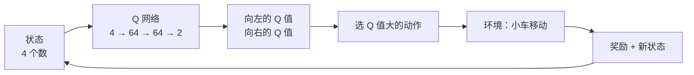
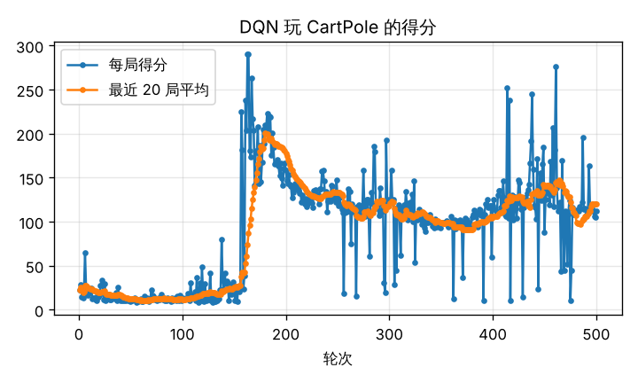
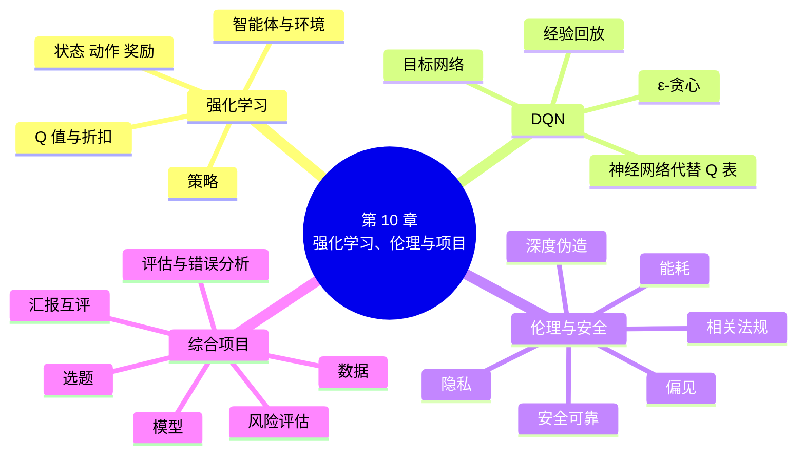

# 第 10 章 深度强化学习、伦理与综合项目

!!! abstract "本章学时"
    线上理论 2 学时 · 线下 1 学时 · 实验 2 学时（本章共 2 个实验，实验 10-2 在线下课堂完成评审）

## 学习目标

学完本章，你应该能够：

1. **说出**智能体、环境、状态、动作、奖励、策略、Q 值、经验回放、目标网络的含义（记忆）；
2. **解释** DQN 为什么要用神经网络代替 Q 表，以及 ε-贪心、经验回放、目标网络的作用（理解）；
3. **运行**并读懂一个 DQN 程序，根据得分曲线描述智能体的学习过程（应用）；
4. 针对一个深度学习应用，**识别**偏见、隐私、深度伪造、安全、能耗等方面的风险，说出相关法规的要求（分析）；
5. 以小组为单位**设计**一个深度学习项目方案，完成原型并参与互评（创造）。

!!! info "先修要求"
    学习本章前，你需要掌握：

    - 本书第 1～9 章的主要内容，综合项目会用到其中的方法；
    - 《机器学习》第 12 章学过的强化学习入门（智能体、奖励、Q 表）。没学过也没关系，10.1 节会简要回顾。

??? abstract "本章概念清单（14 个，点击查看定义和例子）"
    1. [强化学习](../../appendix/glossary.md#g-强化学习)
    2. [智能体](../../appendix/glossary.md#g-智能体)
    3. [环境](../../appendix/glossary.md#g-环境)
    4. [状态](../../appendix/glossary.md#g-状态)
    5. [动作](../../appendix/glossary.md#g-动作)
    6. [奖励](../../appendix/glossary.md#g-奖励)
    7. [策略](../../appendix/glossary.md#g-策略)
    8. [Q 值](../../appendix/glossary.md#g-Q-值)
    9. [DQN](../../appendix/glossary.md#g-DQN)
    10. [ε-贪心](../../appendix/glossary.md#g-ε-贪心)
    11. [经验回放](../../appendix/glossary.md#g-经验回放)
    12. [目标网络](../../appendix/glossary.md#g-目标网络)
    13. [偏见](../../appendix/glossary.md#g-偏见)
    14. [基准方法](../../appendix/glossary.md#g-基准方法)

## 情景导入

2016 年 3 月，谷歌 DeepMind 公司的围棋程序 AlphaGo 以 4∶1 战胜了世界冠军李世石。围棋的变化比宇宙中的原子还多，不可能把所有走法都算一遍。AlphaGo 的秘诀之一，是让神经网络和自己下了几千万盘棋，赢了就加强那些走法，输了就减弱，一步步摸索出了人类棋手都没想到的下法。

这种“在试错中学习”的方法叫[**强化学习**](../../appendix/glossary.md#g-强化学习 "智能体在环境中试错、根据奖励学习如何行动的方法"){ .term }。它不只会下棋：今天的大语言模型在训练的最后阶段，也会请人给模型的多个回答排序，再用强化学习让模型更倾向于给出人们满意的回答。这就是大模型说话越来越“得体”的原因之一。

本章是全书的最后一章，有三项内容：先认识深度强化学习，看一个神经网络怎样学会平衡小车；再讨论深度学习带来的伦理与安全问题，以及我国的相关规定；最后，以小组为单位完成一个综合项目，把全书学到的方法用起来。

## 10.1 强化学习回顾：智能体、环境、奖励 { #101 }

前面各章的学习方式，都是“有人给出标准答案”（监督学习），或者“自己找规律”（如自编码器）。**强化学习**不一样：没有人告诉你每一步该怎么做，只在做完之后给一个[**奖励**](../../appendix/glossary.md#g-奖励 "每做一个动作后得到的分数"){ .term }（或惩罚），要自己在反复尝试中找出得分最高的做法。就像训练小狗：它做对了动作就给零食，做错了就不给，慢慢地它就学会了。

| 要素 | 含义 | 平衡小车的例子 |
|---|---|---|
| [**智能体**](../../appendix/glossary.md#g-智能体 "强化学习中做决定、采取行动的一方"){ .term } | 做决定、采取行动的一方 | 控制小车的程序 |
| [**环境**](../../appendix/glossary.md#g-环境 "智能体所处的世界，对动作做出反应并给出奖励"){ .term } | 智能体所处的世界，对行动做出反应 | 小车、杆子和地面（物理规律） |
| [**状态**](../../appendix/glossary.md#g-状态 "环境当前的情况"){ .term } | 环境当前的情况 | 小车的位置和速度、杆子的角度和角速度，共 4 个数 |
| [**动作**](../../appendix/glossary.md#g-动作 "智能体可以做的选择"){ .term } | 智能体可以做的选择 | 向左推或向右推 |
| **奖励** | 每做一个动作后得到的分数 | 杆子没倒，每坚持一步得 1 分 |
| [**策略**](../../appendix/glossary.md#g-策略 "在什么状态下做什么动作的规则"){ .term } | 在什么状态下做什么动作的规则 | 杆子往右倒时，就把小车往右推 |

强化学习的目标，是找到一个策略，让**累计**得到的奖励最多。关键在“累计”：有时眼前得分少的动作，长远看反而更好，比如下棋时先弃一个子，后面赢一大块。

《机器学习》第 12 章学过 **Q 学习**：用一张表（**Q 表**）记下每个状态下每个动作的[**Q 值**](../../appendix/glossary.md#g-Q-值 "在某状态下做某动作，预计从现在到最后总共能得的分数"){ .term }，即“在这个状态下做这个动作，从现在起到最后，预计总共能得多少分”。有了 Q 表，每一步选 Q 值最大的动作就行。Q 值通过不断试玩来更新：

$$\text{新的 } Q(\text{状态}, \text{动作}) \leftarrow \text{这一步的奖励} + \gamma \times \text{下一个状态中最大的 } Q \text{ 值}$$

其中 $\gamma$（如 0.99）是**折扣**，表示未来的奖励要打一点折，越远的奖励打折越多。

## 10.2 深度强化学习：用神经网络代替 Q 表 { #102 }

### 10.2.1 Q 表装不下了 { #1021 }

Q 表只适合状态很少的问题，比如走迷宫，一共几十个格子。平衡小车的状态是 4 个连续变化的数，有无数种可能，表格根本列不完；如果状态是一张游戏画面（几万个像素），就更不可能了。

解决办法是：用一个神经网络代替 Q 表。输入状态，输出每个动作的 Q 值。这样，没见过的状态也能“估计”出 Q 值，就像第 2 章的网络能认出没见过的手写数字。这就是 2015 年 DeepMind 提出的 [**DQN**](../../appendix/glossary.md#g-DQN "用神经网络代替 Q 表来估计 Q 值的深度强化学习方法"){ .term }（深度 Q 网络），它只看游戏画面，就学会了玩几十种雅达利游戏，有一半以上超过了人类玩家的水平。<sup class="cite">[[3]](#ref10-3)</sup>



### 10.2.2 DQN 的三个关键做法 { #1022 }

直接用神经网络学 Q 值，训练很不稳定。DQN 用了三个办法：

| 做法 | 怎么做 | 为什么 |
|---|---|---|
| [**ε-贪心**](../../appendix/glossary.md#g-ε-贪心 "以 ε 的概率随机选动作、否则选 Q 值最大的动作的策略"){ .term } | 以 ε 的概率随便选一个动作，否则选 Q 值最大的；ε 从 1 慢慢降到 0.05 | 开始什么都不懂，要多“探索”；学会以后，主要“利用”学到的经验 |
| [**经验回放**](../../appendix/glossary.md#g-经验回放 "把玩过的每一步存起来、训练时随机抽取一批的方法"){ .term } | 把玩过的每一步（状态、动作、奖励、新状态）存进一个“回放池”，每次随机抽一批来训练 | 连续几步的数据太相似，直接拿来训练容易学偏；随机抽取更像第 2 章打乱顺序的小批量 |
| [**目标网络**](../../appendix/glossary.md#g-目标网络 "专门用来计算学习目标、隔一段时间才同步一次的网络副本"){ .term } | 复制一份 Q 网络，专门用来算“下一个状态的最大 Q 值”，每隔一段时间才同步一次 | 如果目标随着网络一起变，就像射击时靶子也在乱动，很难打准 |

训练的损失，就是 Q 网络算出的 Q 值和目标值（这一步的奖励 + γ × 目标网络算出的下一步最大 Q 值）之间的差距：

```python
q = q_net(s).gather(1, a.unsqueeze(1)).squeeze(1)                       # 当时所选动作的 Q 值
with torch.no_grad():
    target = r + GAMMA * target_net(s2).max(1).values * (1 - done)     # 游戏结束时没有未来
loss = nn.functional.smooth_l1_loss(q, target)
```

后面的训练五步和第 2 章完全一样。实验 10-1 只用 100 多行代码，就让一个小网络学会了平衡小车。

!!! note "AlphaGo 和大模型里的强化学习"
    AlphaGo 先用人类棋谱训练一个“下一步走哪里”的策略网络（监督学习），再让它和自己对弈，用强化学习继续提高；同时训练一个“估值网络”判断局面的胜率。<sup class="cite">[[4]](#ref10-4)</sup> 大语言模型的“人类反馈强化学习”（RLHF）也是类似的思路：先训练一个模仿人类打分的“奖励模型”，再用强化学习让大模型的回答得到更高的分数。<sup class="cite">[[5]](#ref10-5)</sup> 本书对强化学习只要求“了解”，更深入的内容可以在以后的工作和学习中再接触。

## 10.3 深度学习的伦理与安全 { #103 }

深度学习的能力越强，用错了带来的危害也越大。下面是五个常见的问题，每个都和前面学过的内容有关。

| 问题 | 例子 | 和本书哪里有关 | 怎么应对 |
|---|---|---|---|
| [**偏见**](../../appendix/glossary.md#g-偏见 "模型因训练数据等原因对某些人群做出不公平判断的问题"){ .term }与歧视 | 某招聘模型用过去十年的简历训练，而过去录用的多是男性，结果模型给女性求职者打分偏低；人脸识别对某些肤色人群的错误率明显更高<sup class="cite">[[6]](#ref10-6)</sup> | 模型学的是数据中的规律，数据有偏，模型也有偏（第 4 章、第 7 章） | 检查训练数据是否均衡；分人群计算精确率、召回率；重要决定保留人工复核 |
| **隐私泄露** | 用聊天记录、病历训练模型，模型可能把其中的个人信息“背”出来 | 过拟合就是“死记硬背”（第 4 章） | 只收集必要的数据；去掉姓名、电话等个人信息；遵守《个人信息保护法》 |
| **深度伪造** | 伪造亲友的声音和视频进行诈骗 | 生成模型（第 9 章） | 生成内容要标识；不冒充他人；对“视频通话借钱”要多方核实 |
| **安全与可靠** | 在交通标志上贴几张小贴纸，识别模型就把“停车”认成“限速”；精心设计的提问让大模型绕过安全限制 | 网络只认“统计规律”，不真正理解（第 6 章的注意力热力图、第 7 章的错误分析） | 用多样的数据测试；关键场景设置人工兜底；持续监测 |
| **能耗与成本** | 训练一个大模型要消耗大量电力和算力 | 第 7 章迁移学习可以大幅节省训练 | 能用小模型就不用大模型；优先迁移学习和微调；选择高效的硬件 |

**我国的相关规定**。我国已经出台了一系列法律法规和规范性文件，从业者应当了解：

| 名称 | 施行时间 | 与本书相关的要点 |
|---|---|---|
| 《中华人民共和国个人信息保护法》 | 2021 年 11 月 | 处理个人信息要合法、正当、必要，告知并取得同意；不得过度收集 |
| 《新一代人工智能伦理规范》 | 2021 年 9 月发布 | 增进人类福祉、促进公平公正、保护隐私安全、确保可控可信、强化责任担当、提升伦理素养 |
| 《互联网信息服务深度合成管理规定》 | 2023 年 1 月 | 深度合成内容要进行显著标识 |
| 《生成式人工智能服务管理暂行办法》 | 2023 年 8 月 | 训练数据来源要合法，不得侵犯知识产权和个人信息；采取措施防止歧视；对生成内容进行标识 |
| 《人工智能生成合成内容标识办法》 | 2025 年 9 月 | 规定文字、图片、音频、视频等生成合成内容的显式标识和隐式标识 |

!!! cert "证书考点"
    人工智能训练师（三级）的“智能训练”“职业道德”相关内容，以及各类人工智能应用工程师证书，常考人工智能伦理原则、数据隐私保护、生成内容标识等内容（详见[证书考点对照](../../certificate.md)）。

## 10.4 综合项目：设计并评审一个深度学习项目 { #104 }

综合项目以 3～5 人为一组，用 2～3 周的课余时间完成，在线下课上评审。目的是把全书的方法串起来，体验一个深度学习项目从想法到原型的全过程。

### 10.4.1 项目流程 { #1041 }

| 阶段 | 要做的事 | 对应章节 | 产出 |
|---|---|---|---|
| 1. 选题 | 找一个身边的真实需求，明确“输入是什么、输出是什么、给谁用、做到多好算成功” | 第 7 章 7.2 节 | 一句话的项目目标 |
| 2. 数据 | 确定数据来源（公开数据集、自己拍摄或收集），检查数量、质量和合法性，划分三个集合 | 第 4、7、8 章 | 数据说明表 |
| 3. 模型 | 先找一个简单的基准方法，再选合适的网络或预训练模型 | 第 5～9 章 | 模型选择理由 |
| 4. 训练与评估 | 训练、画曲线、调参，在测试集上算指标，分析错误案例 | 第 4、7 章 | 结果表、曲线、错误案例 |
| 5. 风险评估 | 对照 10.3 节，分析偏见、隐私、安全等风险和应对措施 | 第 10 章 10.3 节 | 风险清单 |
| 6. 展示与互评 | 10 分钟汇报 + 5 分钟问答，其他小组按评分表打分 | — | 演示文稿、原型演示 |

### 10.4.2 选题参考 { #1042 }

| 方向 | 选题举例 | 可以借鉴 |
|---|---|---|
| 图像分类 | 校园垃圾分类、常见中草药识别、零件合格与否、宠物品种识别 | 实验 7-1、7-2 |
| 文本分类 | 课程评价情感分析、校园二手帖分类、客服问题自动分类 | 实验 8-2、8-3 |
| 序列预测 | 食堂每日客流预测、宿舍用电量预测 | 实验 6-1 |
| 异常检测 | 设备传感器异常、产品表面缺陷 | 实验 9-1 |
| 生成与创作 | 用生成工具做校园宣传海报，并评估质量与合规问题 | 第 9 章 |

选题时注意：数据要能在 2～3 周内拿到（每类至少几十条）；不用他人的照片、聊天记录等个人信息；在本机或免费云算力上能训练完。

### 10.4.3 项目方案模板 { #1043 }

| 栏目 | 填写内容 |
|---|---|
| 项目名称与成员分工 | 每人负责的部分 |
| 项目目标 | 一句话：为谁解决什么问题；成功的标准（如测试准确率达到 85%） |
| 数据 | 来源、数量、类别、如何划分；是否涉及个人信息，如何处理 |
| 基准方法 | 最简单的做法及其结果（如“全部猜最多的那一类”“明天和今天一样”） |
| 模型与训练 | 选什么模型、为什么；主要超参数；训练用时 |
| 评估结果 | 测试集指标、混淆矩阵或曲线；与基准方法比较 |
| 错误分析 | 至少 3 个错误案例及原因 |
| 风险与对策 | 至少从偏见、隐私、安全中选两个方面分析 |
| 下一步计划 | 如果再给一个月，最想改进什么 |

### 10.4.4 评分表 { #1044 }

| 评分项 | 分值 | 评分要点 |
|---|---|---|
| 选题与目标 | 15 | 需求真实，目标清楚，成功标准可衡量 |
| 数据 | 20 | 来源合法、数量够用、划分正确，没有数据泄露 |
| 模型与实验 | 25 | 有基准方法对比；方法选择有理由；实验记录完整，结果可信 |
| 评估与错误分析 | 20 | 指标选得对；有错误案例分析和改进思路 |
| 风险与伦理 | 10 | 风险分析具体，对策可行 |
| 展示与答辩 | 10 | 表达清楚，按时完成，回答问题准确；分工合理 |

## 10.5 示范例题 { #105 }

**例题** 某小组提交的项目方案摘要如下，请指出其中的问题，并给出修改建议：

> 项目：校园垃圾分类识别。我们从网上搜索下载了 300 张垃圾图片，分为可回收物、厨余垃圾、有害垃圾、其他垃圾四类，其中可回收物 220 张，其余三类共 80 张。我们把 300 张图全部用来训练一个从零开始的 10 层 CNN，训练了 200 轮，训练准确率 100%，说明模型非常好。最后，我们在食堂门口拍了同学们扔垃圾的视频来测试效果。

**解题思路**：对照 10.4.1 节的六个阶段和 10.3 节的风险逐条检查。

**问题 1，数据不均衡**：可回收物 220 张，其余三类平均不到 27 张。模型可能把大多数图都猜成可回收物。建议：补充少的类别，或者评估时看每一类的召回率（第 7 章）。

**问题 2，没有划分数据**：300 张全部用来训练，没有验证集和测试集，训练准确率 100% 只能说明“背下来了”（第 4 章）。建议：按 7∶1.5∶1.5 划分，所有选择只看验证集，最后在测试集上考一次。

**问题 3，方法选择不当**：数据只有 300 张，从零训练 10 层的 CNN 很容易过拟合。建议：用预训练模型做迁移学习，并加数据增强（第 7 章）。

**问题 4，没有基准方法**：不知道 100% 是和什么比的。建议：至少给出“全部猜可回收物”的准确率（约 73%）作为基准。

**问题 5，隐私风险**：在食堂门口拍同学们的视频，会拍到人脸等个人信息。建议：征得同意，或只拍垃圾本身、不拍人；视频不外传，用完删除（10.3 节）。

**问题 6，数据来源的合法性**：网上搜索的图片可能有版权。建议：优先使用公开数据集，或自己拍摄。

**答**：主要问题有数据不均衡、没有划分数据、方法不当、没有基准、隐私风险、数据版权六处，修改建议见上。

**举一反三**：拿出你们小组的方案，按同样的方法互相“挑毛病”，往往能在动手之前就避免很多返工。

## 10.6 前沿视窗 { #106 }

**多模态大模型**。人类同时用眼睛看、耳朵听、嘴巴说。多模态大模型也是这样：同一个模型能看图、听声音、读文字，还能生成图片和语音。比如拍一张冰箱里的照片，问“今晚能做什么菜”，模型能认出食材并给出菜谱。它们的基础，正是本书学过的 Transformer（第 6 章）、预训练与微调（第 7、8 章）和生成模型（第 9 章）。

**具身智能**。让人工智能拥有“身体”：机器人、自动驾驶汽车、无人机，在真实世界中感知、决策和行动。这里需要视觉模型看懂环境，语言模型理解指令，强化学习学会动作控制。国内已有多家企业在研发人形机器人和智能制造机器人。可以说，本书的每一章，都是通向这些前沿领域的一块基石。

**写在全书最后**。深度学习发展很快，新模型几乎每个月都在出现，但本书讲的基本功不会过时：数据怎么准备，模型怎么训练，结果怎么评估，错误怎么分析，风险怎么防范。希望你带着这些基本功，在今后的工作中继续学习。

## 本章实验

!!! abstract "实验总览"
    | 实验 | 类型 | 建议时长 | 内容 |
    |---|---|---|---|
    | 实验 10-1 | ★ 基础 | 40 分钟 | 运行 DQN 程序，看一个小网络怎样学会平衡小车，读得分曲线 |
    | 实验 10-2 | ★ 基础 | 课余 2～3 周 + 线下 2 学时 | 小组综合项目：写方案、做原型、线下汇报互评 |

    实验 10-1 在本机 CPU 上运行，约 1～2 分钟，需要安装 gymnasium（附录 B）。实验 10-2 的计算资源视选题而定，一般本机 CPU 或免费云算力即可。代码见配套资源 `labs/ch10/` 目录。

### 实验 10-1 ★ 看 DQN 学会平衡小车 { #10-1 }

**实验目的**

1. 认识强化学习环境的用法：重置、执行动作、得到奖励和新状态；
2. 读懂 DQN 的 ε-贪心、经验回放、目标网络在代码中的实现；
3. 根据得分曲线描述智能体的学习过程，体会强化学习训练的不稳定。

**实验环境**：本机 CPU，Python 3.11，PyTorch、gymnasium、Matplotlib。

**实验数据**：不需要事先准备数据，智能体在 gymnasium 提供的 CartPole-v1 环境中边玩边收集。<sup class="cite">[[7]](#ref10-7)</sup> 小车上立着一根杆子，每一步向左或向右推小车；杆子倾斜超过约 12 度或小车移出画面，游戏结束；每坚持一步得 1 分，最多 500 分。

**实验步骤与代码**

第 1 步，创建环境，了解状态和动作：

```python
env = gym.make("CartPole-v1")
state, _ = env.reset(seed=1)                    # 开始一局，得到初始状态（4 个数）
next_state, reward, terminated, truncated, _ = env.step(1)   # 向右推一下
```

第 2 步，搭建 Q 网络（4 → 64 → 64 → 2）和目标网络，准备经验回放池。

第 3 步，玩 500 局。每一步用 ε-贪心选动作，把这一步存进回放池；回放池攒够 1000 步后，每一步都随机抽 64 条训练一次（代码见 10.2.2 节）；每 500 步把 Q 网络的参数复制给目标网络。每局结束后，ε 乘以 0.98，最低降到 0.05。

第 4 步，记录每局得分，画出得分曲线；记住“最近 20 局平均得分”最高时的参数（和第 4 章的早停一样）。

第 5 步，用记住的参数、不再随便试，测试 10 局；再让智能体随机乱推 10 局作为对比。

完整代码见 `lab10_1_dqn_cartpole.py`。

**运行结果**

```text
状态：小车位置、小车速度、杆子角度、杆子角速度；动作：0 向左推，1 向右推
  第  50 局：得分     9，最近 20 局平均   12.4，ε = 0.364，已用 0 秒
  第 100 局：得分    13，最近 20 局平均   11.7，ε = 0.133，已用 1 秒
  第 150 局：得分    25，最近 20 局平均   25.3，ε = 0.050，已用 2 秒
  第 200 局：得分   158，最近 20 局平均  177.8，ε = 0.050，已用 12 秒
  第 250 局：得分   130，最近 20 局平均  133.7，ε = 0.050，已用 20 秒
  第 300 局：得分   122，最近 20 局平均  117.8，ε = 0.050，已用 28 秒
  第 350 局：得分    99，最近 20 局平均   98.6，ε = 0.050，已用 35 秒
  第 400 局：得分   118，最近 20 局平均  104.8，ε = 0.050，已用 41 秒
  第 450 局：得分    88，最近 20 局平均  140.4，ε = 0.050，已用 49 秒
  第 500 局：得分   112，最近 20 局平均  119.8，ε = 0.050，已用 57 秒
曲线已保存到 lab10_1_scores.png

最近 20 局平均得分最高在第 180 局：200.8，用这时的参数测试
训练后测试 10 局得分：[191, 199, 181, 197, 227, 203, 201, 190, 196, 222]，平均 200.7（满分 500）
作为对比，随机乱推 10 局：平均 19.4
```



几点解读：

- 前 150 局，智能体还在“摸索”，平均只能坚持十几步，和随机乱推差不多。这期间回放池在攒经验（攒够 1000 步才开始训练），ε 也在从 1 往下降。
- 第 150～200 局，得分突然大幅上升，最近 20 局平均达到 177.8。智能体学会了“杆子往哪边倒，就把小车往哪边推”。
- 之后得分没有继续上升，而是在 100～200 之间起伏。这是强化学习常见的“学会了又忘掉一些”的现象：智能体的经验不断变化，学习目标也在跟着变，训练不像分类那样稳定。所以程序像第 4 章的早停一样，记住了表现最好时的参数。
- 测试 10 局平均 200.7 分，是随机乱推（19.4 分）的 10 倍多，但离满分 500 还有距离。调整学习率、目标网络的同步间隔、训练局数，或者改用更先进的算法，都能进一步提高。

**实验记录表**

| 项目 | 你的结果 |
|---|---|
| 得分开始明显上升是在第几局左右 | |
| 最近 20 局平均得分最高在第几局，是多少 | |
| 训练后测试 10 局的平均得分 | |
| 随机乱推 10 局的平均得分 | |
| 你对得分曲线的描述（上升、起伏、下降） | |

**常见问题排查**

| 现象 | 原因 | 解决办法 |
|---|---|---|
| `ModuleNotFoundError: No module named 'gymnasium'` | 没有安装 | `pip install gymnasium`（附录 B） |
| 得分一直在 10～20 之间，不上升 | 回放池还没攒够、训练局数太少；或学习率不合适 | 先按原代码运行 500 局；再尝试学习率 0.0005 |
| 每次运行结果不同 | 版本或电脑不同 | 程序已固定随机种子；换了电脑，曲线的形状相近即可 |

**思考与练习**

1. 把 ε 的最低值从 0.05 改成 0.3（多“探索”），或者一开始就设为 0.05（少“探索”），得分曲线有什么变化？
2. 把目标网络的同步间隔从 500 步改成 50 步，训练是更稳定还是更不稳定？

**实验报告要求**

提交得分曲线和记录表，用不超过 200 字描述智能体的学习过程，并说明强化学习的训练曲线和第 2 章分类任务的损失曲线有什么不同。

### 实验 10-2 ★ 小组综合项目：写方案、做原型、互评 { #10-2 }

**实验目的**

1. 综合运用全书的方法，完成一个深度学习项目的方案设计和原型实现；
2. 学会用[基准方法](../../appendix/glossary.md#g-基准方法 "用来对比的最简单做法，判断模型是否真的有用"){ .term }、指标和错误案例说明项目的效果；
3. 识别项目的伦理与安全风险，提出应对措施；
4. 练习团队分工、项目汇报和同伴评审。

**实验环境**：本机 CPU 或免费云算力平台；可以复用本书各章的实验代码。

**实验数据**：由各小组根据选题确定，要求来源合法，不使用未经同意的个人信息。可以使用本书用过的公开数据集，也可以自己拍摄或收集。

**实验步骤**

| 时间 | 任务 | 交付物 |
|---|---|---|
| 第 1 周 | 组队（3～5 人）、选题、确定数据来源；按 10.4.3 节模板写出项目方案初稿，请老师审阅 | 项目方案初稿 |
| 第 2 周 | 收集整理数据、划分；跑通基准方法；选择模型并开始训练，做好实验记录 | 数据说明表、实验记录 |
| 第 3 周 | 完成评估和错误分析；完成风险分析；整理演示文稿，准备原型演示 | 项目方案终稿、演示文稿、代码 |
| 线下课 | 每组 10 分钟汇报 + 5 分钟问答；其他小组按 10.4.4 节评分表打分；老师点评 | 互评表 |

**运行结果**：各小组不同。原型可以是一个能读入新图片或新文本并给出预测的程序，不要求做成网页或手机应用。

**实验记录表（互评表）**

| 被评小组 | 选题与目标（15） | 数据（20） | 模型与实验（25） | 评估与错误分析（20） | 风险与伦理（10） | 展示与答辩（10） | 合计 | 最大亮点 | 最需改进 |
|---|---|---|---|---|---|---|---|---|---|
| | | | | | | | | | |
| | | | | | | | | | |

**常见问题排查**

| 现象 | 原因 | 解决办法 |
|---|---|---|
| 两周过去还没有数据 | 选题太大，或数据很难拿到 | 尽早换成有公开数据集的选题；缩小范围（如 10 类改 3 类） |
| 模型效果很差 | 数据太少或质量不好；方法不合适 | 先看错误案例和数据；优先试迁移学习（第 7 章）或预训练模型（第 8 章） |
| 小组分工不均 | 没有明确每人的任务 | 在方案中写清分工，每周对照检查 |

**思考与练习**

1. 你们的项目如果真的上线，最可能在什么情况下出错？出错的后果是什么？
2. 听完其他小组的汇报，你最想借鉴的一个做法是什么？

**实验报告要求**

每组提交项目方案终稿（按 10.4.3 节模板）、演示文稿和代码；每人提交一份不超过 300 字的个人总结：你负责了什么，遇到了什么困难，学到了什么。

## 本章小结

- **强化学习**：**智能体**在**环境**中根据**状态**选择**动作**，得到**奖励**，目标是让累计奖励最大。**Q 值**表示在某状态下做某动作预计的总得分。
- 状态太多时 Q 表装不下，**DQN** 用神经网络代替 Q 表；三个关键做法：**ε-贪心**（先多探索、后多利用）、**经验回放**（随机抽取经验训练）、**目标网络**（让学习目标稳定）。强化学习的训练比分类更不稳定，要记住表现最好时的参数。
- 深度学习的伦理与安全问题：**偏见**、**隐私**、**深度伪造**、**安全可靠**、**能耗**。我国已出台《个人信息保护法》《生成式人工智能服务管理暂行办法》《人工智能生成合成内容标识办法》等规定，从业者要了解并遵守。
- 综合项目六个阶段：选题、数据、模型、训练与评估、风险评估、展示与互评。一定要有**基准方法**、正确的数据划分和错误分析。



**本章自检**

- [ ] 我能用平衡小车的例子说出强化学习的六个要素。
- [ ] 我能说出 DQN 为什么要用神经网络代替 Q 表。
- [ ] 我能说出 ε-贪心、经验回放、目标网络各自的作用。
- [ ] 给我一个深度学习应用，我能指出它可能存在的偏见、隐私或安全风险。
- [ ] 我知道发布生成内容要标识，处理个人信息要合法、正当、必要。
- [ ] 我能按模板写出一个深度学习项目方案，并按评分表评审别人的方案。

## 参考文献

正文中的上标编号（如<sup class="cite">[[1]](#ref10-1)</sup>）对应下面的文献。

<div class="refs" markdown>

**教材与专著**

- <span id="ref10-1"></span>[1] 邱锡鹏. 神经网络与深度学习[M]. 北京: 机械工业出版社, 2020. https://nndl.github.io/.
    <span class="ref-note">第 14 章“深度强化学习”讲 Q 学习和 DQN，对应 10.1、10.2 节。</span>
- <span id="ref10-2"></span>[2] SUTTON R S, BARTO A G. Reinforcement learning: an introduction[M]. 2nd ed. Cambridge: MIT Press, 2018.
    <span class="ref-note">强化学习的经典教材，对应 10.1 节。</span>

**经典论文**

- <span id="ref10-3"></span>[3] MNIH V, KAVUKCUOGLU K, SILVER D, et al. Human-level control through deep reinforcement learning[J]. Nature, 2015, 518(7540): 529-533.
    <span class="ref-note">提出 DQN，包括经验回放和目标网络，对应 10.2 节和实验 10-1。</span>
- <span id="ref10-4"></span>[4] SILVER D, HUANG A, MADDISON C J, et al. Mastering the game of Go with deep neural networks and tree search[J]. Nature, 2016, 529(7587): 484-489.
    <span class="ref-note">AlphaGo 的论文，对应情景导入和 10.2 节的提示框。</span>
- <span id="ref10-5"></span>[5] OUYANG L, WU J, JIANG X, et al. Training language models to follow instructions with human feedback[C]//Advances in Neural Information Processing Systems 35. New Orleans, 2022: 27730-27744.
    <span class="ref-note">用人类反馈强化学习（RLHF）训练大语言模型，对应 10.2 节的提示框。</span>
- <span id="ref10-6"></span>[6] BUOLAMWINI J, GEBRU T. Gender shades: intersectional accuracy disparities in commercial gender classification[C]//Proceedings of the 1st Conference on Fairness, Accountability and Transparency. New York: PMLR, 2018: 77-91.
    <span class="ref-note">发现商用人脸性别识别系统对不同人群的错误率差别很大，对应 10.3 节。</span>

**工具与法规**

- <span id="ref10-7"></span>[7] TOWERS M, KWIATKOWSKI A, TERRY J, et al. Gymnasium: a standard interface for reinforcement learning environments[EB/OL]. (2024-07-24)[2026-11-01]. https://arxiv.org/abs/2407.17032.
    <span class="ref-note">gymnasium 强化学习环境库，对应实验 10-1。</span>
- <span id="ref10-8"></span>[8] 中华人民共和国个人信息保护法[Z]. 2021-08-20.
    <span class="ref-note">2021 年 11 月 1 日起施行，对应 10.3 节。</span>
- <span id="ref10-9"></span>[9] 国家新一代人工智能治理专业委员会. 新一代人工智能伦理规范[Z]. 2021-09-25.
    <span class="ref-note">提出人工智能活动应遵循的六项基本伦理要求，对应 10.3 节。</span>
- <span id="ref10-10"></span>[10] 国家互联网信息办公室, 国家发展和改革委员会, 教育部, 等. 生成式人工智能服务管理暂行办法[Z]. 2023-07-10.
    <span class="ref-note">2023 年 8 月 15 日起施行，对训练数据、防止歧视、内容标识等作出规定，对应 10.3 节。</span>
- <span id="ref10-11"></span>[11] 国家互联网信息办公室, 工业和信息化部, 公安部, 等. 人工智能生成合成内容标识办法[Z]. 2025-03-07.
    <span class="ref-note">2025 年 9 月 1 日起施行，对应 10.3 节。</span>

</div>

## 课后练习

选择题和判断题可以直接点击选项作答，系统会马上告诉你对错，并展开答案与解析；多选题选好后点“提交答案”。简答和实操题请先自己作答，再点开“答案与解析”核对。

**一、单项选择题**

<div class="quiz" data-answer="C" markdown>

**1.** 强化学习与监督学习最主要的区别是（　　）。

- A. 强化学习不用神经网络
- B. 强化学习只能用于下棋
- C. 强化学习没有每一步的标准答案，只有做完后得到的奖励
- D. 强化学习不需要计算机

</div>

??? tip "答案与解析"
    **答案：C**

    强化学习在试错中学习，靠奖励来判断好坏。

    考查：强化学习 · 认知层次：理解 · [回看 10.1](#101)
    { .quiz-meta }

<div class="quiz" data-answer="A" markdown>

**2.** 在平衡小车问题中，“杆子没倒，每坚持一步得 1 分”属于强化学习的（　　）。

- A. 奖励
- B. 状态
- C. 动作
- D. 环境

</div>

??? tip "答案与解析"
    **答案：A**

    状态是 4 个数，动作是向左或向右推。

    考查：奖励 · 认知层次：记忆 · [回看 10.1](#101)
    { .quiz-meta }

<div class="quiz" data-answer="B" markdown>

**3.** Q 值表示（　　）。

- A. 这一步得到的奖励
- B. 在某个状态下做某个动作，预计从现在到最后总共能得多少分
- C. 网络的参数个数
- D. 智能体已经玩了多少局

</div>

??? tip "答案与解析"
    **答案：B**

    Q 值考虑的是累计奖励，不只是眼前这一步。

    考查：Q 值 · 认知层次：记忆 · [回看 10.1](#101)
    { .quiz-meta }

<div class="quiz" data-answer="D" markdown>

**4.** DQN 用神经网络代替 Q 表的主要原因是（　　）。

- A. 神经网络训练更快
- B. Q 表不能存小数
- C. 神经网络不需要奖励
- D. 状态太多（甚至无穷多），Q 表列不完

</div>

??? tip "答案与解析"
    **答案：D**

    网络还能对没见过的状态估计 Q 值。

    考查：DQN · 认知层次：理解 · [回看 10.2.1](#1021)
    { .quiz-meta }

<div class="quiz" data-answer="C" markdown>

**5.** DQN 中“把玩过的每一步存起来，每次随机抽一批训练”的做法叫（　　）。

- A. ε-贪心
- B. 目标网络
- C. 经验回放
- D. 数据增强

</div>

??? tip "答案与解析"
    **答案：C**

    随机抽取打破了连续几步数据之间的相关性。

    考查：经验回放 · 认知层次：记忆 · [回看 10.2.2](#1022)
    { .quiz-meta }

<div class="quiz" data-answer="A" markdown>

**6.** ε-贪心中，ε 从 1 逐渐降到 0.05，意思是（　　）。

- A. 开始多随便试（探索），学会后多用学到的经验（利用）
- B. 学习率越来越小
- C. 奖励越来越少
- D. 网络越来越小

</div>

??? tip "答案与解析"
    **答案：A**

    ε 是“随便试”的概率。

    考查：ε-贪心 · 认知层次：理解 · [回看 10.2.2](#1022)
    { .quiz-meta }

<div class="quiz" data-answer="B" markdown>

**7.** 某招聘模型用过去十年以男性为主的录用记录训练，结果给女性求职者打分偏低。这属于（　　）问题。

- A. 能耗
- B. 偏见与歧视
- C. 深度伪造
- D. 梯度消失

</div>

??? tip "答案与解析"
    **答案：B**

    数据有偏，模型也学到了偏见。

    考查：偏见 · 认知层次：分析 · [回看 10.3](#103)
    { .quiz-meta }

<div class="quiz" data-answer="D" markdown>

**8.** 综合项目中，“全部猜最多的那一类”这类最简单做法的作用是（　　）。

- A. 代替深度学习模型
- B. 提高训练速度
- C. 减少数据量
- D. 作为基准，判断模型是否真的有用

</div>

??? tip "答案与解析"
    **答案：D**

    没有基准，就不知道模型的结果好在哪里。第 6 章“明天和今天一样”也是基准方法。

    考查：基准方法 · 认知层次：理解 · [回看 10.5](#105)
    { .quiz-meta }

**二、多项选择题**

<div class="quiz quiz-multi" data-answer="ABC" markdown>

**9.** DQN 为了让训练稳定而采用的做法有（　　）。

- A. 经验回放
- B. 目标网络
- C. ε-贪心
- D. 把所有奖励都设为 0

</div>

??? tip "答案与解析"
    **答案：ABC**

    奖励全为 0 就什么也学不到。

    考查：DQN · 认知层次：记忆 · [回看 10.2.2](#1022)
    { .quiz-meta }

<div class="quiz quiz-multi" data-answer="ABD" markdown>

**10.** 下列做法中，有助于保护个人隐私的有（　　）。

- A. 只收集项目必需的数据
- B. 训练前去掉姓名、电话等个人信息
- C. 在网上公开训练用的聊天记录
- D. 拍摄涉及他人的照片前征得同意

</div>

??? tip "答案与解析"
    **答案：ABD**

    公开他人的聊天记录违反《个人信息保护法》的要求。

    考查：隐私 · 认知层次：评价 · [回看 10.3](#103)
    { .quiz-meta }

<div class="quiz quiz-multi" data-answer="BCD" markdown>

**11.** 关于实验 10-1 的结果，下列说法正确的有（　　）。

- A. 得分从第 1 局开始就稳步上升
- B. 第 150～200 局得分大幅上升
- C. 之后得分有起伏，没有一直上升
- D. 训练后的智能体得分是随机乱推的 10 倍多

</div>

??? tip "答案与解析"
    **答案：BCD**

    前 150 局得分和随机乱推差不多，这期间在攒经验、探索。

    考查：DQN · 认知层次：分析 · [回看实验 10-1](#10-1)
    { .quiz-meta }

**三、判断题**

<div class="quiz quiz-judge" data-answer="√" markdown>

**12.** 强化学习的目标是让累计得到的奖励最大，而不只是眼前这一步的奖励最大。

</div>

??? tip "答案与解析"
    **答案：√**

    就像下棋时先弃一个子，后面赢一大块。

    考查：强化学习 · 认知层次：理解 · [回看 10.1](#101)
    { .quiz-meta }

<div class="quiz quiz-judge" data-answer="×" markdown>

**13.** 强化学习的得分曲线和分类任务的损失曲线一样，通常会平稳地一直变好。

</div>

??? tip "答案与解析"
    **答案：×**

    实验 10-1 中得分在上升后有明显起伏，强化学习的训练通常更不稳定。

    考查：DQN · 认知层次：理解 · [回看实验 10-1](#10-1)
    { .quiz-meta }

<div class="quiz quiz-judge" data-answer="√" markdown>

**14.** 深度学习模型的偏见，往往来自训练数据本身的偏差。

</div>

??? tip "答案与解析"
    **答案：√**

    模型学的是数据中的规律。

    考查：偏见 · 认知层次：理解 · [回看 10.3](#103)
    { .quiz-meta }

<div class="quiz quiz-judge" data-answer="×" markdown>

**15.** 只要训练准确率达到 100%，项目就可以直接上线使用。

</div>

??? tip "答案与解析"
    **答案：×**

    要在测试集上评估，看错误案例，并做风险评估。

    考查：项目流程 · 认知层次：评价 · [回看 10.5](#105)
    { .quiz-meta }

<div class="quiz quiz-judge" data-answer="√" markdown>

**16.** 《生成式人工智能服务管理暂行办法》要求训练数据来源合法，不得侵犯知识产权和个人信息。

</div>

??? tip "答案与解析"
    **答案：√**

    该办法自 2023 年 8 月 15 日起施行。

    考查：相关法规 · 认知层次：记忆 · [回看 10.3](#103)
    { .quiz-meta }

**四、简答题**

**17.** 说出 DQN 中经验回放和目标网络各自的作用。

??? tip "答案与解析"
    **参考答案**：经验回放：把玩过的每一步存进回放池，训练时随机抽取一批。连续几步的数据非常相似，直接按顺序训练容易学偏；随机抽取打破了这种相关性，旧经验也能反复利用。目标网络：复制一份 Q 网络专门计算学习目标（下一状态的最大 Q 值），隔一段时间才同步一次。如果目标随着正在学习的网络一起变，就像射击时靶子也在动，训练容易震荡甚至发散；目标网络让靶子在一段时间内固定，训练更稳定。

    考查：经验回放、目标网络 · 认知层次：理解 · [回看 10.2.2](#1022)
    { .quiz-meta }

**18.** 任选一个深度学习应用（如人脸识别门禁、AI 招聘筛选、AI 换脸），分析它可能带来的两种伦理或安全风险，并提出应对措施。

??? tip "答案与解析"
    **参考答案（以人脸识别门禁为例）**：①隐私风险：采集和存储大量人脸信息，一旦泄露无法更改。应对：遵守《个人信息保护法》，告知并取得同意，只存必要信息并加密，提供刷卡等替代方式。②偏见与可靠性风险：对某些人群（如戴口罩、肤色较深、老人）识别错误率较高，可能被拒之门外；也可能被照片或面具欺骗。应对：用多样的数据测试，分人群统计错误率；加入活体检测；保留人工开门的兜底方式。（其他应用言之有理即可）

    考查：伦理与安全 · 认知层次：分析 · [回看 10.3](#103)
    { .quiz-meta }

**五、实操题**

**19.** 某局游戏中，智能体在某个状态下向右推得到奖励 1，到达下一个状态。目标网络在下一个状态中算出的 Q 值为：向左 50、向右 48。折扣 γ = 0.99，游戏没有结束。计算 DQN 的学习目标值；如果这一步之后游戏结束了，目标值又是多少？

??? tip "答案与解析"
    **参考答案**：游戏没有结束：目标 = 1 + 0.99 × max(50, 48) = 1 + 0.99 × 50 = 1 + 49.5 = 50.5。游戏结束：没有未来，目标 = 1 + 0.99 × 50 × (1 − 1) = 1。对应代码中的 `r + GAMMA * target_net(s2).max(1).values * (1 - done)`。

    考查：Q 值 · 认知层次：应用 · [回看 10.2.2](#1022)
    { .quiz-meta }

**20.** 修改实验 10-1，把训练局数从 500 改成 300，再改成 800，记录“最近 20 局平均得分最高”的局数和分数、测试 10 局的平均得分，说明训练局数对结果的影响。

??? tip "答案与解析"
    **参考思路**：只需修改 `for episode in range(1, 501)` 中的 501。由于程序会记住表现最好时的参数，训练局数增加通常不会让最终测试变差，而且有机会遇到更好的参数；局数太少（如果还没到得分上升的阶段）则测试得分会很低。强化学习结果起伏较大，具体数字以你的运行结果为准。结论：强化学习需要足够的尝试次数，同时要保存表现最好时的参数。

    考查：DQN · 认知层次：分析 · [回看实验 10-1](#10-1)
    { .quiz-meta }
